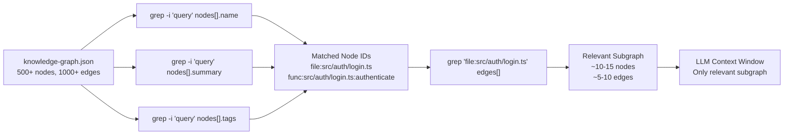

<!-- source: DeepWiki mcp.deepwiki.com · repo Lum1104/Understand-Anything · page 6.2 /understand-chat · fetched 2026-10-26 -->

# /understand-chat

<details>
<summary>Relevant source files</summary>

The following files were used as context for generating this wiki page:

- [understand-anything-plugin/packages/core/src/__tests__/language-lesson.test.ts](understand-anything-plugin/packages/core/src/__tests__/language-lesson.test.ts)
- [understand-anything-plugin/packages/core/src/analyzer/graph-builder.test.ts](understand-anything-plugin/packages/core/src/analyzer/graph-builder.test.ts)
- [understand-anything-plugin/packages/core/src/analyzer/graph-builder.ts](understand-anything-plugin/packages/core/src/analyzer/graph-builder.ts)
- [understand-anything-plugin/packages/dashboard/public/knowledge-graph.json](understand-anything-plugin/packages/dashboard/public/knowledge-graph.json)
- [understand-anything-plugin/skills/understand-chat/SKILL.md](understand-anything-plugin/skills/understand-chat/SKILL.md)
- [understand-anything-plugin/skills/understand-diff/SKILL.md](understand-anything-plugin/skills/understand-diff/SKILL.md)
- [understand-anything-plugin/skills/understand-explain/SKILL.md](understand-anything-plugin/skills/understand-explain/SKILL.md)
- [understand-anything-plugin/skills/understand-onboard/SKILL.md](understand-anything-plugin/skills/understand-onboard/SKILL.md)
- [understand-anything-plugin/skills/understand/frameworks/django.md](understand-anything-plugin/skills/understand/frameworks/django.md)

</details>


## Purpose and Scope

The `/understand-chat` skill provides natural language question-answering capabilities for codebases using the knowledge graph generated by `/understand`. This skill enables users to ask questions like "how does authentication work?" or "what components handle payment processing?" and receive answers grounded in the actual code structure, with references to specific files, functions, and their relationships.

For information about generating the knowledge graph that powers this skill, see [/understand Command (6.1)](). For interactive visual exploration of the knowledge graph, see [/understand-dashboard (6.6)]().

## Overview

`/understand-chat` is a query-focused skill that reads the persisted knowledge graph at `.understand-anything/knowledge-graph.json` [understand-anything-plugin/skills/understand-chat/SKILL.md:9-9]() and extracts relevant context to answer user questions. Unlike traditional code search, it understands relationships between components and provides architectural context by leveraging the graph's nodes, edges, and layer information [understand-anything-plugin/skills/understand-chat/SKILL.md:12-23]().

The skill employs an efficient grep-based strategy to avoid loading the entire knowledge graph into the LLM context window, making it suitable for large codebases [understand-anything-plugin/skills/understand-chat/SKILL.md:25-30]().

**Sources:** [understand-anything-plugin/skills/understand-chat/SKILL.md:1-56]()

## Query Processing Workflow

The skill follows a multi-phase workflow to extract relevant context from the knowledge graph:

### Workflow Diagram: Query to Answer Pipeline

```mermaid
graph TB
    UserQuery["User Query: 'how does auth work?'"]
    
    CheckGraph["Phase 1: Check Graph Exists<br/>.understand-anything/knowledge-graph.json"]
    
    ReadMeta["Phase 2: Read Project Metadata<br/>grep '\"project\"' | extract JSON"]
    
    SearchNodes["Phase 3: Search Nodes<br/>grep -i 'auth' in nodes[]<br/>Match name, summary, tags fields"]
    
    FindEdges["Phase 4: Find Connected Edges<br/>grep matched node IDs in edges[]<br/>Build 1-hop subgraph"]
    
    ReadLayers["Phase 5: Read Layer Context<br/>grep matched node IDs in layers[]"]
    
    FormatContext["Phase 6: Format Context<br/>Assemble subgraph into prompt"]
    
    LLMAnswer["Phase 7: Generate Answer<br/>Claude responds with context"]
    
    UserQuery --> CheckGraph
    CheckGraph -->|exists| ReadMeta
    CheckGraph -->|missing| ErrorMsg["Tell user to run /understand"]
    
    ReadMeta --> SearchNodes
    SearchNodes --> FindEdges
    FindEdges --> ReadLayers
    ReadLayers --> FormatContext
    FormatContext --> LLMAnswer
```

**Sources:** [understand-anything-plugin/skills/understand-chat/SKILL.md:32-56]()

### Phase Descriptions

| Phase | Operation | Purpose | Implementation Detail |
|-------|-----------|---------|----------------------|
| 1 | Graph Validation | Ensure knowledge graph exists | Check file at `.understand-anything/knowledge-graph.json` [understand-anything-plugin/skills/understand-chat/SKILL.md:34-34]() |
| 2 | Metadata Extraction | Get project context | Grep for `"project"` section: name, languages, frameworks [understand-anything-plugin/skills/understand-chat/SKILL.md:36-36]() |
| 3 | Node Search | Find relevant components | Grep for query keywords in `"name"`, `"summary"`, `"tags"` fields [understand-anything-plugin/skills/understand-chat/SKILL.md:38-42]() |
| 4 | Edge Traversal | Expand to connected nodes | Grep for matched node IDs in `edges` section (1-hop) [understand-anything-plugin/skills/understand-chat/SKILL.md:44-47]() |
| 5 | Layer Lookup | Identify architectural context | Grep for node IDs in `"layers"` section [understand-anything-plugin/skills/understand-chat/SKILL.md:49-49]() |
| 6 | Context Assembly | Format for LLM | Build structured prompt with nodes, edges, layers |
| 7 | Answer Generation | Respond to query | Claude processes context and generates answer [understand-anything-plugin/skills/understand-chat/SKILL.md:51-56]() |

**Sources:** [understand-anything-plugin/skills/understand-chat/SKILL.md:32-56]()

## Search Engines and Ranking

While the CLI skill uses `grep` for efficiency, the underlying core library provides sophisticated search engines used by the Dashboard and for advanced context building.

### Fuzzy Search (Fuse.js)
The `SearchEngine` class in `packages/core/src/search.ts` wraps `Fuse.js` to provide weighted field scoring [packages/dashboard/public/knowledge-graph.json:132-140]().
- **Weighted Fields**: Typically configured with `name`, `summary`, `tags`, and `filePath` [packages/dashboard/public/knowledge-graph.json:77-83]().
- **Tokenization**: Supports extended OR-query tokenization for flexible matching [packages/dashboard/public/knowledge-graph.json:132-140]().

### Semantic Search (Embeddings)
The `SemanticSearchEngine` in `packages/core/src/embedding-search.ts` provides vector-based search using `cosineSimilarity` [packages/dashboard/public/knowledge-graph.json:150-158]().
- **Ranking**: Computes similarity between numeric vectors in a single pass [packages/dashboard/public/knowledge-graph.json:167-175]().
- **Filtering**: Supports threshold-based filtering and node-type filtering [packages/dashboard/public/knowledge-graph.json:150-158]().

**Sources:** [packages/dashboard/public/knowledge-graph.json:73-85](), [packages/dashboard/public/knowledge-graph.json:101-113](), [packages/dashboard/public/knowledge-graph.json:132-148](), [packages/dashboard/public/knowledge-graph.json:150-165](), [packages/dashboard/public/knowledge-graph.json:167-182]()

## Efficient Graph Reading Strategy

The skill uses a **grep-first, read-minimal** strategy to avoid overwhelming the LLM context with unnecessary data. This is critical for large codebases where the full knowledge graph may contain hundreds or thousands of nodes.

### Reading Strategy: Grep-Based Queries



**Sources:** [understand-anything-plugin/skills/understand-chat/SKILL.md:25-30]()

### Key Optimization Techniques

1. **Grep-based filtering**: Search the JSON file using `grep` patterns before reading content into context [understand-anything-plugin/skills/understand-chat/SKILL.md:27-27]().
2. **Field-specific searches**: Target only relevant fields (`name`, `summary`, `tags`) rather than full text search [understand-anything-plugin/skills/understand-chat/SKILL.md:39-41]().
3. **1-hop expansion**: Include only directly connected nodes (upstream callers and downstream dependencies), not the entire dependency chain [understand-anything-plugin/skills/understand-chat/SKILL.md:44-47]().
4. **Lazy layer reading**: Only read layer information after node matches are found [understand-anything-plugin/skills/understand-chat/SKILL.md:49-49]().

**Sources:** [understand-anything-plugin/skills/understand-chat/SKILL.md:25-30](), [understand-anything-plugin/skills/understand-chat/SKILL.md:32-56]()

## Knowledge Graph Structure Reference

The skill expects the knowledge graph to follow this structure [understand-anything-plugin/skills/understand-chat/SKILL.md:11-23]():

| Section | Content | Fields |
| :--- | :--- | :--- |
| `project` | Metadata | `name`, `description`, `languages`, `frameworks`, `analyzedAt`, `gitCommitHash` |
| `nodes[]` | Entities | `id`, `type`, `name`, `filePath`, `summary`, `tags[]`, `complexity`, `languageNotes?` |
| `edges[]` | Relationships | `source`, `target`, `type`, `direction`, `weight` |
| `layers[]` | Architecture | `id`, `name`, `description`, `nodeIds[]` |
| `tour[]` | Walkthrough | `order`, `title`, `description`, `nodeIds[]` |

### Node Types and ID Conventions

The knowledge graph utilizes standardized ID formats generated by the `GraphBuilder` class to ensure consistent lookup [understand-anything-plugin/packages/core/src/analyzer/graph-builder.ts:60-60]().

| Node Type | Description | ID Convention | Example |
|-----------|-------------|---------------|---------|
| `file` | Source file | `file:<relative-path>` | `file:src/auth/login.ts` [understand-anything-plugin/packages/core/src/analyzer/graph-builder.ts:92-92]() |
| `function` | Function or method | `function:<relative-path>:<name>` | `function:src/auth/login.ts:authenticate` [understand-anything-plugin/packages/core/src/analyzer/graph-builder.ts:132-132]() |
| `class` | Class or interface | `class:<relative-path>:<name>` | `class:src/models/User.ts:User` [understand-anything-plugin/packages/core/src/analyzer/graph-builder.ts:156-156]() |

**Sources:** [understand-anything-plugin/packages/core/src/analyzer/graph-builder.ts:92-156](), [understand-anything-plugin/skills/understand-chat/SKILL.md:14-19]()

### Edge Types for Relationship Traversal

The skill uses edge types to understand how components connect [understand-anything-plugin/skills/understand-chat/SKILL.md:20-21]():

*   **imports**: Module level dependency [understand-anything-plugin/packages/core/src/analyzer/graph-builder.ts:186-186]().
*   **contains**: Structural containment (e.g., file contains function) [understand-anything-plugin/packages/core/src/analyzer/graph-builder.ts:148-148]().
*   **calls**: Execution flow (function calling another function) [understand-anything-plugin/packages/core/src/analyzer/graph-builder.ts:204-204]().
*   **depends_on**: General logical dependency.

**Sources:** [understand-anything-plugin/packages/core/src/analyzer/graph-builder.ts:145-208](), [understand-anything-plugin/skills/understand-chat/SKILL.md:20-21]()

## Skill Definition and Orchestration

### Skill Definition File

The skill is defined in a Claude Code-compatible markdown file at `understand-anything-plugin/skills/understand-chat/SKILL.md`. This file serves as the system prompt and instruction set for the `/understand-chat` command.

```markdown
---
name: understand-chat
description: Use when you need to ask questions about a codebase or understand code using a knowledge graph
argument-hint: [query]
---
```

**Sources:** [understand-anything-plugin/skills/understand-chat/SKILL.md:1-5]()

### Execution Instructions

The skill definition specifies the following execution workflow for the LLM:

1.  **Validate graph existence** at `.understand-anything/knowledge-graph.json` [understand-anything-plugin/skills/understand-chat/SKILL.md:34-34]().
2.  **Read project metadata** using grep or line-limited read [understand-anything-plugin/skills/understand-chat/SKILL.md:36-36]().
3.  **Search for relevant nodes** using grep on query keywords in name, summary, tags [understand-anything-plugin/skills/understand-chat/SKILL.md:38-42]().
4.  **Find connected edges** by grepping for matched node IDs in edges section [understand-anything-plugin/skills/understand-chat/SKILL.md:44-47]().
5.  **Read layer context** by grepping for node IDs in layers section [understand-anything-plugin/skills/understand-chat/SKILL.md:49-49]().
6.  **Answer the query** using the relevant subgraph, referencing specific files and relationships [understand-anything-plugin/skills/understand-chat/SKILL.md:51-56]().

**Sources:** [understand-anything-plugin/skills/understand-chat/SKILL.md:32-56]()

## Integration with Other Skills

The `/understand-chat` skill is part of a suite of specialized analysis skills:

*   **[/understand-explain (6.4)]()**: Shares the same grep-based node lookup logic but adds source code reading for deep-dives [understand-anything-plugin/skills/understand-explain/SKILL.md:36-50]().
*   **[/understand-diff (6.3)]()**: Uses the graph to find "affected components" by following edges from changed files [understand-anything-plugin/skills/understand-diff/SKILL.md:47-50]().
*   **[/understand-onboard (6.5)]()**: Aggregates layer and tour information to build high-level guides [understand-anything-plugin/skills/understand-onboard/SKILL.md:37-39]().

**Sources:** [understand-anything-plugin/skills/understand-chat/SKILL.md:1-56](), [understand-anything-plugin/skills/understand-explain/SKILL.md:1-59](), [understand-anything-plugin/skills/understand-diff/SKILL.md:1-73](), [understand-anything-plugin/skills/understand-onboard/SKILL.md:1-56]()

---

