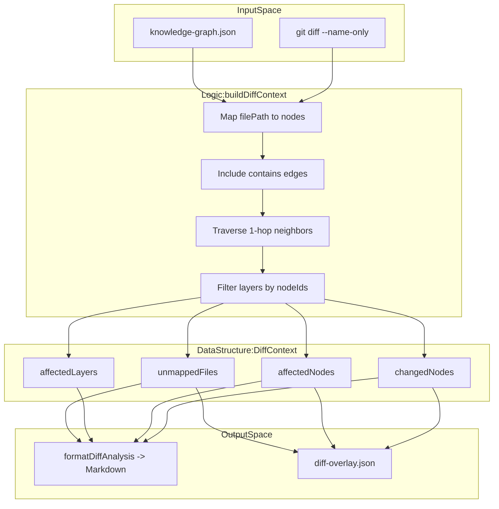
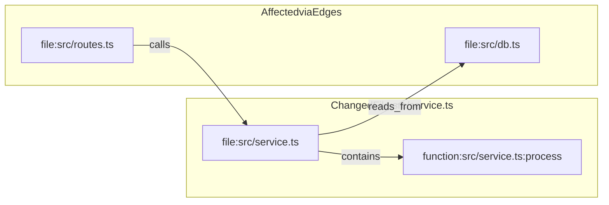

<!-- source: DeepWiki mcp.deepwiki.com · repo Lum1104/Understand-Anything · page 6.3 /understand-diff · fetched 2026-10-26 -->

# /understand-diff

<details>
<summary>Relevant source files</summary>

The following files were used as context for generating this wiki page:

- [understand-anything-plugin/packages/core/src/__tests__/language-lesson.test.ts](understand-anything-plugin/packages/core/src/__tests__/language-lesson.test.ts)
- [understand-anything-plugin/packages/core/src/analyzer/graph-builder.test.ts](understand-anything-plugin/packages/core/src/analyzer/graph-builder.test.ts)
- [understand-anything-plugin/packages/core/src/analyzer/graph-builder.ts](understand-anything-plugin/packages/core/src/analyzer/graph-builder.ts)
- [understand-anything-plugin/packages/dashboard/public/knowledge-graph.json](understand-anything-plugin/packages/dashboard/public/knowledge-graph.json)
- [understand-anything-plugin/skills/understand-chat/SKILL.md](understand-anything-plugin/skills/understand-chat/SKILL.md)
- [understand-anything-plugin/skills/understand-diff/SKILL.md](understand-anything-plugin/skills/understand-diff/SKILL.md)
- [understand-anything-plugin/skills/understand-explain/SKILL.md](understand-anything-plugin/skills/understand-explain/SKILL.md)
- [understand-anything-plugin/skills/understand-onboard/SKILL.md](understand-anything-plugin/skills/understand-onboard/SKILL.md)
- [understand-anything-plugin/skills/understand/frameworks/django.md](understand-anything-plugin/skills/understand/frameworks/django.md)
- [understand-anything-plugin/src/__tests__/diff-analyzer.test.ts](understand-anything-plugin/src/__tests__/diff-analyzer.test.ts)

</details>


## Purpose and Scope

The `/understand-diff` skill analyzes Git diffs and pull requests to identify code changes, affected components, and potential risks. It maps changed files to nodes in the knowledge graph, identifies downstream impact through edge traversal, and produces a structured analysis report with risk assessment. This skill is designed for pre-commit review and impact analysis workflows. [understand-anything-plugin/skills/understand-diff/SKILL.md:1-4]()

For running the initial codebase analysis that produces the knowledge graph, see [/understand](6.1). For natural language Q&A about the codebase, see [/understand-chat](6.2). For deep-dive explanations of specific files, see [/understand-explain](6.4).

---

## Overview

The `/understand-diff` skill performs change impact analysis by:

1.  **Retrieving changed files** from Git (uncommitted changes, feature branches, or specific PRs) [understand-anything-plugin/skills/understand-diff/SKILL.md:35-39]().
2.  **Mapping files to graph nodes** using the knowledge graph [understand-anything-plugin/skills/understand-diff/SKILL.md:42-46]().
3.  **Identifying affected components** through 1-hop edge traversal [understand-anything-plugin/skills/understand-diff/SKILL.md:47-51]().
4.  **Detecting layer impact** across architectural boundaries [understand-anything-plugin/skills/understand-diff/SKILL.md:52-52]().
5.  **Assessing risk** based on complexity, cross-layer changes, and blast radius [understand-anything-plugin/skills/understand-diff/SKILL.md:58-59]().
6.  **Generating a Diff Overlay** for visual representation in the dashboard [understand-anything-plugin/skills/understand-diff/SKILL.md:61-73]().

The skill uses grep-based queries against the knowledge graph JSON file to minimize token usage, only loading the relevant subgraph needed for impact analysis [understand-anything-plugin/skills/understand-diff/SKILL.md:25-27]().

**Sources:** [understand-anything-plugin/skills/understand-diff/SKILL.md:1-73]()

---

## Architecture

### Diff Analysis Data Flow

The following diagram illustrates how Git diff data is processed against the knowledge graph entities defined in `@understand-anything/core`.

| Entity | Code Identifier |
| :--- | :--- |
| Knowledge Graph | `KnowledgeGraph` [understand-anything-plugin/src/__tests__/diff-analyzer.test.ts:3]() |
| Change Context | `DiffContext` [understand-anything-plugin/src/__tests__/diff-analyzer.test.ts:39]() |
| Processing Logic | `buildDiffContext` [understand-anything-plugin/src/__tests__/diff-analyzer.test.ts:2]() |
| Output Formatter | `formatDiffAnalysis` [understand-anything-plugin/src/__tests__/diff-analyzer.test.ts:2]() |

**Sources:** [understand-anything-plugin/src/__tests__/diff-analyzer.test.ts:1-6]()



**Sources:** [understand-anything-plugin/src/__tests__/diff-analyzer.test.ts:37-83](), [understand-anything-plugin/skills/understand-diff/SKILL.md:33-73]()

---

## Core Logic and Data Structures

### DiffContext Analysis

The `buildDiffContext` function populates a context object that tracks the relationship between the physical Git diff and the logical Knowledge Graph nodes.

| Property | Description | Source |
| :--- | :--- | :--- |
| `changedNodes` | Nodes matching `filePath` or contained by changed files | [understand-anything-plugin/src/__tests__/diff-analyzer.test.ts:38-46]() |
| `affectedNodes` | Nodes connected via edges (1-hop) but not directly changed | [understand-anything-plugin/src/__tests__/diff-analyzer.test.ts:48-52]() |
| `affectedLayers` | Layers from the graph that contain any impacted nodes | [understand-anything-plugin/src/__tests__/diff-analyzer.test.ts:54-57]() |
| `unmappedFiles` | Files in the Git diff that do not exist in the graph | [understand-anything-plugin/src/__tests__/diff-analyzer.test.ts:64-68]() |

**Sources:** [understand-anything-plugin/src/__tests__/diff-analyzer.test.ts:36-83]()

### Node Mapping and Traversal

The mapping process follows specific conventions for IDs and relationships:

1.  **Direct Match**: Matches `filePath` in the graph (e.g., `file:src/index.ts`) [understand-anything-plugin/src/__tests__/diff-analyzer.test.ts:16-16]().
2.  **Containment**: Includes nodes like functions or classes defined within those files (e.g., `function:src/service.ts:process`) [understand-anything-plugin/src/__tests__/diff-analyzer.test.ts:19-19]().
3.  **Ripple Effect**: Uses edge types like `calls`, `imports`, and `depends_on` to find neighbors [understand-anything-plugin/skills/understand-diff/SKILL.md:20-21]().



**Sources:** [understand-anything-plugin/src/__tests__/diff-analyzer.test.ts:15-32](), [understand-anything-plugin/packages/core/src/analyzer/graph-builder.ts:145-151]()

---

## Analysis Output

### Markdown Report (`formatDiffAnalysis`)

The skill generates a structured report designed for technical review:

*   **Changed Components**: Directly modified files/functions with summaries and complexity levels [understand-anything-plugin/skills/understand-diff/SKILL.md:55-55]().
*   **Affected Components**: Downstream impacts discovered via edge traversal [understand-anything-plugin/skills/understand-diff/SKILL.md:56-56]().
*   **Affected Layers**: Architectural layers touched (e.g., "API Layer", "Data Layer") [understand-anything-plugin/skills/understand-diff/SKILL.md:57-57]().
*   **Risk Assessment**: A calculated score based on node `complexity` (simple/moderate/complex) and the number of affected components [understand-anything-plugin/skills/understand-diff/SKILL.md:58-59]().

**Sources:** [understand-anything-plugin/src/__tests__/diff-analyzer.test.ts:85-105](), [understand-anything-plugin/skills/understand-diff/SKILL.md:54-59]()

### Dashboard Diff Overlay

To support visual analysis, the skill writes to `.understand-anything/diff-overlay.json`. This file allows the React-based dashboard to highlight specific nodes in the graph view. [understand-anything-plugin/skills/understand-diff/SKILL.md:61-73]()

```json
{
  "version": "1.0.0",
  "baseBranch": "<the base branch used>",
  "generatedAt": "<ISO timestamp>",
  "changedFiles": ["<list of changed file paths>"],
  "changedNodeIds": ["<node IDs mapped from changed files>"],
  "affectedNodeIds": ["<neighbor node IDs from 1-hop traversal>"]
}
```

**Sources:** [understand-anything-plugin/skills/understand-diff/SKILL.md:62-71]()

---

## Implementation Details

### Efficient Graph Querying

Because knowledge graphs can be large, the skill avoids loading the entire JSON into the LLM context. Instead, it uses `grep` for targeted extraction:

*   **Metadata Extraction**: Extracts only the `project` object [understand-anything-plugin/skills/understand-diff/SKILL.md:40-40]().
*   **Node Lookup**: Greps for specific `filePath` strings to find node IDs [understand-anything-plugin/skills/understand-diff/SKILL.md:42-45]().
*   **Edge Lookup**: Greps for node IDs within the `edges` array to find connections [understand-anything-plugin/skills/understand-diff/SKILL.md:47-51]().

**Sources:** [understand-anything-plugin/skills/understand-diff/SKILL.md:26-30]()

### Risk Calculation Logic

Risk is determined by evaluating:
1.  **Complexity**: High-complexity nodes (`complexity: "complex"`) being changed [understand-anything-plugin/skills/understand-diff/SKILL.md:58-58]().
2.  **Blast Radius**: The sheer number of `affectedNodes` found via 1-hop traversal [understand-anything-plugin/skills/understand-diff/SKILL.md:58-58]().
3.  **Cross-Layer Impact**: Whether changes span multiple architectural `layers` [understand-anything-plugin/skills/understand-diff/SKILL.md:58-58]().

**Sources:** [understand-anything-plugin/src/__tests__/diff-analyzer.test.ts:94-98](), [understand-anything-plugin/skills/understand-diff/SKILL.md:58-59]()

---

