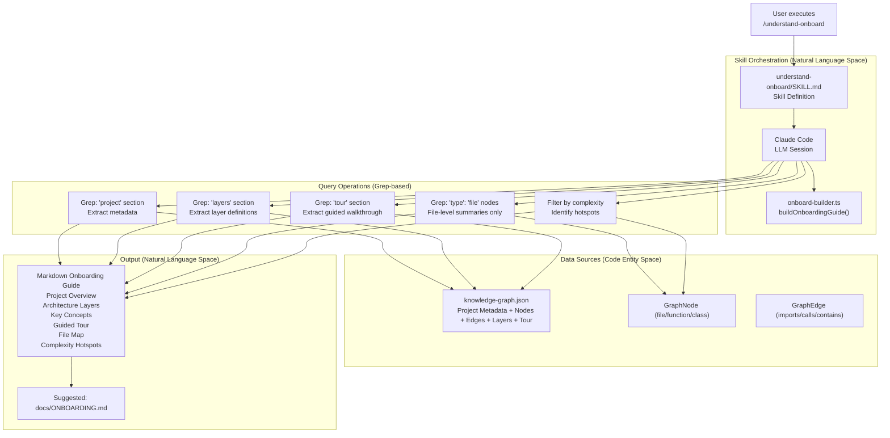
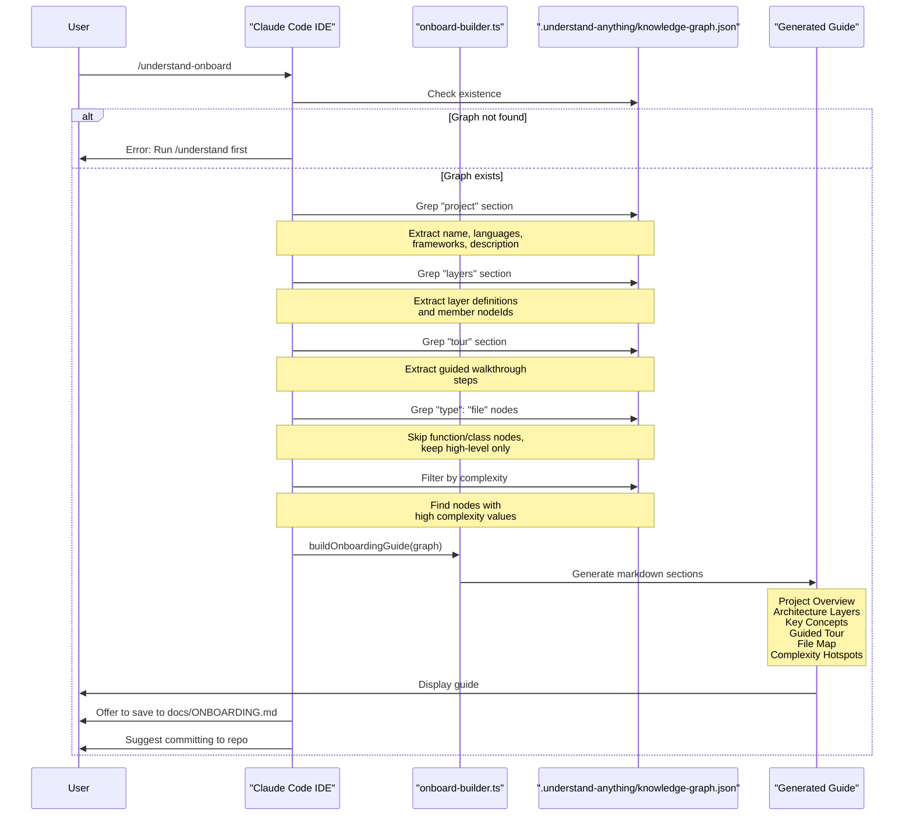

<!-- source: DeepWiki mcp.deepwiki.com · repo Lum1104/Understand-Anything · page 6.5 /understand-onboard · fetched 2026-10-26 -->

# /understand-onboard

Relevant source files

The following files were used as context for generating this wiki page:

- [understand-anything-plugin/packages/core/src/__tests__/language-lesson.test.ts](understand-anything-plugin/packages/core/src/__tests__/language-lesson.test.ts)
- [understand-anything-plugin/packages/core/src/analyzer/graph-builder.test.ts](understand-anything-plugin/packages/core/src/analyzer/graph-builder.test.ts)
- [understand-anything-plugin/packages/core/src/analyzer/graph-builder.ts](understand-anything-plugin/packages/core/src/analyzer/graph-builder.ts)
- [understand-anything-plugin/packages/dashboard/public/knowledge-graph.json](understand-anything-plugin/packages/dashboard/public/knowledge-graph.json)
- [understand-anything-plugin/skills/understand-chat/SKILL.md](understand-anything-plugin/skills/understand-chat/SKILL.md)
- [understand-anything-plugin/skills/understand-diff/SKILL.md](understand-anything-plugin/skills/understand-diff/SKILL.md)
- [understand-anything-plugin/skills/understand-explain/SKILL.md](understand-anything-plugin/skills/understand-explain/SKILL.md)
- [understand-anything-plugin/skills/understand-onboard/SKILL.md](understand-anything-plugin/skills/understand-onboard/SKILL.md)
- [understand-anything-plugin/skills/understand/frameworks/django.md](understand-anything-plugin/skills/understand/frameworks/django.md)
- [understand-anything-plugin/src/onboard-builder.ts](understand-anything-plugin/src/onboard-builder.ts)

## Purpose and Scope

The `/understand-onboard` skill command generates comprehensive onboarding documentation for new team members by synthesizing information from the project's knowledge graph. This page covers the skill's architecture, execution flow, graph query strategy, and the implementation of the guide generation logic.

For information about generating the knowledge graph itself, see [6.1 /understand Command](). For the knowledge graph data structure, see [4. Knowledge Graph]().

---

## Overview

`/understand-onboard` is a consumer skill that reads an existing knowledge graph and produces a structured markdown onboarding guide. Unlike the `/understand` command which analyzes source code to build the graph, this skill extracts high-level patterns from the completed analysis to help new developers understand the project quickly.

The skill operates in Claude Code's IDE context, using grep-based queries to efficiently extract relevant information without loading the entire graph into the LLM context window. The output is a standalone markdown document suitable for committing to a repository's `docs/` directory.

**Sources:** [understand-anything-plugin/skills/understand-onboard/SKILL.md:1-54]()

---

## System Architecture

### Component Interaction Diagram

This diagram shows how the `understand-onboard` skill bridges the **Code Entity Space** (the physical `knowledge-graph.json` and its nodes) with the **Natural Language Space** (the generated Markdown guide).

**Skill Implementation Details**

The skill is defined in [understand-anything-plugin/skills/understand-onboard/SKILL.md](). It leverages the standard `knowledge-graph.json` structure which is programmatically built using the `GraphBuilder` class [understand-anything-plugin/packages/core/src/analyzer/graph-builder.ts:60-74](). The transformation from graph data to Markdown is handled by `buildOnboardingGuide` [understand-anything-plugin/src/onboard-builder.ts:7-124]().

**Sources:** [understand-anything-plugin/skills/understand-onboard/SKILL.md:1-54](), [understand-anything-plugin/src/onboard-builder.ts:7-124]()

---

## Execution Flow

The flow moves from raw data extraction to structured synthesis.

**Sources:** [understand-anything-plugin/skills/understand-onboard/SKILL.md:31-56](), [understand-anything-plugin/src/onboard-builder.ts:7-124]()

---

## Efficient Graph Query Strategy

The skill uses grep-based queries to minimize context window usage, a critical optimization for large knowledge graphs.

### Query Pattern

| Query Target | Grep Pattern | Purpose |
|-------------|--------------|---------|
| Project Metadata | `"project"` | Extract name, languages, frameworks, description [understand-anything-plugin/skills/understand-onboard/SKILL.md:35-36]() |
| Layers | `"layers"` | Get architectural layer definitions [understand-anything-plugin/skills/understand-onboard/SKILL.md:37-37]() |
| Tour Steps | `"tour"` | Extract guided learning path [understand-anything-plugin/skills/understand-onboard/SKILL.md:39-39]() |
| File Nodes | `"type": "file"` | Get file-level summaries only [understand-anything-plugin/skills/understand-onboard/SKILL.md:41-41]() |
| Complexity Hotspots | `"complexity"` | Identify high-complexity areas [understand-anything-plugin/skills/understand-onboard/SKILL.md:43-43]() |

### Why Grep-Based?

The knowledge graph can contain thousands of nodes. Loading the entire JSON into context would exceed token limits and slow down processing. By using grep to extract only the needed sections, the skill stays within token budgets and focuses on architectural patterns [understand-anything-plugin/skills/understand-onboard/SKILL.md:25-30]().

---

## Guide Generation Logic

The `buildOnboardingGuide` function in `onboard-builder.ts` performs the final synthesis.

### Data Synthesis Table

| Section | Logic / Filter | Content |
|---------|-------------|---------|
| **Project Overview** | Direct access to `project` object | Name, languages, frameworks, node/edge counts [understand-anything-plugin/src/onboard-builder.ts:12-22]() |
| **Architecture** | Iterates `layers[]`, maps `nodeIds` to names | Layer description + key components [understand-anything-plugin/src/onboard-builder.ts:25-44]() |
| **Key Concepts** | `nodes.filter(n => n.type === "concept")` | Architectural/domain pattern summaries [understand-anything-plugin/src/onboard-builder.ts:47-59]() |
| **Guided Tour** | Iterates `tour[]`, finds nodes for each step | Ordered steps, file paths, and language tips [understand-anything-plugin/src/onboard-builder.ts:62-89]() |
| **File Map** | `nodes.filter(n => n.type === "file")` | Table of file paths, purposes, and complexity [understand-anything-plugin/src/onboard-builder.ts:92-102]() |
| **Complexity Hotspots**| `nodes.filter(n => n.complexity === "complex")` | Bulleted list of high-risk components [understand-anything-plugin/src/onboard-builder.ts:105-115]() |

**Sources:** [understand-anything-plugin/src/onboard-builder.ts:7-124]()

---

## Integration with Knowledge Graph

### Data Flow Dependencies

The onboarding skill depends on the successful execution of the analysis pipeline. The `knowledge-graph.json` must contain specific keys for the skill to function correctly.

**Required Graph Components:**

| Component | Key in JSON | Purpose |
|-----------|-------------|---------|
| **Project Meta** | `project` | Basic project identity [understand-anything-plugin/skills/understand-onboard/SKILL.md:13-13]() |
| **Layers** | `layers` | Defines architectural structure [understand-anything-plugin/skills/understand-onboard/SKILL.md:21-21]() |
| **Tour Steps** | `tour` | Provides the learning sequence [understand-anything-plugin/skills/understand-onboard/SKILL.md:22-22]() |
| **Nodes** | `nodes` | Provides summaries and complexity [understand-anything-plugin/skills/understand-onboard/SKILL.md:14-14]() |

**Graceful Degradation:**
If the `.understand-anything/knowledge-graph.json` does not exist, the skill instructs the user to run `/understand` first [understand-anything-plugin/skills/understand-onboard/SKILL.md:33-33]().

---

## Usage Patterns

### Typical Workflow

1. **Initial Analysis**: User runs `/understand` to build the `knowledge-graph.json`.
2. **Guide Generation**: User runs `/understand-onboard`.
3. **Synthesis**: Claude Code greps the graph and calls `buildOnboardingGuide` to build the guide sections [understand-anything-plugin/skills/understand-onboard/SKILL.md:35-50]().
4. **Persistence**: The skill offers to save the result to `docs/ONBOARDING.md` [understand-anything-plugin/skills/understand-onboard/SKILL.md:54-54]().
5. **Team Sharing**: User commits the markdown file to the repository [understand-anything-plugin/skills/understand-onboard/SKILL.md:55-55]().

### Comparison with Other Skills

| Skill | Primary Input | Primary Output | Scope |
|-------|---------------|----------------|-------|
| `/understand-onboard` | Full Graph | Markdown Guide | High-level Project |
| `/understand-chat` | Query Keywords | Q&A Response | Targeted Search [understand-anything-plugin/skills/understand-chat/SKILL.md:38-42]() |
| `/understand-explain` | Component Path | Deep-dive Analysis | Single Component [understand-anything-plugin/skills/understand-explain/SKILL.md:36-39]() |
| `/understand-diff` | Git Diff + Graph | Risk Assessment | Change Impact [understand-anything-plugin/skills/understand-diff/SKILL.md:54-59]() |

**Sources:** [understand-anything-plugin/skills/understand-onboard/SKILL.md:1-56](), [understand-anything-plugin/src/onboard-builder.ts:7-124](), [understand-anything-plugin/skills/understand-chat/SKILL.md:1-56](), [understand-anything-plugin/skills/understand-explain/SKILL.md:1-59](), [understand-anything-plugin/skills/understand-diff/SKILL.md:1-73]()

---

