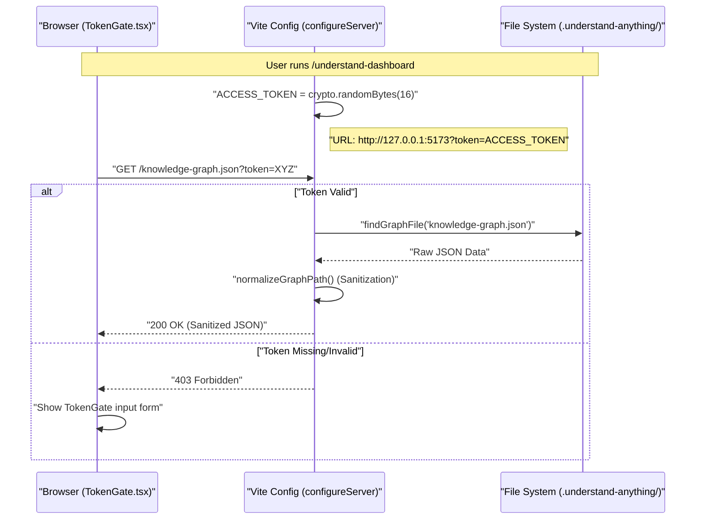
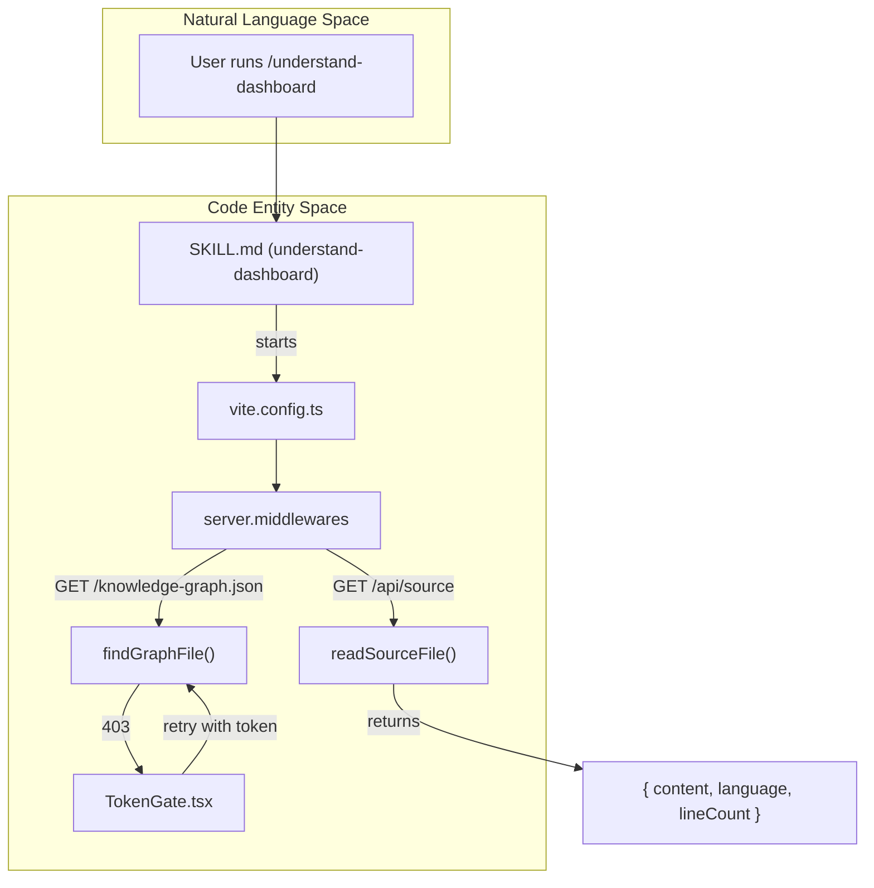

<!-- source: DeepWiki mcp.deepwiki.com · repo Lum1104/Understand-Anything · page 6.6 /understand-dashboard · fetched 2026-10-26 -->

# /understand-dashboard

Relevant source files

The following files were used as context for generating this wiki page:

- [homepage/package.json](homepage/package.json)
- [pnpm-lock.yaml](pnpm-lock.yaml)
- [understand-anything-plugin/packages/dashboard/package.json](understand-anything-plugin/packages/dashboard/package.json)
- [understand-anything-plugin/packages/dashboard/src/components/TokenGate.tsx](understand-anything-plugin/packages/dashboard/src/components/TokenGate.tsx)
- [understand-anything-plugin/packages/dashboard/src/utils/__tests__/smoke.test.ts](understand-anything-plugin/packages/dashboard/src/utils/__tests__/smoke.test.ts)
- [understand-anything-plugin/packages/dashboard/vite.config.ts](understand-anything-plugin/packages/dashboard/vite.config.ts)
- [understand-anything-plugin/skills/understand-dashboard/SKILL.md](understand-anything-plugin/skills/understand-dashboard/SKILL.md)

The `/understand-dashboard` skill launches a local Vite development server to visualize an existing knowledge graph in the browser. This command serves as the entry point to the interactive React dashboard, automatically locating and serving the `knowledge-graph.json` file from a project's `.understand-anything/` directory.

For information about the dashboard application itself (UI components, state management, graph visualization), see **5. Interactive Dashboard**. For details about generating the knowledge graph that the dashboard visualizes, see **6.1. /understand Command**.

---

## Purpose and Scope

The `/understand-dashboard` skill performs the following tasks:

1.  **Validation**: Verifies that a knowledge graph exists in the target project [understand-anything-plugin/skills/understand-dashboard/SKILL.md:17-20]().
2.  **Discovery**: Locates the dashboard package within the plugin installation using a tiered search strategy involving `CLAUDE_PLUGIN_ROOT` and universal symlinks [understand-anything-plugin/skills/understand-dashboard/SKILL.md:22-69]().
3.  **Dependency Management**: Installs dashboard dependencies and builds the `@understand-anything/core` package if necessary [understand-anything-plugin/skills/understand-dashboard/SKILL.md:71-78]().
4.  **Server Launch**: Starts a Vite development server with the `GRAPH_DIR` environment variable pointing to the project's knowledge graph [understand-anything-plugin/skills/understand-dashboard/SKILL.md:80-84]().
5.  **Security**: Generates a one-time `ACCESS_TOKEN` and enforces `TokenGate` session security on all data endpoints [understand-anything-plugin/packages/dashboard/vite.config.ts:9-12]().

**Sources:** [understand-anything-plugin/skills/understand-dashboard/SKILL.md:1-106](), [understand-anything-plugin/packages/dashboard/vite.config.ts:9-12]()

---

## TokenGate Session Security

To prevent unauthorized access to sensitive codebase metadata, the dashboard implements a security mechanism within the Vite configuration and a React-based entry gate.

1.  **Token Generation**: A cryptographically secure 16-byte hex token (`ACCESS_TOKEN`) is generated when the Vite process starts [understand-anything-plugin/packages/dashboard/vite.config.ts:12]().
2.  **Local Binding**: The server is explicitly bound to `127.0.0.1` to block access from other devices on the same network [understand-anything-plugin/packages/dashboard/vite.config.ts:187-191]().
3.  **Endpoint Protection**: Middleware intercepts requests to data files and source code previews [understand-anything-plugin/packages/dashboard/vite.config.ts:246-261]().
4.  **Validation**: Requests without a matching `?token=` query parameter are rejected with a `403 Forbidden` status [understand-anything-plugin/packages/dashboard/vite.config.ts:252-257]().
5.  **Frontend Gate**: The `TokenGate.tsx` component provides a UI for users to manually enter the token if the URL parameter is missing, validating it against `/knowledge-graph.json` before granting access to the store [understand-anything-plugin/packages/dashboard/src/components/TokenGate.tsx:21-28]().

**Diagram: Dashboard Data Flow and Security Gate**

**Sources:** [understand-anything-plugin/packages/dashboard/vite.config.ts:9-12](), [understand-anything-plugin/packages/dashboard/vite.config.ts:187-191](), [understand-anything-plugin/packages/dashboard/vite.config.ts:246-261](), [understand-anything-plugin/packages/dashboard/src/components/TokenGate.tsx:7-79]()

---

## Vite Server Configuration

The dashboard uses a custom Vite configuration to bridge the dashboard application with the project's local data [understand-anything-plugin/packages/dashboard/vite.config.ts:179-286]().

### Path Sanitization and Safety
To prevent leaking absolute local directory structures or accessing unauthorized files:
- **`normalizeGraphPath`**: Converts absolute paths into relative paths anchored to the `projectRoot` [understand-anything-plugin/packages/dashboard/vite.config.ts:34-53]().
- **`graphFilePathSet`**: Reads the graph to build a whitelist of files that are allowed to be previewed [understand-anything-plugin/packages/dashboard/vite.config.ts:55-70]().
- **`readSourceFile`**: Enforces safety checks: prevents path traversal (`..`), limits file size to 1MB (`MAX_SOURCE_FILE_BYTES`), and blocks binary files [understand-anything-plugin/packages/dashboard/vite.config.ts:114-177]().

### Data Resolution Logic
The server searches for data files (like `knowledge-graph.json`) using `graphFileCandidates` in prioritized locations:
1.  The path provided via the `GRAPH_DIR` environment variable [understand-anything-plugin/packages/dashboard/vite.config.ts:16-20]().
2.  The current working directory (`process.cwd()`) [understand-anything-plugin/packages/dashboard/vite.config.ts:21]().
3.  Three levels up from the current directory (fallback for monorepo development) [understand-anything-plugin/packages/dashboard/vite.config.ts:22]().

**Sources:** [understand-anything-plugin/packages/dashboard/vite.config.ts:15-28](), [understand-anything-plugin/packages/dashboard/vite.config.ts:34-70](), [understand-anything-plugin/packages/dashboard/vite.config.ts:114-177]()

---

## Implementation Details

### Project Directory Resolution
The skill determines the target project directory using the following logic:
1. If `$ARGUMENTS` contains a path, use that as the project directory [understand-anything-plugin/skills/understand-dashboard/SKILL.md:14]().
2. Otherwise, use the current working directory [understand-anything-plugin/skills/understand-dashboard/SKILL.md:15]().

### Dashboard Package Discovery
The skill uses a tiered search to find the `packages/dashboard` directory, checking environment variables like `CLAUDE_PLUGIN_ROOT` and common installation paths [understand-anything-plugin/skills/understand-dashboard/SKILL.md:40-53]().

### Dependency Management
Before launching, the skill ensures the environment is ready:
- Runs `pnpm install` in the dashboard directory [understand-anything-plugin/skills/understand-dashboard/SKILL.md:73]().
- Explicitly builds the core package using `pnpm --filter @understand-anything/core build` [understand-anything-plugin/skills/understand-dashboard/SKILL.md:77]().

**Sources:** [understand-anything-plugin/skills/understand-dashboard/SKILL.md:13-78](), [understand-anything-plugin/packages/dashboard/package.json:6-13]()

---

## Supported Data Endpoints

The dashboard server handles several specific virtual endpoints to serve data from the `.understand-anything/` directory:

| Endpoint | Local File | Purpose |
| :--- | :--- | :--- |
| `/knowledge-graph.json` | `knowledge-graph.json` | Primary code relationship graph [understand-anything-plugin/packages/dashboard/vite.config.ts:271]() |
| `/domain-graph.json` | `domain-graph.json` | High-level business domain and flow mapping [understand-anything-plugin/packages/dashboard/vite.config.ts:269]() |
| `/diff-overlay.json` | `diff-overlay.json` | Change impact analysis data [understand-anything-plugin/packages/dashboard/vite.config.ts:265]() |
| `/meta.json` | `meta.json` | Project metadata and staleness fingerprints [understand-anything-plugin/packages/dashboard/vite.config.ts:267]() |
| `/api/source` | (Dynamic) | Serves file content for the `CodeViewer` component [understand-anything-plugin/packages/dashboard/vite.config.ts:273]() |

**Diagram: Code Entity Space to Server Routes**

**Sources:** [understand-anything-plugin/packages/dashboard/vite.config.ts:264-284](), [understand-anything-plugin/packages/dashboard/vite.config.ts:114-177](), [understand-anything-plugin/skills/understand-dashboard/SKILL.md:80-84](), [understand-anything-plugin/packages/dashboard/src/components/TokenGate.tsx:21-28]()

---

