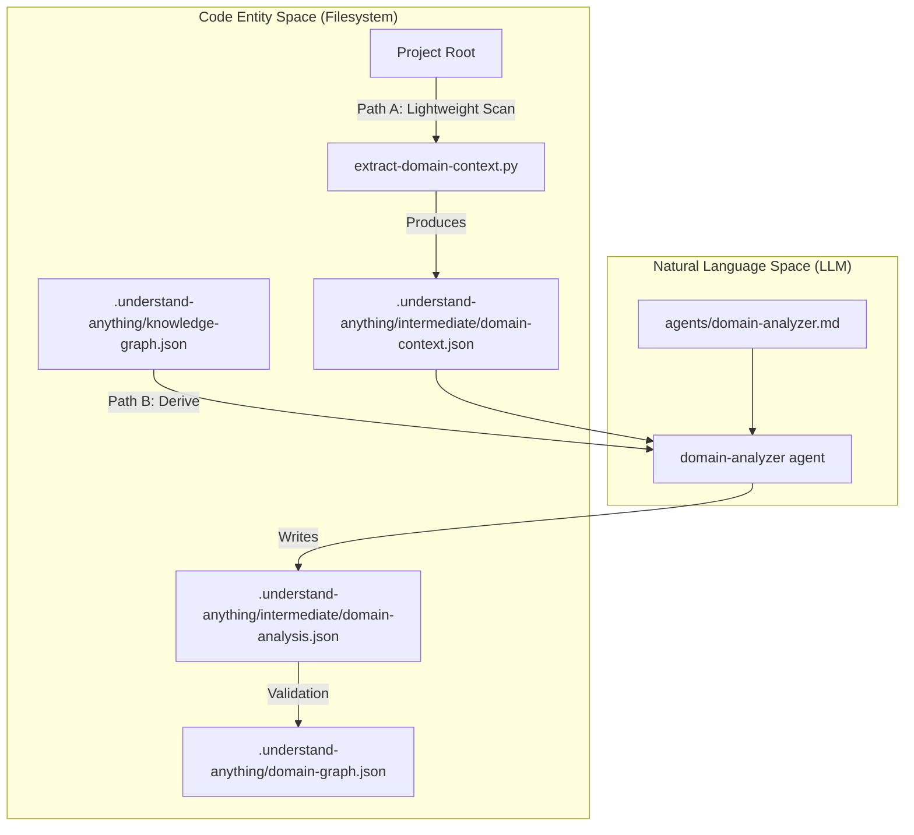
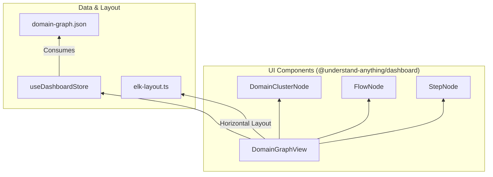

<!-- source: DeepWiki mcp.deepwiki.com · repo Lum1104/Understand-Anything · page 6.7 /understand-domain · fetched 2026-10-26 -->

# /understand-domain

Relevant source files

The following files were used as context for generating this wiki page:

- [CLAUDE.md](CLAUDE.md)
- [understand-anything-plugin/agents/architecture-analyzer.md](understand-anything-plugin/agents/architecture-analyzer.md)
- [understand-anything-plugin/agents/article-analyzer.md](understand-anything-plugin/agents/article-analyzer.md)
- [understand-anything-plugin/agents/assemble-reviewer.md](understand-anything-plugin/agents/assemble-reviewer.md)
- [understand-anything-plugin/agents/domain-analyzer.md](understand-anything-plugin/agents/domain-analyzer.md)
- [understand-anything-plugin/agents/graph-reviewer.md](understand-anything-plugin/agents/graph-reviewer.md)
- [understand-anything-plugin/agents/knowledge-graph-guide.md](understand-anything-plugin/agents/knowledge-graph-guide.md)
- [understand-anything-plugin/agents/project-scanner.md](understand-anything-plugin/agents/project-scanner.md)
- [understand-anything-plugin/agents/tour-builder.md](understand-anything-plugin/agents/tour-builder.md)
- [understand-anything-plugin/skills/understand-domain/SKILL.md](understand-anything-plugin/skills/understand-domain/SKILL.md)
- [understand-anything-plugin/skills/understand-domain/extract-domain-context.py](understand-anything-plugin/skills/understand-domain/extract-domain-context.py)
- [understand-anything-plugin/src/__tests__/worktree-redirect.test.mjs](understand-anything-plugin/src/__tests__/worktree-redirect.test.mjs)

The `/understand-domain` command is a specialized skill designed to extract high-level business logic, domain boundaries, and process flows from a codebase. Unlike the structural analysis performed by `/understand`, which focuses on code entities like classes and functions, `/understand-domain` synthesizes these technical details into a **Business Domain Graph**.

## Overview

The domain extraction process identifies how technical components map to business value. It produces a `domain-graph.json` file that powers the **Domain Graph View** in the interactive dashboard, allowing users to visualize the system as a series of interconnected business processes rather than just a file tree.

### Key Capabilities
*   **Domain Discovery**: Identifying logical business areas (e.g., "Order Management", "User Authentication").
*   **Flow Extraction**: Mapping end-to-end business processes (e.g., "Create Order").
*   **Step Sequencing**: Ordering specific code execution steps within a flow.
*   **Entry Point Detection**: Automatically finding HTTP routes, CLI commands, and event handlers that trigger business logic.

---

## Technical Architecture

The skill operates via two distinct execution paths depending on the availability of existing analysis data.

### Data Flow Diagram

The following diagram illustrates how the system transitions from raw code to a structured domain graph, bridging the gap between physical file structures and logical business domains.

**Domain Extraction Pipeline**

Sources: [understand-anything-plugin/skills/understand-domain/SKILL.md:9-131](), [understand-anything-plugin/skills/understand-domain/extract-domain-context.py:1-13]()

---

## Implementation Details

### 1. Preprocessing: `extract-domain-context.py`
When no knowledge graph exists (or `--full` is passed), a Python-based scanner performs a "cheap" pass to gather raw material for the LLM. This prevents the agent from wasting tool calls on manual exploration [understand-anything-plugin/skills/understand-domain/SKILL.md:97-108]().

**Key Detection Patterns:**
The script uses regex patterns defined in `ENTRY_POINT_PATTERNS` [understand-anything-plugin/skills/understand-domain/extract-domain-context.py:70-114]() to find:
*   **HTTP Routes**: Express/Koa routes, Decorator routes (Flask/FastAPI/NestJS), and Next.js/Remix route handlers [understand-anything-plugin/skills/understand-domain/extract-domain-context.py:72-82]().
*   **CLI Commands**: Argparse sub-parsers and common CLI library patterns [understand-anything-plugin/skills/understand-domain/extract-domain-context.py:84-89]().
*   **Events/Cron**: Event listeners, subscriber decorators, and scheduled tasks/crontabs [understand-anything-plugin/skills/understand-domain/extract-domain-context.py:91-101]().
*   **GraphQL/gRPC**: Resolvers and service definitions [understand-anything-plugin/skills/understand-domain/extract-domain-context.py:102-109]().

**Output Structure (`domain-context.json`):**
*   **File Tree**: A flat list of relative file paths, filtered by `.gitignore` and `SKIP_DIRS` [understand-anything-plugin/skills/understand-domain/extract-domain-context.py:151-192]().
*   **Signatures**: Exports and imports per file [understand-anything-plugin/skills/understand-domain/SKILL.md:106-106]().
*   **Snippets**: The first few lines of detected entry points to provide implementation context [understand-anything-plugin/skills/understand-domain/SKILL.md:107-107]().

### 2. The Domain Analyzer Agent
The `domain-analyzer` agent consumes either the `domain-context.json` (Option A) or the full `knowledge-graph.json` (Option B) [understand-anything-plugin/agents/domain-analyzer.md:15-21](). It is tasked with creating a three-level hierarchy [understand-anything-plugin/agents/domain-analyzer.md:27-32]():
1.  **Business Domain**: High-level areas (e.g., "Payment Processing").
2.  **Business Flow**: Specific processes (e.g., "Process Refund").
3.  **Business Step**: Individual actions (e.g., "Validate input").

### 3. Output: `domain-graph.json`
The final output uses a specialized subset of the Knowledge Graph schema, specifically leveraging three node types [understand-anything-plugin/agents/domain-analyzer.md:48-84]():
*   `domain`: Includes `domainMeta` for entities and business rules.
*   `flow`: Includes `entryPoint` and `entryType` (http, cli, etc.).
*   `step`: Includes `filePath` and `lineRange` for code mapping.

The validation pipeline ensures these nodes conform to the expected schema before saving to `.understand-anything/domain-graph.json` [understand-anything-plugin/skills/understand-domain/SKILL.md:132-134]().

---

## Dashboard Visualization

The dashboard consumes `domain-graph.json` via specialized components. It implements a drill-down pattern: **Overview** (Domains) $\rightarrow$ **Detail** (Flows & Steps).

### Domain Mapping Logic
The dashboard uses specific edge types to reconstruct the hierarchy:
*   `contains_flow`: Links a `domain` node to its constituent `flow` nodes [understand-anything-plugin/agents/domain-analyzer.md:86-86]().
*   `flow_step`: Links a `flow` node to its `step` nodes. The `weight` property (0.1, 0.2, etc.) encodes the execution order [understand-anything-plugin/agents/domain-analyzer.md:87-87](), [understand-anything-plugin/agents/domain-analyzer.md:99-99]().
*   `cross_domain`: Represents dependencies or interactions between different business domains [understand-anything-plugin/agents/domain-analyzer.md:88-88]().

### Component Architecture
The following diagram maps the dashboard components to the domain data structures they render.

**Domain Graph Rendering System**

Sources: [understand-anything-plugin/agents/domain-analyzer.md:33-93](), [understand-anything-plugin/skills/understand-domain/SKILL.md:9-15]()

### Visual Representation
*   **Domain Overview**: Shows domains as large clusters with summaries, entity counts, and business rules [understand-anything-plugin/agents/domain-analyzer.md:56-60]().
*   **Flow Detail**: When a domain is selected, the view transitions to show the sequence of steps. Steps are positioned left-to-right based on their `weight` value [understand-anything-plugin/agents/domain-analyzer.md:99-99]().

Sources:
- [understand-anything-plugin/skills/understand-domain/SKILL.md:1-140]()
- [understand-anything-plugin/agents/domain-analyzer.md:1-125]()
- [understand-anything-plugin/skills/understand-domain/extract-domain-context.py:1-114]()
- [understand-anything-plugin/agents/knowledge-graph-guide.md:81-88]()

---

