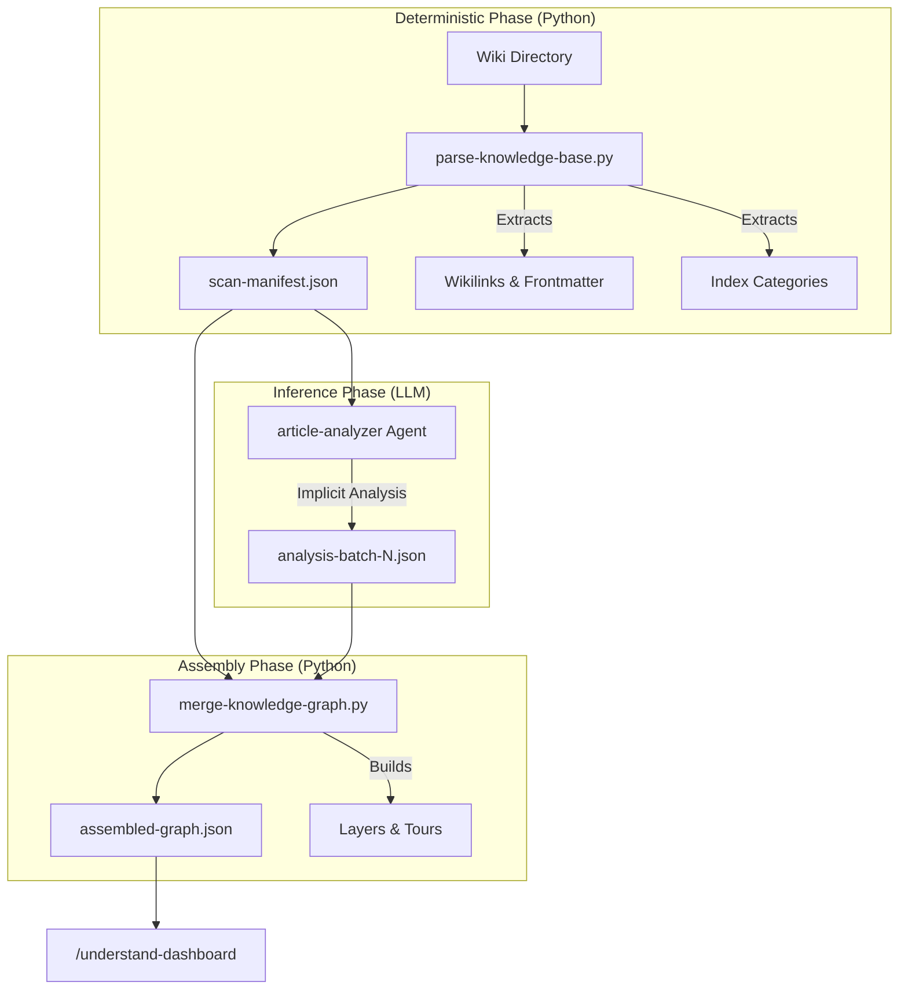
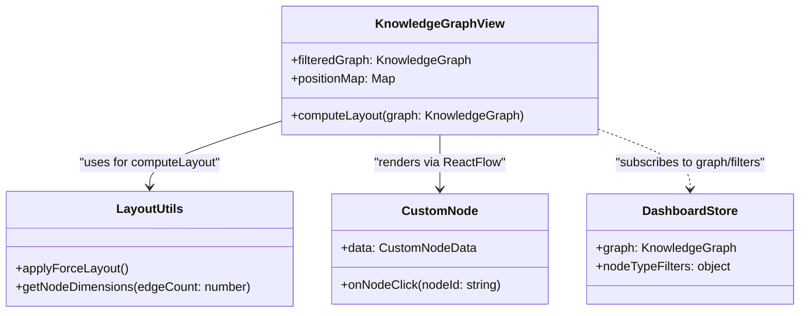

<!-- source: DeepWiki mcp.deepwiki.com · repo Lum1104/Understand-Anything · page 6.8 /understand-knowledge · fetched 2026-10-26 -->

# /understand-knowledge

Relevant source files

The following files were used as context for generating this wiki page:

- [understand-anything-plugin/packages/dashboard/src/components/KnowledgeGraphView.tsx](understand-anything-plugin/packages/dashboard/src/components/KnowledgeGraphView.tsx)
- [understand-anything-plugin/skills/understand-knowledge/SKILL.md](understand-anything-plugin/skills/understand-knowledge/SKILL.md)
- [understand-anything-plugin/skills/understand-knowledge/merge-knowledge-graph.py](understand-anything-plugin/skills/understand-knowledge/merge-knowledge-graph.py)
- [understand-anything-plugin/skills/understand-knowledge/parse-knowledge-base.py](understand-anything-plugin/skills/understand-knowledge/parse-knowledge-base.py)

The `/understand-knowledge` skill implements a specialized analysis pipeline for **Karpathy-pattern LLM wikis**. Unlike standard codebase analysis, this skill focuses on extracting structured knowledge from a three-layer documentation system consisting of raw sources, markdown articles with wikilinks, and organizational schema files.

## Overview

The Karpathy LLM wiki pattern (inspired by Andrej Karpathy's workflow) is characterized by a specific directory structure and syntax:
*   **Raw Sources**: Immutable documents (PDFs, papers, raw data) stored in a `raw/` directory.
*   **Wiki Articles**: LLM-generated or human-curated markdown files using `[[wikilink]]` syntax for cross-referencing.
*   **Schema**: High-level configuration files (e.g., `CLAUDE.md`, `AGENTS.md`) defining the "soul" or operating procedures of the knowledge base.
*   **Structural Files**: An `index.md` for categorization and a `log.md` for chronological operations.

Sources: `[understand-anything-plugin/skills/understand-knowledge/SKILL.md:13-20]()`

## System Architecture and Data Flow

The analysis follows a multi-phase pipeline that transitions from deterministic parsing to LLM-driven inference.

### Knowledge Extraction Pipeline

Title: "Knowledge Analysis Data Flow"

Sources: `[understand-anything-plugin/skills/understand-knowledge/SKILL.md:24-125]()`, `[understand-anything-plugin/skills/understand-knowledge/merge-knowledge-graph.py:12-16]()`

### 1. Deterministic Parser (`parse-knowledge-base.py`)
The parser identifies the wiki root by looking for `index.md` and `log.md` signals `[understand-anything-plugin/skills/understand-knowledge/parse-knowledge-base.py:38-69]()`. It performs the following tasks without LLM intervention:
*   **Wikilink Resolution**: Extracts `[[target|display]]` patterns and creates `related` edges `[understand-anything-plugin/skills/understand-knowledge/parse-knowledge-base.py:89-97]()`.
*   **Category Extraction**: Parses `##` headings in `index.md` to define topic clusters and `categorized_under` relationships `[understand-anything-plugin/skills/understand-knowledge/parse-knowledge-base.py:170-194]()`.
*   **Structural Analysis**: Extracts YAML frontmatter, H1 titles, and the first descriptive paragraph as node summaries `[understand-anything-plugin/skills/understand-knowledge/parse-knowledge-base.py:113-163]()`.

### 2. Article Analyzer Agent
The `article-analyzer` agent is dispatched to find **implicit** knowledge that isn't captured by explicit wikilinks. It operates on batches of 10-15 articles `[understand-anything-plugin/skills/understand-knowledge/SKILL.md:58-64]()`.

Key extraction targets:
*   **Entities**: People, tools, or organizations mentioned in text but lacking their own wiki pages.
*   **Claims**: Specific assertions, architectural decisions, or theses found within the prose.
*   **Implicit Relationships**: High-confidence relationships like `builds_on`, `contradicts`, and `exemplifies`.

Sources: `[understand-anything-plugin/skills/understand-knowledge/SKILL.md:52-71]()`

### 3. Knowledge Graph Assembly (`merge-knowledge-graph.py`)
The merge script consolidates the manifest and LLM batches into the final `knowledge-graph.json`.

*   **Entity Deduplication**: Normalizes entity names (case-insensitive) via `normalize_entity_name` to prevent duplicate nodes for the same person or tool `[understand-anything-plugin/skills/understand-knowledge/merge-knowledge-graph.py:83-87]()`.
*   **Type Normalization**: Maps various LLM outputs to canonical types (e.g., "note" -> "article", "assertion" -> "claim") using `NODE_TYPE_ALIASES` and `EDGE_TYPE_ALIASES` `[understand-anything-plugin/skills/understand-knowledge/merge-knowledge-graph.py:50-66]()`.
*   **Structural Assembly**: Builds layers from `index.md` categories and generates a guided tour based on the section ordering in the index `[understand-anything-plugin/skills/understand-knowledge/merge-knowledge-graph.py:8-9]()`.

## Node and Edge Schema

The knowledge graph generated by this skill uses a specialized subset of types tailored for documentation.

### Specialized Node Types
| Type | Description | Source |
| :--- | :--- | :--- |
| `article` | A markdown file in the wiki. | `index.md` or file scan |
| `source` | A raw document in the `raw/` directory. | File scan |
| `entity` | A named person, tool, or organization. | LLM Inference |
| `claim` | A specific assertion or decision. | LLM Inference |
| `topic` | A category or theme. | `index.md` headings |

Sources: `[understand-anything-plugin/skills/understand-knowledge/merge-knowledge-graph.py:29-35]()`

### Knowledge Edge Styles
The dashboard applies specific visual styles to knowledge-centric edges via the `EDGE_STYLES` constant:
| Edge Type | Visual Style | Semantics |
| :--- | :--- | :--- |
| `cites` | Dashed, Source Color | Article references a raw source. |
| `contradicts` | Red, Thick | Direct conflict between two articles/claims. |
| `builds_on` | Claim Color | Refinement or extension of an idea. |
| `exemplifies` | Dotted, Entity Color | Concrete example of a concept. |
| `related` | Thin, Low Opacity | Standard wikilink association. |

Sources: `[understand-anything-plugin/packages/dashboard/src/components/KnowledgeGraphView.tsx:24-34]()`

## Dashboard Visualization

When a graph is flagged with `kind: "knowledge"`, the dashboard prioritizes a force-directed layout over hierarchical trees to better represent the web-like nature of wikis `[understand-anything-plugin/skills/understand-knowledge/SKILL.md:131-131]()`.

Title: "Knowledge Graph UI Architecture"

The layout engine scales node dimensions based on connection density (degree centrality) using `getNodeDimensions`, making highly-referenced articles visually prominent `[understand-anything-plugin/packages/dashboard/src/components/KnowledgeGraphView.tsx:37-45]()`. The `KnowledgeGraphView` component also filters nodes based on the `knowledge` category in the `nodeTypeFilters` `[understand-anything-plugin/packages/dashboard/src/components/KnowledgeGraphView.tsx:124-129]()`.

Sources: `[understand-anything-plugin/packages/dashboard/src/components/KnowledgeGraphView.tsx:51-94]()`, `[understand-anything-plugin/packages/dashboard/src/components/KnowledgeGraphView.tsx:121-137]()`

---

