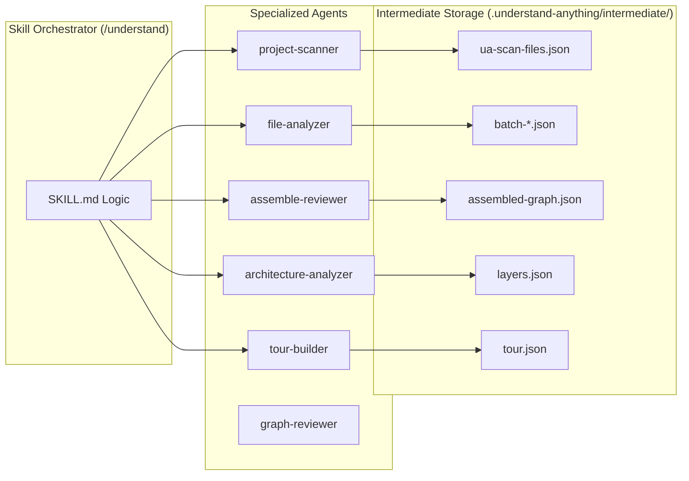
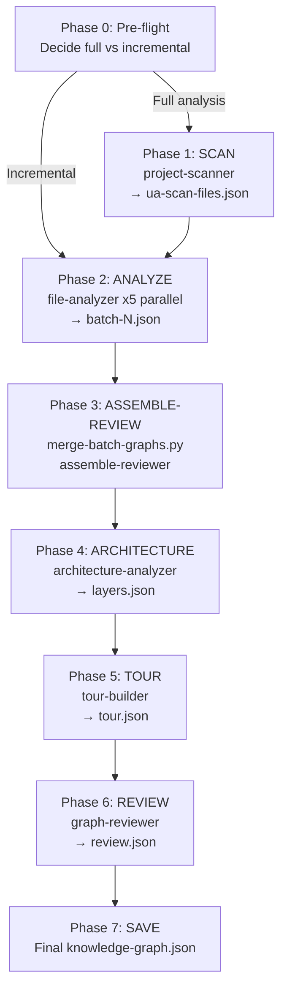
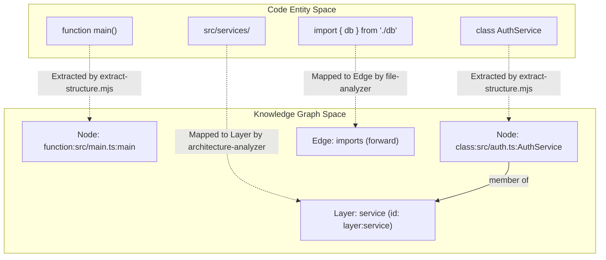

<!-- source: DeepWiki mcp.deepwiki.com · repo Lum1104/Understand-Anything · page 7 Multi-Agent Pipeline · fetched 2026-10-26 -->

# Multi-Agent Pipeline

Relevant source files

The following files were used as context for generating this wiki page:

- [CLAUDE.md](CLAUDE.md)
- [understand-anything-plugin/agents/architecture-analyzer.md](understand-anything-plugin/agents/architecture-analyzer.md)
- [understand-anything-plugin/agents/article-analyzer.md](understand-anything-plugin/agents/article-analyzer.md)
- [understand-anything-plugin/agents/assemble-reviewer.md](understand-anything-plugin/agents/assemble-reviewer.md)
- [understand-anything-plugin/agents/domain-analyzer.md](understand-anything-plugin/agents/domain-analyzer.md)
- [understand-anything-plugin/agents/file-analyzer.md](understand-anything-plugin/agents/file-analyzer.md)
- [understand-anything-plugin/agents/graph-reviewer.md](understand-anything-plugin/agents/graph-reviewer.md)
- [understand-anything-plugin/agents/knowledge-graph-guide.md](understand-anything-plugin/agents/knowledge-graph-guide.md)
- [understand-anything-plugin/agents/project-scanner.md](understand-anything-plugin/agents/project-scanner.md)
- [understand-anything-plugin/agents/tour-builder.md](understand-anything-plugin/agents/tour-builder.md)
- [understand-anything-plugin/skills/understand/SKILL.md](understand-anything-plugin/skills/understand/SKILL.md)
- [understand-anything-plugin/skills/understand/merge-batch-graphs.py](understand-anything-plugin/skills/understand/merge-batch-graphs.py)
- [understand-anything-plugin/skills/understand/merge-subdomain-graphs.py](understand-anything-plugin/skills/understand/merge-subdomain-graphs.py)

The multi-agent pipeline is the core analysis system that transforms source code into a knowledge graph. It orchestrates specialized AI agents through a seven-phase process, using disk-based intermediate storage and deterministic scripts to manage complex multi-stage analysis without overwhelming context windows.

**Scope**: This page covers the pipeline architecture, phase sequencing, and coordination patterns. For implementation details of the orchestration logic, see [Agent Orchestration](#7.1). For specifications of individual agents, see [Individual Agents](#7.2). For the knowledge graph output format, see [Knowledge Graph](#4).

---

## Architecture Overview

The multi-agent design solves two key problems:

1. **Context window management**: Instead of returning large analysis results to the orchestrating skill's context, agents write JSON outputs to disk at `.understand-anything/intermediate/`. This enables processing of large codebases without hitting token limits [CLAUDE.md:28-31]().
2. **Deterministic Grounding**: Every agent follows a two-phase pattern: first, it writes and executes a **discovery/extraction script** (Node.js or Python) to gather hard facts from the disk; second, it performs LLM semantic analysis on those facts [understand-anything-plugin/agents/project-scanner.md:14-17](), [understand-anything-plugin/agents/file-analyzer.md:13-15]().

**Agent Coordination Space**

Sources: [understand-anything-plugin/skills/understand/SKILL.md:23-40](), [understand-anything-plugin/agents/project-scanner.md:56-60](), [understand-anything-plugin/agents/file-analyzer.md:71-74]()

---

## Seven-Phase Pipeline

The `/understand` skill implements a seven-phase pipeline that progresses from discovery to final assembly [understand-anything-plugin/skills/understand/SKILL.md:27-39]():

**Phase Summary**

| Phase | Agent / Tool | Responsibility |
|-------|--------------|----------------|
| 1: SCAN | `project-scanner` | Inventory files using `scan-project.mjs`, detect languages/frameworks, and extract narrative metadata [understand-anything-plugin/agents/project-scanner.md:23-50](). |
| 2: ANALYZE | `file-analyzer` | Extract structural nodes (functions, classes) using `extract-structure.mjs` and semantic edges from file batches [understand-anything-plugin/agents/file-analyzer.md:27-82](). |
| 3: ASSEMBLE | `merge-batch-graphs.py` & `assemble-reviewer` | Merge batches, normalize IDs, and fix cross-batch edge gaps [understand-anything-plugin/skills/understand/merge-batch-graphs.py:2-9](), [understand-anything-plugin/agents/assemble-reviewer.md:10-23](). |
| 4: ARCHITECTURE | `architecture-analyzer` | Identify logical layers (e.g., API, Service, Data) based on directory patterns and imports [understand-anything-plugin/agents/architecture-analyzer.md:10-14](). |
| 5: TOUR | `tour-builder` | Design 5-15 pedagogical steps using BFS traversal and fan-in importance [understand-anything-plugin/agents/tour-builder.md:10-14](). |
| 6: REVIEW | `graph-reviewer` | Perform final schema validation and referential integrity checks [understand-anything-plugin/agents/graph-reviewer.md:10-14](). |

Sources: [understand-anything-plugin/skills/understand/SKILL.md:27-39](), [understand-anything-plugin/agents/assemble-reviewer.md:10-23]()

---

## Phase 2: ANALYZE — Parallel Execution

This phase is the most resource-intensive. The orchestrator batches the file list and dispatches subagents to analyze them.

### Batching Logic
- **Concurrency**: The system manages parallel workers to process batches simultaneously [understand-anything-plugin/skills/understand/SKILL.md:32-33]().
- **Extraction Script**: Agents use the bundled `extract-structure.mjs` script to gather tree-sitter data for `code` files and specialized metrics for `config`, `docs`, and `infra` [understand-anything-plugin/agents/file-analyzer.md:66-74]().
- **Neighbor Map**: Agents receive a `neighborMap` containing symbols from other batches to improve the confidence of cross-batch edges [understand-anything-plugin/agents/file-analyzer.md:54-62]().

Sources: [understand-anything-plugin/skills/understand/SKILL.md:32-33](), [understand-anything-plugin/agents/file-analyzer.md:54-74]()

---

## Phase 3: ASSEMBLE — Merging and Review

Because agents analyze batches in isolation, Phase 3 is critical for stitching the global graph together.

1. **`merge-batch-graphs.py`**: A deterministic Python script that merges all `batch-*.json` files. It normalizes node IDs (e.g., stripping double prefixes) and maps complexity values to the canonical `simple`, `moderate`, `complex` set [understand-anything-plugin/skills/understand/merge-batch-graphs.py:32-78](), [understand-anything-plugin/skills/understand/merge-batch-graphs.py:178-200]().
2. **`assemble-reviewer`**: An LLM agent that reviews the merge script's "Could not fix" report. It recovers dropped nodes and, crucially, adds **cross-batch edges** by comparing the assembled graph against the original `$IMPORT_MAP` [understand-anything-plugin/agents/assemble-reviewer.md:36-68]().

Sources: [understand-anything-plugin/skills/understand/merge-batch-graphs.py:2-9](), [understand-anything-plugin/agents/assemble-reviewer.md:36-68]()

---

## Domain and Knowledge Pipelines

Specialized agents extend the multi-agent architecture for non-structural analysis:

- **Domain Analysis**: The `domain-analyzer` identifies a hierarchy of **Domains** → **Flows** → **Steps**. It uses `flow_step` edge weights to encode sequential order [understand-anything-plugin/agents/domain-analyzer.md:27-32](), [understand-anything-plugin/agents/domain-analyzer.md:99-102]().
- **Knowledge Base Analysis**: The `article-analyzer` processes Karpathy-pattern wikis, extracting entities, claims, and topics from Markdown articles [understand-anything-plugin/skills/understand/merge-batch-graphs.py:60-65]().

Sources: [understand-anything-plugin/agents/domain-analyzer.md:27-102](), [understand-anything-plugin/skills/understand/merge-batch-graphs.py:60-65]()

---

## Data Flow: Code to Graph Entities

The following diagram illustrates how raw code concepts are mapped to the Knowledge Graph schema by the `file-analyzer` and `architecture-analyzer`.

Sources: [understand-anything-plugin/agents/file-analyzer.md:82-115](), [understand-anything-plugin/agents/architecture-analyzer.md:107-145]()

---

## Technical Coordination Details

### Intermediate File Storage
All agents communicate via the `.understand-anything/intermediate/` directory. This directory is purged after graph assembly to save disk space [CLAUDE.md:28-31]().

### Script Execution Environment
Agents are required to write and execute scripts in Node.js or Python to ensure data is grounded in file system reality rather than LLM hallucination [understand-anything-plugin/agents/file-analyzer.md:27-29](), [understand-anything-plugin/agents/graph-reviewer.md:18-20](), [understand-anything-plugin/agents/architecture-analyzer.md:23-25]().

Sources: [CLAUDE.md:28-31](), [understand-anything-plugin/agents/file-analyzer.md:27-29](), [understand-anything-plugin/agents/graph-reviewer.md:18-20]()

---

