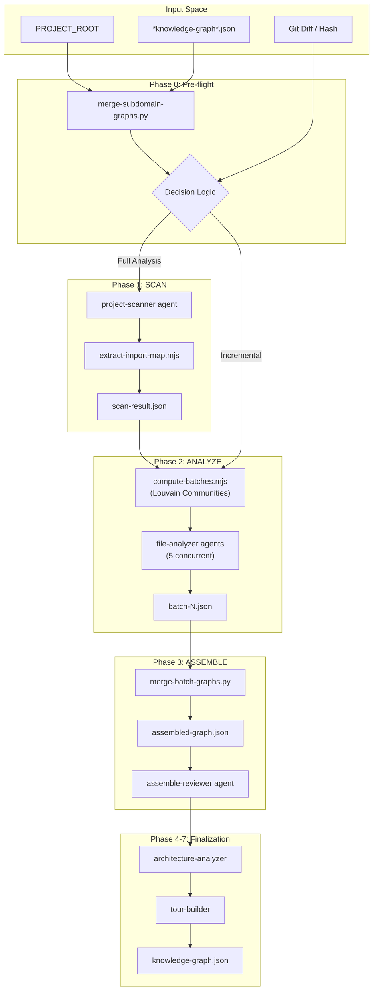
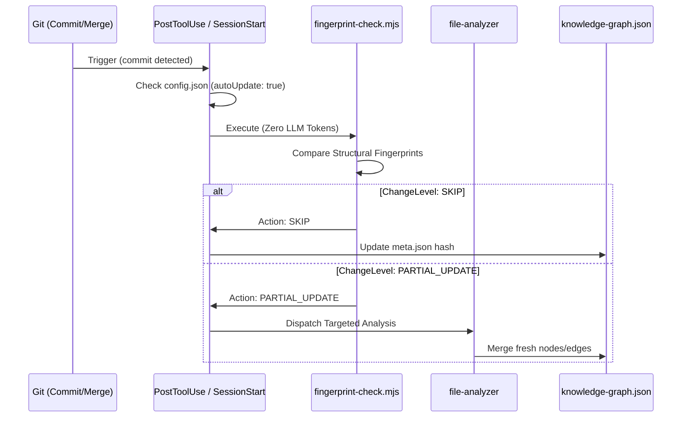

<!-- source: DeepWiki mcp.deepwiki.com · repo Lum1104/Understand-Anything · page 7.1 Agent Orchestration · fetched 2026-10-26 -->

# Agent Orchestration

Relevant source files

The following files were used as context for generating this wiki page:

- [tests/skill/understand/test_extract_import_map.test.mjs](tests/skill/understand/test_extract_import_map.test.mjs)
- [understand-anything-plugin/agents/file-analyzer.md](understand-anything-plugin/agents/file-analyzer.md)
- [understand-anything-plugin/hooks/auto-update-prompt.md](understand-anything-plugin/hooks/auto-update-prompt.md)
- [understand-anything-plugin/hooks/hooks.json](understand-anything-plugin/hooks/hooks.json)
- [understand-anything-plugin/packages/core/src/__tests__/change-classifier.test.ts](understand-anything-plugin/packages/core/src/__tests__/change-classifier.test.ts)
- [understand-anything-plugin/packages/core/src/__tests__/fingerprint.test.ts](understand-anything-plugin/packages/core/src/__tests__/fingerprint.test.ts)
- [understand-anything-plugin/packages/core/src/fingerprint.ts](understand-anything-plugin/packages/core/src/fingerprint.ts)
- [understand-anything-plugin/skills/understand/SKILL.md](understand-anything-plugin/skills/understand/SKILL.md)
- [understand-anything-plugin/skills/understand/compute-batches.mjs](understand-anything-plugin/skills/understand/compute-batches.mjs)
- [understand-anything-plugin/skills/understand/extract-import-map.mjs](understand-anything-plugin/skills/understand/extract-import-map.mjs)
- [understand-anything-plugin/skills/understand/merge-batch-graphs.py](understand-anything-plugin/skills/understand/merge-batch-graphs.py)
- [understand-anything-plugin/skills/understand/merge-subdomain-graphs.py](understand-anything-plugin/skills/understand/merge-subdomain-graphs.py)

This document details how the `/understand` skill orchestrates the multi-agent analysis pipeline, manages concurrency, and coordinates intermediate file storage. For documentation of the individual agents (project-scanner, file-analyzer, architecture-analyzer, tour-builder, graph-reviewer, domain-analyzer, assemble-reviewer), see section 7.2.

## Purpose and Scope

The `/understand` skill implements a sophisticated orchestration system that coordinates specialized agents across a multi-phase pipeline. The orchestrator:

- Decides between full analysis, incremental update, or review-only paths based on Git history and existing graph state [understand-anything-plugin/skills/understand/SKILL.md:42-44]().
- Manages high-concurrency batching (5 parallel workers, 20-30 files per batch) [understand-anything-plugin/agents/file-analyzer.md:33-35]().
- Coordinates intermediate file storage on disk using the `.understand-anything/intermediate/` and `.understand-anything/tmp/` directories [understand-anything-plugin/agents/file-analyzer.md:33-43](), [understand-anything-plugin/skills/understand/merge-batch-graphs.py:12-18]().
- Implements a deterministic auto-update hook system to keep graphs in sync with Git commits using structural fingerprinting [understand-anything-plugin/hooks/hooks.json:1-25](), [understand-anything-plugin/hooks/auto-update-prompt.md:94-122]().
- Merges subdomain graphs and batch results using specialized scripts [understand-anything-plugin/skills/understand/merge-subdomain-graphs.py:1-11](), [understand-anything-plugin/skills/understand/merge-batch-graphs.py:1-9]().

**Sources:** [understand-anything-plugin/skills/understand/SKILL.md:42-114](), [understand-anything-plugin/agents/file-analyzer.md:33-52](), [understand-anything-plugin/hooks/hooks.json:1-25](), [understand-anything-plugin/skills/understand/merge-batch-graphs.py:1-19]()

## Pipeline Architecture

The orchestrator manages a pipeline where each phase depends on the outputs of previous phases, utilizing disk-based storage for coordination.

Title: Multi-Agent Orchestration Flow

**Sources:** [understand-anything-plugin/skills/understand/SKILL.md:42-120](), [understand-anything-plugin/skills/understand/extract-import-map.mjs:1-34](), [understand-anything-plugin/skills/understand/compute-batches.mjs:1-13](), [understand-anything-plugin/skills/understand/merge-batch-graphs.py:1-19](), [understand-anything-plugin/skills/understand/merge-subdomain-graphs.py:1-19]()

## Concurrency and Batching Strategy

To handle large codebases, the orchestrator employs an aggressive batching strategy in the analysis phase.

- **Community Detection:** The orchestrator uses `compute-batches.mjs` which applies Louvain community detection to the import graph to group related files together in the same batch [understand-anything-plugin/skills/understand/compute-batches.mjs:5-12]().
- **Batch Size:** Typically 20-30 files per batch to balance LLM context windows and processing speed.
- **Parallelism:** Up to 5 `file-analyzer` subagents run concurrently.
- **Collision Prevention:** Agents use a `batchIndex` in all temporary file paths (e.g., `ua-file-analyzer-input-<batchIndex>.json`) to avoid overwriting each other's data [understand-anything-plugin/agents/file-analyzer.md:33-35]().
- **Structural Extraction:** Each agent executes a bundled `extract-structure.mjs` script locally to provide deterministic structural data (functions, classes, call graphs) before performing semantic analysis [understand-anything-plugin/agents/file-analyzer.md:27-30](), [understand-anything-plugin/agents/file-analyzer.md:66-74]().

**Sources:** [understand-anything-plugin/skills/understand/compute-batches.mjs:5-12](), [understand-anything-plugin/agents/file-analyzer.md:33-74]()

## Intermediate Data Merging

The system uses specialized scripts to normalize and merge data produced by different agents or batches.

### merge-batch-graphs.py
This script combines `batch-*.json` files into `assembled-graph.json`. It performs mechanical normalization:
- **ID Normalization:** Strips double prefixes (e.g., `file:file:`) and project-name prefixes (e.g., `my-project:file:`) [understand-anything-plugin/skills/understand/merge-batch-graphs.py:182-197]().
- **Complexity Mapping:** Normalizes values like "easy", "hard", or numeric values to `simple`, `moderate`, or `complex` [understand-anything-plugin/skills/understand/merge-batch-graphs.py:68-78]().
- **Edge Deduplication:** Deduplicates edges by `(source, target, type)`, keeping the one with the higher weight [understand-anything-plugin/skills/understand/merge-batch-graphs.py:77-89]().
- **Direction Normalization:** Canonicalizes direction values to `forward`, `backward`, or `bidirectional` [understand-anything-plugin/skills/understand/merge-batch-graphs.py:115-121]().

### merge-subdomain-graphs.py
Handles merging of pre-existing `*knowledge-graph*.json` files. It deduplicates nodes by ID (later occurrence wins) and edges by source/target/type (higher weight wins) [understand-anything-graph-plugin/skills/understand/merge-subdomain-graphs.py:64-89](). It also performs union operations on layer `nodeIds` and merges tour steps with identical titles [understand-anything-plugin/skills/understand/merge-subdomain-graphs.py:106-146]().

**Sources:** [understand-anything-plugin/skills/understand/merge-batch-graphs.py:1-193](), [understand-anything-plugin/skills/understand/merge-subdomain-graphs.py:1-160]()

## Auto-Update Hook System

The system maintains graph freshness through Git hooks (`PostToolUse`) and session start triggers defined in `hooks.json` [understand-anything-plugin/hooks/hooks.json:1-25]().

Title: Auto-Update Logic Flow

### Structural Fingerprinting
The `fingerprint-check.mjs` script (Phase 1 of auto-update) computes SHA-256 hashes and extracts structural elements (functions, classes, imports, exports) via regex [understand-anything-plugin/hooks/auto-update-prompt.md:94-122](). 
- **COSMETIC:** Internal logic changed, but signatures match. No LLM tokens spent [understand-anything-plugin/hooks/auto-update-prompt.md:117-117](), [understand-anything-plugin/packages/core/src/fingerprint.ts:128-130]().
- **STRUCTURAL:** New/removed functions, classes, or imports. Triggers targeted LLM re-analysis [understand-anything-plugin/hooks/auto-update-prompt.md:118-118](), [understand-anything-plugin/packages/core/src/fingerprint.ts:129-129]().

**Sources:** [understand-anything-plugin/hooks/hooks.json:1-25](), [understand-anything-plugin/hooks/auto-update-prompt.md:1-145](), [understand-anything-plugin/packages/core/src/fingerprint.ts:124-134]()

## Intermediate Storage Layout

All intermediate state is stored in `.understand-anything/intermediate/` and `tmp/` to maintain a clean workspace and allow for phase coordination.

| File | Producer | Consumer |
| :--- | :--- | :--- |
| `ua-file-analyzer-input-<N>.json` | Orchestrator | `extract-structure.mjs` [understand-anything-plugin/agents/file-analyzer.md:33-43]() |
| `ua-file-extract-results-<N>.json` | `extract-structure.mjs` | `file-analyzer` agent [understand-anything-plugin/agents/file-analyzer.md:71-74]() |
| `batch-N.json` | `file-analyzer` | `merge-batch-graphs.py` [understand-anything-plugin/skills/understand/merge-batch-graphs.py:15-18]() |
| `assembled-graph.json` | `merge-batch-graphs.py` | `assemble-reviewer` [understand-anything-plugin/skills/understand/merge-batch-graphs.py:18-19]() |
| `change-analysis.json` | `fingerprint-check.mjs` | Auto-update orchestrator [understand-anything-plugin/hooks/auto-update-prompt.md:121-122]() |

**Sources:** [understand-anything-plugin/agents/file-analyzer.md:33-74](), [understand-anything-plugin/skills/understand/merge-batch-graphs.py:12-19](), [understand-anything-plugin/hooks/auto-update-prompt.md:121-122]()

---

