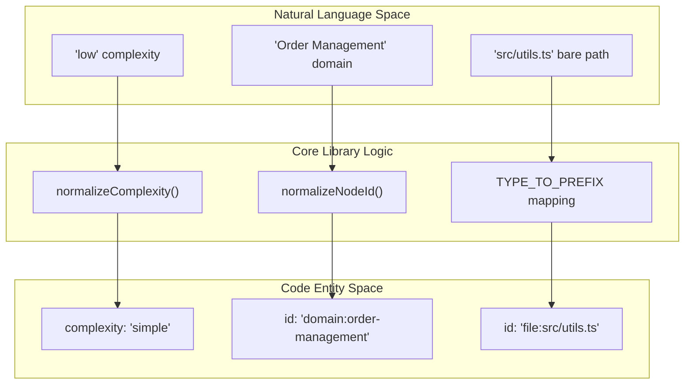
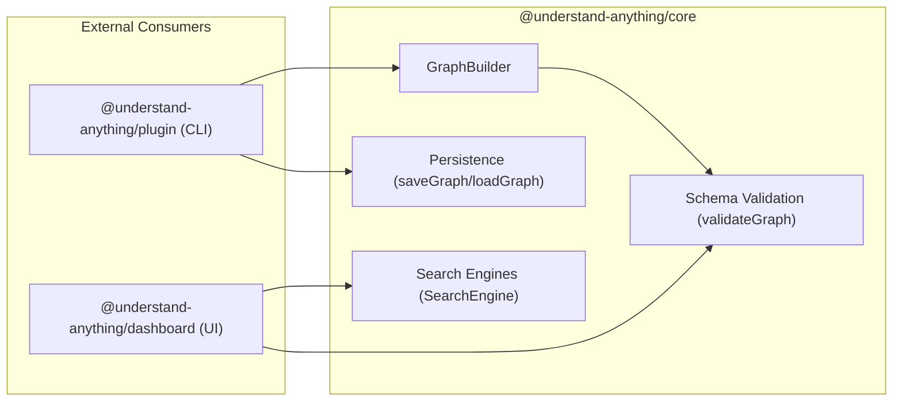

<!-- source: DeepWiki mcp.deepwiki.com · repo Lum1104/Understand-Anything · page 8 Core Library (@understand-anything/core) · fetched 2026-10-26 -->

# Core Library (@understand-anything/core)

Relevant source files

The following files were used as context for generating this wiki page:

- [understand-anything-plugin/packages/core/src/__tests__/domain-normalize.test.ts](understand-anything-plugin/packages/core/src/__tests__/domain-normalize.test.ts)
- [understand-anything-plugin/packages/core/src/__tests__/domain-persistence.test.ts](understand-anything-plugin/packages/core/src/__tests__/domain-persistence.test.ts)
- [understand-anything-plugin/packages/core/src/__tests__/normalize-graph.test.ts](understand-anything-plugin/packages/core/src/__tests__/normalize-graph.test.ts)
- [understand-anything-plugin/packages/core/src/analyzer/normalize-graph.ts](understand-anything-plugin/packages/core/src/analyzer/normalize-graph.ts)
- [understand-anything-plugin/packages/core/src/index.ts](understand-anything-plugin/packages/core/src/index.ts)
- [understand-anything-plugin/packages/core/src/persistence/index.ts](understand-anything-plugin/packages/core/src/persistence/index.ts)
- [understand-anything-plugin/packages/core/src/persistence/persistence.test.ts](understand-anything-plugin/packages/core/src/persistence/persistence.test.ts)
- [understand-anything-plugin/packages/core/src/types.test.ts](understand-anything-plugin/packages/core/src/types.test.ts)
- [understand-anything-plugin/packages/core/src/types.ts](understand-anything-plugin/packages/core/src/types.ts)

The `@understand-anything/core` package serves as the engine of the Understand Anything ecosystem. It provides the fundamental TypeScript APIs for analyzing source code, building and validating knowledge graphs, performing semantic searches, and managing project persistence. It is designed to be platform-agnostic, allowing it to be used within the CLI plugin, the dashboard, or third-party integrations.

## Public API Surface

The core library exports a comprehensive suite of utilities for graph manipulation, LLM interaction, and file system operations [understand-anything-plugin/packages/core/src/index.ts:1-125]().

| Category | Key Exports |
| :--- | :--- |
| **Analysis** | `GraphBuilder`, `LLMFileAnalysis`, `buildFileAnalysisPrompt`, `detectLayers` |
| **Graph Schema** | `KnowledgeGraphSchema`, `validateGraph`, `sanitizeGraph`, `autoFixGraph`, `normalizeNodeId` |
| **Search** | `SearchEngine` (Fuzzy), `SemanticSearchEngine` (Embeddings) |
| **Persistence** | `saveGraph`, `loadGraph`, `saveMeta`, `loadMeta`, `ProjectConfig` |
| **Plugins** | `PluginRegistry`, `LanguageRegistry`, `TreeSitterPlugin`, `registerAllParsers` |

Sources: [understand-anything-plugin/packages/core/src/index.ts:1-125]()

## System Subsystems

The core library is organized into several major subsystems that coordinate to transform raw source code into a structured, searchable knowledge graph.

### Graph Construction and Normalization
The `GraphBuilder` coordinates the extraction of entities from code [understand-anything-plugin/packages/core/src/index.ts:16-16](). A critical phase of this process is **Normalization**, handled by `normalizeBatchOutput`, which ensures that node IDs follow a canonical `type:path` format and that metadata like complexity is standardized [understand-anything-plugin/packages/core/src/analyzer/normalize-graph.ts:202-205](). The system supports 21 node types across code, non-code, domain, and knowledge categories [understand-anything-plugin/packages/core/src/types.ts:1-7]().

For details, see [Graph Builder and LLM Analyzer](#8.1).

### Search and Discovery
The library provides dual-engine search capabilities. The `SearchEngine` utilizes `fuse.js` for weighted fuzzy matching across node names and summaries [understand-anything-plugin/packages/core/src/index.ts:32-32](). The `SemanticSearchEngine` provides vector-based similarity searches using `cosineSimilarity` on embeddings [understand-anything-plugin/packages/core/src/index.ts:80-83]().

For details, see [Search Engines](#8.2).

### Persistence and Fingerprinting
The persistence layer manages the `.understand-anything/` directory, handling the serialization of the knowledge graph (`knowledge-graph.json`), domain graph (`domain-graph.json`), and project metadata (`meta.json`) [understand-anything-plugin/packages/core/src/persistence/index.ts:7-11](). It includes `sanitiseFilePaths` to ensure absolute paths from the developer's machine are converted to project-relative paths before storage [understand-anything-plugin/packages/core/src/persistence/index.ts:38-67](). It also includes a fingerprinting system (via `buildFingerprintStore`) that generates structural hashes to detect changes and enable incremental updates [understand-anything-plugin/packages/core/src/index.ts:85-98]().

For details, see [Persistence Layer](#8.3).

### Plugin and Language Registry
The core is extensible via a plugin architecture. The `PluginRegistry` manages specialized analyzers [understand-anything-plugin/packages/core/src/index.ts:57-57](), while the `LanguageRegistry` and `FrameworkRegistry` provide configurations for over 25 languages and various web frameworks [understand-anything-plugin/packages/core/src/index.ts:59-65]().

For details, see [Plugin System](#9).

## Data Flow: Code to Graph Entity

The following diagram illustrates how the core library maps natural language concepts and raw file paths into standardized code entities within the Knowledge Graph.

**Entity Normalization Flow**

Sources: [understand-anything-plugin/packages/core/src/analyzer/normalize-graph.ts:8-25](), [understand-anything-plugin/packages/core/src/analyzer/normalize-graph.ts:115-128](), [understand-anything-plugin/packages/core/src/analyzer/normalize-graph.ts:134-152]()

## Architectural Relationship

The core library sits at the center of the workspace, providing the types and logic consumed by both the CLI and the Dashboard.

**Core Library Integration**

Sources: [understand-anything-plugin/packages/core/src/index.ts:1-125](), [understand-anything-plugin/packages/core/src/analyzer/normalize-graph.ts:202-205](), [understand-anything-plugin/packages/core/src/persistence/index.ts:69-105]()

## Normalization Logic

The library implements rigorous normalization to prevent ID collisions and data inconsistency. For example, `step` nodes are uniquely identified by incorporating their parent flow slug and file path to distinguish between similar steps in different business processes [understand-anything-plugin/packages/core/src/analyzer/normalize-graph.ts:78-85]().

**ID Normalization Examples**
| Input ID | Node Type | Normalized Output ID |
| :--- | :--- | :--- |
| `my-project:file:src/foo.ts` | `file` | `file:src/foo.ts` |
| `formatDate` (in `src/utils.ts`) | `function` | `func:src/utils.ts:formatDate` |
| `validate` (in `create-order` flow) | `step` | `step:create-order:src/validators/order.ts:validate` |
| `high` | N/A (Complexity) | `complex` |

Sources: [understand-anything-plugin/packages/core/src/analyzer/normalize-graph.ts:64-111](), [understand-anything-plugin/packages/core/src/__tests__/normalize-graph.test.ts:28-60](), [understand-anything-plugin/packages/core/src/__tests__/domain-normalize.test.ts:21-28]()

---

