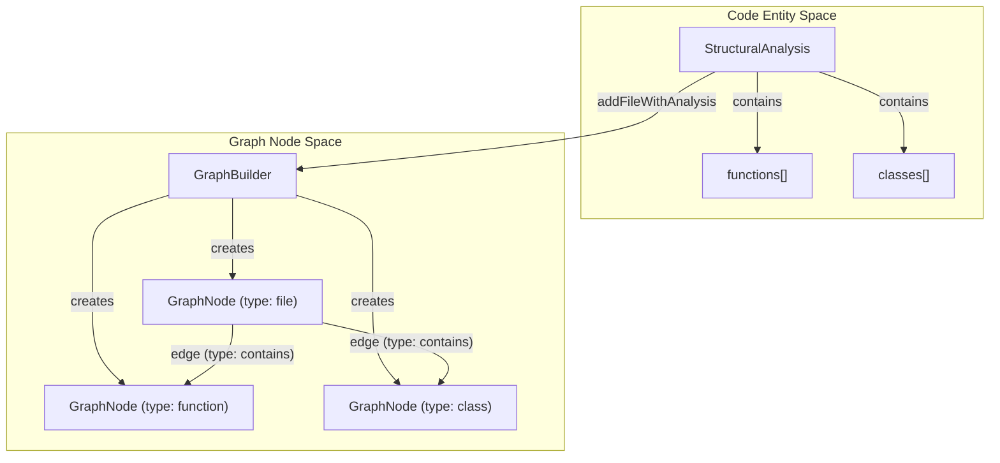
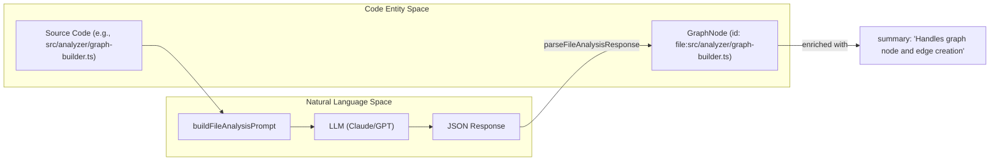

<!-- source: DeepWiki mcp.deepwiki.com · repo Lum1104/Understand-Anything · page 8.1 Graph Builder and LLM Analyzer · fetched 2026-10-26 -->

# Graph Builder and LLM Analyzer

Relevant source files

The following files were used as context for generating this wiki page:

- [understand-anything-plugin/packages/core/src/__tests__/domain-normalize.test.ts](understand-anything-plugin/packages/core/src/__tests__/domain-normalize.test.ts)
- [understand-anything-plugin/packages/core/src/__tests__/language-lesson.test.ts](understand-anything-plugin/packages/core/src/__tests__/language-lesson.test.ts)
- [understand-anything-plugin/packages/core/src/__tests__/normalize-graph.test.ts](understand-anything-plugin/packages/core/src/__tests__/normalize-graph.test.ts)
- [understand-anything-plugin/packages/core/src/analyzer/graph-builder.test.ts](understand-anything-plugin/packages/core/src/analyzer/graph-builder.test.ts)
- [understand-anything-plugin/packages/core/src/analyzer/graph-builder.ts](understand-anything-plugin/packages/core/src/analyzer/graph-builder.ts)
- [understand-anything-plugin/packages/core/src/analyzer/normalize-graph.ts](understand-anything-plugin/packages/core/src/analyzer/normalize-graph.ts)
- [understand-anything-plugin/packages/core/src/index.ts](understand-anything-plugin/packages/core/src/index.ts)
- [understand-anything-plugin/packages/dashboard/public/knowledge-graph.json](understand-anything-plugin/packages/dashboard/public/knowledge-graph.json)
- [understand-anything-plugin/skills/understand-chat/SKILL.md](understand-anything-plugin/skills/understand-chat/SKILL.md)
- [understand-anything-plugin/skills/understand-diff/SKILL.md](understand-anything-plugin/skills/understand-diff/SKILL.md)
- [understand-anything-plugin/skills/understand-explain/SKILL.md](understand-anything-plugin/skills/understand-explain/SKILL.md)
- [understand-anything-plugin/skills/understand-onboard/SKILL.md](understand-anything-plugin/skills/understand-onboard/SKILL.md)
- [understand-anything-plugin/skills/understand/frameworks/django.md](understand-anything-plugin/skills/understand/frameworks/django.md)

The `GraphBuilder` class and the LLM analysis suite form the bridge between raw source code, structural metadata, and the final `KnowledgeGraph` data structure. This system handles language detection, structural-to-graph mapping, and the orchestration of LLM prompts to generate semantic summaries of code entities.

## GraphBuilder Class

The `GraphBuilder` is a stateful utility class responsible for assembling the `KnowledgeGraph` by creating nodes and edges from both code and non-code files [understand-anything-plugin/packages/core/src/analyzer/graph-builder.ts:60-74](). It manages project metadata, such as the Git commit hash and detected languages, ensuring the graph remains consistent with the analyzed source state [understand-anything-plugin/packages/core/src/analyzer/graph-builder.ts:66-73]().

### Key Functions

| Function | Purpose |
| :--- | :--- |
| `addFile` | Adds a basic file node with summary, tags, and complexity [understand-anything-plugin/packages/core/src/analyzer/graph-builder.ts:84-103](). |
| `addFileWithAnalysis` | Creates a file node plus child `function` and `class` nodes based on `StructuralAnalysis` [understand-anything-plugin/packages/core/src/analyzer/graph-builder.ts:105-177](). |
| `addImportEdge` | Creates an `imports` type edge between two file nodes [understand-anything-plugin/packages/core/src/analyzer/graph-builder.ts:179-190](). |
| `addCallEdge` | Creates a `calls` type edge between two function nodes [understand-anything-plugin/packages/core/src/analyzer/graph-builder.ts:192-208](). |
| `addNonCodeFileWithAnalysis` | Handles non-code files (SQL, YAML, Docker) and maps their definitions to specialized node types [understand-anything-plugin/packages/core/src/analyzer/graph-builder.ts:228-260](). |
| `build` | Finalizes the graph, calculates unique languages, and returns a `KnowledgeGraph` object [understand-anything-plugin/packages/core/src/analyzer/graph-builder.ts:290-307](). |

### Structural to Graph Mapping
When `addFileWithAnalysis` is called, the builder automatically generates `contains` edges to link the parent file to its constituent classes and functions [understand-anything-plugin/packages/core/src/analyzer/graph-builder.ts:145-151](). For non-code files, it uses a mapping table `KIND_TO_NODE_TYPE` to convert domain-specific definitions (like `table`, `service`, or `route`) into the appropriate graph node types [understand-anything-plugin/packages/core/src/analyzer/graph-builder.ts:39-58]().

**Graph Construction Flow**

Sources: [understand-anything-plugin/packages/core/src/analyzer/graph-builder.ts:105-177](), [understand-anything-plugin/packages/core/src/analyzer/graph-builder.test.ts:41-93]()

## LLM Analysis and Prompting

The LLM Analyzer subsystem generates the semantic layer of the graph. It uses specialized prompts to transform raw code into high-level summaries and architectural insights.

### Language Detection and Context
The system uses the `LanguageRegistry` to map file paths to language identifiers [understand-anything-plugin/packages/core/src/analyzer/graph-builder.ts:76-78](). This registry is used during node creation to track the project's language composition [understand-anything-plugin/packages/core/src/analyzer/graph-builder.ts:110-113]().

### Prompt Building and Parsing
Prompts are dynamically constructed based on the file content and framework context.
*   **Analysis Prompts**: `buildFileAnalysisPrompt` and `buildProjectSummaryPrompt` are used to generate the core content of the graph [understand-anything-plugin/packages/core/src/index.ts:18-19]().
*   **Language Lessons**: The system generates `languageNotes` and `concepts` for specific nodes to help users understand language-specific patterns (e.g., `async/await` in TypeScript) [understand-anything-plugin/packages/core/src/__tests__/language-lesson.test.ts:39-77]().
*   **Response Parsing**: Responses from the LLM are expected in JSON format. The `parseFileAnalysisResponse` and `parseLanguageLessonResponse` functions handle extraction even when the JSON is wrapped in markdown code blocks [understand-anything-plugin/packages/core/src/index.ts:20-21](), [understand-anything-plugin/packages/core/src/__tests__/language-lesson.test.ts:101-115]().
*   **Framework Addendums**: When a framework like **Django** is detected, the prompt is extended with framework-specific rules for identifying "Canonical File Roles" (e.g., `models.py` as `data-model`) and specific edge patterns like "Signal wiring" [understand-anything-plugin/skills/understand/frameworks/django.md:1-46]().

### Normalization Pipeline
Before the graph is finalized, `normalizeBatchOutput` is called to fix malformed IDs, handle numeric complexity scales, and rewrite edge references [understand-anything-plugin/packages/core/src/analyzer/normalize-graph.ts:195-201]().
*   **ID Normalization**: `normalizeNodeId` ensures IDs follow the `type:path` format, handling double-prefixes or bare paths [understand-anything-plugin/packages/core/src/analyzer/normalize-graph.ts:64-111]().
*   **Complexity Normalization**: `normalizeComplexity` maps various string aliases (e.g., "low", "hard") or numeric scales (1-10) to the canonical "simple", "moderate", or "complex" values [understand-anything-plugin/packages/core/src/analyzer/normalize-graph.ts:134-152]().

**Semantic Enrichment Flow**

Sources: [understand-anything-plugin/packages/core/src/analyzer/graph-builder.ts:21-24](), [understand-anything-plugin/packages/core/src/index.ts:18-23](), [understand-anything-plugin/packages/core/src/__tests__/language-lesson.test.ts:79-121]()

## Project Integration

The `GraphBuilder` ensures that the final output includes comprehensive project metadata, including the version, name, Git hash, and the full list of detected languages [understand-anything-plugin/packages/core/src/analyzer/graph-builder.ts:290-307]().

This metadata is crucial for the dashboard to display the project overview and for the staleness detection system to determine if the graph needs an update. Skills like `/understand-diff` use this metadata to compare current file states against the last analyzed commit [understand-anything-plugin/skills/understand-diff/SKILL.md:13-23]().

Sources: [understand-anything-plugin/packages/core/src/analyzer/graph-builder.ts:290-307](), [understand-anything-plugin/packages/core/src/analyzer/graph-builder.test.ts:180-203](), [understand-anything-plugin/skills/understand-diff/SKILL.md:35-40]()

---

