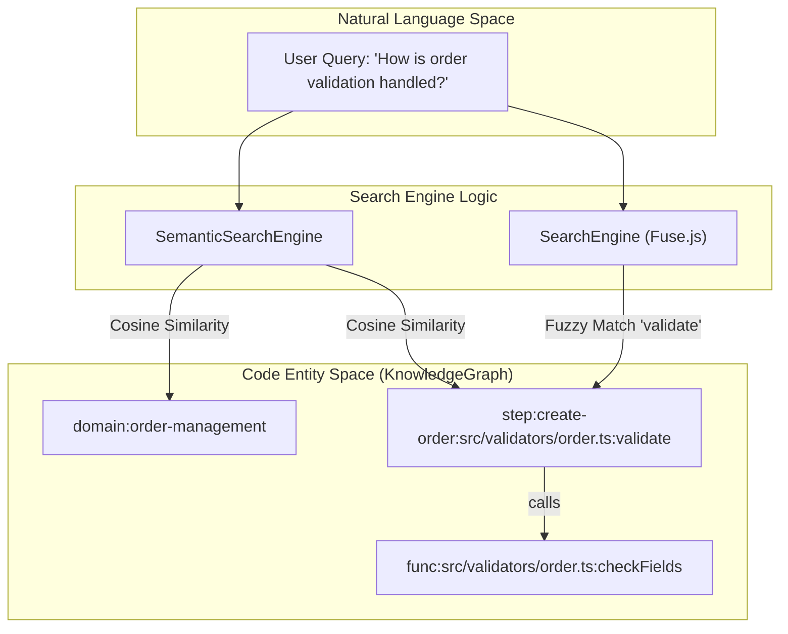
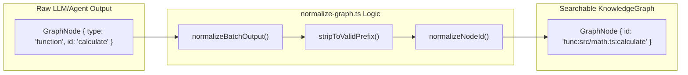

<!-- source: DeepWiki mcp.deepwiki.com · repo Lum1104/Understand-Anything · page 8.2 Search Engines · fetched 2026-10-26 -->

# Search Engines

<details>
<summary>Relevant source files</summary>

The following files were used as context for generating this wiki page:

- [understand-anything-plugin/packages/core/src/__tests__/domain-normalize.test.ts](understand-anything-plugin/packages/core/src/__tests__/domain-normalize.test.ts)
- [understand-anything-plugin/packages/core/src/__tests__/domain-persistence.test.ts](understand-anything-plugin/packages/core/src/__tests__/domain-persistence.test.ts)
- [understand-anything-plugin/packages/core/src/__tests__/normalize-graph.test.ts](understand-anything-plugin/packages/core/src/__tests__/normalize-graph.test.ts)
- [understand-anything-plugin/packages/core/src/analyzer/normalize-graph.ts](understand-anything-plugin/packages/core/src/analyzer/normalize-graph.ts)
- [understand-anything-plugin/packages/core/src/index.ts](understand-anything-plugin/packages/core/src/index.ts)
- [understand-anything-plugin/packages/core/src/persistence/index.ts](understand-anything-plugin/packages/core/src/persistence/index.ts)
- [understand-anything-plugin/packages/core/src/persistence/persistence.test.ts](understand-anything-plugin/packages/core/src/persistence/persistence.test.ts)
- [understand-anything-plugin/packages/core/src/types.test.ts](understand-anything-plugin/packages/core/src/types.test.ts)
- [understand-anything-plugin/packages/core/src/types.ts](understand-anything-plugin/packages/core/src/types.ts)

</details>


The Understand Anything platform employs a dual-engine search architecture to facilitate rapid discovery and semantic understanding of the codebase. This system combines traditional fuzzy string matching for precise identifier lookup with semantic vector search for conceptual queries.

## Overview

Search capabilities are integrated across the dashboard (via the `SearchBar` component) and the chat skill (`/understand-chat`). The system reconciles 21 distinct node types (including code, non-code, domain, and knowledge nodes) and 35 edge types to provide a unified search interface [understand-anything-plugin/packages/core/src/types.ts:2-19]().

### Search Engine Types

| Engine | Implementation | Primary Use Case |
| :--- | :--- | :--- |
| **SearchEngine** | Fuse.js (Fuzzy) | Finding specific files, functions, or classes by name/path. |
| **SemanticSearchEngine** | Cosine Similarity | Answering "How does X work?" or "Where is auth handled?". |

Sources: [understand-anything-plugin/packages/core/src/index.ts:32-32](), [understand-anything-plugin/packages/core/src/index.ts:79-83](), [understand-anything-plugin/packages/core/src/types.ts:2-7]()

---

## Fuzzy Search Engine (`SearchEngine`)

The `SearchEngine` provides high-performance fuzzy matching using the `Fuse.js` library. It is optimized for structural entities like files and functions where the user likely knows a fragment of the name.

### Weighted Field Configuration
To ensure relevant results appear first, fields in the `GraphNode` are weighted differently:
- **Name/ID**: Highest weight (Primary identifier).
- **FilePath**: Medium weight (Contextual location).
- **Summary/Tags**: Lower weight (Conceptual context).

### Implementation Flow
The engine indexes the `KnowledgeGraph` nodes and returns a `SearchResult` interface containing the node ID and its match score [understand-anything-plugin/packages/core/src/index.ts:32-32](). The `SearchOptions` allow for filtering by node type or limiting result counts.

Sources: [understand-anything-plugin/packages/core/src/index.ts:32-32](), [understand-anything-plugin/packages/core/src/types.ts:39-51]()

---

## Semantic Search Engine (`SemanticSearchEngine`)

The `SemanticSearchEngine` operates in "Natural Language Space," allowing users to query the codebase using intent rather than specific syntax.

### Vector Embeddings and Similarity
1. **Context Building**: For every node, a text representation is generated using the `summary`, `tags`, and `knowledgeMeta` or `domainMeta` fields [understand-anything-plugin/packages/core/src/types.ts:45-50]().
2. **Retrieval**: When a query is received, the engine calculates the `cosineSimilarity` [understand-anything-plugin/packages/core/src/index.ts:81-81]() between the query embedding and the node embeddings.
3. **Options**: The engine supports `SemanticSearchOptions` to tune result thresholds and limits [understand-anything-plugin/packages/core/src/index.ts:82-82]().

### Extended Node Support
The engine specifically handles expanded node types introduced in recent versions, including:
- **Domain Nodes**: `domain`, `flow`, `step` [understand-anything-plugin/packages/core/src/types.ts:6-6]().
- **Knowledge Nodes**: `article`, `entity`, `topic`, `claim`, `source` [understand-anything-plugin/packages/core/src/types.ts:7-7]().

Sources: [understand-anything-plugin/packages/core/src/index.ts:79-83](), [understand-anything-plugin/packages/core/src/types.ts:2-7]()

---

## Data Structures

### SearchResult Interface
Both engines return results conforming to a standard structure.

```typescript
export interface SearchResult {
  nodeId: string;
  score: number;      // 0 to 1 (lower is better for Fuse.js, higher for Semantic)
}
```

### Node ID Normalization
Search reliability depends on canonical node IDs. The `normalizeNodeId` function ensures that IDs generated by different agents follow the `type:path` or `type:path:name` format [understand-anything-plugin/packages/core/src/analyzer/normalize-graph.ts:64-67]().

| Type | Canonical Format |
| :--- | :--- |
| `file` | `file:src/index.ts` |
| `function` | `func:src/utils.ts:calculate` |
| `step` | `step:flow-slug:path:step-slug` |

The system uses `TYPE_TO_PREFIX` to map internal types like `function` to short ID prefixes like `func` [understand-anything-plugin/packages/core/src/analyzer/normalize-graph.ts:8-25]().

Sources: [understand-anything-plugin/packages/core/src/index.ts:32-32](), [understand-anything-plugin/packages/core/src/analyzer/normalize-graph.ts:8-25](), [understand-anything-plugin/packages/core/src/analyzer/normalize-graph.ts:78-86]()

---

## Architectural Diagrams

### Search Flow: Natural Language to Code Entity
This diagram illustrates how a user query traverses from a conceptual request to a specific code entity in the `KnowledgeGraph`.

**Query Resolution Pipeline**

Sources: [understand-anything-plugin/packages/core/src/index.ts:32-32](), [understand-anything-plugin/packages/core/src/index.ts:79-81](), [understand-anything-plugin/packages/core/src/analyzer/normalize-graph.ts:8-25](), [understand-anything-plugin/packages/core/src/__tests__/domain-normalize.test.ts:22-27]()

### ID Normalization and Validation
Before nodes are indexed for search, they pass through `normalizeBatchOutput` to fix malformed IDs and ensure consistency across the graph.

**Data Normalization Pipeline**

Sources: [understand-anything-plugin/packages/core/src/analyzer/normalize-graph.ts:31-31](), [understand-anything-plugin/packages/core/src/analyzer/normalize-graph.ts:64-64](), [understand-anything-plugin/packages/core/src/analyzer/normalize-graph.ts:202-214](), [understand-anything-plugin/packages/core/src/types.ts:39-42]()

---

## Usage in Skills

### /understand-chat
The chat skill uses search engines to build context for the LLM. It performs a search to find "seed" nodes and then expands the context by following graph relationships (1-hop expansion).

### Persistence and Search
Search engines operate on graphs loaded via the persistence layer. The `loadGraph` function retrieves the `knowledge-graph.json` from the `.understand-anything` directory, optionally validating it against the `KnowledgeGraphSchema` before indexing [understand-anything-plugin/packages/core/src/persistence/index.ts:85-102]().

Sources: [understand-anything-plugin/packages/core/src/persistence/index.ts:85-102](), [understand-anything-plugin/packages/core/src/index.ts:32-32]()

---

