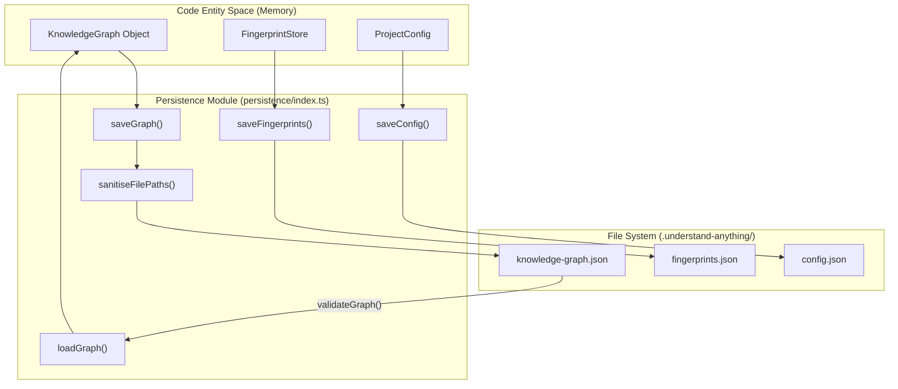
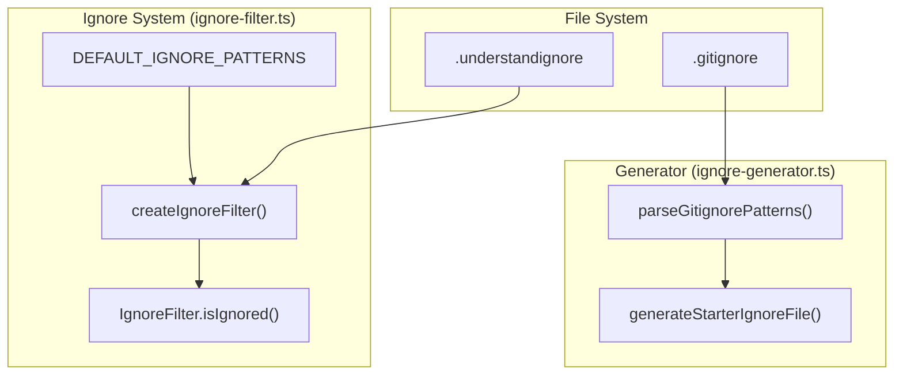

<!-- source: DeepWiki mcp.deepwiki.com · repo Lum1104/Understand-Anything · page 8.3 Persistence Layer · fetched 2026-10-26 -->

# Persistence Layer

Relevant source files

The following files were used as context for generating this wiki page:

- [understand-anything-plugin/packages/core/src/__tests__/domain-persistence.test.ts](understand-anything-plugin/packages/core/src/__tests__/domain-persistence.test.ts)
- [understand-anything-plugin/packages/core/src/__tests__/ignore-filter.test.ts](understand-anything-plugin/packages/core/src/__tests__/ignore-filter.test.ts)
- [understand-anything-plugin/packages/core/src/__tests__/ignore-generator.test.ts](understand-anything-plugin/packages/core/src/__tests__/ignore-generator.test.ts)
- [understand-anything-plugin/packages/core/src/ignore-filter.ts](understand-anything-plugin/packages/core/src/ignore-filter.ts)
- [understand-anything-plugin/packages/core/src/ignore-generator.ts](understand-anything-plugin/packages/core/src/ignore-generator.ts)
- [understand-anything-plugin/packages/core/src/persistence/index.ts](understand-anything-plugin/packages/core/src/persistence/index.ts)
- [understand-anything-plugin/packages/core/src/persistence/persistence.test.ts](understand-anything-plugin/packages/core/src/persistence/persistence.test.ts)
- [understand-anything-plugin/packages/core/src/types.test.ts](understand-anything-plugin/packages/core/src/types.test.ts)
- [understand-anything-plugin/packages/core/src/types.ts](understand-anything-plugin/packages/core/src/types.ts)

The Persistence Layer is responsible for the serialization and deserialization of the knowledge graph and its associated metadata to the local file system. It ensures that analysis results are preserved across sessions, manages directory structures, and implements critical security measures by sanitizing file paths to prevent leaking sensitive local environment information. It also encompasses the project's ignore system, which filters out irrelevant files from the analysis pipeline.

## Directory Layout

All persistent data is stored within a hidden directory named `.understand-anything` at the root of the analyzed project [understand-anything-plugin/packages/core/src/persistence/index.ts:7-7](). The `ensureDir` function handles the creation of this directory if it does not exist [understand-anything-plugin/packages/core/src/persistence/index.ts:13-19]().

| File | Constant | Purpose |
| :--- | :--- | :--- |
| `.understand-anything/knowledge-graph.json` | `GRAPH_FILE` | The primary structural knowledge graph containing nodes, edges, and layers [understand-anything-plugin/packages/core/src/persistence/index.ts:8-8](). |
| `.understand-anything/domain-graph.json` | `DOMAIN_GRAPH_FILE` | The business-logic oriented graph containing domains, flows, and steps [understand-anything-plugin/packages/core/src/persistence/index.ts:150-150](). |
| `.understand-anything/meta.json` | `META_FILE` | High-level analysis statistics and versioning information [understand-anything-plugin/packages/core/src/persistence/index.ts:9-9](). |
| `.understand-anything/fingerprints.json` | `FINGERPRINT_FILE` | Structural hashes used for incremental update detection [understand-anything-plugin/packages/core/src/persistence/index.ts:10-10](). |
| `.understand-anything/config.json` | `CONFIG_FILE` | Project-specific settings (e.g., auto-update and language preferences) [understand-anything-plugin/packages/core/src/persistence/index.ts:11-11](). |
| `.understand-anything/.understandignore` | - | Project-local ignore patterns (Layer 2) [understand-anything-plugin/packages/core/src/ignore-filter.ts:92-93](). |

**Sources:** [understand-anything-plugin/packages/core/src/persistence/index.ts:7-11](), [understand-anything-plugin/packages/core/src/persistence/index.ts:150-150](), [understand-anything-plugin/packages/core/src/ignore-filter.ts:92-93]()

## Data Flow and Sanitization

A critical feature of the persistence layer is `sanitiseFilePaths`. During analysis, agents often work with absolute paths. Before writing to disk, the persistence module converts these into project-relative paths [understand-anything-plugin/packages/core/src/persistence/index.ts:38-67](). This prevents the leakage of developer-specific information (like usernames or home directory structures) into the shared `knowledge-graph.json` [understand-anything-plugin/packages/core/src/persistence/index.ts:72-76]().

### Path Sanitization Logic
1.  **Relative Paths:** Left untouched [understand-anything-plugin/packages/core/src/persistence/index.ts:51-54]().
2.  **Inside Project Root:** Converted to relative paths using `relative()` from `node:path` [understand-anything-plugin/packages/core/src/persistence/index.ts:56-59]().
3.  **Outside Project Root:** Reduced to the base filename only using `basename()` to minimize exposure [understand-anything-plugin/packages/core/src/persistence/index.ts:61-63]().

### Persistence Operations Diagram
This diagram illustrates how the core functions bridge the gap between in-memory Code Entities and the local File System.

**Sources:** [understand-anything-plugin/packages/core/src/persistence/index.ts:38-148](), [understand-anything-plugin/packages/core/src/persistence/index.ts:152-160]()

## Ignore System

The ignore system prevents the analyzer from processing irrelevant files such as build artifacts, dependency directories, and binary assets. It uses the `ignore` package to support standard `.gitignore` syntax [understand-anything-plugin/packages/core/src/ignore-filter.ts:1-1]().

### Ignore Filter Layers
The `createIgnoreFilter` function merges three layers of patterns, where later layers can override earlier ones using the `!` negation prefix [understand-anything-plugin/packages/core/src/ignore-filter.ts:77-85]():

1.  **Layer 1: Hardcoded Defaults:** A robust list of 70+ patterns including `node_modules/`, `.git/`, `dist/`, and binary extensions like `*.png`, `*.pdf`, and `*.zip` [understand-anything-plugin/packages/core/src/ignore-filter.ts:9-70]().
2.  **Layer 2: Local Ignore:** Patterns found in `.understand-anything/.understandignore` [understand-anything-plugin/packages/core/src/ignore-filter.ts:92-97]().
3.  **Layer 3: Root Ignore:** Patterns found in `.understandignore` at the project root [understand-anything-plugin/packages/core/src/ignore-filter.ts:99-104]().

### Ignore Generator
The `generateStarterIgnoreFile` function assists users by creating a template `.understandignore`. It scans the project for common directories (e.g., `__tests__`, `docs`, `scripts`) and extracts unique patterns from the existing `.gitignore` that are not already covered by built-in defaults [understand-anything-plugin/packages/core/src/ignore-generator.ts:61-102]().

**Sources:** [understand-anything-plugin/packages/core/src/ignore-filter.ts:86-111](), [understand-anything-plugin/packages/core/src/ignore-generator.ts:37-102]()

## Key Functions

### Graph Management
*   **`saveGraph(projectRoot, graph)`**: Sanitizes paths and writes the `KnowledgeGraph` to `knowledge-graph.json` [understand-anything-plugin/packages/core/src/persistence/index.ts:69-83]().
*   **`loadGraph(projectRoot, options)`**: Reads the graph and, by default, runs it through `validateGraph` to ensure schema integrity [understand-anything-plugin/packages/core/src/persistence/index.ts:85-105]().
*   **`saveDomainGraph` / `loadDomainGraph`**: Specialized versions for the business domain graph, using the same `sanitiseFilePaths` logic but targeting `domain-graph.json` [understand-anything-plugin/packages/core/src/persistence/index.ts:152-182]().

### Metadata and Configuration
*   **`saveMeta` / `loadMeta`**: Persists `AnalysisMeta` containing `lastAnalyzedAt`, `gitCommitHash`, and the number of `analyzedFiles` [understand-anything-plugin/packages/core/src/persistence/index.ts:107-116]().
*   **`saveFingerprints` / `loadFingerprints`**: Manages the `FingerprintStore`. If the JSON is corrupted, `loadFingerprints` returns `null` to trigger a fresh scan [understand-anything-plugin/packages/core/src/persistence/index.ts:118-131]().
*   **`loadConfig`**: Returns a `DEFAULT_CONFIG` (`{ autoUpdate: false, outputLanguage: "en" }`) if the configuration file is missing or corrupted [understand-anything-plugin/packages/core/src/persistence/index.ts:140-148]().

**Sources:** [understand-anything-plugin/packages/core/src/persistence/index.ts:69-182](), [understand-anything-plugin/packages/core/src/types.ts:108-114]()

## ProjectConfig

The `ProjectConfig` interface manages user preferences for the specific repository [understand-anything-plugin/packages/core/src/types.ts:117-120]().

| Property | Type | Default | Description |
| :--- | :--- | :--- | :--- |
| `autoUpdate` | `boolean` | `false` | Whether the system should automatically trigger re-analysis when structural changes are detected. |
| `outputLanguage` | `string` | `"en"` | The preferred language for analysis summaries and generated documentation. |

**Sources:** [understand-anything-plugin/packages/core/src/persistence/index.ts:133-133](), [understand-anything-plugin/packages/core/src/types.ts:117-120]()

---

