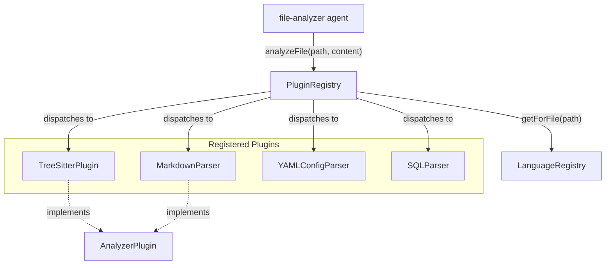
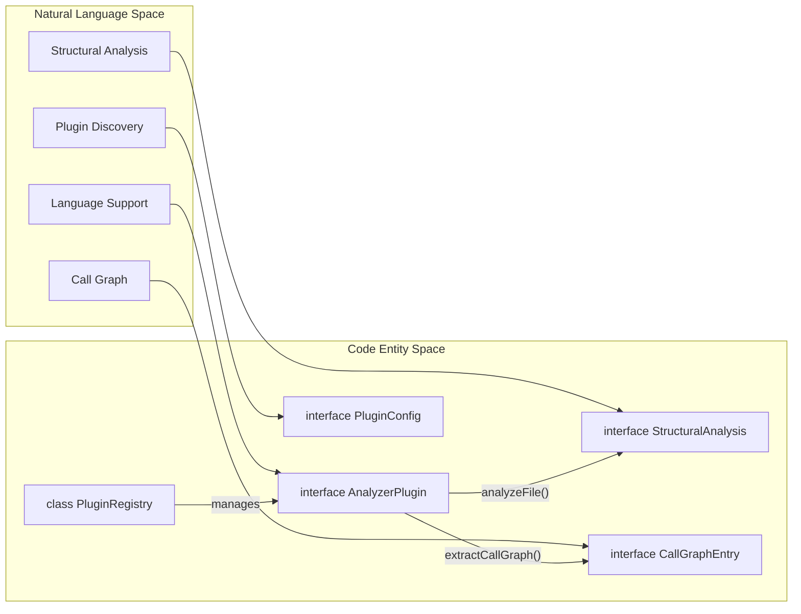

<!-- source: DeepWiki mcp.deepwiki.com · repo Lum1104/Understand-Anything · page 9 Plugin System · fetched 2026-10-26 -->

# Plugin System

<details>
<summary>Relevant source files</summary>

The following files were used as context for generating this wiki page:

- [understand-anything-plugin/packages/core/src/__tests__/domain-types.test.ts](understand-anything-plugin/packages/core/src/__tests__/domain-types.test.ts)
- [understand-anything-plugin/packages/core/src/__tests__/plugin-discovery.test.ts](understand-anything-plugin/packages/core/src/__tests__/plugin-discovery.test.ts)
- [understand-anything-plugin/packages/core/src/__tests__/plugin-registry.test.ts](understand-anything-plugin/packages/core/src/__tests__/plugin-registry.test.ts)
- [understand-anything-plugin/packages/core/src/__tests__/schema.test.ts](understand-anything-plugin/packages/core/src/__tests__/schema.test.ts)
- [understand-anything-plugin/packages/core/src/analyzer/language-lesson.ts](understand-anything-plugin/packages/core/src/analyzer/language-lesson.ts)
- [understand-anything-plugin/packages/core/src/plugins/discovery.ts](understand-anything-plugin/packages/core/src/plugins/discovery.ts)
- [understand-anything-plugin/packages/core/src/plugins/registry.ts](understand-anything-plugin/packages/core/src/plugins/registry.ts)
- [understand-anything-plugin/packages/core/src/plugins/tree-sitter-plugin.test.ts](understand-anything-plugin/packages/core/src/plugins/tree-sitter-plugin.test.ts)
- [understand-anything-plugin/packages/core/src/plugins/tree-sitter-plugin.ts](understand-anything-plugin/packages/core/src/plugins/tree-sitter-plugin.ts)
- [understand-anything-plugin/packages/core/src/schema.ts](understand-anything-plugin/packages/core/src/schema.ts)

</details>


The plugin system provides an extensible architecture for adding language-specific code analysis capabilities to Understand Anything. It defines a common interface for analyzing source files across different programming languages and manages the registration, discovery, and dispatch of analyzer plugins through a centralized registry.

For information about the file analysis process that uses these plugins, see [Multi-Agent Pipeline](#7). For details on the knowledge graph structure that plugins populate, see [Knowledge Graph](#4).

## Overview

The plugin system consists of three main components:

1.  **AnalyzerPlugin Interface** — Defines the contract that all language analyzers must implement, including methods for file analysis (`analyzeFile`), import resolution (`resolveImports`), and call graph extraction (`extractCallGraph`) [understand-anything-plugin/packages/core/src/plugins/registry.ts:56-72]().
2.  **PluginRegistry** — Manages plugin registration, language detection via `LanguageRegistry`, and plugin dispatch [understand-anything-plugin/packages/core/src/plugins/registry.ts:11-18]().
3.  **TreeSitterPlugin** — A powerful, config-driven plugin that uses WASM grammars to provide deep structural analysis for 10+ major programming languages [understand-anything-plugin/packages/core/src/plugins/tree-sitter-plugin.ts:21-32]().

This architecture allows the system to support a vast array of programming languages and configuration formats without modifying core analysis logic. Each plugin is responsible for parsing source files and extracting structural information such as functions, classes, imports, and exports.

**Sources:** [understand-anything-plugin/packages/core/src/plugins/registry.ts:11-18](), [understand-anything-plugin/packages/core/src/plugins/tree-sitter-plugin.ts:21-32](), [understand-anything-plugin/packages/core/src/__tests__/plugin-registry.test.ts:13-20]()

## System Architecture

### Plugin System Integration

The `PluginRegistry` acts as the primary entry point for the `file-analyzer` agent, delegating tasks to specific plugins based on file types. It uses `LanguageRegistry` to resolve the correct language ID before dispatching to a registered `AnalyzerPlugin` [understand-anything-plugin/packages/core/src/plugins/registry.ts:43-60]().



**Sources:** [understand-anything-plugin/packages/core/src/plugins/registry.ts:43-60](), [understand-anything-plugin/packages/core/src/plugins/tree-sitter-plugin.ts:32-34]()

### Code Entity Mapping

The following diagram bridges Natural Language concepts to the specific TypeScript interfaces and classes used in the plugin system.



**Sources:** [understand-anything-plugin/packages/core/src/plugins/registry.ts:11-14](), [understand-anything-plugin/packages/core/src/plugins/discovery.ts:3-12](), [understand-anything-plugin/packages/core/src/__tests__/plugin-registry.test.ts:6-11]()

## Plugin Registry and Discovery

The `PluginRegistry` (detailed in [Plugin Registry and Language Registry](#9.1)) is the central dispatcher. It uses the `LanguageRegistry` to map file extensions to standardized language IDs and routes files to the appropriate implementation [understand-anything-plugin/packages/core/src/plugins/registry.ts:43-47]().

### Plugin Configuration
The system supports dynamic discovery and configuration of plugins via a `PluginConfig` object, allowing plugins to be enabled or disabled and passed custom options [understand-anything-plugin/packages/core/src/plugins/discovery.ts:3-12](). The `DEFAULT_PLUGIN_CONFIG` enables the `tree-sitter` plugin for all supported languages [understand-anything-plugin/packages/core/src/plugins/discovery.ts:14-24]().

| Feature | Description |
| :--- | :--- |
| **Language Mapping** | Maps extensions like `.ts` or `.py` to internal language IDs via `LanguageRegistry` [understand-anything-plugin/packages/core/src/plugins/registry.ts:52-54]() |
| **Priority** | Later registrations for the same language take priority over earlier ones [understand-anything-plugin/packages/core/src/__tests__/plugin-registry.test.ts:85-92]() |
| **Discovery** | Parses JSON configurations to initialize available plugins [understand-anything-plugin/packages/core/src/plugins/discovery.ts:30-61]() |

For more details on dispatch logic and the discovery system, see [Plugin Registry and Language Registry](#9.1).

## Built-in Analyzers

The system relies heavily on the `TreeSitterPlugin` for high-fidelity code analysis.

### Tree-Sitter Support
The `TreeSitterPlugin` provides deep structural analysis for primary programming languages (TypeScript, JavaScript, Python, Go, Rust, Java, etc.) [understand-anything-plugin/packages/core/src/plugins/tree-sitter-plugin.ts:23-27](). It uses language-specific `LanguageExtractor` implementations to traverse ASTs [understand-anything-plugin/packages/core/src/plugins/tree-sitter-plugin.ts:105-109]().
- **Functions**: Extracts names, parameters, and return types [understand-anything-plugin/packages/core/src/plugins/tree-sitter-plugin.test.ts:13-34]().
- **Classes**: Identifies methods and properties [understand-anything-plugin/packages/core/src/plugins/tree-sitter-plugin.test.ts:52-82]().
- **Call Graphs**: Maps function calls to callers with line numbers [understand-anything-plugin/packages/core/src/plugins/registry.ts:68-72]().
- **Imports/Exports**: Maps dependency relationships and API surfaces [understand-anything-plugin/packages/core/src/plugins/tree-sitter-plugin.test.ts:84-107]().

### Language Lessons
The system can generate language-specific lessons for code components by detecting patterns like `async/await`, `middleware`, or `generics` using `detectLanguageConcepts` [understand-anything-plugin/packages/core/src/analyzer/language-lesson.ts:69-93](). These lessons are derived from `BASE_CONCEPT_PATTERNS` and language-specific configs [understand-anything-plugin/packages/core/src/analyzer/language-lesson.ts:13-42]().

**Sources:** [understand-anything-plugin/packages/core/src/plugins/tree-sitter-plugin.ts:21-34](), [understand-anything-plugin/packages/core/src/analyzer/language-lesson.ts:13-42](), [understand-anything-plugin/packages/core/src/plugins/tree-sitter-plugin.test.ts:13-130]()

## Creating Custom Plugins

Developers can extend the system by implementing the `AnalyzerPlugin` interface. This is useful for supporting proprietary languages or adding specialized analysis into the knowledge graph generation.

For a step-by-step guide, see [Creating Custom Plugins](#9.2).

### StructuralAnalysis Interface
Custom plugins must return a `StructuralAnalysis` object, which serves as the intermediate representation for the Knowledge Graph [understand-anything-plugin/packages/core/src/__tests__/plugin-registry.test.ts:6-11]():

```typescript
export interface StructuralAnalysis {
  functions: Array<{
    name: string;
    lineRange: [number, number];
    params: string[];
    returnType?: string;
  }>;
  classes: Array<{
    name: string;
    lineRange: [number, number];
    methods: string[];
    properties?: string[];
  }>;
  imports: Array<{
    source: string;
    specifiers: string[];
    lineNumber?: number;
  }>;
  exports: Array<{
    name: string;
    lineNumber?: number;
  }>;
}
```

**Sources:** [understand-anything-plugin/packages/core/src/__tests__/plugin-registry.test.ts:6-11](), [understand-anything-plugin/packages/core/src/plugins/tree-sitter-plugin.test.ts:13-130]()

---

