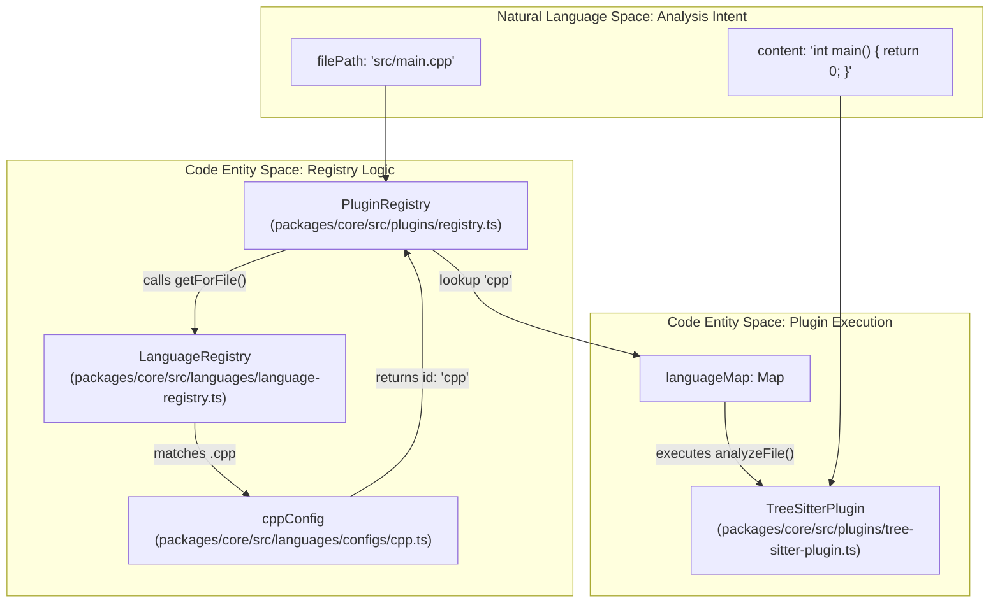
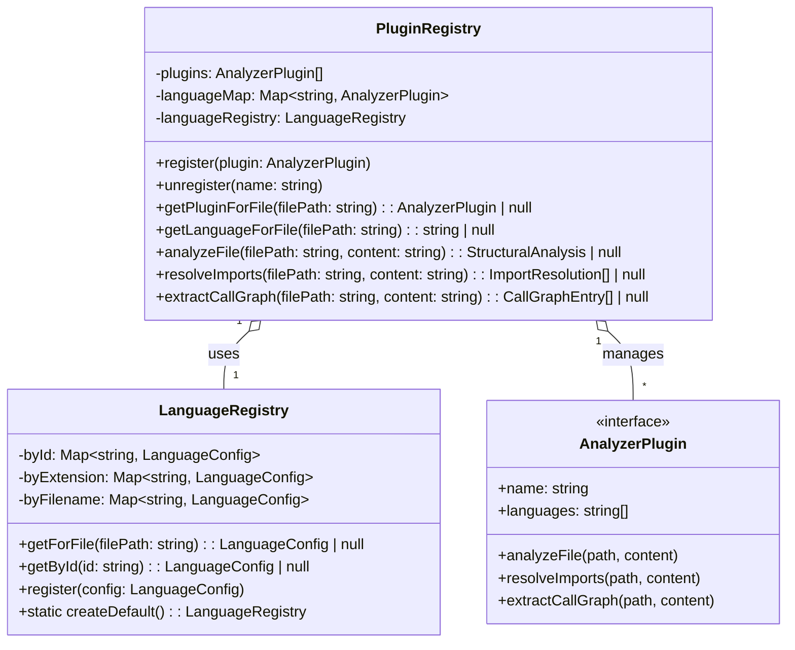

<!-- source: DeepWiki mcp.deepwiki.com · repo Lum1104/Understand-Anything · page 9.1 Plugin Registry and Language Registry · fetched 2026-10-26 -->

# Plugin Registry and Language Registry

Relevant source files

The following files were used as context for generating this wiki page:

- [understand-anything-plugin/packages/core/src/__tests__/language-registry.test.ts](understand-anything-plugin/packages/core/src/__tests__/language-registry.test.ts)
- [understand-anything-plugin/packages/core/src/__tests__/plugin-registry.test.ts](understand-anything-plugin/packages/core/src/__tests__/plugin-registry.test.ts)
- [understand-anything-plugin/packages/core/src/analyzer/language-lesson.ts](understand-anything-plugin/packages/core/src/analyzer/language-lesson.ts)
- [understand-anything-plugin/packages/core/src/languages/configs/cpp.ts](understand-anything-plugin/packages/core/src/languages/configs/cpp.ts)
- [understand-anything-plugin/packages/core/src/languages/configs/index.ts](understand-anything-plugin/packages/core/src/languages/configs/index.ts)
- [understand-anything-plugin/packages/core/src/languages/language-registry.ts](understand-anything-plugin/packages/core/src/languages/language-registry.ts)
- [understand-anything-plugin/packages/core/src/languages/types.ts](understand-anything-plugin/packages/core/src/languages/types.ts)
- [understand-anything-plugin/packages/core/src/plugins/discovery.ts](understand-anything-plugin/packages/core/src/plugins/discovery.ts)
- [understand-anything-plugin/packages/core/src/plugins/registry.ts](understand-anything-plugin/packages/core/src/plugins/registry.ts)
- [understand-anything-plugin/packages/core/src/plugins/tree-sitter-plugin.test.ts](understand-anything-plugin/packages/core/src/plugins/tree-sitter-plugin.test.ts)

## Purpose and Scope

The Plugin Registry and Language Registry form the backbone of the system's multi-language analysis capabilities. The `PluginRegistry` manages `AnalyzerPlugin` implementations [understand-anything-plugin/packages/core/src/plugins/registry.ts:11-12](), while the `LanguageRegistry` handles the identification of files by extension, filename, or ID [understand-anything-plugin/packages/core/src/languages/language-registry.ts:9-12](). Together, they provide a unified dispatch logic that allows the analysis pipeline to process diverse codebases without hardcoded logic for every file type.

The system supports 40 built-in language configurations [understand-anything-plugin/packages/core/src/__tests__/language-registry.test.ts:55](), ranging from primary programming languages (TypeScript, Go, Python) [understand-anything-plugin/packages/core/src/languages/configs/index.ts:46-49]() to configuration formats and non-code types (YAML, Dockerfile, SQL, CSV) [understand-anything-plugin/packages/core/src/languages/configs/index.ts:61-86]().

Sources: [understand-anything-plugin/packages/core/src/plugins/registry.ts:4-18](), [understand-anything-plugin/packages/core/src/languages/language-registry.ts:1-13](), [understand-anything-plugin/packages/core/src/languages/configs/index.ts:44-87]()

---

## Language Registry

The `LanguageRegistry` is responsible for mapping file metadata to `LanguageConfig` objects. It maintains internal maps for lookup by unique ID (`byId`), file extension (`byExtension`), or exact filename (`byFilename`) [understand-anything-plugin/packages/core/src/languages/language-registry.ts:10-12]().

### Language Detection Logic

The registry uses a tiered lookup strategy in the `getForFile(filePath)` method [understand-anything-plugin/packages/core/src/languages/language-registry.ts:38-48]():
1.  **Filename Match**: Checks if the basename (e.g., `Dockerfile`, `Makefile`, or `docker-compose.yml`) matches a known entry in the `byFilename` map [understand-anything-plugin/packages/core/src/languages/language-registry.ts:40-42](). This handles files without extensions or files where the full name is the primary identifier [understand-anything-plugin/packages/core/src/__tests__/language-registry.test.ts:124-138]().
2.  **Extension Match**: Falls back to checking the file extension (e.g., `.ts`, `.py`, `.cpp`). The registry normalizes extensions by ensuring a leading dot and lowercase comparison for consistency [understand-anything-plugin/packages/core/src/languages/language-registry.ts:17-21](), [understand-anything-plugin/packages/core/src/languages/language-registry.ts:34-36]().

### Language Configuration Schema
Every language is defined by a `LanguageConfig` [understand-anything-plugin/packages/core/src/languages/types.ts:26-34](), which includes:
- **`id`**: Unique identifier (e.g., "cpp") [understand-anything-plugin/packages/core/src/languages/configs/cpp.ts:4]().
- **`extensions`**: Array of associated extensions (e.g., `[".cpp", ".cc", ".hpp"]`) [understand-anything-plugin/packages/core/src/languages/configs/cpp.ts:6]().
- **`treeSitter`**: Optional configuration for WASM-based parsing, specifying the `wasmPackage` and `wasmFile` [understand-anything-plugin/packages/core/src/languages/configs/cpp.ts:7-10]().
- **`concepts`**: A list of language-specific idioms (e.g., "RAII", "smart pointers", "templates") used to detect patterns and generate learning lessons [understand-anything-plugin/packages/core/src/languages/configs/cpp.ts:11-22]().
- **`filePatterns`**: Categorization of files into `entryPoints`, `barrels`, `tests`, and `config` [understand-anything-plugin/packages/core/src/languages/configs/cpp.ts:23-28]().

Sources: [understand-anything-plugin/packages/core/src/languages/language-registry.ts:14-48](), [understand-anything-plugin/packages/core/src/languages/types.ts:26-36](), [understand-anything-plugin/packages/core/src/languages/configs/cpp.ts:3-29]()

---

## Plugin Registry Architecture

The `PluginRegistry` class coordinates between the detected language and the specific `AnalyzerPlugin` that can parse it. It provides a unified interface for `analyzeFile`, `resolveImports`, and `extractCallGraph` [understand-anything-plugin/packages/core/src/plugins/registry.ts:56-72]().

### Analysis Dispatch Flow

This diagram illustrates how a request to analyze a file (Natural Language Space/Intent) is resolved to specific code entities (Code Entity Space).

Sources: [understand-anything-plugin/packages/core/src/plugins/registry.ts:43-60](), [understand-anything-plugin/packages/core/src/languages/language-registry.ts:38-48](), [understand-anything-plugin/packages/core/src/languages/configs/cpp.ts:3-6]()

### Registry Structure

Sources: [understand-anything-plugin/packages/core/src/plugins/registry.ts:11-81](), [understand-anything-plugin/packages/core/src/languages/language-registry.ts:9-64]()

---

## Plugin Discovery and Configuration

The system supports a discovery mechanism via `PluginConfig`, allowing the system to enable or disable specific plugins and provide custom options.

### Configuration Schema
Plugins are configured using a JSON structure defined in `discovery.ts`. By default, the `tree-sitter` plugin is enabled for all built-in languages that have a `treeSitter` configuration defined [understand-anything-plugin/packages/core/src/plugins/discovery.ts:14-24]().

- **`PluginEntry`**: Defines a plugin's `name`, `enabled` status, supported `languages`, and optional `options` [understand-anything-plugin/packages/core/src/plugins/discovery.ts:3-8]().
- **`parsePluginConfig`**: A robust parser that handles invalid JSON or missing fields by falling back to the `DEFAULT_PLUGIN_CONFIG` [understand-anything-plugin/packages/core/src/plugins/discovery.ts:30-61]().
- **`serializePluginConfig`**: Converts a `PluginConfig` object back to a JSON string for persistence [understand-anything-plugin/packages/core/src/plugins/discovery.ts:66-68]().

Sources: [understand-anything-plugin/packages/core/src/plugins/discovery.ts:1-69](), [understand-anything-plugin/packages/core/src/__tests__/plugin-registry.test.ts:23-92]()

---

## Language Lessons and Concept Detection

The system leverages `LanguageConfig` to bridge the gap between raw code analysis and educational insights. The `detectLanguageConcepts` function scans file summaries and tags against both `BASE_CONCEPT_PATTERNS` and language-specific concepts defined in the registry [understand-anything-plugin/packages/core/src/analyzer/language-lesson.ts:69-93]().

### Concept Mapping

| Entity | Role in System | Source |
|:-------|:---------------|:-------|
| `BASE_CONCEPT_PATTERNS` | Global patterns like "middleware", "singleton", or "async/await" [understand-anything-plugin/packages/core/src/analyzer/language-lesson.ts:13-42](). |
| `buildConceptPatterns` | Merges global patterns with `LanguageConfig.concepts` [understand-anything-plugin/packages/core/src/analyzer/language-lesson.ts:48-63](). |
| `buildLanguageLessonPrompt` | Orchestrates LLM requests to generate beginner-friendly explanations of detected patterns [understand-anything-plugin/packages/core/src/analyzer/language-lesson.ts:112-156](). |

Sources: [understand-anything-plugin/packages/core/src/analyzer/language-lesson.ts:13-156]()

---

## API Reference

### `PluginRegistry` Key Methods

| Method | Description | Source |
|:-------|:------------|:-------|
| `register(plugin)` | Adds a plugin and maps its supported languages to the plugin instance. | [registry.ts:20-25]() |
| `unregister(name)` | Removes a plugin and rebuilds the language map. | [registry.ts:27-37]() |
| `getPluginForFile(path)`| Delegates to `LanguageRegistry` to find the language, then returns the mapped plugin. | [registry.ts:43-47]() |
| `analyzeFile(path, content)` | Dispatches analysis to the appropriate plugin for the file type. | [registry.ts:56-60]() |
| `resolveImports(path, content)` | Dispatches import resolution to the plugin, if supported. | [registry.ts:62-66]() |

### `LanguageRegistry` Key Methods

| Method | Description | Source |
|:-------|:------------|:-------|
| `register(config)` | Validates and indexes a language config by ID, extension, and filename. | [language-registry.ts:14-27]() |
| `getForFile(path)` | Implements the tiered lookup logic (Filename -> Extension). | [language-registry.ts:38-48]() |
| `createDefault()` | Static factory returning a registry pre-populated with 40 built-in configs. | [language-registry.ts:57-63]() |

Sources: [understand-anything-plugin/packages/core/src/plugins/registry.ts:11-81](), [understand-anything-plugin/packages/core/src/languages/language-registry.ts:9-64]()

---

