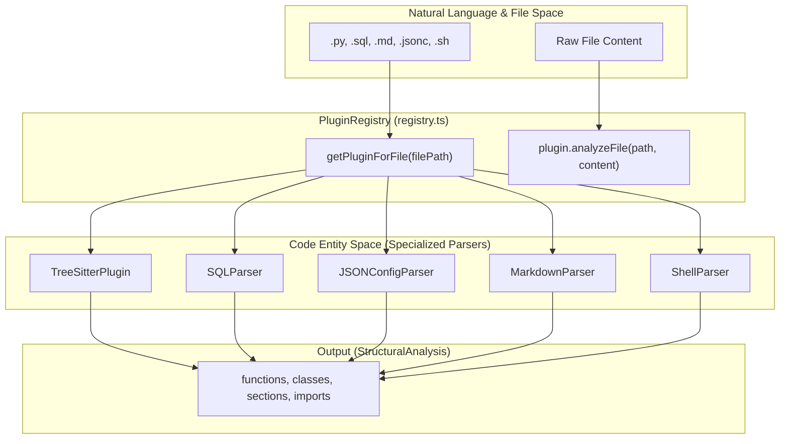
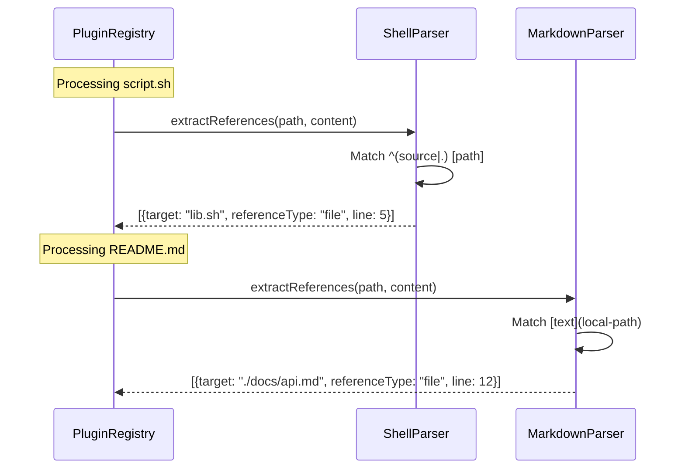

<!-- source: DeepWiki mcp.deepwiki.com · repo Lum1104/Understand-Anything · page 9.2 Creating Custom Plugins · fetched 2026-10-26 -->

# Creating Custom Plugins

<details>
<summary>Relevant source files</summary>

The following files were used as context for generating this wiki page:

- [understand-anything-plugin/packages/core/src/__tests__/domain-types.test.ts](understand-anything-plugin/packages/core/src/__tests__/domain-types.test.ts)
- [understand-anything-plugin/packages/core/src/__tests__/parsers.test.ts](understand-anything-plugin/packages/core/src/__tests__/parsers.test.ts)
- [understand-anything-plugin/packages/core/src/__tests__/plugin-discovery.test.ts](understand-anything-plugin/packages/core/src/__tests__/plugin-discovery.test.ts)
- [understand-anything-plugin/packages/core/src/__tests__/schema.test.ts](understand-anything-plugin/packages/core/src/__tests__/schema.test.ts)
- [understand-anything-plugin/packages/core/src/plugins/extractors/base-extractor.ts](understand-anything-plugin/packages/core/src/plugins/extractors/base-extractor.ts)
- [understand-anything-plugin/packages/core/src/plugins/extractors/types.ts](understand-anything-plugin/packages/core/src/plugins/extractors/types.ts)
- [understand-anything-plugin/packages/core/src/plugins/parsers/dockerfile-parser.ts](understand-anything-plugin/packages/core/src/plugins/parsers/dockerfile-parser.ts)
- [understand-anything-plugin/packages/core/src/plugins/parsers/env-parser.ts](understand-anything-plugin/packages/core/src/plugins/parsers/env-parser.ts)
- [understand-anything-plugin/packages/core/src/plugins/parsers/json-parser.ts](understand-anything-plugin/packages/core/src/plugins/parsers/json-parser.ts)
- [understand-anything-plugin/packages/core/src/plugins/parsers/makefile-parser.ts](understand-anything-plugin/packages/core/src/plugins/parsers/makefile-parser.ts)
- [understand-anything-plugin/packages/core/src/plugins/parsers/markdown-parser.ts](understand-anything-plugin/packages/core/src/plugins/parsers/markdown-parser.ts)
- [understand-anything-plugin/packages/core/src/plugins/parsers/protobuf-parser.ts](understand-anything-plugin/packages/core/src/plugins/parsers/protobuf-parser.ts)
- [understand-anything-plugin/packages/core/src/plugins/parsers/shell-parser.ts](understand-anything-plugin/packages/core/src/plugins/parsers/shell-parser.ts)
- [understand-anything-plugin/packages/core/src/plugins/parsers/terraform-parser.ts](understand-anything-plugin/packages/core/src/plugins/parsers/terraform-parser.ts)
- [understand-anything-plugin/packages/core/src/plugins/parsers/yaml-parser.ts](understand-anything-plugin/packages/core/src/plugins/parsers/yaml-parser.ts)
- [understand-anything-plugin/packages/core/src/plugins/tree-sitter-plugin.ts](understand-anything-plugin/packages/core/src/plugins/tree-sitter-plugin.ts)
- [understand-anything-plugin/packages/core/src/schema.ts](understand-anything-plugin/packages/core/src/schema.ts)

</details>


This document guides developers through implementing custom language analyzer plugins and non-code parsers for the Understand Anything system. Custom plugins extend the system's ability to extract structural information from source code, configuration files, and documentation.

---

## Plugin System Overview

The `PluginRegistry` manages a collection of `AnalyzerPlugin` implementations. It maps file extensions and language IDs to specific plugins, providing a unified interface for the `file-analyzer` agent to process diverse file types.

### Core Plugin Interface
Every plugin must implement the `AnalyzerPlugin` interface defined in `packages/core/src/types.ts`.

| Method | Description | Requirement |
| :--- | :--- | :--- |
| `analyzeFile` | Extracts structural entities (functions, classes, sections, etc.) from content. | Mandatory |
| `resolveImports` | Resolves string-based imports to actual file paths. | Optional |
| `extractReferences` | Identifies links between files (e.g., Markdown links, SQL table refs, $ref). | Optional |
| `extractCallGraph` | Maps function calls within the file for behavioral analysis. | Optional |

**Sources:** [understand-anything-plugin/packages/core/src/plugins/registry.ts:11-18](), [understand-anything-plugin/packages/core/src/plugins/tree-sitter-plugin.ts:31-33](), [understand-anything-plugin/packages/core/src/plugins/parsers/shell-parser.ts:8-12]()

---

## Architecture: From File Content to Knowledge Graph

This diagram illustrates how the `PluginRegistry` dispatches analysis tasks to specific implementations, bridging the gap between raw file data and the "Code Entity Space".



**Sources:** [understand-anything-plugin/packages/core/src/plugins/registry.ts:56-66](), [understand-anything-plugin/packages/core/src/plugins/tree-sitter-plugin.ts:203-210](), [understand-anything-plugin/packages/core/src/plugins/parsers/json-parser.ts:76-85]()

---

## Deep Structural Analysis with Tree-sitter

The `TreeSitterPlugin` provides high-fidelity analysis for code-heavy languages. It uses WASM-based grammars to generate Abstract Syntax Trees (ASTs) which are then processed by specialized `LanguageExtractor` implementations.

### Built-in Extractors
The system includes `LanguageExtractor` classes that map AST nodes to common structural types:
*   **WASM Loading**: The plugin initializes by loading `.wasm` grammars from packages like `tree-sitter-typescript` using `LanguageCls.load()` [understand-anything-plugin/packages/core/src/plugins/tree-sitter-plugin.ts:141-150]().
*   **Structural Mapping**: Extractors implement `extractStructure(rootNode)` to identify `functions`, `classes`, `imports`, and `exports` [understand-anything-plugin/packages/core/src/plugins/extractors/types.ts:10-15]().
*   **AST Traversal**: A `traverse` utility recursively visits nodes, while helpers like `findChild` and `getStringValue` simplify data extraction from the AST [understand-anything-plugin/packages/core/src/plugins/extractors/base-extractor.ts:4-33]().

**Sources:** [understand-anything-plugin/packages/core/src/plugins/tree-sitter-plugin.ts:124-160](), [understand-anything-plugin/packages/core/src/plugins/extractors/types.ts:10-19](), [understand-anything-plugin/packages/core/src/plugins/extractors/base-extractor.ts:4-52]()

---

## Implementing Non-Code Parsers

For configuration and documentation formats, specialized parsers extract sections and references without full AST generation.

### 1. Configuration Parsers (JSON/YAML)
These plugins leverage standard libraries but add logic to compute line ranges for top-level keys.

*   **JSONConfigParser**: Supports JSONC (JSON with comments) by stripping comments before parsing [understand-anything-parser/packages/core/src/plugins/parsers/json-parser.ts:11-59](). It extracts top-level keys as `SectionInfo` and identifies `$ref` pointers as `ReferenceResolution` [understand-anything-plugin/packages/core/src/plugins/parsers/json-parser.ts:87-103]().
*   **YAMLConfigParser**: Handles standard YAML and flavored formats like `docker-compose` and `github-actions` [understand-anything-plugin/packages/core/src/plugins/parsers/yaml-parser.ts:14-22](). It supports array-root documents by naming sections based on `name`, `id`, or `kind` fields [understand-anything-plugin/packages/core/src/plugins/parsers/yaml-parser.ts:61-80]().

### 2. Documentation and Shell Parsers
*   **MarkdownParser**: Identifies ATX-style headings (#) while ignoring those inside fenced code blocks [understand-anything-plugin/packages/core/src/plugins/parsers/markdown-parser.ts:41-70](). It extracts local file and image links while skipping external URLs [understand-anything-plugin/packages/core/src/plugins/parsers/markdown-parser.ts:23-39]().
*   **ShellParser**: Detects function definitions (both `name() {` and `function name {` styles) and extracts file references from `source` or `.` commands [understand-anything-plugin/packages/core/src/plugins/parsers/shell-parser.ts:24-40]().

---

## Reference Extraction Flow

The following diagram shows how the system identifies cross-file relationships that are not formal language imports, such as documentation links or shell sourcing.



**Sources:** [understand-anything-plugin/packages/core/src/plugins/parsers/shell-parser.ts:24-40](), [understand-anything-plugin/packages/core/src/plugins/parsers/markdown-parser.ts:23-39]()

---

## Integrating a New Plugin

To integrate a new language analyzer:

1.  **Define the Plugin**: Create a class implementing `AnalyzerPlugin`.
2.  **Declare Support**: Populate the `languages` array with IDs matching the `LanguageRegistry` [understand-anything-plugin/packages/core/src/plugins/parsers/shell-parser.ts:12]().
3.  **Implement analyzeFile**: Return a `StructuralAnalysis` containing entities with valid `lineRange` [understand-anything-plugin/packages/core/src/plugins/parsers/shell-parser.ts:14-22]().
4.  **Discovery Config**: Plugins can be enabled/disabled via `PluginConfig`. The system defaults to enabling `tree-sitter` [understand-anything-plugin/packages/core/src/plugins/discovery.ts:6-7]().

```typescript
// Example Implementation Structure
export class MyCustomParser implements AnalyzerPlugin {
  name = "my-custom-parser";
  languages = ["my-lang"];

  analyzeFile(filePath: string, content: string): StructuralAnalysis {
    // 1. Parse content
    // 2. Extract functions/classes/sections
    // 3. Return StructuralAnalysis object
  }
}
```

**Sources:** [understand-anything-plugin/packages/core/src/plugins/registry.ts:20-25](), [understand-anything-plugin/packages/core/src/plugins/discovery.ts:11-22]()

---

## Testing and Validation

All custom plugins should include unit tests to ensure correct extraction and normalization.

*   **Schema Compliance**: Use `validateGraph` to ensure extracted nodes (like `domain`, `flow`, `step`) and edges (like `contains_flow`) meet the Zod schema requirements [understand-anything-plugin/packages/core/src/__tests__/domain-types.test.ts:68-85]().
*   **Normalization**: Verify that plugins or the schema layer correctly normalize aliases (e.g., `func` -> `function`, `pkg` -> `module`) [understand-anything-plugin/packages/core/src/__tests__/schema.test.ts:122-138]().
*   **Parser Accuracy**: Verify `MarkdownParser` ignores headings inside code fences and `JSONConfigParser` handles comments correctly [understand-anything-plugin/packages/core/src/__tests__/parsers.test.ts:55-74](), [understand-anything-plugin/packages/core/src/__tests__/parsers.test.ts:162-171]().

**Sources:** [understand-anything-plugin/packages/core/src/__tests__/schema.test.ts:122-147](), [understand-anything-plugin/packages/core/src/__tests__/domain-types.test.ts:110-130](), [understand-anything-plugin/packages/core/src/__tests__/parsers.test.ts:17-86]()

---

