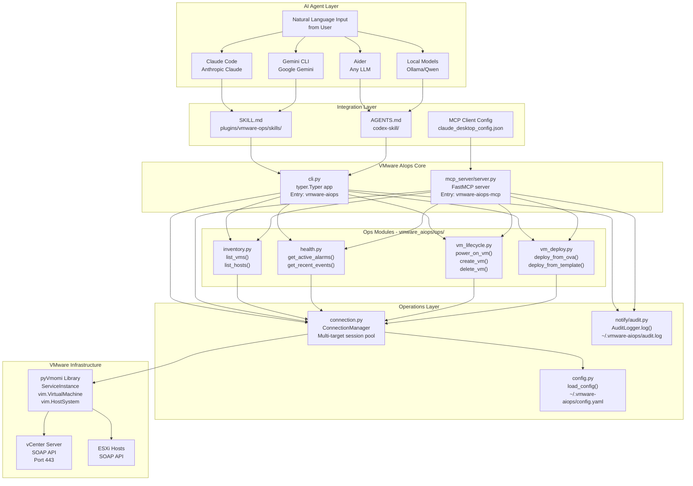
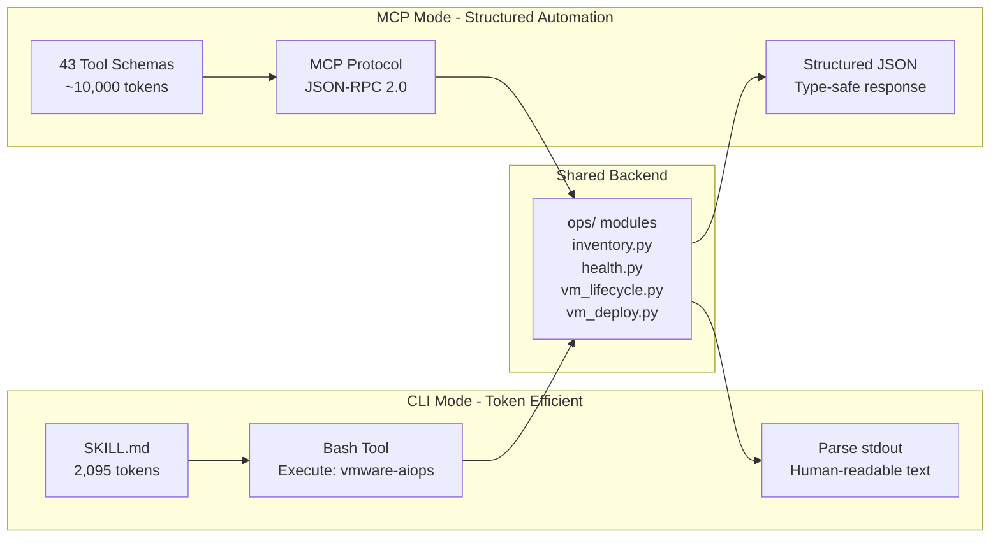
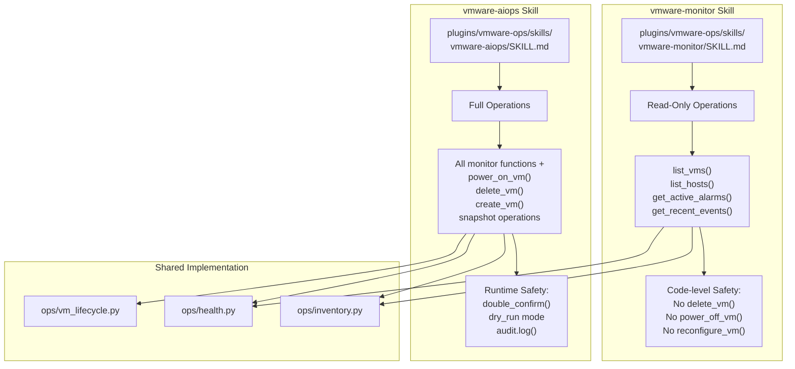
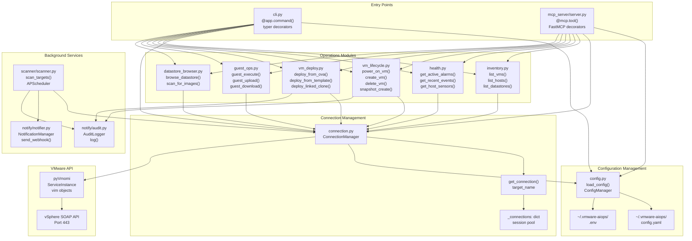
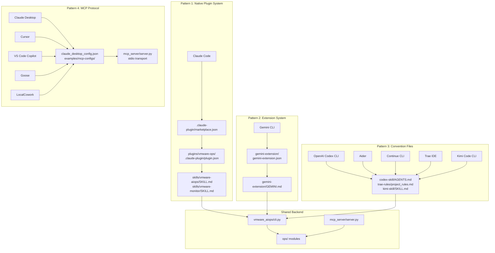
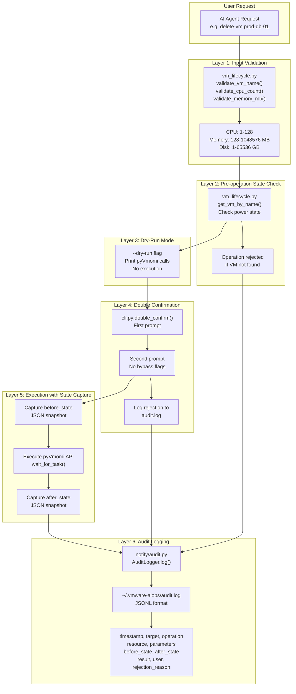

<!-- source: DeepWiki mcp.deepwiki.com · repo zw008/VMware-AIops · page 1 Overview · fetched 2026-10-26 -->

# Overview

<details>
<summary>Relevant source files</summary>

The following files were used as context for generating this wiki page:

- [README-CN.md](README-CN.md)
- [README.md](README.md)
- [pyproject.toml](pyproject.toml)

</details>


This document introduces the VMware AIops system, its architectural design, and core components. For installation instructions, see [Getting Started](#2). For detailed operational guides, see [Operations Guide](#7).

## Purpose and Scope

VMware AIops is an AI-powered automation framework for VMware vSphere infrastructure management. It enables AI coding assistants and agents to perform monitoring and operational tasks on vCenter Server and ESXi hosts through natural language instructions. The system provides both read-only monitoring capabilities and full lifecycle management of virtual machines, with built-in safety mechanisms including double confirmation, dry-run preview, and comprehensive audit logging.

The system solves the token efficiency problem for local AI models while maintaining structured automation capabilities for cloud-based agents through a dual-mode architecture (CLI and MCP), and addresses production safety concerns through a dual-skill architecture (monitor and aiops).

Sources: [README.md:1-967](), [README-CN.md:1-617]()

## System Architecture Overview

VMware AIops operates as a Python-based middleware layer between AI agents and VMware infrastructure, exposing operations through two distinct interfaces optimized for different use cases.



**System Architecture: Natural Language to vSphere API**

The architecture consists of five layers:

1. **AI Agent Layer**: Natural language input processed by various AI platforms (Claude, Gemini, Aider, local models)
2. **Integration Layer**: Platform-specific documentation files that teach AI agents how to invoke VMware AIops
3. **Core Layer**: Dual entry points - `cli.py` for shell-based invocation (~2K token context) and `mcp_server/server.py` for structured tool calling (~10K token context)
4. **Operations Layer**: Shared infrastructure including `ConnectionManager` for pyVmomi session pooling, configuration management, and audit logging
5. **VMware Infrastructure**: Direct SOAP API communication via pyVmomi to vCenter Server or standalone ESXi hosts

Sources: [README.md:68-82](), [vmware_aiops/cli.py](), [vmware_aiops/connection.py](), [vmware_aiops/config.py](), [mcp_server/server.py]()

## Dual-Mode Architecture: CLI vs MCP

VMware AIops provides two operational modes with different token efficiency and automation trade-offs.



**CLI vs MCP Mode Comparison**

| Aspect | CLI Mode | MCP Mode |
|--------|----------|----------|
| **Context Size** | ~2K tokens (SKILL.md) | ~10K tokens (43 tool schemas) |
| **Entry Point** | `vmware_aiops/cli.py:app` | `mcp_server/server.py:main()` |
| **Invocation** | Shell command execution | JSON-RPC tool calls |
| **Best For** | Local models <32B params, cost optimization | Cloud LLMs, automated pipelines |
| **Output Format** | Human-readable text (stdout) | Structured JSON objects |
| **Documentation** | `plugins/vmware-ops/skills/vmware-aiops/SKILL.md`, `codex-skill/AGENTS.md` | MCP tool definitions in `mcp_server/server.py` |
| **Integration** | Claude Code, Gemini, Codex, Aider, Continue, Trae, Kimi | Claude Desktop, Cursor, VS Code Copilot, Goose, LocalCowork |

The CLI mode minimizes token consumption by providing a single Bash execution tool with comprehensive Markdown documentation. AI agents read the documentation once and invoke shell commands. This is critical for local models like Qwen 2.5 Coder 7B-32B which struggle with large context windows.

The MCP mode provides 43 individual tools with JSON schema definitions, enabling type-safe parameter passing and structured responses. This eliminates shell parsing ambiguity and enables reliable agent chaining in automated workflows.

Sources: [README.md:57-66](), [plugins/vmware-ops/skills/vmware-aiops/SKILL.md](), [mcp_server/server.py]()

## Dual-Skill Architecture: Safety Through Code Separation

VMware AIops provides two skill variants with different operational capabilities and safety guarantees.



**Dual-Skill Safety Architecture**

The system provides defense-in-depth safety through two distinct skill definitions:

**vmware-monitor**: Achieves safety through code-level enforcement. The SKILL.md documentation only exposes read-only commands like `inventory vms`, `health alarms`, and `health events`. Destructive operations like `vm delete` or `vm power-off` are documented as unavailable. This prevents AI agents from even attempting destructive operations.

**vmware-aiops**: Provides full operational capabilities including VM lifecycle management (`vm_lifecycle.py:create_vm()`, `vm_lifecycle.py:delete_vm()`, `vm_lifecycle.py:power_off_vm()`), but enforces safety through runtime controls:

- **Double Confirmation**: All destructive operations call `cli.py:double_confirm()` which requires two sequential user confirmations with no bypass flags
- **Dry-Run Preview**: `--dry-run` flag on destructive commands shows exact pyVmomi API calls without execution
- **Input Validation**: Parameter range checking in `vm_lifecycle.py` (CPU: 1-128, Memory: 128-1048576 MB, Disk: 1-65536 GB)
- **Audit Logging**: Every operation logged to `~/.vmware-aiops/audit.log` via `notify/audit.py:AuditLogger.log()` including before/after state and rejection reasons

Deployment strategy: Use **vmware-monitor** skill in production environments where only observability is needed. Use **vmware-aiops** skill in development/test environments where full automation is required with audit trails.

Sources: [README.md:8-8](), [README-CN.md:8-13](), [plugins/vmware-ops/skills/vmware-monitor/SKILL.md](), [plugins/vmware-ops/skills/vmware-aiops/SKILL.md](), [vmware_aiops/cli.py](), [vmware_aiops/ops/vm_lifecycle.py]()

## Core Components and Code Structure

The system follows a layered architecture with clear separation between entry points, business logic, and infrastructure access.



**Component Hierarchy and Dependencies**

### Entry Points

Two independent entry points share the same backend:

- **CLI Mode**: `vmware_aiops/cli.py` - Typer-based command-line application, entry point `vmware-aiops` defined in `pyproject.toml:32`
- **MCP Mode**: `mcp_server/server.py` - FastMCP server using stdio transport, entry point `vmware-aiops-mcp` defined in `pyproject.toml:33`

### Configuration and Connection Management

- **config.py**: `load_config()` reads `~/.vmware-aiops/config.yaml` and `~/.vmware-aiops/.env`, returns `ConfigManager` object with target definitions
- **connection.py**: `ConnectionManager` maintains a session pool (`_connections` dictionary) to avoid repeated authentication. `get_connection(target_name)` returns a pyVmomi `ServiceInstance` for the specified target

### Operations Modules (vmware_aiops/ops/)

All operations modules are stateless functions that accept a `ServiceInstance` and return results:

- **inventory.py**: `list_vms(si, filters)`, `list_hosts(si)`, `list_datastores(si)`, `list_clusters(si)` - Query vSphere inventory
- **health.py**: `get_active_alarms(si)`, `get_recent_events(si, hours, severity)`, `get_host_sensors(si, host)` - Monitoring and health checks
- **vm_lifecycle.py**: `power_on_vm(si, vm_name)`, `create_vm(si, name, cpu, memory, disk)`, `delete_vm(si, vm_name)`, `snapshot_create(si, vm_name, snapshot_name)` - VM lifecycle operations
- **vm_deploy.py**: `deploy_from_ova(si, ova_path, vm_name)`, `deploy_from_template(si, template_name, vm_name)`, `deploy_linked_clone(si, source_vm, snapshot, new_name)` - Deployment operations
- **guest_ops.py**: `guest_execute(si, vm_name, cmd, args, user, password)`, `guest_upload(si, vm_name, local_path, guest_path)` - Guest OS operations (requires VMware Tools)
- **datastore_browser.py**: `browse_datastore(si, datastore_name, path)`, `scan_for_images(si)` - Datastore file browsing

### Background Services

- **scanner/scanner.py**: APScheduler-based daemon that periodically calls `scan_targets()` to check alarms, events, and host logs across all configured targets
- **notify/notifier.py**: `NotificationManager.send_webhook()` sends JSON payloads to configured webhook URLs
- **notify/audit.py**: `AuditLogger.log(operation, resource, params, result)` writes JSONL entries to `~/.vmware-aiops/audit.log`

Sources: [vmware_aiops/cli.py](), [mcp_server/server.py](), [vmware_aiops/config.py](), [vmware_aiops/connection.py](), [vmware_aiops/ops/inventory.py](), [vmware_aiops/ops/health.py](), [vmware_aiops/ops/vm_lifecycle.py](), [vmware_aiops/ops/vm_deploy.py](), [vmware_aiops/ops/guest_ops.py](), [vmware_aiops/ops/datastore_browser.py](), [vmware_aiops/scanner/scanner.py](), [vmware_aiops/notify/notifier.py](), [vmware_aiops/notify/audit.py](), [pyproject.toml:31-33]()

## AI Platform Integration Ecosystem

VMware AIops integrates with 10+ AI platforms through four distinct integration patterns.



**Four Integration Patterns**

### Pattern 1: Native Plugin System (Claude Code)

Claude Code discovers plugins through `.claude-plugin/marketplace.json` which points to `plugins/vmware-ops/.claude-plugin/plugin.json`. This plugin manifest defines two skills accessible via `/vmware-ops:vmware-aiops` and `/vmware-ops:vmware-monitor`. Each skill references a SKILL.md file in `plugins/vmware-ops/skills/` that provides comprehensive command documentation.

Installation: `/plugin marketplace add zw008/VMware-AIops` followed by `/plugin install vmware-ops`

### Pattern 2: Extension System (Gemini CLI)

Gemini CLI uses an extension manifest `gemini-extension/gemini-extension.json` that points to `gemini-extension/GEMINI.md`. The extension is installed via `gemini extensions install ./gemini-extension`.

### Pattern 3: Convention/Rule Files

Multiple AI tools (Codex, Aider, Continue, Trae, Kimi) support loading project-specific documentation files:

- **Codex/Aider/Continue**: Load `codex-skill/AGENTS.md` via `--conventions` flag or `~/.aider.conf.yml`
- **Trae IDE**: Reads `.trae/rules/project_rules.md` from `trae-rules/project_rules.md` template
- **Kimi Code CLI**: Loads `kimi-skill/SKILL.md` from `~/.kimi/skills/vmware-aiops/`

These files contain identical operational documentation but formatted for each platform's conventions system.

### Pattern 4: MCP Protocol

MCP-compatible clients (Claude Desktop, Cursor, VS Code Copilot, Goose, LocalCowork) connect to the MCP server via JSON-RPC over stdio. Configuration examples are in `examples/mcp-configs/` for each client. The server is started via `python -m mcp_server` or the `vmware-aiops-mcp` entry point.

MCP server configuration typically specifies:
```json
{
  "mcpServers": {
    "vmware-aiops": {
      "command": "python",
      "args": ["-m", "mcp_server"],
      "env": {
        "VMWARE_AIOPS_CONFIG": "/path/to/config.yaml"
      }
    }
  }
}
```

Sources: [.claude-plugin/marketplace.json](), [plugins/vmware-ops/.claude-plugin/plugin.json](), [plugins/vmware-ops/skills/vmware-aiops/SKILL.md](), [plugins/vmware-ops/skills/vmware-monitor/SKILL.md](), [gemini-extension/gemini-extension.json](), [gemini-extension/GEMINI.md](), [codex-skill/AGENTS.md](), [trae-rules/project_rules.md](), [kimi-skill/SKILL.md](), [examples/mcp-configs/](), [mcp_server/server.py](), [README.md:268-314]()

## Technology Stack and Dependencies

The system is built on Python 3.10+ with minimal external dependencies for maximum compatibility.

| Component | Technology | Purpose | Defined In |
|-----------|------------|---------|------------|
| **Core Language** | Python 3.10+ | System implementation | `pyproject.toml:11` |
| **vSphere API Client** | pyVmomi >=8.0.3.0 | SOAP API communication with vCenter/ESXi | `pyproject.toml:14` |
| **CLI Framework** | Typer >=0.12 | Command-line interface with double confirmation | `pyproject.toml:16` |
| **Terminal Output** | Rich >=13.0 | Formatted tables and progress indicators | `pyproject.toml:17` |
| **Configuration** | PyYAML >=24.0 | Parse config.yaml | `pyproject.toml:15` |
| **Environment Variables** | python-dotenv >=1.0 | Load .env credentials | `pyproject.toml:20` |
| **Task Scheduling** | APScheduler >=3.10 | Background scanning daemon | `pyproject.toml:18` |
| **HTTP Client** | httpx >=0.27 | Webhook notifications | `pyproject.toml:19` |
| **MCP Server** | mcp[cli] >=1.0 | Model Context Protocol implementation | `pyproject.toml:21` |
| **Build System** | Hatchling | PEP 517 build backend | `pyproject.toml:2` |
| **Testing** | pytest >=8.0, pytest-cov >=5.0 | Unit and integration tests | `pyproject.toml:26-27` |
| **Linting** | Ruff >=0.5 | Code formatting and linting | `pyproject.toml:28` |

### VMware API Coverage

The system interacts with VMware infrastructure exclusively through pyVmomi, which wraps the vSphere SOAP API:

- `vim.VirtualMachine` - VM lifecycle operations in `vm_lifecycle.py`
- `vim.HostSystem` - ESXi host information in `inventory.py` and `health.py`
- `vim.Datastore` - Storage management in `inventory.py` and `datastore_browser.py`
- `vim.host.DatastoreBrowser` - File browsing in `datastore_browser.py`
- `vim.OvfManager` - OVA deployment in `vm_deploy.py`
- `vim.ClusterComputeResource` - Cluster management in `inventory.py`
- `vim.alarm.AlarmManager` - Alarm retrieval in `health.py`
- `vim.event.EventManager` - Event queries in `health.py`

### Version Compatibility

pyVmomi performs automatic API version negotiation during SOAP handshake. The same codebase supports vSphere 6.5, 6.7, 7.0, and 8.0+ without modification. For vSphere 8.0, deprecated APIs like `CreateSnapshot_Task` are replaced with `CreateSnapshotEx_Task` in `vm_lifecycle.py`.

Sources: [pyproject.toml:1-48](), [README.md:84-93](), [README.md:934-949]()

## Safety and Audit Mechanisms

VMware AIops implements defense-in-depth safety through six layers of controls.



**Six-Layer Safety Architecture**

### Layer 1: Input Validation

All parameters are validated in `vmware_aiops/ops/vm_lifecycle.py` before vSphere API calls:
- VM name length and character restrictions
- CPU count: 1-128 cores
- Memory: 128 MB - 1,048,576 MB (1 TB)
- Disk size: 1-65,536 GB (64 TB)

Invalid inputs are rejected immediately with error messages.

### Layer 2: Pre-operation State Validation

Operations check resource existence and current state via `get_vm_by_name(si, vm_name)`. Power state is validated before operations (cannot delete a powered-on VM without `--force`, cannot power on an already running VM).

### Layer 3: Dry-Run Preview

The `--dry-run` flag on any destructive command shows the exact pyVmomi API calls that would be executed without making any changes. Example: `vmware-aiops vm delete my-vm --dry-run` displays the `vim.VirtualMachine.Destroy_Task()` call with target VM details.

### Layer 4: Double Confirmation

Destructive operations in `vmware_aiops/cli.py` call `double_confirm(operation_name)` which requires two sequential user confirmations:

1. First prompt: "Are you sure you want to {operation}? (yes/no)"
2. Second prompt: "Please confirm again: {operation} (yes/no)"

There are no bypass flags like `--force-confirm` or `--yes`. All rejections are logged to `audit.log` with `rejection_reason` field.

### Layer 5: State Capture and Task Synchronization

Before execution:
- Current VM state captured as JSON (power state, CPU, memory, disk, network)
- Stored in `before_state` field

After execution:
- pyVmomi tasks are awaited via `wait_for_task(task)` for synchronous completion
- New VM state captured in `after_state` field
- Task result (success/failure) recorded

### Layer 6: Comprehensive Audit Logging

Every operation is logged via `vmware_aiops/notify/audit.py:AuditLogger.log()` to `~/.vmware-aiops/audit.log` in JSONL format:

```json
{
  "timestamp": "2024-01-15T10:30:45.123Z",
  "target": "prod-vcenter",
  "operation": "vm_delete",
  "resource": "test-vm-01",
  "parameters": {"vm_name": "test-vm-01", "force": false},
  "before_state": {"power_state": "poweredOff", "cpu": 2, "memory_mb": 4096},
  "after_state": null,
  "result": "success",
  "user": "admin",
  "rejection_reason": null
}
```

Rejected operations are also logged:
```json
{
  "timestamp": "2024-01-15T10:32:18.456Z",
  "operation": "vm_power_off",
  "resource": "prod-db-01",
  "rejection_reason": "User declined second confirmation",
  "result": "rejected"
}
```

This audit trail is tamper-evident (append-only JSONL), provides complete operation history for security review and compliance, and enables rollback planning for multi-step operations.

Sources: [vmware_aiops/cli.py](), [vmware_aiops/ops/vm_lifecycle.py](), [vmware_aiops/notify/audit.py](), [README.md:199-214]()

## Related Pages

- For installation instructions and initial setup, see [Getting Started](#2)
- For detailed configuration options, see [Configuration](#2.2)
- For complete CLI command reference, see [CLI Command Reference](#4.1)
- For MCP server setup and tool definitions, see [MCP Mode Usage](#5)
- For AI platform integration guides, see [AI Agent Integration](#6)
- For operational procedures, see [Operations Guide](#7)
- For safety features and best practices, see [Security and Safety](#10)

---

