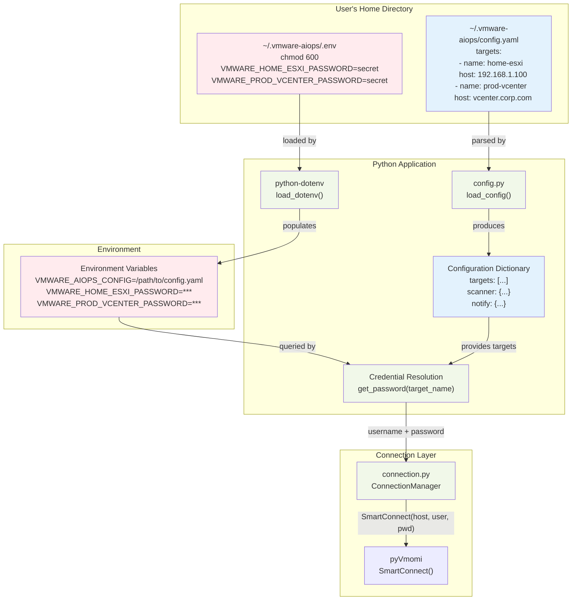
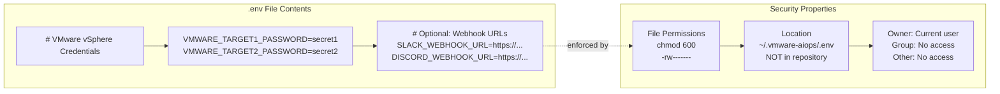
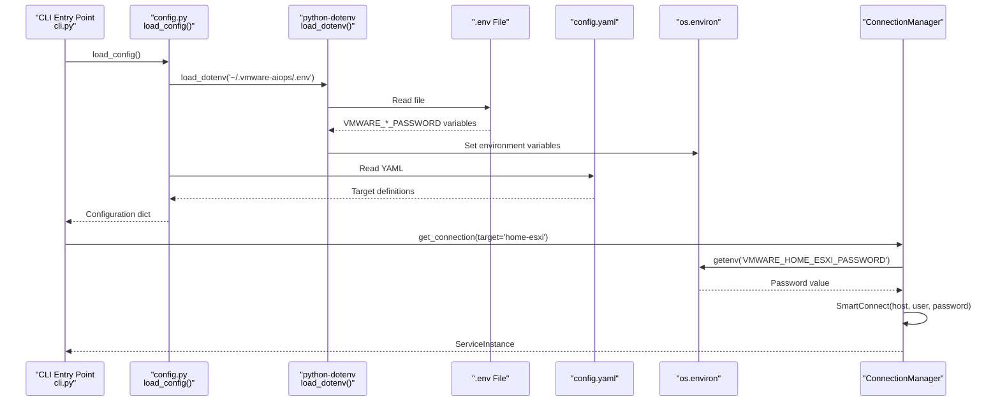
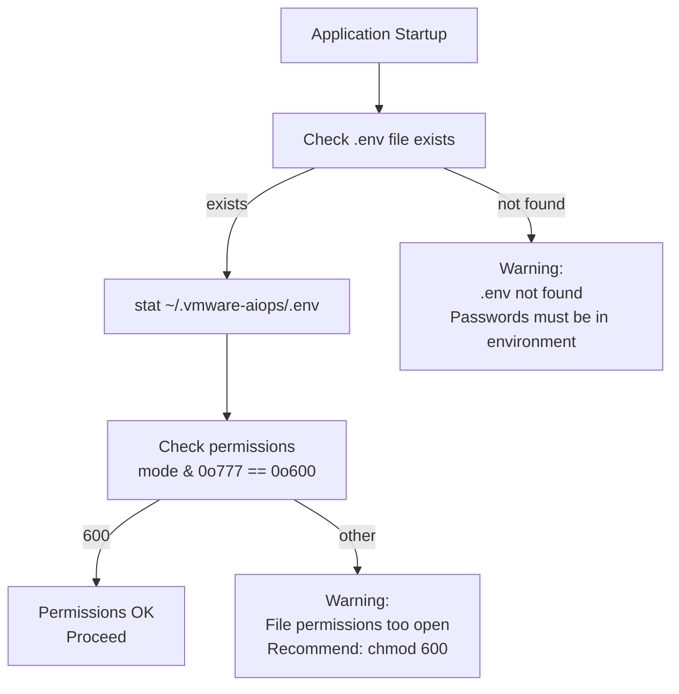
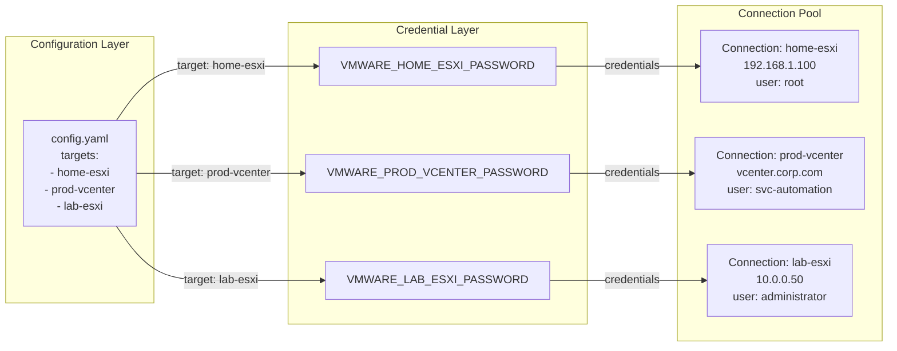

<!-- source: DeepWiki mcp.deepwiki.com · repo zw008/VMware-AIops · page 10.1 Credential Management · fetched 2026-10-26 -->

# Credential Management

<details>
<summary>Relevant source files</summary>

The following files were used as context for generating this wiki page:

- [README.md](README.md)
- [skills/vmware-aiops/SKILL.md](skills/vmware-aiops/SKILL.md)

</details>


This page describes how VMware AIops securely stores and manages vSphere credentials, including password protection mechanisms, configuration file structure, environment variable naming conventions, and best practices for credential security.

For information about audit logging of credential-related operations, see [Audit Logging](#10.2). For input validation and safety rules, see [Input Validation and Safety Rules](#10.3).

---

## Overview

VMware AIops implements a **separation-of-secrets architecture** where sensitive credentials are stored separately from configuration data:

- **Secrets** (passwords, tokens) → `~/.vmware-aiops/.env` (mode 600, owner-only read/write)
- **Configuration** (hostnames, ports, settings) → `~/.vmware-aiops/config.yaml` (can be version-controlled)

This design ensures that passwords never appear in:
- Configuration files committed to version control
- Command-line arguments visible in `ps` output
- Shell history files
- Log files or audit trails

**Sources:** [README.md:351-381](), [skills/vmware-aiops/SKILL.md:493-505]()

---

## Credential Storage Architecture



**Diagram: Credential Storage and Loading Architecture**

The architecture maintains strict separation between secrets and configuration. The `.env` file is loaded via `python-dotenv` into environment variables, while `config.yaml` is parsed to extract target definitions. The credential resolution layer combines these sources to provide username and password pairs to the connection manager.

**Sources:** [vmware_aiops/config.py](), [vmware_aiops/connection.py](), [README.md:351-367]()

---

## Environment Variable Naming Convention

VMware AIops uses a **predictable naming pattern** for password environment variables:

```
VMWARE_{TARGET_NAME_UPPER}_PASSWORD
```

Where `{TARGET_NAME_UPPER}` is the target name from `config.yaml` transformed to uppercase with hyphens replaced by underscores.

### Transformation Rules

| Target Name in config.yaml | Environment Variable Name |
|---------------------------|--------------------------|
| `home-esxi` | `VMWARE_HOME_ESXI_PASSWORD` |
| `prod-vcenter` | `VMWARE_PROD_VCENTER_PASSWORD` |
| `lab_environment` | `VMWARE_LAB_ENVIRONMENT_PASSWORD` |
| `test-cluster-01` | `VMWARE_TEST_CLUSTER_01_PASSWORD` |

### Example Configuration

**config.yaml:**
```yaml
targets:
  - name: home-esxi
    host: 192.168.1.100
    username: root
    type: esxi
    
  - name: prod-vcenter
    host: vcenter.corp.com
    username: svc-automation
    type: vcenter
```

**.env:**
```bash
VMWARE_HOME_ESXI_PASSWORD=MyEsxiPassword123
VMWARE_PROD_VCENTER_PASSWORD=MyVcenterPassword456
```

**Sources:** [README.md:361-367](), [.env.example]()

---

## File Structure and Contents

### .env File Structure



**Diagram: .env File Structure and Security Properties**

The `.env` file must have mode 600 (owner-only read/write) to prevent unauthorized access. This permission check is enforced at application startup.

**Sources:** [README.md:351-359](), [.env.example]()

### config.yaml File Structure

**Complete structure with credential references:**

```yaml
# ~/.vmware-aiops/config.yaml

targets:
  - name: home-esxi                    # Used in VMWARE_HOME_ESXI_PASSWORD
    host: 192.168.1.100
    port: 443
    username: root
    type: esxi
    verify_ssl: false                  # Only for self-signed certs in labs
    
  - name: prod-vcenter                 # Used in VMWARE_PROD_VCENTER_PASSWORD
    host: vcenter.corp.com
    port: 443
    username: svc-automation@vsphere.local
    type: vcenter
    verify_ssl: true                   # Always true in production

scanner:
  enabled: false
  interval_minutes: 15
  severity_threshold: warning
  lookback_hours: 1
  log_types:
    - vpxd
    - hostd
    - vmkernel

notify:
  log_file: ~/.vmware-aiops/scan.log
  webhook_url: null                    # Optional: Set via SLACK_WEBHOOK_URL env var
```

**What is NOT in config.yaml:**
- ❌ Passwords
- ❌ API tokens
- ❌ Authentication secrets
- ✅ Target hostnames, ports, usernames (non-sensitive)
- ✅ Feature flags and operational settings

**Sources:** [config.example.yaml](), [README.md:869-884]()

---

## Configuration Loading Flow



**Diagram: Configuration and Credential Loading Sequence**

The loading sequence ensures that environment variables from `.env` are available before any connection attempts. The `load_dotenv()` function populates `os.environ`, which is then queried by the connection manager using the target-specific variable names.

**Sources:** [vmware_aiops/config.py](), [vmware_aiops/connection.py](), [vmware_aiops/cli.py]()

---

## Credential Resolution in Code

### Configuration Loading

The `config.py` module handles YAML parsing and environment variable loading:

```python
# Pseudocode representation of vmware_aiops/config.py

def load_config():
    """Load configuration from YAML and .env files."""
    
    # 1. Load environment variables from .env file
    env_path = Path.home() / ".vmware-aiops" / ".env"
    if env_path.exists():
        load_dotenv(env_path)
        # Check file permissions (must be 600)
        check_env_permissions(env_path)
    
    # 2. Load config.yaml
    config_path = os.getenv("VMWARE_AIOPS_CONFIG") or \
                  Path.home() / ".vmware-aiops" / "config.yaml"
    
    with open(config_path) as f:
        config = yaml.safe_load(f)
    
    return config

def get_password(target_name: str) -> str:
    """Resolve password from environment variable."""
    env_var = f"VMWARE_{target_name.upper().replace('-', '_')}_PASSWORD"
    return os.getenv(env_var)
```

**Key implementation details:**
- `load_dotenv()` from `python-dotenv` library loads `.env` into `os.environ`
- Permission check ensures `.env` is mode 600
- Password lookup uses dynamic environment variable names
- Fails safely if password is not found

**Sources:** [vmware_aiops/config.py]()

### Connection Manager Usage

The `ConnectionManager` class in `connection.py` uses resolved credentials:

```python
# Pseudocode representation of vmware_aiops/connection.py

class ConnectionManager:
    def __init__(self, config):
        self.config = config
        self.connections = {}  # Target name -> ServiceInstance cache
    
    def get_connection(self, target_name: str):
        """Get or create a connection to the specified target."""
        
        # Check cache first
        if target_name in self.connections:
            return self.connections[target_name]
        
        # Find target configuration
        target = self._find_target(target_name)
        
        # Resolve password from environment
        password = get_password(target_name)
        if not password:
            raise ValueError(f"Password not found for target: {target_name}")
        
        # Establish connection
        si = SmartConnect(
            host=target['host'],
            user=target['username'],
            pwd=password,
            port=target.get('port', 443),
            disableSslCertValidation=not target.get('verify_ssl', True)
        )
        
        # Cache connection
        self.connections[target_name] = si
        return si
```

**Connection lifecycle:**
1. Target name provided by user or auto-detected
2. Password resolved via environment variable lookup
3. `SmartConnect()` called with host, username, and password
4. Connection cached for reuse
5. Password never logged or stored in memory longer than necessary

**Sources:** [vmware_aiops/connection.py]()

---

## Security Best Practices

### Credential Storage Rules

| ✅ DO | ❌ DON'T |
|-------|----------|
| Store passwords in `~/.vmware-aiops/.env` | Hardcode passwords in scripts |
| Set `.env` permissions to 600 | Pass passwords as command-line arguments |
| Use environment variables exclusively | Store passwords in config.yaml |
| Version-control config.yaml (without secrets) | Commit .env to git repositories |
| Review source code before deploying | Export passwords via `export` (visible in history) |

**Sources:** [README.md:369-381]()

### File Permission Enforcement



**Diagram: .env File Permission Validation Flow**

The application checks `.env` permissions at startup and warns if they are too permissive. While not enforced as a hard error (to support CI/CD environments), production deployments should always use mode 600.

**Sources:** [vmware_aiops/config.py]()

### Password Never Appears In

| Location | Status | Reason |
|----------|:------:|--------|
| Command-line arguments | ❌ Never | Visible in `ps`, shell history |
| Config files in git | ❌ Never | Separation of secrets architecture |
| Log files | ❌ Never | Sanitized before logging |
| Audit trail | ❌ Never | Only operation metadata logged |
| Error messages | ❌ Never | Generic errors only |
| Process environment (ps) | ⚠️ Only via export | Use .env file instead |
| Memory longer than needed | ❌ Never | Cleared after connection established |

**Sources:** [README.md:369-381](), [vmware_aiops/notify/audit.py]()

---

## Multi-Target Credential Management

VMware AIops supports multiple vSphere targets with independent credentials:



**Diagram: Multi-Target Credential Resolution**

Each target has its own environment variable for password storage. The ConnectionManager maintains a separate connection pool for each target, allowing simultaneous operations across multiple vSphere environments.

**Sources:** [vmware_aiops/connection.py](), [config.example.yaml]()

---

## Credential Scope and Visibility

```mermaid
graph TB
    subgraph "Outside Application"
        User["User / Admin"]
        Git["Git Repository<br/>(config.yaml only)"]
        CI["CI/CD Pipeline"]
    end
    
    subgraph "File System"
        EnvFile[".env File<br/>chmod 600<br/>SECRETS"]
        ConfigFile["config.yaml<br/>PUBLIC CONFIG"]
    end
    
    subgraph "Application Runtime"
        OsEnviron["os.environ<br/>Loaded from .env"]
        ConfigModule["config.py<br/>Parses YAML"]
        ConnectionMgr["connection.py<br/>Uses credentials"]
    end
    
    subgraph "vSphere Infrastructure"
        VCenter["vCenter Server"]
        ESXi["ESXi Host"]
    end
    
    User -->|"creates/edits"| EnvFile
    User -->|"creates/edits"| ConfigFile
    ConfigFile -->|"can be committed"| Git
    EnvFile -.X.-|"NEVER commit"| Git
    
    CI -->|"sets via CI vars"| OsEnviron
    
    EnvFile -->|"load_dotenv()"| OsEnviron
    ConfigFile -->|"yaml.safe_load()"| ConfigModule
    
    OsEnviron -->|"getenv()"| ConnectionMgr
    ConfigModule -->|"target defs"| ConnectionMgr
    
    ConnectionMgr -->|"SmartConnect(pwd)"| VCenter
    ConnectionMgr -->|"SmartConnect(pwd)"| ESXi
    
    classDef secret fill:#ffebee
    classDef public fill:#e8f5e9
    
    class EnvFile,OsEnviron secret
    class ConfigFile,Git,ConfigModule public
```

**Diagram: Credential Scope and Visibility Boundaries**

Credentials exist only in three locations: (1) the `.env` file on disk with restricted permissions, (2) process environment variables during runtime, and (3) in-memory during active connections. They never appear in version control, logs, or audit trails.

**Sources:** [vmware_aiops/config.py](), [vmware_aiops/connection.py](), [README.md:369-381]()

---

## Webhook Authentication

For optional webhook notifications to Slack or Discord:

**.env:**
```bash
# VMware credentials
VMWARE_HOME_ESXI_PASSWORD=secret123

# Optional: Webhook URLs (disabled by default)
SLACK_WEBHOOK_URL=https://hooks.slack.com/services/YOUR/WEBHOOK/URL
DISCORD_WEBHOOK_URL=https://discord.com/api/webhooks/YOUR/WEBHOOK/URL
```

**Security properties:**
- Webhooks are **disabled by default** (must explicitly configure URL)
- Data sent to **user-configured URLs only** (no third-party services)
- Payloads contain **no credentials, IPs, or PII** (only aggregated alert metadata)
- Webhook URLs stored in `.env` alongside vSphere passwords
- Same permission requirements (mode 600)

**Sources:** [README.md:377-378](), [skills/vmware-aiops/SKILL.md:502-503]()

---

## Initialization Workflow

VMware AIops provides an `init` command to generate configuration templates:

```bash
$ vmware-aiops init
```

**What it creates:**

| File | Location | Content | Permissions |
|------|----------|---------|-------------|
| config.yaml | `~/.vmware-aiops/config.yaml` | Template with example targets | 644 (user discretion) |
| .env | `~/.vmware-aiops/.env` | Template with placeholder passwords | **600** (enforced) |

**Template .env file:**
```bash
# VMware vSphere Credentials
# Replace placeholders with actual passwords

VMWARE_HOME_ESXI_PASSWORD=REPLACE_WITH_ACTUAL_PASSWORD
VMWARE_PROD_VCENTER_PASSWORD=REPLACE_WITH_ACTUAL_PASSWORD

# Optional: Webhook URLs (disabled by default)
# SLACK_WEBHOOK_URL=https://hooks.slack.com/services/...
# DISCORD_WEBHOOK_URL=https://discord.com/api/webhooks/...
```

After running `vmware-aiops init`:
1. Edit `~/.vmware-aiops/config.yaml` to define targets
2. Edit `~/.vmware-aiops/.env` to set passwords
3. Run `chmod 600 ~/.vmware-aiops/.env` to restrict permissions
4. Verify with `vmware-aiops doctor`

**Sources:** [skills/vmware-aiops/SKILL.md:472-477](), [README.md:343-359]()

---

## Least Privilege Recommendations

For vSphere service accounts used by VMware AIops:

### Read-Only Monitoring (vmware-monitor skill)

**Recommended role:** `Read-only`

**Permissions required:**
- System.View
- VirtualMachine.Config.Settings (read-only)
- Host.Config.Settings (read-only)
- Datastore.Browse (read-only)

**Use when:** Only monitoring/inventory operations needed

### Full Operations (vmware-aiops skill)

**Recommended custom role:** `AIops-Automation`

**Minimum permissions:**
- All read-only permissions above
- VirtualMachine.Interact.PowerOn
- VirtualMachine.Interact.PowerOff
- VirtualMachine.Inventory.Create
- VirtualMachine.Inventory.Delete
- VirtualMachine.Config.AddNewDisk
- VirtualMachine.Config.Settings
- VirtualMachine.State.CreateSnapshot
- VirtualMachine.Provisioning.Clone
- Resource.AssignVMToPool

**Avoid:** Using `Administrator@vsphere.local` for automation tasks

**Sources:** [README.md:378](), [skills/vmware-aiops/SKILL.md:504]()

---

## Security Validation

The `vmware-aiops doctor` command includes credential security checks:

```bash
$ vmware-aiops doctor
```

**Checks performed:**

| Check | What It Validates | Pass Criteria |
|-------|------------------|---------------|
| Config file exists | `~/.vmware-aiops/config.yaml` | File found and readable |
| .env file exists | `~/.vmware-aiops/.env` | File found (optional) |
| .env permissions | File mode | Mode 600 or warnings issued |
| Password resolution | Environment variables | All target passwords found |
| Connection test | vSphere authentication | SmartConnect succeeds for each target |

**Example output:**
```
✅ Config file: ~/.vmware-aiops/config.yaml
⚠️  .env file: Permissions too open (644), recommend: chmod 600
✅ Target 'home-esxi': Password found
✅ Target 'home-esxi': Connection successful
```

**Skip auth check** for faster validation:
```bash
$ vmware-aiops doctor --skip-auth
```

**Sources:** [README.md:776-777](), [skills/vmware-aiops/SKILL.md:367]()

---

## Common Pitfalls and Solutions

### Problem: "Password not found" error

**Cause:** Environment variable name mismatch

**Solution:**
```bash
# If target name is "home-esxi-01" in config.yaml:
# Environment variable must be:
VMWARE_HOME_ESXI_01_PASSWORD=secret

# Common mistakes:
# ❌ VMWARE_HOME-ESXI-01_PASSWORD (hyphens not replaced)
# ❌ VMWARE_home_esxi_01_PASSWORD (not uppercase)
# ✅ VMWARE_HOME_ESXI_01_PASSWORD (correct)
```

### Problem: Passwords visible in shell history

**Cause:** Using `export` command

**Solution:**
```bash
# ❌ DON'T: Visible in ~/.bash_history
export VMWARE_HOME_ESXI_PASSWORD=secret123

# ✅ DO: Use .env file
echo "VMWARE_HOME_ESXI_PASSWORD=secret123" >> ~/.vmware-aiops/.env
chmod 600 ~/.vmware-aiops/.env
```

### Problem: .env file ignored

**Cause:** File not in expected location

**Solution:**
```bash
# The .env file must be at:
~/.vmware-aiops/.env

# NOT at:
# - ./.env (project root)
# - /etc/vmware-aiops/.env (system-wide)
# - ~/vmware-aiops/.env (missing dot prefix)
```

**Sources:** [README.md:361-367](), [vmware_aiops/config.py]()

---

