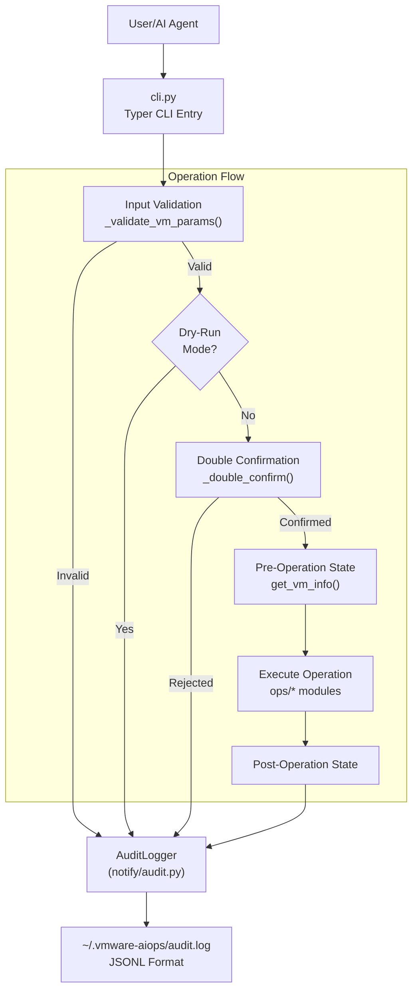
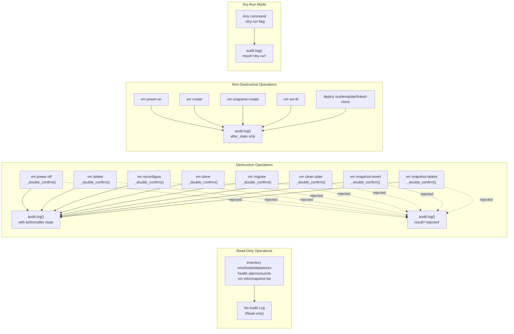
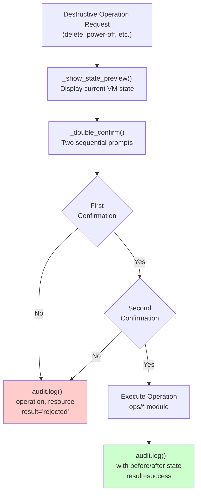

<!-- source: DeepWiki mcp.deepwiki.com · repo zw008/VMware-AIops · page 10.2 Audit Logging · fetched 2026-10-26 -->

# Audit Logging

<details>
<summary>Relevant source files</summary>

The following files were used as context for generating this wiki page:

- [README.md](README.md)
- [skills/vmware-aiops/SKILL.md](skills/vmware-aiops/SKILL.md)
- [vmware_aiops/cli.py](vmware_aiops/cli.py)

</details>


## Purpose and Scope

This document describes the audit logging system in VMware AIops, which records a comprehensive trail of all operations performed through the CLI and MCP server. The audit log provides accountability, security review capabilities, and compliance documentation by capturing operation details, user decisions, state changes, and rejection events.

For information about other safety mechanisms such as double confirmation and input validation, see [Input Validation and Safety Rules](#10.3). For credential management practices, see [Credential Management](#10.1).

---

## Log File Location and Format

The audit log is stored as a JSONL (JSON Lines) file at `~/.vmware-aiops/audit.log`. Each line represents a single log entry encoded as a JSON object. This format enables:

- **Append-only writes**: No file locking or complex serialization required
- **Streaming analysis**: Process logs line-by-line without loading entire file
- **Easy parsing**: Standard JSON parsing libraries work per-line
- **Compatibility**: Works with log aggregation tools like `jq`, Logstash, Fluentd

**Example log location initialization:**
```
~/.vmware-aiops/
├── config.yaml
├── .env
├── audit.log          # JSONL format audit trail
├── plans/
└── image_registry.json
```

**Sources:** [README.md:206](), [skills/vmware-aiops/SKILL.md:312]()

---

## Audit Logging Architecture

The following diagram shows how audit logging integrates with the CLI command execution flow:



**Sources:** [vmware_aiops/cli.py:14-16](), [vmware_aiops/cli.py:82-89](), [vmware_aiops/cli.py:389-395](), [vmware_aiops/cli.py:156-162]()

---

## Log Entry Structure

Each audit log entry is a JSON object with the following fields:

| Field | Type | Description | Example |
|-------|------|-------------|---------|
| `timestamp` | string (ISO 8601) | UTC timestamp of the operation | `"2024-01-15T14:32:18.123456Z"` |
| `target` | string | Target name from config.yaml, or "default" | `"home-esxi"` |
| `operation` | string | Operation identifier | `"power_off"`, `"delete_vm"`, `"create_vm"` |
| `resource` | string | Resource name (VM, host, cluster, etc.) | `"test-vm-01"` |
| `parameters` | object | Operation parameters (optional) | `{"force": true, "dry_run": false}` |
| `before_state` | object | Resource state before operation (optional) | `{"power_state": "poweredOn", "cpu": 4}` |
| `after_state` | object | Resource state after operation (optional) | `{"power_state": "poweredOff"}` |
| `result` | string | Operation result or status | `"VM powered off successfully"`, `"rejected"`, `"dry-run"` |
| `rejection_reason` | string | Reason for rejection (if applicable) | `"User declined confirmation"` |
| `user` | string | User identifier (optional, future enhancement) | `"admin@vsphere.local"` |

**Example audit log entries:**

```json
{"timestamp": "2024-01-15T14:30:05.123Z", "target": "home-esxi", "operation": "power_on", "resource": "web-server-01", "after_state": {"power_state": "poweredOn"}, "result": "VM powered on successfully"}
{"timestamp": "2024-01-15T14:32:18.456Z", "target": "home-esxi", "operation": "power_off", "resource": "web-server-01", "parameters": {"force": false}, "before_state": {"power_state": "poweredOn"}, "after_state": {"power_state": "poweredOff"}, "result": "VM powered off successfully"}
{"timestamp": "2024-01-15T14:35:22.789Z", "target": "home-esxi", "operation": "delete_vm", "resource": "test-vm-03", "result": "rejected"}
{"timestamp": "2024-01-15T14:40:10.012Z", "target": "prod-vcenter", "operation": "reconfigure_vm", "resource": "app-server-05", "parameters": {"dry_run": true, "cpu": 8, "memory_mb": 16384}, "result": "dry-run"}
```

**Sources:** [README.md:206](), [vmware_aiops/cli.py:82-89]()

---

## Operations That Generate Audit Logs

The following diagram maps CLI commands to their audit logging behavior:



**Sources:** [vmware_aiops/cli.py:366-395](), [vmware_aiops/cli.py:398-432](), [vmware_aiops/cli.py:481-520](), [vmware_aiops/cli.py:523-578]()

---

## Audit Log Call Sites in the Codebase

### CLI Module Integration

The `AuditLogger` instance is initialized once at module level and used throughout the CLI:

**Initialization:**
```python
# vmware_aiops/cli.py:14-16
from vmware_aiops.notify.audit import AuditLogger

_audit = AuditLogger()
```

**Key audit logging patterns in cli.py:**

| Operation Category | Function | Audit Call Location | State Captured |
|-------------------|----------|---------------------|----------------|
| VM Power Operations | `vm_power_on()` | [cli.py:389-395]() | after_state |
| VM Power Operations | `vm_power_off()` | [cli.py:424-432]() | before_state, after_state, parameters |
| VM Lifecycle | `vm_create()` | [cli.py:472-478]() | parameters |
| VM Lifecycle | `vm_delete()` | [cli.py:509-520]() | before_state |
| VM Lifecycle | `vm_reconfigure()` | [cli.py:567-578]() | before_state, after_state, parameters |
| Snapshots | `vm_snapshot_create()` | [cli.py:604-610]() | parameters |
| Snapshots | `vm_snapshot_revert()` | [cli.py:658-665]() | before_state, parameters |
| Snapshots | `vm_snapshot_delete()` | [cli.py:691-697]() | parameters |
| Cloning | `vm_clone()` | [cli.py:726-733]() | before_state, parameters |
| Migration | `vm_migrate()` | [cli.py:763-771]() | before_state, after_state, parameters |
| Clean Slate | `vm_clean_slate()` | [cli.py:859-866]() | before_state, parameters |
| Guest Operations | `vm_guest_exec_cmd()` | [cli.py:887-892]() | result only |
| Guest Operations | `vm_guest_upload_cmd()` | [cli.py:919-925]() | result only |
| Guest Operations | `vm_guest_download_cmd()` | [cli.py:943-949]() | result only |
| Deployment | `deploy_ova_cmd()` | [cli.py:1072-1076]() | parameters |
| Deployment | `deploy_template_cmd()` | [cli.py:1110-1114]() | parameters |
| Deployment | `deploy_linked_clone_cmd()` | [cli.py:1148-1152]() | parameters |
| Deployment | `deploy_batch_cmd()` | [cli.py:1198-1203]() | parameters, aggregated result |
| Deployment | `deploy_batch_clone_cmd()` | [cli.py:1249-1253]() | parameters, aggregated result |
| Deployment | `deploy_mark_template()` | [cli.py:1269-1272]() | result |
| Deployment | `deploy_iso_cmd()` | [cli.py:1288-1291]() | parameters |
| Cluster Management | `cluster_create_cmd()` | [cli.py:1352-1356]() | parameters |
| Cluster Management | `cluster_delete_cmd()` | [cli.py:1382-1385]() | before_state |
| Cluster Management | `cluster_add_host_cmd()` | [cli.py:1411-1414]() | parameters |
| Cluster Management | `cluster_remove_host_cmd()` | [cli.py:1440-1443]() | parameters |
| Cluster Management | `cluster_configure_cmd()` | [cli.py:1483-1486]() | parameters |
| Storage | `storage_iscsi_enable_cmd()` | [cli.py:1513-1516]() | result |
| Storage | `storage_iscsi_add_target_cmd()` | [cli.py:1572-1575]() | parameters |
| Storage | `storage_iscsi_remove_target_cmd()` | [cli.py:1602-1605]() | parameters |
| Storage | `storage_rescan_cmd()` | [cli.py:1628-1631]() | result |
| TTL | `vm_set_ttl()` | [cli.py:789-795]() | parameters |

**Sources:** [vmware_aiops/cli.py:14-16](), [vmware_aiops/cli.py:389-395](), [vmware_aiops/cli.py:424-432](), [vmware_aiops/cli.py:509-520](), [vmware_aiops/cli.py:567-578]()

---

## Rejection Logging

A critical security feature is the logging of **rejected operations** when users decline double confirmation prompts. This creates an audit trail of attempted but not executed destructive actions.

**Double confirmation with rejection logging:**



**Implementation in `_double_confirm()`:**

The function at [cli.py:141-163]() raises `typer.Abort` when confirmation is declined, which is caught and logged:

```python
def _double_confirm(action, vm_name, target="default", resource_type="VM"):
    console.print(f"⚠️  即将执行: {action} {resource_type} '{vm_name}'")
    try:
        typer.confirm(f"第 1 次确认: 确定要{action} '{vm_name}'?", abort=True)
        typer.confirm(f"第 2 次确认: 再次确认{action} '{vm_name}'，此操作不可撤销?", abort=True)
    except typer.Abort:
        _audit.log(
            target=target,
            operation=action,
            resource=vm_name,
            result="rejected",
        )
        raise
```

**Example rejection log entries:**
```json
{"timestamp": "2024-01-15T14:35:22.789Z", "target": "home-esxi", "operation": "delete_vm", "resource": "test-vm-03", "result": "rejected"}
{"timestamp": "2024-01-15T15:12:45.321Z", "target": "prod-vcenter", "operation": "关机", "resource": "prod-db-01", "result": "rejected"}
{"timestamp": "2024-01-15T16:20:33.654Z", "target": "prod-vcenter", "operation": "删除集群", "resource": "test-cluster", "result": "rejected"}
```

**Sources:** [vmware_aiops/cli.py:141-163](), [vmware_aiops/cli.py:420-422](), [vmware_aiops/cli.py:505-507](), [README.md:205]()

---

## Dry-Run Mode Logging

When operations are executed with the `--dry-run` flag, the system logs the operation with `result="dry-run"` to maintain a record of what **would have been** executed without making actual changes.

**Dry-run helper function:**

The `_dry_run_print()` function at [cli.py:57-90]() displays the preview and logs the dry-run:

```python
def _dry_run_print(
    *,
    target: str,
    vm_name: str,
    operation: str,
    api_call: str,
    parameters: dict | None = None,
    before_state: dict | None = None,
    expected_after: dict | None = None,
    resource_label: str = "VM",
) -> None:
    """Print a dry-run preview of the API call that would be made."""
    console.print("\n[DRY-RUN] No changes will be made.")
    console.print(f"  Target:    {target}")
    console.print(f"  {resource_label}:        {vm_name}")
    console.print(f"  Operation: {operation}")
    console.print(f"  API Call:  {api_call}")
    # ... display parameters, state ...
    
    _audit.log(
        target=target,
        operation=operation,
        resource=vm_name,
        parameters={"dry_run": True, **(parameters or {})},
        before_state=before_state or {},
        result="dry-run",
    )
```

**Example dry-run log entry:**
```json
{"timestamp": "2024-01-15T14:40:10.012Z", "target": "prod-vcenter", "operation": "reconfigure_vm", "resource": "app-server-05", "parameters": {"dry_run": true, "cpu": 8, "memory_mb": 16384}, "before_state": {"cpu": 4, "memory_mb": 8192}, "result": "dry-run"}
```

**Sources:** [vmware_aiops/cli.py:57-90](), [vmware_aiops/cli.py:377-386](), [vmware_aiops/cli.py:411-419]()

---

## Use Cases for Audit Logs

### Security Review and Compliance

| Use Case | Query Pattern | Example |
|----------|---------------|---------|
| **Identify rejected attempts** | Filter `result="rejected"` | Detect potential unauthorized access attempts or user errors |
| **Track destructive operations** | Filter operations: `delete_vm`, `power_off`, `reconfigure_vm` | Compliance audits for change management |
| **Review parameter changes** | Examine `parameters`, `before_state`, `after_state` | Verify configuration changes match approval |
| **User accountability** | Group by `target` or future `user` field | Attribute actions to specific operators |
| **Dry-run previews** | Filter `result="dry-run"` | Understand what users tested before executing |

### Example Analysis Queries

**Using `jq` to analyze audit logs:**

```bash
# Count rejected operations in the last 24 hours
jq -r 'select(.result == "rejected") | .operation' ~/.vmware-aiops/audit.log | sort | uniq -c

# List all VM deletions with timestamps
jq -r 'select(.operation == "delete_vm") | "\(.timestamp) \(.resource) \(.result)"' ~/.vmware-aiops/audit.log

# Find operations on a specific VM
jq -r 'select(.resource == "prod-web-01")' ~/.vmware-aiops/audit.log

# Identify force power-off operations
jq -r 'select(.operation == "power_off" and .parameters.force == true)' ~/.vmware-aiops/audit.log

# Track dry-run executions by operation type
jq -r 'select(.result == "dry-run") | .operation' ~/.vmware-aiops/audit.log | sort | uniq -c

# Extract all operations with state changes
jq -r 'select(.before_state != null and .after_state != null) | {op: .operation, resource: .resource, before: .before_state, after: .after_state}' ~/.vmware-aiops/audit.log
```

**Sources:** [README.md:206-207](), [skills/vmware-aiops/SKILL.md:312]()

---

## Integration with MCP Server

While the CLI implementation is well-documented with audit logging calls throughout [cli.py](), the MCP server (`mcp_server/server.py`) similarly logs all operations. The MCP server uses the same `AuditLogger` class to ensure consistent audit trail format across both operational modes.

**Operational mode comparison:**

| Mode | Entry Point | AuditLogger Usage | Log Location |
|------|-------------|-------------------|--------------|
| CLI | `vmware_aiops/cli.py` | `_audit = AuditLogger()` at line 16 | `~/.vmware-aiops/audit.log` |
| MCP | `mcp_server/server.py` | Same `AuditLogger` class | `~/.vmware-aiops/audit.log` |

Both modes write to the same audit log file, enabling unified analysis regardless of how operations were invoked (CLI commands vs. MCP tool calls from AI agents).

**Sources:** [vmware_aiops/cli.py:14-16](), [README.md:570-591](), [skills/vmware-aiops/SKILL.md:98-114]()

---

## Log Rotation and Management

The audit log is an append-only file that grows over time. Organizations should implement log rotation based on their retention policies:

**Recommended rotation strategies:**

1. **Log rotation via cron/systemd timer:**
   ```bash
   # Daily rotation with 30-day retention
   logrotate -d /etc/logrotate.d/vmware-aiops
   ```

2. **Manual archival:**
   ```bash
   # Archive current log
   mv ~/.vmware-aiops/audit.log ~/.vmware-aiops/audit.log.$(date +%Y%m%d)
   
   # Compress old logs
   gzip ~/.vmware-aiops/audit.log.20240115
   ```

3. **Centralized log shipping:**
   ```bash
   # Ship to syslog
   tail -f ~/.vmware-aiops/audit.log | logger -t vmware-aiops
   
   # Ship to Elasticsearch/Splunk
   filebeat -c filebeat-vmware-aiops.yml
   ```

**Storage estimates:**
- Average log entry size: ~300-500 bytes (depending on state captured)
- 1000 operations/day ≈ 500KB/day ≈ 15MB/month
- Recommended minimum retention: 90 days (compliance-dependent)

**Sources:** [README.md:206]()

---

## Summary

The audit logging system provides comprehensive accountability for all VMware AIops operations through:

1. **JSONL format** at `~/.vmware-aiops/audit.log` with structured fields
2. **Before/after state capture** for destructive operations
3. **Rejection logging** for declined confirmations
4. **Dry-run logging** for preview operations
5. **Consistent logging** across CLI and MCP modes
6. **Analyzable format** compatible with standard log analysis tools

The audit trail enables security review, compliance reporting, and operational accountability without impacting performance. All operations—successful, rejected, or dry-run—are recorded with sufficient context for reconstruction and analysis.

**Sources:** [README.md:206-207](), [skills/vmware-aiops/SKILL.md:312](), [vmware_aiops/cli.py:14-16](), [vmware_aiops/cli.py:82-89](), [vmware_aiops/cli.py:141-163]()

---

