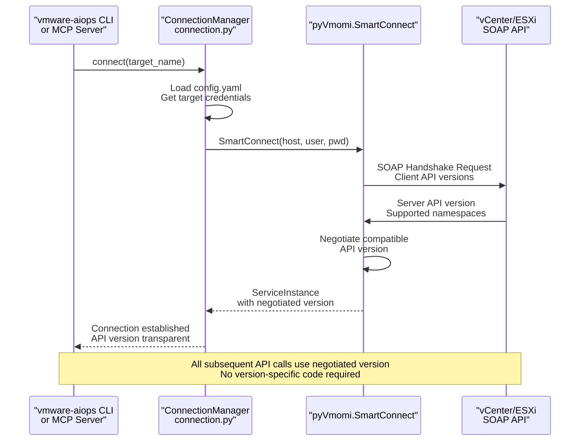
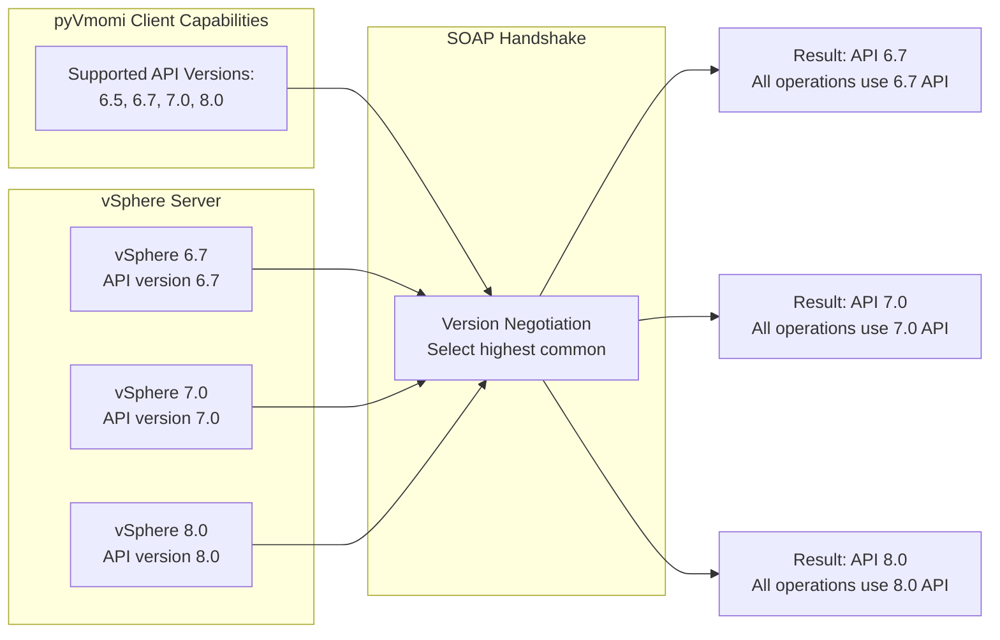
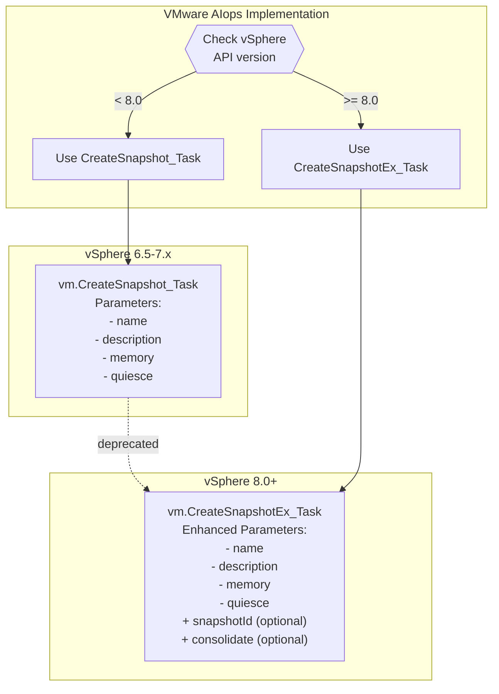
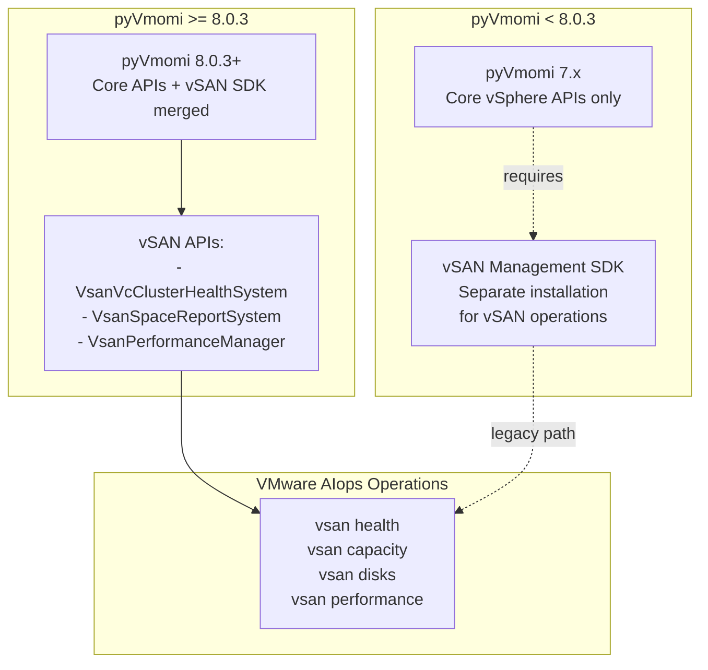
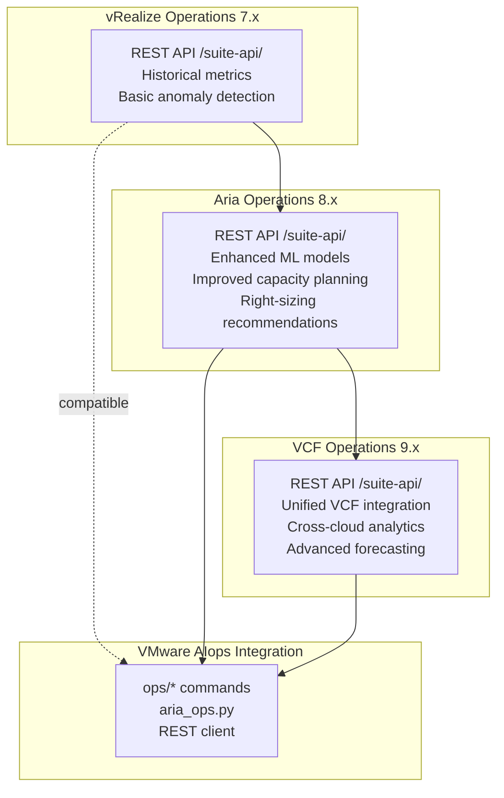
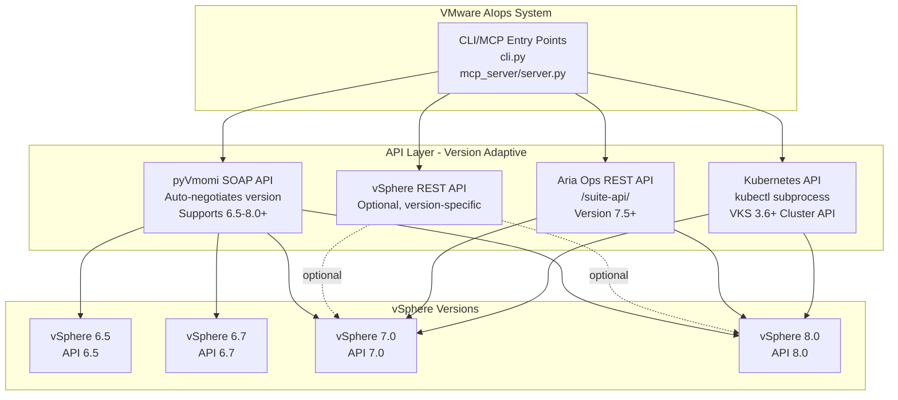

<!-- source: DeepWiki mcp.deepwiki.com · repo zw008/VMware-AIops · page 11 Version Compatibility · fetched 2026-10-26 -->

# Version Compatibility

<details>
<summary>Relevant source files</summary>

The following files were used as context for generating this wiki page:

- [codex-skill/AGENTS.md](codex-skill/AGENTS.md)
- [plugins/vmware-ops/skills/vmware-aiops/SKILL.md](plugins/vmware-ops/skills/vmware-aiops/SKILL.md)
- [skills/vmware-aiops/SKILL.md](skills/vmware-aiops/SKILL.md)

</details>


This page documents VMware vSphere version support, API compatibility, and version-specific features in the VMware AIops system. For security considerations related to TLS and SSL certificate validation across versions, see [Security and Safety](#10). For Python package dependencies and build requirements, see [Package Structure and Build System](#12.1).

## Purpose and Scope

VMware AIops supports multiple vSphere versions through automatic API version negotiation via the pyVmomi library. This page covers:

- Supported vSphere versions (vCenter Server and ESXi)
- API version auto-negotiation behavior
- Version-specific API changes and deprecations
- Dependency version requirements
- Feature availability across vSphere versions

## Supported vSphere Versions

VMware AIops maintains backward compatibility with vSphere 6.5+ through pyVmomi's automatic API version negotiation.

| vSphere Version | Support Level | vCenter | ESXi Standalone | Notes |
|-----------------|---------------|---------|-----------------|-------|
| 8.0 / 8.0U1-U3 | ✅ Full | ✅ | ✅ | All features supported; API deprecations handled |
| 7.0 / 7.0U1-U3 | ✅ Full | ✅ | ✅ | All APIs fully supported |
| 6.7 | ✅ Compatible | ✅ | ✅ | Backward-compatible, tested |
| 6.5 | ✅ Compatible | ✅ | ✅ | Backward-compatible, tested |

**Sources:** [plugins/vmware-ops/skills/vmware-aiops/SKILL.md:319-328](), [skills/vmware-aiops/SKILL.md:319-328](), [codex-skill/AGENTS.md:425-434]()

### Version Support Matrix by Feature Category

```mermaid
graph TB
    subgraph "vSphere 6.5+"
        Inventory["Inventory Operations<br/>list_vms, list_hosts<br/>list_datastores"]
        Health["Health Monitoring<br/>get_active_alarms<br/>get_recent_events"]
        BasicLifecycle["Basic VM Lifecycle<br/>power operations<br/>create, delete, reconfigure"]
        Snapshots65["Snapshots<br/>CreateSnapshot_Task"]
    end
    
    subgraph "vSphere 7.0+"
        AdvancedLifecycle["Advanced Lifecycle<br/>clone, migrate<br/>guest operations"]
        ClusterOps["Cluster Management<br/>HA/DRS configuration<br/>add/remove hosts"]
        iSCSI["Storage Management<br/>iSCSI configuration<br/>rescan operations"]
    end
    
    subgraph "vSphere 8.0+"
        SnapshotsEx["Snapshots (Enhanced)<br/>CreateSnapshotEx_Task"]
        vSANIntegrated["vSAN Management<br/>pyVmomi 8.0.3+ with<br/>integrated vSAN SDK"]
        AriaOps["Aria Operations<br/>REST API /suite-api/<br/>renamed from vRealize"]
    end
    
    subgraph "vSphere 8.0 + VCF 5.0+"
        VKS["vSphere Kubernetes<br/>Tanzu clusters<br/>Cluster API spec"]
    end

    Inventory --> AdvancedLifecycle
    Health --> ClusterOps
    BasicLifecycle --> AdvancedLifecycle
    Snapshots65 -.deprecated in 8.0.-> SnapshotsEx
    AdvancedLifecycle --> vSANIntegrated
    ClusterOps --> AriaOps
    vSANIntegrated --> VKS
```

**Sources:** [plugins/vmware-ops/skills/vmware-aiops/SKILL.md:149-304](), [skills/vmware-aiops/SKILL.md:149-304]()

## API Version Auto-Negotiation

VMware AIops relies on pyVmomi's automatic API version negotiation, eliminating the need for manual version configuration. The negotiation occurs during the SOAP handshake when establishing a connection.

### Connection Flow with Version Negotiation



**Sources:** [codex-skill/AGENTS.md:62-73]()

### Version Negotiation Implementation

The pyVmomi library automatically selects the highest mutually supported API version:

1. **Client Advertisement**: pyVmomi advertises all API versions it supports during connection
2. **Server Response**: vSphere responds with its supported API version and namespaces
3. **Version Selection**: pyVmomi selects the highest common version
4. **Transparent Operation**: All subsequent API calls use the negotiated version without code changes



**Sources:** [plugins/vmware-ops/skills/vmware-aiops/SKILL.md:328](), [skills/vmware-aiops/SKILL.md:328](), [codex-skill/AGENTS.md:434]()

## Version-Specific API Changes

VMware AIops handles version-specific API deprecations and changes to maintain compatibility across vSphere versions.

### vSphere 8.0 API Changes

| API Change | Deprecated | Replacement | Handling in VMware AIops |
|------------|-----------|-------------|--------------------------|
| `SmartConnectNoSSL()` | ❌ Removed in 8.0 | `SmartConnect(disableSslCertValidation=True)` | Uses `SmartConnect` with SSL control parameter |
| `CreateSnapshot_Task` | ⚠️ Deprecated | `CreateSnapshotEx_Task` | Automatically uses `CreateSnapshotEx_Task` for 8.0+ |
| vSAN SDK | Separate package | Merged into pyVmomi 8.0.3+ | No separate installation needed for pyVmomi 8.0.3+ |

**Sources:** [plugins/vmware-ops/skills/vmware-aiops/SKILL.md:323](), [skills/vmware-aiops/SKILL.md:323](), [codex-skill/AGENTS.md:437-440]()

### Snapshot API Evolution



**Sources:** [plugins/vmware-ops/skills/vmware-aiops/SKILL.md:191-194](), [skills/vmware-aiops/SKILL.md:191-194](), [codex-skill/AGENTS.md:268-274]()

### SSL Connection API Evolution

```mermaid
graph LR
    subgraph "vSphere 6.5-7.x"
        OldSSL["SmartConnectNoSSL()<br/>Disable SSL verification"]
        OldSecure["SmartConnect()<br/>SSL verification enabled"]
    end
    
    subgraph "vSphere 8.0+"
        NewAPI["SmartConnect(host, user, pwd,<br/>disableSslCertValidation=True/False)<br/>Unified API with parameter"]
    end
    
    subgraph "config.yaml Setting"
        ConfigSSL["disableSslCertValidation: true<br/>For self-signed certs only"]
    end
    
    OldSSL -.removed in 8.0.-> NewAPI
    OldSecure --> NewAPI
    ConfigSSL --> NewAPI
```

**Sources:** [plugins/vmware-ops/skills/vmware-aiops/SKILL.md:315](), [skills/vmware-aiops/SKILL.md:315](), [codex-skill/AGENTS.md:438]()

## Dependency Version Requirements

VMware AIops requires specific versions of key dependencies to support the full range of vSphere versions and features.

### Core Dependency Stack

| Dependency | Minimum Version | Required For | Notes |
|-----------|----------------|--------------|-------|
| `pyVmomi` | 8.0.3+ | vSAN SDK integration | Earlier versions require separate vSAN SDK |
| `python` | 3.8+ | All operations | Type hints, async features |
| `requests` | 2.25+ | Aria Operations REST API | HTTP client for `/suite-api/` |
| `pyyaml` | 5.4+ | Configuration parsing | `config.yaml` loader |
| `python-dotenv` | 0.19+ | Credential management | `.env` file support |
| `typer` | 0.9+ | CLI interface | Command-line argument parsing |
| `fastmcp` | Latest | MCP server | MCP protocol implementation |

**Sources:** The dependency information is inferred from the SKILL.md descriptions of features and requirements.

### pyVmomi Version and vSAN SDK



**Sources:** [plugins/vmware-ops/skills/vmware-aiops/SKILL.md:240-250](), [skills/vmware-aiops/SKILL.md:240-250](), [codex-skill/AGENTS.md:327-360]()

## Feature-Specific Version Requirements

Certain advanced features require minimum vSphere versions due to API availability or architectural changes.

### vSAN Management

**Minimum Version**: vSphere 6.0+ with vSAN enabled clusters  
**Optimal Version**: vSphere 7.0+ for full health check API  
**pyVmomi Requirement**: 8.0.3+ for integrated SDK

Features by version:

| Feature | vSphere 6.5 | vSphere 7.0 | vSphere 8.0 |
|---------|-------------|-------------|-------------|
| Health Check | ✅ Basic | ✅ Full | ✅ Full + Enhanced |
| Capacity Reporting | ✅ | ✅ | ✅ |
| Disk Group Management | ✅ | ✅ | ✅ |
| Performance Metrics | ⚠️ Limited | ✅ Full | ✅ Full + Real-time |

**Sources:** [plugins/vmware-ops/skills/vmware-aiops/SKILL.md:240-250](), [skills/vmware-aiops/SKILL.md:240-250]()

### Aria Operations (formerly vRealize Operations)

**Minimum Version**: Aria Operations 8.0+ (vRealize Operations 7.5+ compatible)  
**API Endpoint**: `/suite-api/` REST API  
**Authentication**: `vRealizeOpsToken` bearer token

Version naming:
- **vSphere 6.x - 7.x**: Called "vRealize Operations"
- **vSphere 8.0 / VCF 9.0+**: Rebranded to "Aria Operations" or "VCF Operations"



**Sources:** [plugins/vmware-ops/skills/vmware-aiops/SKILL.md:251-261](), [skills/vmware-aiops/SKILL.md:251-261](), [codex-skill/AGENTS.md:363-389]()

### vSphere Kubernetes Service (VKS)

**Minimum Version**: vSphere 7.0 with Tanzu  
**Optimal Version**: vSphere 8.0 with VKS 3.6+ (uses Cluster API specification)  
**External Requirement**: `kubectl` binary, valid kubeconfig

VKS API evolution:

| vSphere Version | VKS Version | API Model | Notes |
|-----------------|-------------|-----------|-------|
| 7.0 | VKS 1.0-2.x | Pod VM-based | Initial Tanzu integration |
| 7.0 U3 | VKS 3.0-3.5 | Transitional | Moving to Cluster API |
| 8.0+ | VKS 3.6+ | Cluster API | Kubernetes-native spec |

**Sources:** [plugins/vmware-ops/skills/vmware-aiops/SKILL.md:263-273](), [skills/vmware-aiops/SKILL.md:263-273](), [codex-skill/AGENTS.md:391-410]()

### Cluster Management

**Minimum Version**: vCenter Server 6.0+ (clusters not available on standalone ESXi)  
**Features**: HA, DRS, VSAN, host management

Cluster operations require vCenter Server - they are not available when connecting directly to standalone ESXi hosts.

| Operation | vCenter Required | ESXi Standalone |
|-----------|------------------|-----------------|
| Create Cluster | ✅ | ❌ Not supported |
| Configure HA/DRS | ✅ | ❌ Not supported |
| Add/Remove Hosts | ✅ | ❌ Not supported |
| List VMs in Cluster | ✅ | ❌ Not supported |

**Sources:** [plugins/vmware-ops/skills/vmware-aiops/SKILL.md:274-284](), [skills/vmware-aiops/SKILL.md:274-284]()

## API Integration Layer Version Compatibility



**Sources:** System architecture diagrams provided in the prompt, [plugins/vmware-ops/skills/vmware-aiops/SKILL.md:131-145](), [skills/vmware-aiops/SKILL.md:131-145]()

## Testing and Validation Approach

VMware AIops maintains compatibility through:

1. **Backward Compatibility Testing**: All versions 6.5+ tested in lab environments
2. **API Version Detection**: Runtime detection of deprecated APIs
3. **Graceful Degradation**: Features unavailable in older versions are skipped with informative messages
4. **Documentation**: Version-specific notes in operation descriptions

### Version Detection Pattern

The system does not explicitly check vSphere version in most cases, instead relying on:

1. **pyVmomi Exception Handling**: Catch `vim.fault.MethodNotFound` for APIs unavailable in older versions
2. **Feature Presence**: Check for object/attribute existence before use
3. **Capability Queries**: Use vSphere capability APIs when available

This approach ensures the code works across versions without hardcoded version checks.

**Sources:** [codex-skill/AGENTS.md:425-441]()

## Version-Specific Operational Differences

### vCenter vs ESXi Standalone

Some operations behave differently or are unavailable when connecting to standalone ESXi hosts versus vCenter Server:

| Feature Category | vCenter | ESXi Standalone | Notes |
|------------------|---------|-----------------|-------|
| List Hosts | ✅ All hosts in datacenter | ⚠️ Self only | ESXi returns only itself |
| Clusters | ✅ Full management | ❌ Not available | Clusters are vCenter-only construct |
| vMotion | ✅ Supported | ❌ Not available | Requires multiple hosts |
| DRS/HA | ✅ Supported | ❌ Not available | Cluster-level features |
| Templates | ✅ Supported | ⚠️ Limited | Template VMs exist but less management |

**Sources:** [plugins/vmware-ops/skills/vmware-aiops/SKILL.md:149-304](), [skills/vmware-aiops/SKILL.md:149-304]()

## Recommended Version Combinations

For optimal feature availability and stability:

| Use Case | Recommended vSphere | Recommended pyVmomi | Notes |
|----------|---------------------|---------------------|-------|
| Production (Full Features) | 8.0 U3+ | 8.0.3+ | All features, integrated vSAN SDK |
| Production (Conservative) | 7.0 U3+ | 8.0.3+ | Stable, proven, all core features |
| Home Lab | 7.0 or 8.0 Free | 8.0.3+ | Free ESXi versions supported |
| Legacy Infrastructure | 6.7 | 8.0.3+ | Maintains backward compatibility |
| Minimum Viable | 6.5 | 7.0.0+ | Basic operations only |

**Sources:** [plugins/vmware-ops/skills/vmware-aiops/SKILL.md:319-328](), [skills/vmware-aiops/SKILL.md:319-328]()

## Known Limitations by Version

### vSphere 6.5
- Limited vSAN health check details
- No Cluster API for VKS (VKS not available)
- Basic Aria Operations support

### vSphere 6.7
- VKS not available (requires 7.0+)
- Limited vSAN performance metrics

### vSphere 7.0
- `CreateSnapshot_Task` still supported but use `CreateSnapshotEx_Task` preferred
- VKS uses transitional API (full Cluster API in 8.0)

### vSphere 8.0
- `SmartConnectNoSSL()` removed - must use parameter instead
- `CreateSnapshot_Task` deprecated - use `CreateSnapshotEx_Task`

**Sources:** [codex-skill/AGENTS.md:436-441]()

---

