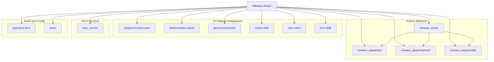
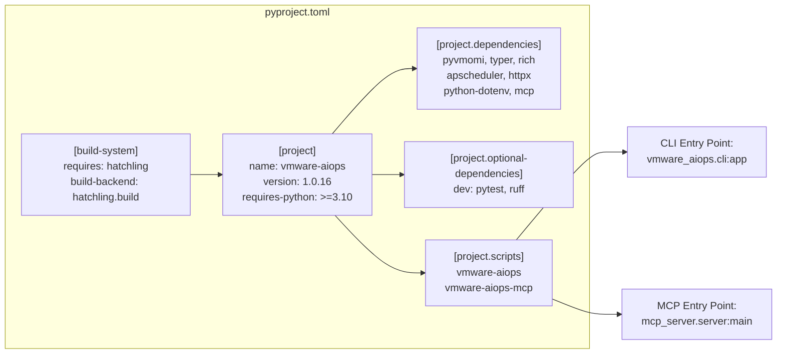
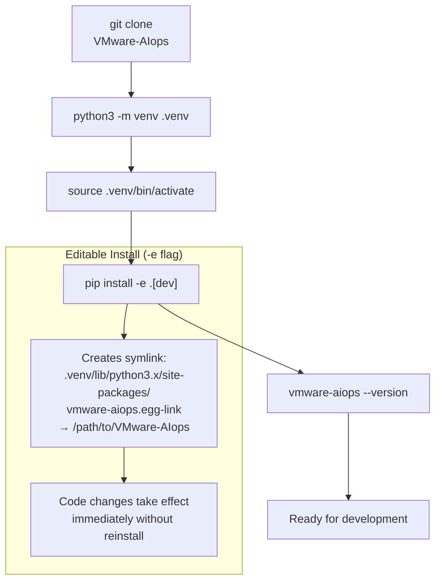
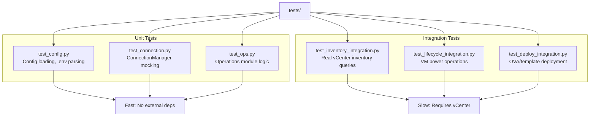
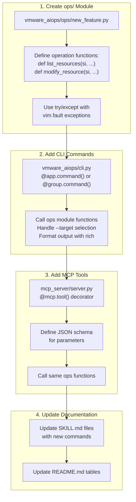
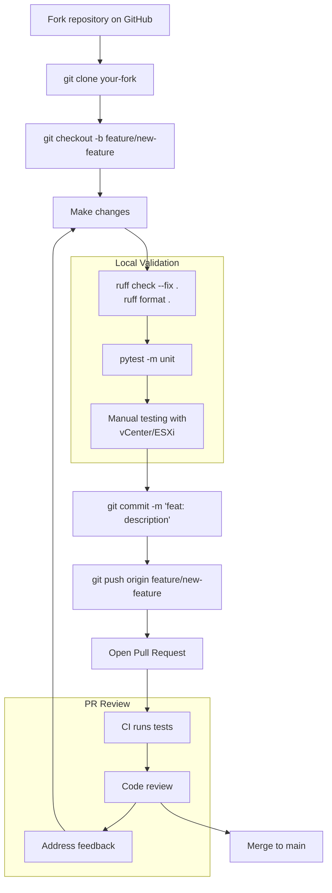
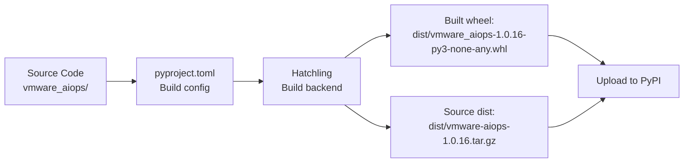

<!-- source: DeepWiki mcp.deepwiki.com · repo zw008/VMware-AIops · page 12 Development and Contributing · fetched 2026-10-26 -->

# Development and Contributing

<details>
<summary>Relevant source files</summary>

The following files were used as context for generating this wiki page:

- [README.md](README.md)
- [pyproject.toml](pyproject.toml)
- [vmware_aiops/__init__.py](vmware_aiops/__init__.py)

</details>


This page provides technical guidance for developers who want to contribute to or extend the VMware AIops codebase. It covers the package structure, build system, development environment setup, testing strategy, and contribution workflow.

For usage documentation, see [Getting Started](#2). For system architecture internals, see [System Architecture](#9).

---

## Package Structure Overview

The VMware AIops codebase follows a modular architecture with clear separation between the Python backend, AI platform integrations, and MCP server implementation.

### Directory Layout



**Sources:** [README.md:888-933](), [pyproject.toml:1-48]()

### Core Backend Modules

| Directory | Purpose | Key Files |
|-----------|---------|-----------|
| `vmware_aiops/` | Core Python package | `__init__.py`, `config.py`, `connection.py`, `cli.py` |
| `vmware_aiops/ops/` | Operations modules | `inventory.py`, `health.py`, `vm_lifecycle.py`, `vm_deploy.py`, `datastore_browser.py`, `cluster_mgmt.py`, `iscsi_config.py`, `vsan.py`, `aria_ops.py`, `vks.py`, `guest_ops.py` |
| `vmware_aiops/scanner/` | Background scanning daemon | `scanner.py` |
| `vmware_aiops/notify/` | Notification and audit logging | `notifier.py`, `audit.py` |
| `mcp_server/` | MCP protocol server | `server.py`, `__main__.py` |
| `tests/` | Test suite | Unit and integration tests |

**Sources:** [README.md:903-914]()

### AI Platform Integration Files

| Directory | Platform | Key Files |
|-----------|----------|-----------|
| `plugins/vmware-ops/` | Claude Code marketplace plugin | `plugin.json`, `skills/vmware-aiops/SKILL.md` |
| `.claude-plugin/` | Claude Code marketplace manifest | `marketplace.json` |
| `skills/` | Skills.sh index | `vmware-aiops/SKILL.md` |
| `gemini-extension/` | Gemini CLI extension | `gemini-extension.json`, `GEMINI.md` |
| `codex-skill/` | OpenAI Codex / Aider / Continue | `SKILL.md`, `AGENTS.md` |
| `trae-rules/` | Trae IDE | `project_rules.md` |
| `kimi-skill/` | Kimi Code CLI | `SKILL.md` |

**Sources:** [README.md:890-924]()

---

## Build System and Packaging

VMware AIops uses modern Python packaging with PEP 517/518 standards via `hatchling` as the build backend.

### Build Configuration Diagram



**Sources:** [pyproject.toml:1-48]()

### Dependencies

The project has carefully versioned dependencies to ensure compatibility:

#### Core Dependencies

| Package | Version Constraint | Purpose |
|---------|-------------------|---------|
| `pyvmomi` | `>=8.0.3.0,<10.0` | vSphere SOAP API client library |
| `typer` | `>=0.12,<1.0` | CLI framework with type hints |
| `rich` | `>=13.0,<15.0` | Terminal formatting and output |
| `apscheduler` | `>=3.10,<4.0` | Background scanning daemon scheduler |
| `httpx` | `>=0.27,<1.0` | Webhook HTTP client |
| `python-dotenv` | `>=1.0,<2.0` | Environment variable loading |
| `mcp[cli]` | `>=1.0,<2.0` | Model Context Protocol server framework |

**Sources:** [pyproject.toml:13-22]()

#### Development Dependencies

Development dependencies are optional and installed via `pip install -e ".[dev]"`:

| Package | Version Constraint | Purpose |
|---------|-------------------|---------|
| `pytest` | `>=8.0,<10.0` | Test framework |
| `pytest-cov` | `>=5.0,<8.0` | Code coverage reporting |
| `ruff` | `>=0.5,<1.0` | Fast Python linter and formatter |

**Sources:** [pyproject.toml:24-29]()

### Entry Points

The package exposes two console scripts defined in `[project.scripts]`:

```python
# Generated console scripts
# vmware-aiops → vmware_aiops.cli:app (Typer CLI application)
# vmware-aiops-mcp → mcp_server.server:main (FastMCP server)
```

**Sources:** [pyproject.toml:31-33]()

---

## Development Environment Setup

### Initial Setup

```bash
# 1. Clone the repository
git clone https://github.com/zw008/VMware-AIops.git
cd VMware-AIops

# 2. Create and activate virtual environment
python3 -m venv .venv
source .venv/bin/activate  # Linux/macOS
# or .venv\Scripts\activate on Windows

# 3. Install in editable mode with dev dependencies
pip install -e ".[dev]"

# 4. Verify installation
vmware-aiops --version
vmware-aiops-mcp --help
```

### Development Installation Workflow



**Sources:** [README.md:330-339]()

### Version Management

The package version is defined in two locations that must be kept in sync:

- [pyproject.toml:7]() - Build metadata: `version = "1.0.16"`
- [vmware_aiops/__init__.py:3]() - Runtime access: `__version__ = "1.0.16"`

When releasing a new version, both files must be updated.

**Sources:** [pyproject.toml:7](), [vmware_aiops/__init__.py:3]()

---

## Testing Strategy

### Test Configuration

The test suite uses `pytest` with markers for test categorization:

```toml
[tool.pytest.ini_options]
testpaths = ["tests"]
markers = [
    "unit: Unit tests",
    "integration: Integration tests (require vCenter)",
]
```

**Sources:** [pyproject.toml:42-47]()

### Test Categories

| Marker | Purpose | Requirements | Execution |
|--------|---------|--------------|-----------|
| `@pytest.mark.unit` | Fast isolated tests | None | Always run in CI |
| `@pytest.mark.integration` | Tests against real vSphere | vCenter/ESXi access | Optional, manual trigger |

### Running Tests

```bash
# Run all unit tests
pytest -m unit

# Run all tests including integration
pytest

# Run specific test file
pytest tests/test_connection.py

# Run with coverage report
pytest --cov=vmware_aiops --cov-report=html

# Run only integration tests
pytest -m integration
```

### Test Structure Diagram



**Sources:** [pyproject.toml:42-47]()

---

## Code Quality Tools

### Ruff Configuration

The project uses Ruff for fast linting and formatting with strict rules:

```toml
[tool.ruff]
line-length = 100
target-version = "py310"

[tool.ruff.lint]
select = ["E", "F", "I", "N", "W", "UP"]
```

**Enabled rule categories:**
- `E` - pycodestyle errors
- `F` - Pyflakes errors
- `I` - isort import sorting
- `N` - pep8-naming conventions
- `W` - pycodestyle warnings
- `UP` - pyupgrade (Python 3.10+ syntax)

**Sources:** [pyproject.toml:35-40]()

### Running Code Quality Checks

```bash
# Lint all Python files
ruff check .

# Auto-fix issues where possible
ruff check --fix .

# Format code
ruff format .

# Check formatting without changes
ruff format --check .
```

### Pre-commit Integration

For contributors, setting up a pre-commit hook is recommended:

```bash
# .git/hooks/pre-commit
#!/bin/bash
ruff check . || exit 1
ruff format --check . || exit 1
pytest -m unit || exit 1
```

**Sources:** [pyproject.toml:35-40]()

---

## Module Development Patterns

### Adding a New Operation Module

When adding new VMware operations functionality, follow this pattern:



### Connection Management Pattern

All operation modules should use the `ConnectionManager` to obtain `ServiceInstance` objects:

```python
# Pattern used throughout ops/ modules
from vmware_aiops.connection import get_connection_manager

def some_operation(target: str, ...):
    """Operation that needs vSphere connection."""
    conn_mgr = get_connection_manager()
    si = conn_mgr.get_connection(target)
    
    try:
        # Use pyVmomi APIs
        content = si.RetrieveContent()
        # ... operation logic
    except vim.fault.VimFault as e:
        # Handle vSphere-specific errors
        raise
    finally:
        # Connections are pooled, no explicit close needed
        pass
```

**Sources:** Based on patterns in [vmware_aiops/ops/]() modules

---

## Contributing Workflow

### Contribution Process Diagram



### Commit Message Convention

Follow conventional commits format:

```
<type>(<scope>): <description>

[optional body]

[optional footer]
```

**Types:**
- `feat` - New feature
- `fix` - Bug fix
- `docs` - Documentation changes
- `test` - Test additions or modifications
- `refactor` - Code refactoring
- `perf` - Performance improvements
- `chore` - Build process or tool changes

**Examples:**
```
feat(ops): add vSAN disk group management
fix(cli): correct snapshot revert confirmation prompt
docs(readme): update installation instructions for uv
test(integration): add VM migration test cases
```

### Pull Request Guidelines

1. **Title:** Use conventional commit format
2. **Description:** Explain what and why, not how
3. **Testing:** Describe manual testing performed
4. **Breaking Changes:** Call out any breaking changes
5. **Documentation:** Update README.md and SKILL.md files if adding features

### Code Review Checklist

Before submitting:

- [ ] Ruff checks pass: `ruff check . && ruff format --check .`
- [ ] Unit tests pass: `pytest -m unit`
- [ ] Manually tested against vCenter/ESXi
- [ ] Documentation updated (README.md, SKILL.md files)
- [ ] Version bumped if needed (pyproject.toml, __init__.py)
- [ ] Commit messages follow convention
- [ ] No hardcoded credentials or sensitive data

**Sources:** [README.md:961-963]()

---

## Building and Releasing

### Build Process



### Building Locally

```bash
# Install build tools
pip install build

# Build wheel and source distribution
python -m build

# Output in dist/
ls -l dist/
# vmware_aiops-1.0.16-py3-none-any.whl
# vmware-aiops-1.0.16.tar.gz

# Install locally for testing
pip install dist/vmware_aiops-1.0.16-py3-none-any.whl
```

### Release Checklist

1. **Update version numbers:**
   - [pyproject.toml:7]() - `version = "X.Y.Z"`
   - [vmware_aiops/__init__.py:3]() - `__version__ = "X.Y.Z"`

2. **Update RELEASE_NOTES.md:**
   - Document all changes since last release
   - Follow conventional changelog format

3. **Run full test suite:**
   ```bash
   pytest
   ruff check .
   ruff format --check .
   ```

4. **Build packages:**
   ```bash
   python -m build
   ```

5. **Tag release:**
   ```bash
   git tag -a v1.0.16 -m "Release version 1.0.16"
   git push origin v1.0.16
   ```

6. **Upload to PyPI:**
   ```bash
   pip install twine
   twine upload dist/*
   ```

7. **Verify installation:**
   ```bash
   pip install vmware-aiops==1.0.16
   vmware-aiops --version
   ```

**Sources:** [pyproject.toml:1-7](), [vmware_aiops/__init__.py:1-3]()

---

## Development Tools Reference

### Essential Commands

| Task | Command |
|------|---------|
| Install dev environment | `pip install -e ".[dev]"` |
| Run unit tests | `pytest -m unit` |
| Run all tests | `pytest` |
| Coverage report | `pytest --cov=vmware_aiops --cov-report=html` |
| Lint code | `ruff check .` |
| Format code | `ruff format .` |
| Build package | `python -m build` |
| Install from wheel | `pip install dist/vmware_aiops-*.whl` |

### Entry Point Testing

```bash
# Test CLI entry point
vmware-aiops --version
vmware-aiops doctor

# Test MCP server entry point
vmware-aiops-mcp --help
python -m mcp_server

# Test with custom config
VMWARE_AIOPS_CONFIG=~/.vmware-aiops/config.yaml vmware-aiops-mcp
```

**Sources:** [pyproject.toml:31-33]()

---

## Contact and Support

For questions, bug reports, or contributions:

- **Email:** zhouwei008@gmail.com
- **Issues:** GitHub Issues on [zw008/VMware-AIops](https://github.com/zw008/VMware-AIops)
- **Pull Requests:** GitHub Pull Requests welcome

**Sources:** [README.md:961-963]()

---

