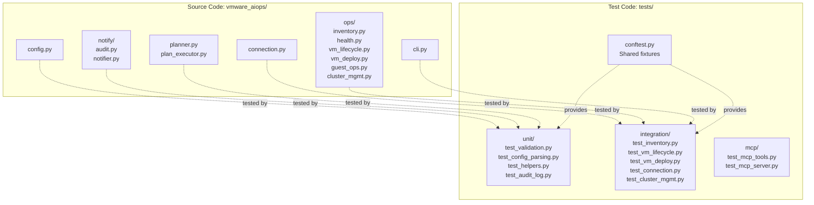
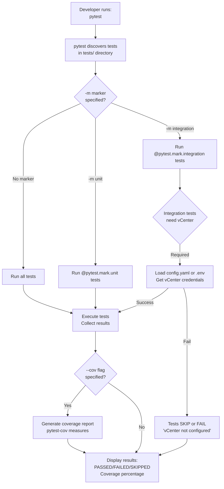
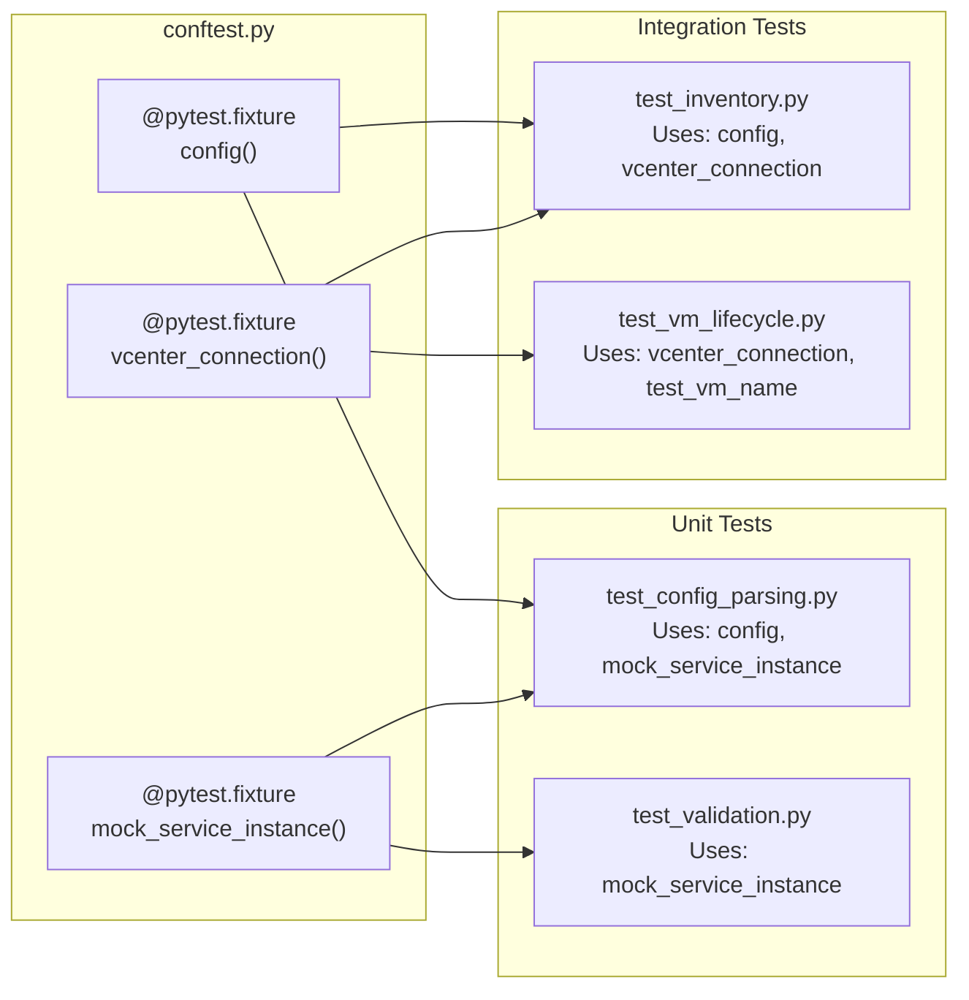
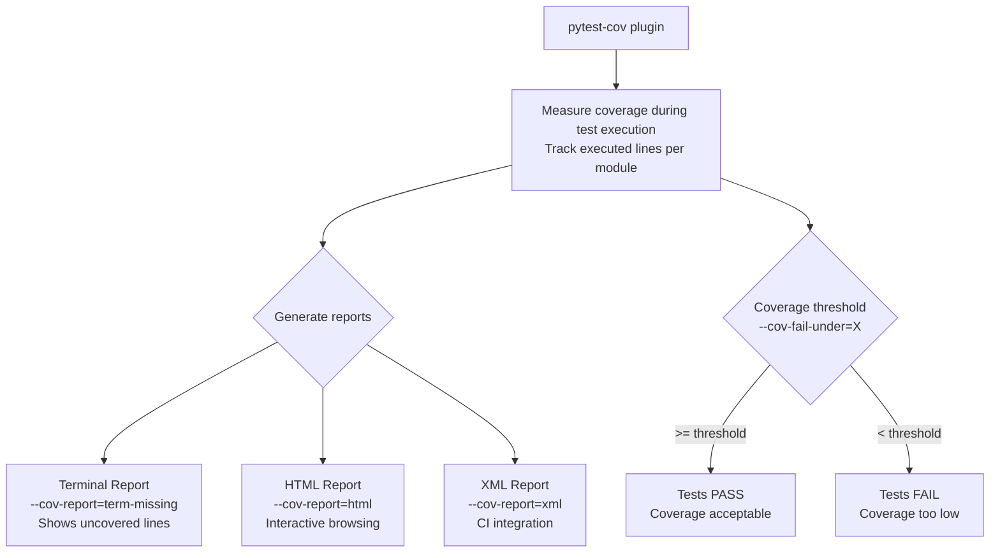
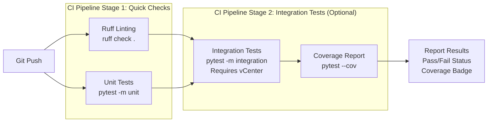

<!-- source: DeepWiki mcp.deepwiki.com · repo zw008/VMware-AIops · page 12.2 Testing Strategy · fetched 2026-10-26 -->

# Testing Strategy

<details>
<summary>Relevant source files</summary>

The following files were used as context for generating this wiki page:

- [pyproject.toml](pyproject.toml)

</details>


## Purpose and Scope

This document describes the testing strategy, infrastructure, and requirements for the VMware AIops codebase. It covers test categories, test organization, execution methods, and quality standards that contributors must meet. For information about the overall package structure and build system, see [Package Structure and Build System](#12.1). For general contribution guidelines beyond testing, see [Development and Contributing](#12).

---

## Test Infrastructure

VMware AIops uses **pytest** as its primary test framework with **pytest-cov** for coverage reporting and **ruff** for code quality checks. The test infrastructure is defined in [pyproject.toml:24-29]() under optional development dependencies.

### Core Testing Dependencies

| Package | Version Constraint | Purpose |
|---------|-------------------|---------|
| `pytest` | >=8.0,<10.0 | Test framework and runner |
| `pytest-cov` | >=5.0,<8.0 | Code coverage measurement |
| `ruff` | >=0.5,<1.0 | Linting and code quality |

### Test Configuration

The pytest configuration is defined in [pyproject.toml:42-47]() and specifies:

- **Test paths**: `tests/` directory contains all test files
- **Test markers**: Two categories of tests are defined:
  - `unit`: Unit tests that do not require external infrastructure
  - `integration`: Integration tests that require a live vCenter connection

```python
# Example marker usage in test files
@pytest.mark.unit
def test_input_validation():
    """Test input validation logic without vCenter"""
    pass

@pytest.mark.integration
def test_vm_creation():
    """Test VM creation against real vCenter"""
    pass
```

**Sources:** [pyproject.toml:24-47]()

---

## Test Categories

VMware AIops defines two distinct test categories to balance test coverage with infrastructure requirements and execution speed.

### Test Category Architecture

```mermaid
graph TB
    subgraph "Test Categories"
        Unit["Unit Tests<br/>@pytest.mark.unit"]
        Integration["Integration Tests<br/>@pytest.mark.integration"]
    end
    
    subgraph "Unit Test Scope"
        UnitInput["Input Validation<br/>validate_vm_name()<br/>validate_cpu_count()"]
        UnitLogic["Business Logic<br/>calculate_ttl()<br/>parse_config()"]
        UnitMock["Mocked API Calls<br/>Mock pyVmomi responses"]
        UnitHelpers["Helper Functions<br/>format_timestamp()<br/>convert_bytes()"]
    end
    
    subgraph "Integration Test Scope"
        IntegAPI["Real API Calls<br/>pyVmomi → vCenter"]
        IntegOps["Operations Modules<br/>ops/inventory.py<br/>ops/vm_lifecycle.py"]
        IntegE2E["End-to-End Workflows<br/>create → snapshot → delete"]
        IntegConnection["Connection Management<br/>ConnectionManager"]
    end
    
    subgraph "Infrastructure Requirements"
        NoInfra["No Infrastructure<br/>Fast execution<br/>CI-friendly"]
        LiveVC["Live vCenter Required<br/>Slower execution<br/>Manual/scheduled runs"]
    end
    
    Unit --> UnitInput
    Unit --> UnitLogic
    Unit --> UnitMock
    Unit --> UnitHelpers
    Unit --> NoInfra
    
    Integration --> IntegAPI
    Integration --> IntegOps
    Integration --> IntegE2E
    Integration --> IntegConnection
    Integration --> LiveVC
```



**Sources:** [pyproject.toml:44-47]()

### Unit Tests (`@pytest.mark.unit`)

Unit tests verify individual functions and classes in isolation without requiring external VMware infrastructure. These tests should:

- **Execute quickly** (< 100ms per test)
- **Use mocks/stubs** for pyVmomi API calls
- **Focus on logic validation**:
  - Input validation rules (CPU: 1-128, Memory: 128-1048576 MB, Disk: 1-65536 GB)
  - Configuration parsing (`config.py` YAML/env loading)
  - Helper functions (formatting, conversion, validation)
  - Audit log serialization (`notify/audit.py` JSONL formatting)
  - Plan generation logic (`planner.py` rollback information)

**Example unit test targets:**
- Validate VM name format restrictions
- Test CPU/memory/disk parameter range validation
- Verify YAML configuration parsing with missing keys
- Test timestamp formatting functions
- Validate audit log JSON structure

### Integration Tests (`@pytest.mark.integration`)

Integration tests verify operations against a real vCenter server and require live infrastructure. These tests should:

- **Require vCenter connection** via `config.yaml` or environment variables
- **Test real API interactions** through pyVmomi
- **Validate end-to-end workflows**:
  - Inventory operations (`ops/inventory.py` list functions)
  - VM lifecycle operations (`ops/vm_lifecycle.py` power, create, delete)
  - Deployment workflows (`ops/vm_deploy.py` OVA/template deployment)
  - Guest operations (`ops/guest_ops.py` command execution)
  - Cluster management (`ops/cluster_mgmt.py` create/configure)
  - Connection pooling (`connection.py` ConnectionManager)

**Example integration test targets:**
- Create VM from template → verify in inventory → delete
- Power on VM → wait for state change → power off
- Create snapshot → revert → delete snapshot
- Deploy OVA → wait for completion → verify deployment
- Execute guest command → verify output

**Sources:** [pyproject.toml:44-47]()

---

## Test Organization Structure

Tests should be organized to mirror the source code structure in the `vmware_aiops/` package.

### Recommended Test Directory Structure



### Test File Naming Convention

| Source File | Unit Test | Integration Test |
|-------------|-----------|------------------|
| `config.py` | `tests/unit/test_config_parsing.py` | N/A |
| `connection.py` | `tests/unit/test_connection_mock.py` | `tests/integration/test_connection.py` |
| `ops/inventory.py` | `tests/unit/test_inventory_validation.py` | `tests/integration/test_inventory.py` |
| `ops/vm_lifecycle.py` | `tests/unit/test_lifecycle_validation.py` | `tests/integration/test_vm_lifecycle.py` |
| `notify/audit.py` | `tests/unit/test_audit_log.py` | N/A |
| `mcp_server/server.py` | `tests/mcp/test_mcp_tools.py` | `tests/mcp/test_mcp_integration.py` |

**Sources:** [pyproject.toml:43]()

---

## Running Tests

### Install Development Dependencies

Before running tests, install the package with development dependencies:

```bash
# Install package in editable mode with dev dependencies
pip install -e ".[dev]"
```

This installs pytest, pytest-cov, and ruff as specified in [pyproject.toml:25-29]().

### Execute Tests

```bash
# Run all tests
pytest

# Run only unit tests (no vCenter required)
pytest -m unit

# Run only integration tests (requires vCenter)
pytest -m integration

# Run tests with coverage report
pytest --cov=vmware_aiops --cov-report=term-missing

# Run tests with coverage and generate HTML report
pytest --cov=vmware_aiops --cov-report=html

# Run specific test file
pytest tests/unit/test_config_parsing.py

# Run specific test function
pytest tests/unit/test_validation.py::test_cpu_count_validation

# Run tests with verbose output
pytest -v

# Run tests and stop on first failure
pytest -x
```

### Test Execution Flow



**Sources:** [pyproject.toml:42-47]()

---

## Test Fixtures and Shared Resources

Test fixtures should be defined in `tests/conftest.py` and made available to all tests.

### Recommended Fixtures

```python
# Example fixture structure (not actual code)
# tests/conftest.py

@pytest.fixture
def config():
    """Load test configuration"""
    pass

@pytest.fixture
def vcenter_connection():
    """Provide vCenter connection for integration tests"""
    # Mark as integration-only
    pytest.mark.integration
    pass

@pytest.fixture
def mock_service_instance():
    """Mock pyVmomi ServiceInstance for unit tests"""
    pass

@pytest.fixture
def test_vm_name():
    """Generate unique VM name for test isolation"""
    return f"test-vm-{uuid.uuid4().hex[:8]}"

@pytest.fixture
def cleanup_test_vms(vcenter_connection):
    """Fixture to clean up test VMs after integration tests"""
    yield
    # Cleanup logic here
    pass
```

### Fixture Usage Pattern



**Sources:** [pyproject.toml:43]()

---

## Testing Requirements by Component

Different components have different testing requirements based on their criticality and complexity.

### Component Testing Matrix

| Component | Unit Test Priority | Integration Test Priority | Key Test Areas |
|-----------|-------------------|---------------------------|----------------|
| `config.py` | **High** | Low | YAML parsing, env variable loading, multi-target config |
| `connection.py` | Medium | **High** | Connection pooling, session management, error handling |
| `ops/inventory.py` | Medium | **High** | List VMs, hosts, datastores, clusters |
| `ops/health.py` | Medium | **High** | Alarms, events, metrics retrieval |
| `ops/vm_lifecycle.py` | **High** | **High** | Power operations, create, delete, snapshot, clone |
| `ops/vm_deploy.py` | Medium | **High** | OVA deployment, template deployment, batch operations |
| `ops/guest_ops.py` | Medium | **High** | Command execution, file upload/download |
| `ops/cluster_mgmt.py` | Medium | **High** | Cluster creation, HA/DRS configuration |
| `notify/audit.py` | **High** | Low | JSONL formatting, state capture, audit logging |
| `planner.py` | **High** | Medium | Plan generation, rollback info, validation |
| `plan_executor.py` | Medium | **High** | Plan execution, rollback, error handling |
| `cli.py` | Low | Medium | Command parsing, output formatting |
| `mcp_server/server.py` | Medium | Medium | MCP protocol compliance, tool registration |

### Critical Test Coverage Areas

```mermaid
graph TB
    subgraph "Safety-Critical: Must Have 100% Test Coverage"
        Safety1["Input Validation<br/>CPU/Memory/Disk ranges<br/>VM name format"]
        Safety2["Double Confirmation<br/>Destructive operation checks"]
        Safety3["Audit Logging<br/>JSONL format validation<br/>State capture"]
        Safety4["Plan Validation<br/>Rollback info generation<br/>Irreversible warnings"]
    end
    
    subgraph "High-Risk Operations: Must Have Integration Tests"
        Risk1["VM Lifecycle<br/>create, delete, snapshot<br/>clone, migrate"]
        Risk2["Cluster Management<br/>cluster create/delete<br/>host add/remove"]
        Risk3["Storage Operations<br/>iSCSI configuration<br/>datastore management"]
        Risk4["Guest Operations<br/>command execution<br/>file operations"]
    end
    
    subgraph "Read-Only Operations: Can Use Mocked Unit Tests"
        ReadOnly1["Inventory Queries<br/>list_vms, list_hosts<br/>list_datastores"]
        ReadOnly2["Health Monitoring<br/>get_alarms, get_events<br/>get_metrics"]
        ReadOnly3["Datastore Browser<br/>browse, scan_images"]
    end
    
    Safety1 -.requires.-> UnitTests["Unit Tests<br/>Fast, CI-friendly"]
    Safety2 -.requires.-> UnitTests
    Safety3 -.requires.-> UnitTests
    Safety4 -.requires.-> UnitTests
    
    Risk1 -.requires.-> IntegTests["Integration Tests<br/>Real vCenter"]
    Risk2 -.requires.-> IntegTests
    Risk3 -.requires.-> IntegTests
    Risk4 -.requires.-> IntegTests
    
    ReadOnly1 -.can use.-> UnitTests
    ReadOnly1 -.should have.-> IntegTests
    ReadOnly2 -.can use.-> UnitTests
    ReadOnly3 -.can use.-> UnitTests
```



**Sources:** [pyproject.toml:44-47]()

---

## Code Quality Checks

In addition to pytest tests, the codebase uses **ruff** for linting and code quality enforcement.

### Ruff Configuration

The ruff linter is configured in [pyproject.toml:35-40]() with the following settings:

- **Line length**: 100 characters maximum
- **Target Python version**: 3.10+
- **Enabled rule sets**:
  - `E`: pycodestyle errors
  - `F`: Pyflakes
  - `I`: isort (import sorting)
  - `N`: pep8-naming
  - `W`: pycodestyle warnings
  - `UP`: pyupgrade (Python version modernization)

### Running Code Quality Checks

```bash
# Run ruff linter
ruff check .

# Run ruff and auto-fix issues
ruff check . --fix

# Check specific file
ruff check vmware_aiops/config.py

# Format code (if ruff formatter is enabled)
ruff format .
```

### Pre-commit Integration

Contributors should run both tests and linting before committing:

```bash
# Run all quality checks
ruff check . --fix
pytest -m unit
pytest -m integration  # If vCenter is available
```

**Sources:** [pyproject.toml:35-40]()

---

## Coverage Requirements

### Minimum Coverage Targets

| Component Type | Unit Test Coverage | Integration Test Coverage | Rationale |
|----------------|-------------------|---------------------------|-----------|
| Input Validation | **100%** | N/A | Safety-critical, must catch all invalid inputs |
| Audit Logging | **100%** | N/A | Compliance requirement, all paths must log |
| Plan Generation | **90%+** | 70%+ | High complexity, critical for multi-step ops |
| VM Lifecycle Ops | 70%+ | **90%+** | Must verify real API interactions |
| Inventory/Health | 60%+ | 80%+ | Lower risk, but should validate API contracts |
| Helper Functions | 80%+ | N/A | Should be thoroughly unit tested |

### Generating Coverage Reports

```bash
# Generate terminal coverage report
pytest --cov=vmware_aiops --cov-report=term-missing

# Generate HTML coverage report (opens in browser)
pytest --cov=vmware_aiops --cov-report=html
open htmlcov/index.html

# Generate both terminal and HTML reports
pytest --cov=vmware_aiops --cov-report=term-missing --cov-report=html

# Fail if coverage is below threshold
pytest --cov=vmware_aiops --cov-fail-under=80
```

### Coverage Report Structure



**Sources:** [pyproject.toml:26-27]()

---

## Integration Test Environment Setup

Integration tests require a live vCenter environment. Here are the requirements and setup instructions.

### vCenter Test Environment Requirements

| Requirement | Specification | Purpose |
|-------------|--------------|---------|
| vCenter Server | 7.0+ or 8.0+ | API compatibility |
| Test Cluster | 1+ ESXi host | Cluster management tests |
| Datastore | 50GB+ free space | VM deployment tests |
| Network | VM Network configured | VM creation tests |
| Test User | vCenter Administrator role | Full API access |
| Template | 1+ VM template | Deployment tests |

### Configuration for Integration Tests

Integration tests should use a separate configuration file or environment variables:

```bash
# Option 1: Use dedicated test config
export VMWARE_CONFIG=tests/fixtures/test_config.yaml

# Option 2: Use environment variables
export VMWARE_TARGET=test-vcenter
export VMWARE_HOST=test-vcenter.example.com
export VMWARE_USER=test-admin@vsphere.local
export VMWARE_PASSWORD=test-password
export VMWARE_DATACENTER=TestDC
export VMWARE_CLUSTER=TestCluster
```

### Test Data Isolation

Integration tests should:
- Use unique VM names with test prefixes (`test-vm-{uuid}`)
- Clean up all created resources after test completion
- Use dedicated test datastores if possible
- Tag test VMs with custom attributes for identification
- Implement fixture cleanup even on test failure

**Sources:** [pyproject.toml:44-47]()

---

## Continuous Integration Recommendations

While not currently implemented in the repository, here are recommendations for CI/CD integration.

### CI Pipeline Structure



### Recommended CI Configuration

**GitHub Actions Example:**
```yaml
# .github/workflows/test.yml (example, not in repo)
name: Tests
on: [push, pull_request]

jobs:
  lint-and-unit-tests:
    runs-on: ubuntu-latest
    steps:
      - uses: actions/checkout@v3
      - uses: actions/setup-python@v4
        with:
          python-version: '3.10'
      - run: pip install -e ".[dev]"
      - run: ruff check .
      - run: pytest -m unit --cov=vmware_aiops

  integration-tests:
    runs-on: ubuntu-latest
    # Only run if vCenter secrets are configured
    if: github.event_name == 'schedule' || github.ref == 'refs/heads/main'
    steps:
      - uses: actions/checkout@v3
      - uses: actions/setup-python@v4
        with:
          python-version: '3.10'
      - run: pip install -e ".[dev]"
      - run: pytest -m integration
        env:
          VMWARE_HOST: ${{ secrets.TEST_VCENTER_HOST }}
          VMWARE_USER: ${{ secrets.TEST_VCENTER_USER }}
          VMWARE_PASSWORD: ${{ secrets.TEST_VCENTER_PASSWORD }}
```

**Sources:** [pyproject.toml:24-47]()

---

## Test Writing Guidelines

### Naming Conventions

- **Test files**: `test_*.py` or `*_test.py`
- **Test functions**: `test_<what_is_being_tested>()`
- **Test classes**: `Test<ComponentName>`

### Test Structure

Follow the **Arrange-Act-Assert** pattern:

```python
@pytest.mark.unit
def test_cpu_count_validation():
    # Arrange: Set up test data
    valid_cpu = 8
    invalid_cpu_low = 0
    invalid_cpu_high = 256
    
    # Act: Execute the function
    result_valid = validate_cpu_count(valid_cpu)
    result_invalid_low = validate_cpu_count(invalid_cpu_low)
    result_invalid_high = validate_cpu_count(invalid_cpu_high)
    
    # Assert: Verify expectations
    assert result_valid is True
    assert result_invalid_low is False
    assert result_invalid_high is False
```

### Documentation

Each test should have a docstring explaining:
- What is being tested
- What the expected behavior is
- Any special setup or preconditions

```python
@pytest.mark.integration
def test_vm_power_on():
    """
    Test VM power on operation against real vCenter.
    
    Preconditions:
    - VM must exist and be powered off
    
    Expected behavior:
    - VM power state changes to POWERED_ON
    - Operation completes within 30 seconds
    - Audit log records the operation
    """
    pass
```

**Sources:** [pyproject.toml:42-47]()

---

## Summary

The VMware AIops testing strategy uses:

1. **pytest** as the test framework with **pytest-cov** for coverage measurement
2. **Two test categories**: `@pytest.mark.unit` for fast, isolated tests and `@pytest.mark.integration` for vCenter-dependent tests
3. **Ruff** for code quality enforcement (line length, import sorting, naming conventions)
4. **Coverage targets**: 100% for safety-critical components, 80%+ for general code
5. **Test organization**: Mirror source structure in `tests/` directory
6. **Fixture pattern**: Shared test fixtures in `conftest.py`

Contributors must ensure:
- All new code includes unit tests
- Safety-critical code (validation, audit, confirmation) has 100% coverage
- Destructive operations have integration tests with cleanup
- Code passes `ruff check .` before commit
- Integration tests clean up all created resources

**Sources:** [pyproject.toml:24-47]()

---

