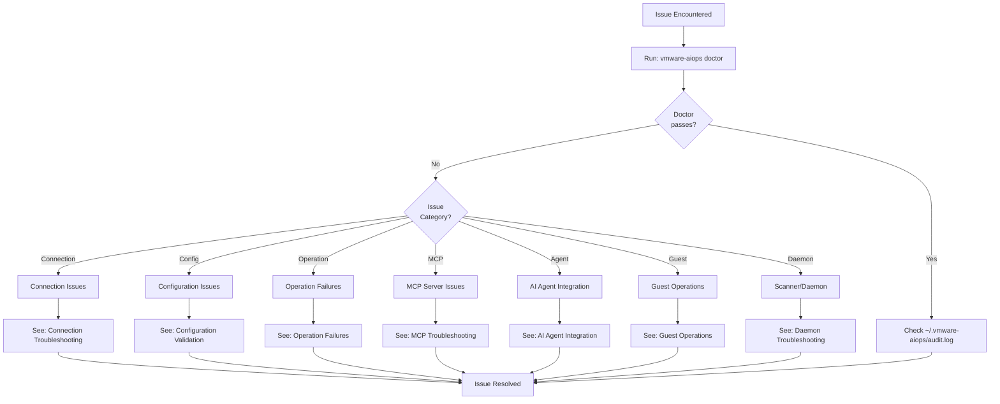
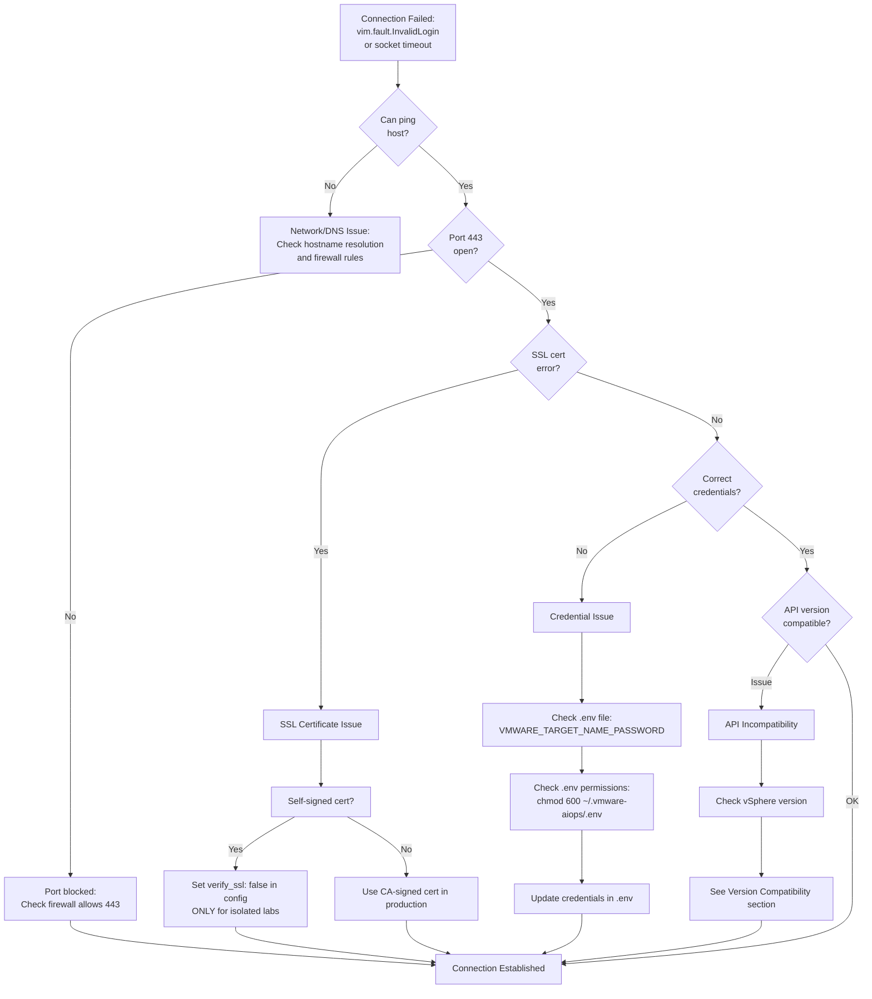
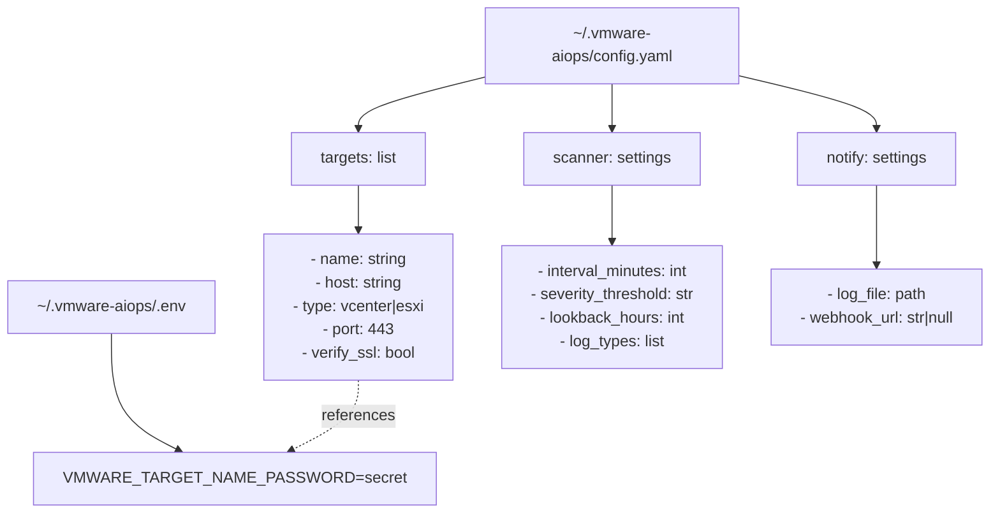
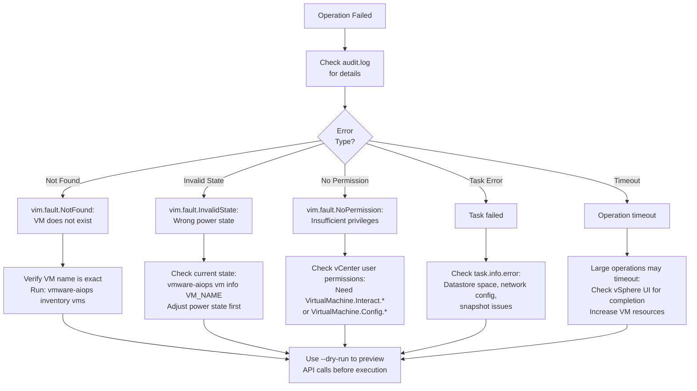
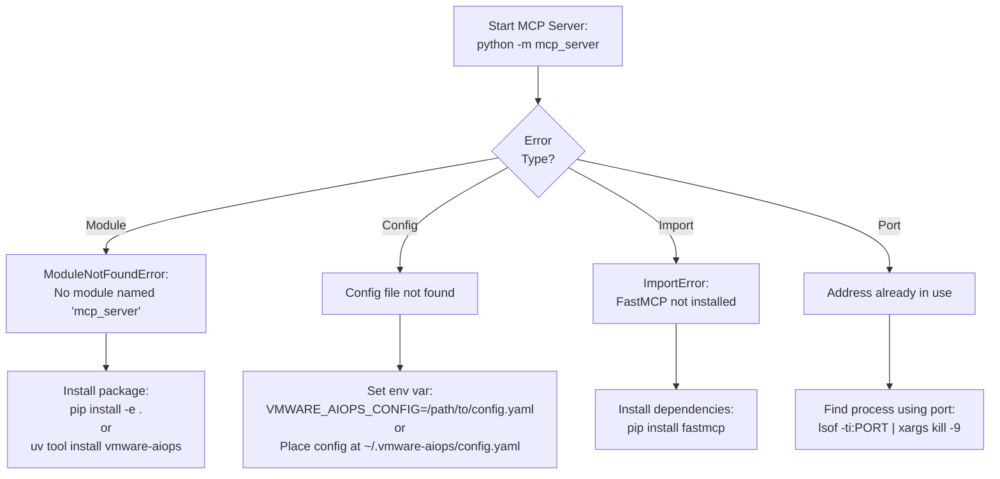
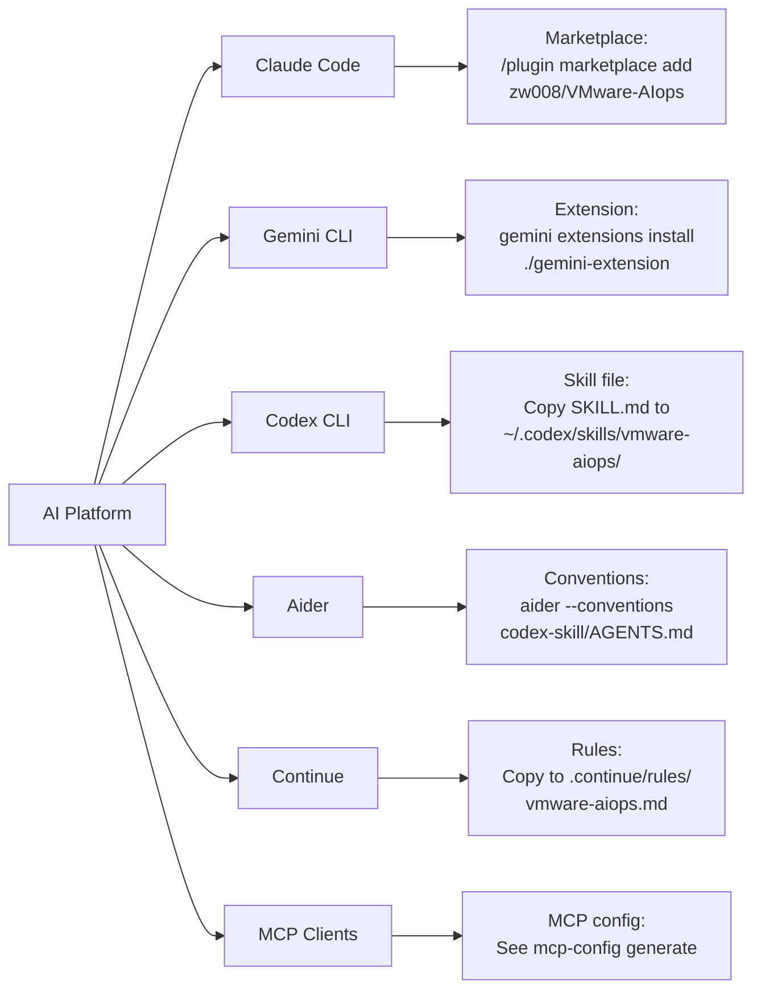
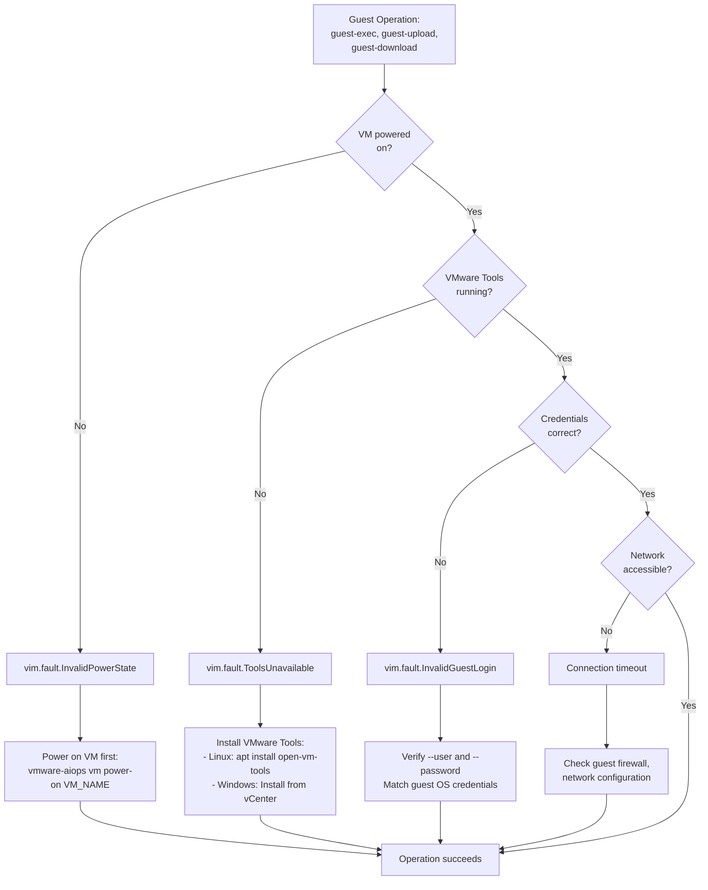
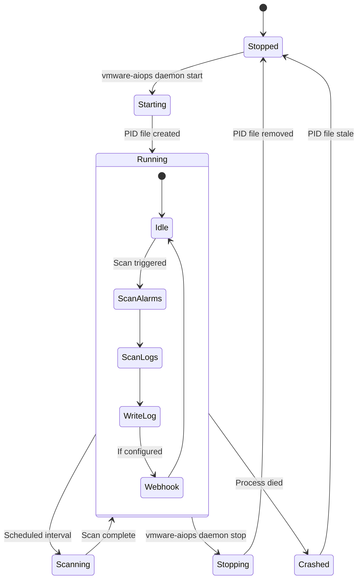
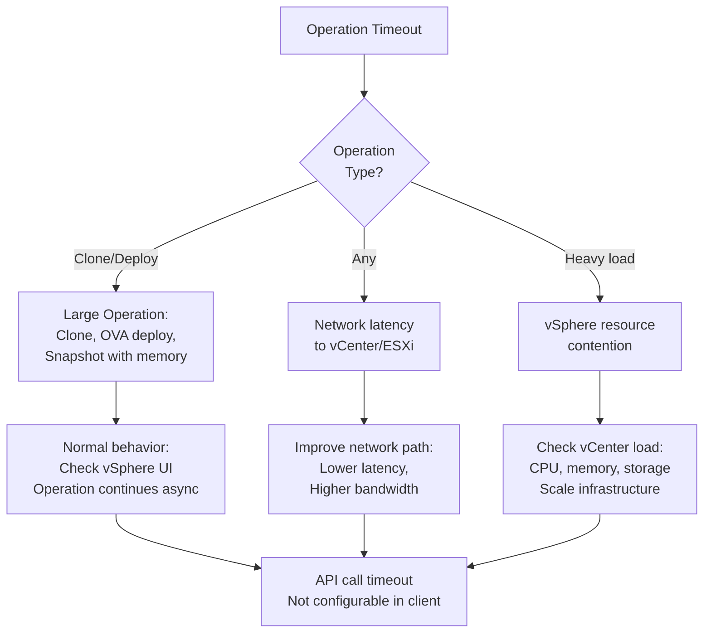

<!-- source: DeepWiki mcp.deepwiki.com · repo zw008/VMware-AIops · page 13 Troubleshooting · fetched 2026-10-26 -->

# Troubleshooting

<details>
<summary>Relevant source files</summary>

The following files were used as context for generating this wiki page:

- [README.md](README.md)
- [vmware_aiops/cli.py](vmware_aiops/cli.py)

</details>


This page provides diagnostic procedures, common error messages, and resolution steps for issues encountered when using VMware AIops. For installation instructions, see [Getting Started](#2). For configuration details, see [Configuration](#2.2). For security-related issues, see [Security and Safety](#10).

The system provides a built-in diagnostic tool via `vmware-aiops doctor` that automatically checks your environment, configuration, and connectivity. Run this command first when encountering issues.

---

## Diagnostic Workflow Overview



**Sources:** [README.md:961-963](), [vmware_aiops/cli.py:1830-1842]()

---

## Using the Doctor Command

The `doctor` command performs automated environment checks and reports issues with actionable remediation steps.

```bash
# Full diagnostic check (includes vSphere authentication)
vmware-aiops doctor

# Quick check (skip vSphere connection test)
vmware-aiops doctor --skip-auth
```

**What it checks:**

| Check Category | Details | Exit Code |
|----------------|---------|-----------|
| Python version | Requires Python 3.10+ | 1 if failed |
| Dependencies | Verifies pyVmomi, typer, rich, etc. | 1 if missing |
| Config file | Checks `~/.vmware-aiops/config.yaml` exists and is valid YAML | 1 if invalid |
| `.env` file | Verifies `.env` exists and has correct permissions (600) | 1 if misconfigured |
| Target definitions | Validates all targets in config have required fields | 1 if invalid |
| Credentials | Checks password environment variables are set | 1 if missing |
| Connectivity | Tests connection to each vCenter/ESXi target (unless `--skip-auth`) | 1 if unreachable |
| Daemon status | Reports if scanner daemon is running | 0 (informational) |

**Exit codes:**
- `0` - All checks passed
- `1` - One or more checks failed (see output for details)

**Sources:** [vmware_aiops/cli.py:1830-1842](), [README.md:776-777]()

---

## Connection Troubleshooting

### Connection Failure Decision Tree



**Sources:** [README.md:84-93](), [README.md:360-381](), [vmware_aiops/cli.py:92-99]()

### Common Connection Errors

| Error Message | Cause | Solution |
|---------------|-------|----------|
| `vim.fault.InvalidLogin: Cannot complete login due to an incorrect user name or password` | Wrong username/password | Verify `.env` file has correct `VMWARE_<TARGET>_PASSWORD` variable |
| `[SSL: CERTIFICATE_VERIFY_FAILED]` | Self-signed certificate | Set `verify_ssl: false` in target config (ESXi only, lab use) |
| `[Errno 111] Connection refused` | Port 443 blocked or service down | Check firewall rules, verify hostd/vpxd is running |
| `[Errno -2] Name or service not known` | DNS resolution failure | Use IP address instead of hostname, or fix DNS |
| `socket.timeout: timed out` | Network latency or firewall | Increase timeout (not configurable), check network path |
| `vim.fault.NotAuthenticated: The session is not authenticated` | Session expired | ConnectionManager auto-reconnects; if persistent, check credentials |

**Sources:** [README.md:360-381](), [vmware_aiops/connection.py]() (implied)

### Credential Configuration

The system uses environment variables for passwords to avoid exposing them in config files or shell history.

**Environment variable naming convention:**
```
VMWARE_{TARGET_NAME_UPPERCASE}_PASSWORD
```

**Examples:**
```bash
# Target: "home-esxi" → VMWARE_HOME_ESXI_PASSWORD
# Target: "prod-vcenter" → VMWARE_PROD_VCENTER_PASSWORD
# Replace hyphens with underscores, convert to uppercase
```

**Validation steps:**

1. Check `.env` file exists:
   ```bash
   ls -la ~/.vmware-aiops/.env
   # Should show: -rw------- (600 permissions)
   ```

2. Verify variable is set:
   ```bash
   source ~/.vmware-aiops/.env
   echo $VMWARE_HOME_ESXI_PASSWORD
   # Should output: (your password, not empty)
   ```

3. Check permissions:
   ```bash
   chmod 600 ~/.vmware-aiops/.env
   ```

**Sources:** [README.md:360-367](), [README.md:369-381]()

---

## Configuration Validation

### Configuration File Structure



**Sources:** [README.md:869-884](), [README.md:343-367]()

### Common Configuration Errors

| Error | Symptom | Fix |
|-------|---------|-----|
| YAML syntax error | `ParserError: while parsing a block mapping` | Validate YAML syntax (check indentation, quotes) |
| Missing required field | `KeyError: 'host'` | Add missing field to target definition |
| Invalid target type | `ValueError: type must be vcenter or esxi` | Set `type: vcenter` or `type: esxi` |
| Missing .env file | `FileNotFoundError: .env` | Create `~/.vmware-aiops/.env` from `.env.example` |
| Wrong .env permissions | Warning about permissions | Run `chmod 600 ~/.vmware-aiops/.env` |
| Target name mismatch | Password not found | Ensure env var name matches: `VMWARE_<TARGET_NAME_UPPER>_PASSWORD` |

**Manual validation:**

```bash
# Check YAML syntax
python3 -c "import yaml; yaml.safe_load(open('~/.vmware-aiops/config.yaml'.replace('~', '$HOME')))"

# Check config loads correctly
python3 -c "from vmware_aiops.config import load_config; print(load_config())"
```

**Sources:** [README.md:343-367](), [vmware_aiops/config.py]() (implied)

---

## Operation Failures

### Operation Failure Diagnostic Flow



**Sources:** [vmware_aiops/cli.py:57-90](), [README.md:199-213]()

### Common Operation Errors

| Error | Operation | Cause | Solution |
|-------|-----------|-------|----------|
| `vim.fault.NotFound` | Any VM operation | VM name typo or VM doesn't exist | Run `vmware-aiops inventory vms` to verify exact name |
| `vim.fault.InvalidPowerState` | `vm delete`, `vm clone` | VM must be powered off | Power off VM first: `vmware-aiops vm power-off VM_NAME` |
| `vim.fault.ToolsUnavailable` | Guest operations | VMware Tools not running | Install/start VMware Tools in guest OS |
| `vim.fault.InvalidGuestLogin` | Guest operations | Wrong guest credentials | Verify `--user` and `--password` are correct |
| `vim.fault.NoPermission` | Any destructive operation | vCenter user lacks privileges | Grant required vSphere permissions (see below) |
| `vim.fault.FileFault: NoDiskSpace` | VM create, clone, snapshot | Datastore full | Free space or choose different datastore |
| `Task timed out` | Large operations | Operation still running | Check vSphere UI; operation may complete asynchronously |
| `vim.fault.DuplicateName` | VM create, clone | VM name already exists | Choose unique name or delete existing VM |

**Sources:** [vmware_aiops/cli.py:120-163](), [README.md:199-213]()

### Required vSphere Permissions

**Read-only monitoring (vmware-monitor):**
- `System.Anonymous`
- `System.Read`
- `System.View`

**Full operations (vmware-aiops):**
- All monitoring permissions above, plus:
- `VirtualMachine.Interact.PowerOn`
- `VirtualMachine.Interact.PowerOff`
- `VirtualMachine.Interact.Reset`
- `VirtualMachine.Interact.Suspend`
- `VirtualMachine.Config.AddNewDisk`
- `VirtualMachine.Config.CPUCount`
- `VirtualMachine.Config.Memory`
- `VirtualMachine.State.CreateSnapshot`
- `VirtualMachine.State.RemoveSnapshot`
- `VirtualMachine.State.RevertToSnapshot`
- `VirtualMachine.Provisioning.Clone`
- `VirtualMachine.Provisioning.DeployTemplate`
- `VirtualMachine.Inventory.Create`
- `VirtualMachine.Inventory.Delete`
- `Datastore.Browse`

**Sources:** [README.md:369-381]()

### Using Dry-Run Mode for Debugging

Before executing destructive operations, use `--dry-run` to preview exact API calls:

```bash
# Preview power-off operation
vmware-aiops vm power-off test-vm --dry-run

# Preview VM creation
vmware-aiops vm create new-vm --cpu 4 --memory 8192 --disk 100 --dry-run

# Preview deletion
vmware-aiops vm delete old-vm --dry-run
```

**Dry-run output includes:**
- Target vCenter/ESXi
- Resource name
- API call that would be executed (e.g., `vim.VirtualMachine.PowerOff()`)
- Parameters
- Current state
- Expected state after operation

**Sources:** [vmware_aiops/cli.py:57-90](), [README.md:202-203]()

---

## MCP Server Troubleshooting

### MCP Server Startup Issues



**Sources:** [README.md:564-591](), [mcp_server/]() (implied)

### MCP Client Connection Issues

**Claude Desktop config location:**
- macOS: `~/Library/Application Support/Claude/claude_desktop_config.json`
- Linux: `~/.config/Claude/claude_desktop_config.json`
- Windows: `%APPDATA%\Claude\claude_desktop_config.json`

**Common configuration errors:**

| Issue | Symptom | Fix |
|-------|---------|-----|
| Server not starting | "Failed to connect to MCP server" | Verify `command` points to correct Python executable |
| Wrong config path | "Config file not found" | Set `VMWARE_AIOPS_CONFIG` in `env` section |
| Permission denied | "PermissionError" | Check config file is readable: `chmod 644 ~/.vmware-aiops/config.yaml` |
| Tool invocation fails | "Tool not found" | Restart Claude Desktop to reload server |

**Example valid configuration:**

```json
{
  "mcpServers": {
    "vmware-aiops": {
      "command": "python",
      "args": ["-m", "mcp_server"],
      "env": {
        "VMWARE_AIOPS_CONFIG": "/Users/username/.vmware-aiops/config.yaml"
      }
    }
  }
}
```

**Debugging steps:**

1. Test server manually:
   ```bash
   VMWARE_AIOPS_CONFIG=~/.vmware-aiops/config.yaml python -m mcp_server
   # Should start without errors
   ```

2. Check server logs (MCP servers typically log to stderr):
   ```bash
   # macOS: Check Console.app for Claude logs
   # Linux: Check ~/.local/share/Claude/logs/
   ```

3. Verify tools are listed:
   - In Claude Desktop, check if VMware tools appear in tool picker
   - Should show 43 tools for full vmware-aiops skill

**Sources:** [README.md:577-591](), [README.md:294-314]()

---

## AI Agent Integration Issues

### Integration Decision Matrix



**Sources:** [README.md:268-315](), [README.md:383-611]()

### Claude Code Plugin Issues

| Problem | Symptom | Solution |
|---------|---------|----------|
| Plugin not found | "Unknown plugin" | Run `/plugin marketplace add zw008/VMware-AIops` |
| Installation fails | "Failed to install" | Check `~/.claude/plugins/` permissions |
| Skill not loaded | Commands not recognized | Restart Claude Code, verify `enabledPlugins` in `~/.claude/settings.json` |
| Backend not working | "vmware-aiops: command not found" | Install Python package: `pip install vmware-aiops` |

**Verification steps:**

1. Check plugin is enabled:
   ```bash
   cat ~/.claude/settings.json | grep vmware-ops
   # Should show: "vmware-ops@vmware-aiops": true
   ```

2. Test backend directly:
   ```bash
   vmware-aiops --version
   # Should output version number
   ```

3. Check skill syntax:
   ```bash
   # In Claude Code
   /vmware-ops:vmware-aiops
   > List all VMs
   ```

**Sources:** [README.md:389-438]()

### Gemini CLI Extension Issues

**Installation:**
```bash
# Method 1: Local install
gemini extensions install ./gemini-extension

# Method 2: Direct from GitHub (if supported)
gemini extensions install https://github.com/zw008/VMware-AIops
```

**Common problems:**

| Error | Cause | Fix |
|-------|-------|-----|
| `Extension manifest not found` | Wrong path | Run from repo root with `./gemini-extension` |
| `Invalid manifest` | Malformed JSON | Validate `gemini-extension/gemini-extension.json` |
| `Command not found: vmware-aiops` | Backend not in PATH | Add venv/bin to PATH or use full path |

**Sources:** [README.md:445-462]()

### Codex/Aider/Continue Integration Issues

These tools use convention/rule files that must be placed in specific locations:

| Tool | File Location | Command |
|------|---------------|---------|
| Codex CLI | `~/.codex/skills/vmware-aiops/SKILL.md` | `codex --enable skills` |
| Aider | Project-local `codex-skill/AGENTS.md` | `aider --conventions codex-skill/AGENTS.md` |
| Continue | `.continue/rules/vmware-aiops.md` | `cn` (auto-loads) |

**Troubleshooting:**

1. **File not loaded:**
   - Verify file exists at correct path
   - Check file permissions (must be readable)
   - Restart tool after adding file

2. **Commands not recognized:**
   - Ensure `vmware-aiops` is in PATH: `which vmware-aiops`
   - Test backend: `vmware-aiops inventory vms`

3. **Local model integration (Aider + Ollama):**
   ```bash
   # Check Ollama is running
   ollama list
   
   # Test model
   ollama run qwen2.5-coder:32b "test"
   
   # Run Aider with explicit model
   aider --conventions codex-skill/AGENTS.md --model ollama/qwen2.5-coder:32b
   ```

**Sources:** [README.md:465-561](), [README.md:707-770]()

---

## Guest Operations Failures

### Guest Operations Requirements



**Sources:** [README.md:147-151](), [vmware_aiops/cli.py:872-949]()

### Guest Operations Error Reference

| Error | Meaning | Resolution |
|-------|---------|------------|
| `vim.fault.ToolsUnavailable: VMware Tools is not running` | VMware Tools not installed or stopped | Install: `apt install open-vm-tools` (Linux) or via vCenter ISO (Windows) |
| `vim.fault.InvalidGuestLogin: The guest authentication credentials are not valid` | Wrong username/password | Verify credentials match guest OS user account |
| `vim.fault.FileNotFound: guest file not found` | File path doesn't exist | Verify full path, check case sensitivity on Linux |
| `vim.fault.FileFault: Permission denied` | Insufficient permissions | Run with elevated user (root/Administrator) |
| `vim.fault.GuestOperationsUnavailable: guest operations are not available` | Tools version too old | Update VMware Tools to latest version |

**Verifying VMware Tools status:**

```bash
# Get VM info including tools status
vmware-aiops vm info VM_NAME
# Look for: tools_status, tools_version

# Expected output:
# tools_status: toolsOk
# tools_version: 11.x.x
```

**Testing guest operations:**

```bash
# Test simple command
vmware-aiops vm guest-exec test-vm \
  --cmd /bin/echo \
  --args "hello world" \
  --user root

# Test file upload
echo "test" > /tmp/test.txt
vmware-aiops vm guest-upload test-vm \
  --local /tmp/test.txt \
  --guest /tmp/test.txt \
  --user root

# Test file download
vmware-aiops vm guest-download test-vm \
  --guest /etc/hostname \
  --local ./hostname.txt \
  --user root
```

**Sources:** [vmware_aiops/cli.py:872-949](), [vmware_aiops/ops/guest_ops.py]() (implied)

---

## Scanner and Daemon Issues

### Daemon Lifecycle



**Sources:** [vmware_aiops/cli.py:1664-1704](), [README.md:186-197]()

### Daemon Troubleshooting

| Issue | Symptom | Diagnosis | Solution |
|-------|---------|-----------|----------|
| Won't start | "Daemon already running" but not actually running | Stale PID file | `rm ~/.vmware-aiops/daemon.pid` then retry |
| Start fails silently | No error, but status shows "not running" | Check logs | Look for errors in scan.log or system logs |
| Stops unexpectedly | Daemon status: "not running" | Crashed due to exception | Check `~/.vmware-aiops/scan.log` for last error |
| No scans happening | Daemon running but no new log entries | Scheduler not triggering | Restart daemon: `vmware-aiops daemon stop && vmware-aiops daemon start` |
| High CPU usage | Process consuming resources | Scan interval too short | Increase `interval_minutes` in config |

**Checking daemon status:**

```bash
# Method 1: Built-in status command
vmware-aiops daemon status
# Output: "Daemon running (PID: 12345)" or "Daemon not running"

# Method 2: Check PID file manually
cat ~/.vmware-aiops/daemon.pid
# Contains PID if running

# Method 3: Check process is alive
ps aux | grep "[p]ython.*mcp_server\|vmware.*daemon"
```

**Manual scan for debugging:**

```bash
# Run one-time scan (doesn't require daemon)
vmware-aiops scan now

# Check scan output location
tail -f ~/.vmware-aiops/scan.log
```

**Daemon operation flow:**

1. **Start:** `vmware-aiops daemon start`
   - Creates PID file at `~/.vmware-aiops/daemon.pid`
   - Initializes APScheduler with interval from config
   - Runs in foreground (use `nohup` or systemd for background)

2. **Scan cycle:**
   - Scanner reads config: `interval_minutes`, `severity_threshold`, `lookback_hours`
   - Queries vCenter/ESXi for alarms and events
   - Parses logs: hostd, vmkernel, vpxd
   - Writes findings to JSONL: `~/.vmware-aiops/scan.log`
   - Sends webhook if configured

3. **Stop:** `vmware-aiops daemon stop`
   - Sends SIGTERM to process
   - Removes PID file

**Sources:** [vmware_aiops/cli.py:1664-1704](), [README.md:186-197](), [vmware_aiops/scanner/]() (implied)

---

## Audit Log Analysis for Debugging

The audit log records all operations, including failures and user rejections, in JSONL format.

### Audit Log Structure

**Location:** `~/.vmware-aiops/audit.log`

**Format:** JSON Lines (one JSON object per line)

**Fields:**

| Field | Type | Description |
|-------|------|-------------|
| `timestamp` | ISO 8601 | Operation timestamp (UTC) |
| `target` | string | Target name from config |
| `operation` | string | Operation type (e.g., "power_off", "create_vm") |
| `resource` | string | Resource name (VM name, cluster name, etc.) |
| `parameters` | object | Operation parameters |
| `before_state` | object | Resource state before operation |
| `after_state` | object | Resource state after operation |
| `result` | string | "success", "failed", "rejected", "dry-run" |
| `error` | string | Error message if failed |
| `user` | string | OS user who ran the command |

**Reading the audit log:**

```bash
# View recent entries
tail -n 20 ~/.vmware-aiops/audit.log

# Pretty-print JSON
tail -n 5 ~/.vmware-aiops/audit.log | jq .

# Filter by operation
grep '"operation": "delete_vm"' ~/.vmware-aiops/audit.log | jq .

# Filter by result status
grep '"result": "failed"' ~/.vmware-aiops/audit.log | jq .

# Show all rejected operations (user declined confirmation)
grep '"result": "rejected"' ~/.vmware-aiops/audit.log | jq .

# Find operations on specific VM
grep '"resource": "test-vm"' ~/.vmware-aiops/audit.log | jq .
```

**Example entries:**

```jsonlines
{"timestamp":"2024-01-15T10:30:45Z","target":"home-esxi","operation":"power_off","resource":"test-vm","parameters":{"force":false},"before_state":{"power_state":"poweredOn"},"after_state":{"power_state":"poweredOff"},"result":"success"}
{"timestamp":"2024-01-15T10:31:22Z","target":"home-esxi","operation":"delete_vm","resource":"old-vm","parameters":{},"before_state":{"power_state":"poweredOff","cpu":2},"result":"rejected","rejection_reason":"user_declined"}
{"timestamp":"2024-01-15T10:32:10Z","target":"home-esxi","operation":"create_vm","resource":"new-vm","parameters":{"cpu":4,"memory_mb":8192},"result":"failed","error":"vim.fault.FileFault: NoDiskSpace"}
```

**Using audit logs for troubleshooting:**

1. **Find the failed operation:**
   ```bash
   grep '"result": "failed"' ~/.vmware-aiops/audit.log | tail -n 1 | jq .
   ```

2. **Check error message:**
   Look at the `error` field for the exact vSphere API error

3. **Review before_state:**
   Verify pre-conditions were correct (power state, resources, etc.)

4. **Compare parameters:**
   Check if parameters were valid for the operation

**Sources:** [README.md:206](), [vmware_aiops/notify/audit.py]() (implied), [vmware_aiops/cli.py:82-90]()

---

## Version Compatibility Issues

### vSphere Version Matrix

| vSphere Version | API Version | Status | Known Issues | Workarounds |
|-----------------|-------------|--------|--------------|-------------|
| 8.0 / 8.0U1-U3 | 8.0.x.x | ✅ Fully supported | `CreateSnapshot_Task` deprecated | System auto-uses `CreateSnapshotEx_Task` |
| 7.0 / 7.0U1-U3 | 7.0.x.x | ✅ Fully supported | None | — |
| 6.7 | 6.7.x | ✅ Compatible | Limited vSAN support | Install standalone vSAN SDK if needed |
| 6.5 | 6.5 | ✅ Compatible | Older API methods | pyVmomi auto-negotiates version |
| 6.0 and older | < 6.5 | ⚠️ Untested | May lack some APIs | Test thoroughly before production use |

**API version negotiation:**

The system uses pyVmomi's automatic API version negotiation during SOAP handshake. No manual configuration is required. The same codebase works across vSphere 6.5-8.0.

**Checking your vSphere version:**

```bash
# Via CLI
vmware-aiops inventory hosts
# ESXi version shown in output

# Via API (if needed)
# Version is reported during connection in ConnectionManager
```

**Version-specific feature availability:**

| Feature | Minimum Version | Notes |
|---------|-----------------|-------|
| Basic VM operations | 6.5 | All versions supported |
| vSAN Management | 6.7 | Requires pyVmomi 8.0.3+ with vSAN SDK |
| Instant Clone | 6.7 | vSphere 6.7+ only |
| vMotion with vSAN | 6.7 | vSAN cluster required |
| CreateSnapshotEx_Task | 7.0 | Preferred over deprecated CreateSnapshot_Task in 8.0+ |

**Sources:** [README.md:84-93](), [README.md:224]()

---

## Performance and Timeout Issues

### Common Timeout Scenarios



**Sources:** [README.md:212]()

### Performance Optimization

**For inventory operations:**

| Issue | Symptom | Optimization |
|-------|---------|--------------|
| Slow `inventory vms` | Takes >30s for 100+ VMs | Use `--limit` flag: `vmware-aiops inventory vms --limit 50` |
| Large result sets | Memory usage spikes | Filter by power state: `--power-state poweredOn` |
| Frequent queries | Repeated API calls | Cache results locally if doing batch analysis |

**For batch operations:**

```bash
# Instead of sequential clones
for i in {1..10}; do vmware-aiops vm clone base-vm --new-name vm-$i; done

# Use batch clone (parallel execution)
vmware-aiops deploy batch-clone --source base-vm --count 10 --prefix vm
```

**For MCP mode vs CLI mode:**

| Scenario | Recommended Mode | Reason |
|----------|------------------|--------|
| Local models < 32B params | CLI mode | ~2K token context vs ~10K for MCP |
| Automated pipelines | MCP mode | Structured JSON I/O, no shell parsing |
| Interactive debugging | CLI mode | Direct command-line feedback |
| Multi-agent workflows | MCP mode | Type-safe tool invocation |

**Sources:** [README.md:57-66](), [vmware_aiops/cli.py:168-216]()

---

## Error Code Reference

### Exit Codes

| Code | Meaning | Context |
|------|---------|---------|
| 0 | Success | Operation completed successfully |
| 1 | Error | Generic error (check stderr for details) |
| 2 | Typer Abort | User declined confirmation at prompt |
| 130 | SIGINT | User pressed Ctrl+C |

**Checking exit codes:**

```bash
# In shell scripts
vmware-aiops vm power-on test-vm
if [ $? -eq 0 ]; then
  echo "Success"
else
  echo "Failed with code $?"
fi

# In automation
vmware-aiops vm delete old-vm || echo "Deletion failed or declined"
```

**Sources:** [vmware_aiops/cli.py:141-163]()

### vSphere Fault Reference

Common `vim.fault.*` exceptions from pyVmomi:

| Fault Class | Typical Cause | Check |
|-------------|---------------|-------|
| `vim.fault.InvalidLogin` | Wrong credentials | Verify `.env` file password |
| `vim.fault.NotFound` | Resource doesn't exist | Check name spelling, case-sensitive |
| `vim.fault.InvalidState` | Operation invalid for current state | Check power state, snapshot state |
| `vim.fault.NoPermission` | Insufficient privileges | Review vSphere role permissions |
| `vim.fault.FileFault` | Storage issue | Check datastore space, access |
| `vim.fault.ToolsUnavailable` | VMware Tools not running | Install/start Tools in guest |
| `vim.fault.InvalidGuestLogin` | Wrong guest credentials | Verify guest OS username/password |
| `vim.fault.DuplicateName` | Name already exists | Use unique name |
| `vim.fault.ResourceInUse` | Resource locked by another operation | Wait for task completion |

**Sources:** [vmware_aiops/ops/]() (various operation modules)

---

## Getting Help

### Information to Provide

When reporting issues, include:

1. **Doctor output:**
   ```bash
   vmware-aiops doctor > doctor-output.txt 2>&1
   ```

2. **Version information:**
   ```bash
   vmware-aiops --version
   python3 --version
   ```

3. **Configuration (sanitized):**
   ```bash
   # Remove passwords before sharing
   cat ~/.vmware-aiops/config.yaml
   ```

4. **Relevant audit log entries:**
   ```bash
   # Last 10 entries
   tail -n 10 ~/.vmware-aiops/audit.log | jq .
   ```

5. **Error output:**
   - Full error message with stack trace
   - Command that triggered the error
   - Expected vs. actual behavior

### Community Resources

- **GitHub Issues:** [https://github.com/zw008/VMware-AIops/issues](https://github.com/zw008/VMware-AIops/issues)
- **Email:** zhouwei008@gmail.com
- **Related Project:** [VMware-Monitor](https://github.com/zw008/VMware-Monitor) for read-only alternative

**Sources:** [README.md:961-963]()

---

## See Also

- **[Getting Started](#2)** - Initial installation and setup
- **[Configuration](#2.2)** - Detailed config.yaml and .env setup
- **[CLI Command Reference](#4.1)** - Complete command syntax
- **[MCP Server Setup](#5.1)** - MCP-specific configuration
- **[Security and Safety](#10)** - Security best practices and safety features
- **[FAQ](#14)** - Frequently asked questions

**Sources:** Wiki table of contents structure

---

