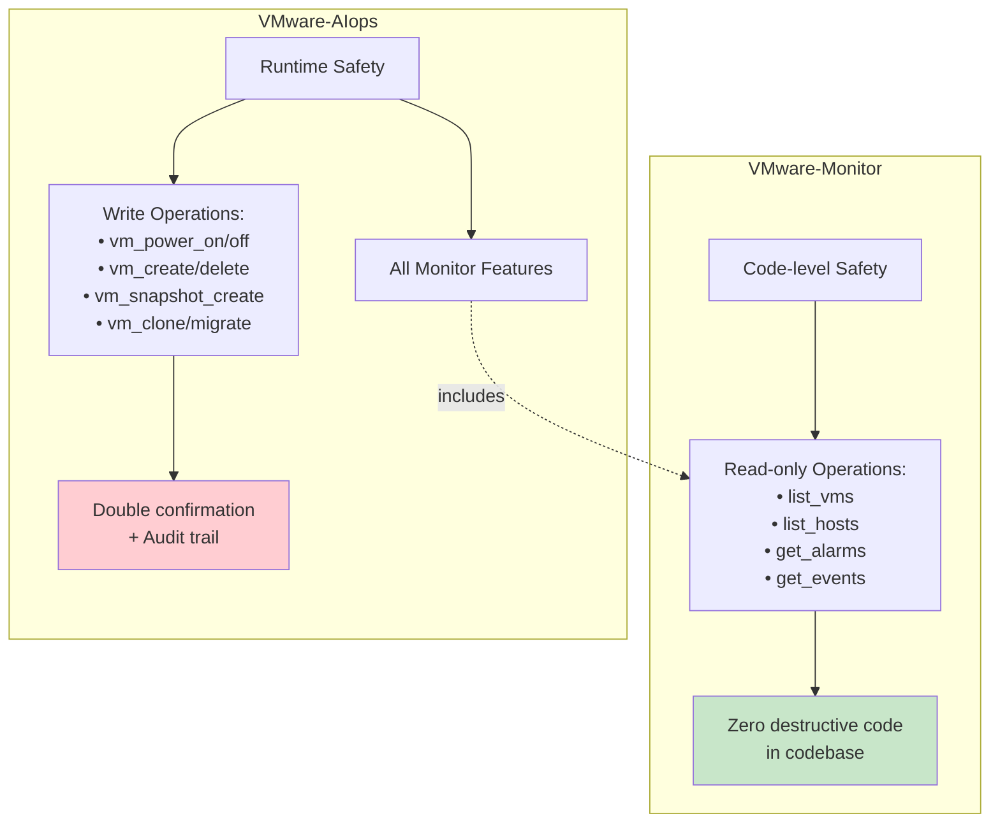
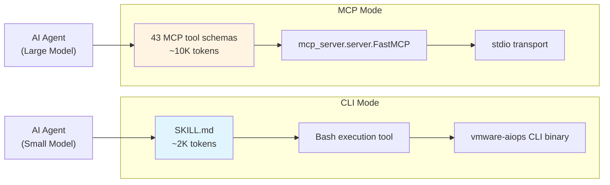
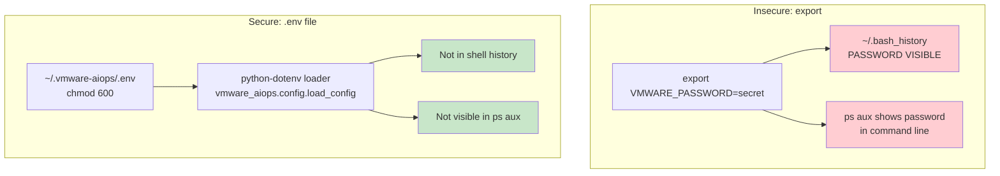
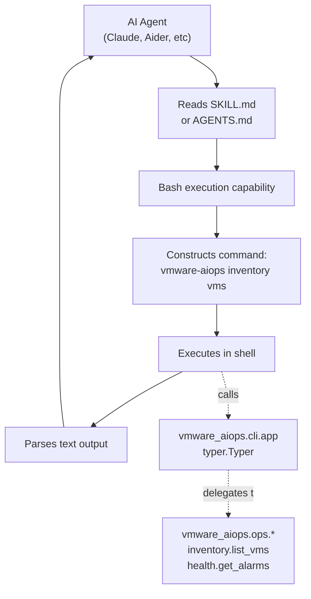
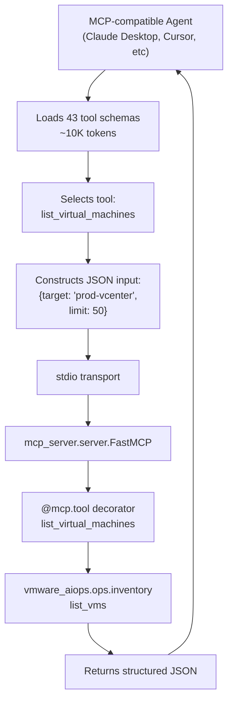
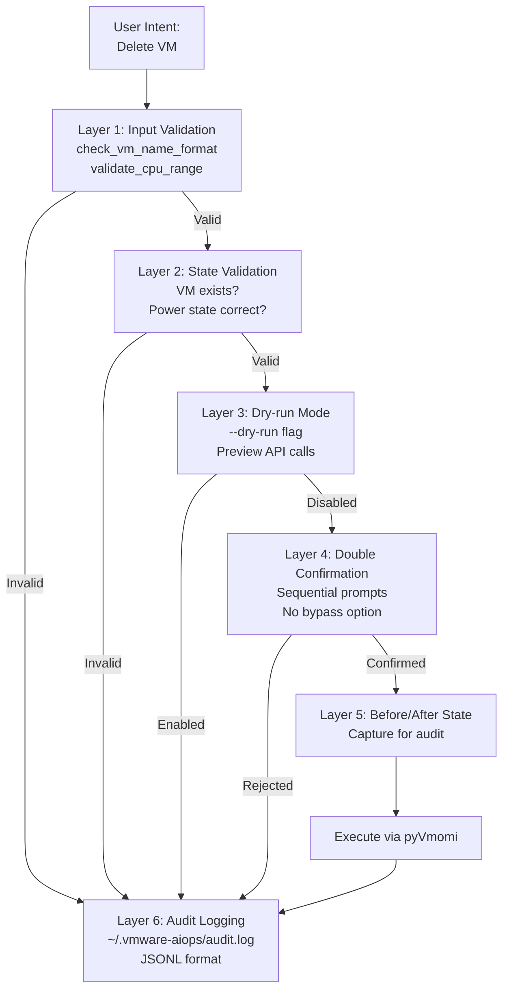
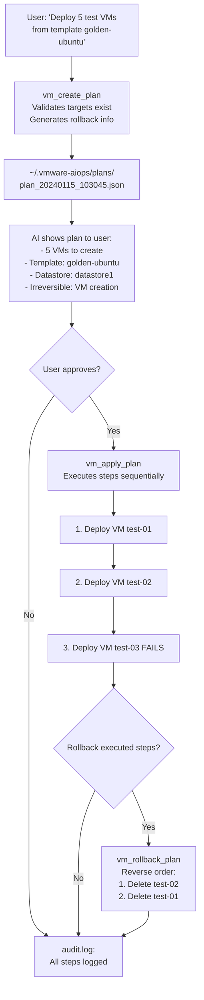

<!-- source: DeepWiki mcp.deepwiki.com · repo zw008/VMware-AIops · page 14 FAQ · fetched 2026-10-26 -->

# FAQ

<details>
<summary>Relevant source files</summary>

The following files were used as context for generating this wiki page:

- [README-CN.md](README-CN.md)
- [README.md](README.md)
- [plugins/vmware-ops/skills/vmware-aiops/SKILL.md](plugins/vmware-ops/skills/vmware-aiops/SKILL.md)

</details>


This page answers frequently asked questions about VMware AIops installation, configuration, usage modes, safety features, and troubleshooting. For detailed setup instructions, see [Getting Started](#2). For architecture deep dives, see [Core Concepts](#3) and [System Architecture](#9).

---

## General Questions

### What is VMware AIops?

VMware AIops is an AI-powered VMware infrastructure operations tool that enables management of vCenter Server and ESXi environments through natural language interfaces. It provides both CLI and MCP (Model Context Protocol) modes for interacting with VMware infrastructure via AI coding assistants.

The system is built on pyVmomi (vSphere SOAP API) and supports inventory queries, health monitoring, VM lifecycle operations, deployment, cluster management, and advanced features like vSAN, Aria Operations, and VKS.

Sources: [README.md:1-18](), [plugins/vmware-ops/skills/vmware-aiops/SKILL.md:1-18]()

### What's the difference between VMware-Monitor and VMware-AIops?



**VMware-Monitor** ([separate repository](https://github.com/zw008/VMware-Monitor)) provides read-only monitoring with code-level safety—destructive operations literally do not exist in the codebase. Use for production environments where any risk of accidental modification is unacceptable.

**VMware-AIops** (this repository) provides full operations including VM lifecycle management. Safety is enforced through runtime controls: double confirmation, input validation, audit logging, and optional dry-run modes. Use when you need both monitoring and operational capabilities.

Sources: [README.md:8](), [README.md:378-382](), [README-CN.md:8-13]()

### When should I use CLI mode vs MCP mode?

**Decision Matrix:**

| Scenario | Recommended | Reason |
|----------|------------|--------|
| Local/small models (<32B params) | **CLI** | ~2K token context vs ~10K for MCP |
| Token-sensitive workflows | **CLI** | SKILL.md + Bash = minimal overhead |
| Cloud models (Claude, GPT-4o) | Either | Both work well; MCP provides structured JSON I/O |
| Automated pipelines | **MCP** | Type-safe parameters, no shell parsing needed |
| Agent chaining | **MCP** | Structured input/output between agents |

**Context Size Comparison:**



Sources: [README.md:57-66](), [plugins/vmware-ops/skills/vmware-aiops/SKILL.md:60-76]()

---

## Installation & Setup

### What are the prerequisites?

- **Python 3.10+** — Required for the vmware-aiops package
- **Node.js 18+** — Only if using Gemini CLI, Codex CLI, or Skills.sh installation
- **VMware environment** — vCenter Server or ESXi 6.5+ (6.7, 7.0, 8.0 supported)

Sources: [README.md:322-328]()

### How do I install vmware-aiops?

**Three installation methods:**

```bash
# Method 1: Via uv (recommended for version pinning)
uv tool install vmware-aiops==1.0.16

# Method 2: Via Skills.sh (fetches from GitHub)
npx skills add zw008/VMware-AIops

# Method 3: Via ClawHub (fetches from ClawHub registry)
clawhub install vmware-aiops
```

All methods install from the same source repository: [github.com/zw008/VMware-AIops](https://github.com/zw008/VMware-AIops).

Sources: [README.md:27-38](), [plugins/vmware-ops/skills/vmware-aiops/SKILL.md:40-49]()

### What gets installed on my system?

The `vmware-aiops` package installs:
- **CLI binary**: `vmware-aiops` command-line tool
- **MCP server**: `vmware-aiops-mcp` entry point (optional)
- **Python dependencies**: pyVmomi, Click, Rich, APScheduler, python-dotenv, typer, pydantic

**No background services are installed automatically.** The scanner daemon only runs when explicitly started via `vmware-aiops daemon start`.

**File locations after installation:**
- Config: `~/.vmware-aiops/config.yaml`
- Credentials: `~/.vmware-aiops/.env`
- Audit log: `~/.vmware-aiops/audit.log`
- Scan log: `~/.vmware-aiops/scan.log`
- Image registry: `~/.vmware-aiops/image_registry.json`
- Plans: `~/.vmware-aiops/plans/`

Sources: [plugins/vmware-ops/skills/vmware-aiops/SKILL.md:479-481](), [README.md:882-883]()

### How do I upgrade to the latest version?

| Install Method | Update Command |
|---------------|---------------|
| uv | `uv tool install vmware-aiops --force` |
| Skills.sh | `npx skills add zw008/VMware-AIops` |
| ClawHub | `clawhub install vmware-aiops` |
| Claude Code Plugin | `/plugin marketplace add zw008/VMware-AIops` |
| Git clone | `cd VMware-AIops && git pull origin main && uv pip install -e .` |

Check current version: `vmware-aiops --version`

Sources: [README.md:613-625]()

---

## Configuration & Credentials

### How do I configure multiple vCenter/ESXi targets?

Edit `~/.vmware-aiops/config.yaml` to define multiple targets:

```yaml
targets:
  - name: prod-vcenter
    host: vcenter.company.com
    port: 443
    type: vcenter
    verify_ssl: true
    
  - name: lab-esxi
    host: esxi-lab.example.com
    port: 443
    type: esxi
    verify_ssl: false  # Self-signed cert in lab
```

Then set credentials in `~/.vmware-aiops/.env`:

```bash
VMWARE_PROD_VCENTER_PASSWORD=actual-password
VMWARE_LAB_ESXI_PASSWORD=actual-password
```

Environment variable naming: `VMWARE_{TARGET_NAME_UPPER}_PASSWORD` (hyphens become underscores).

Sources: [README.md:344-367](), [README.md:869-883]()

### Why should I use .env file instead of export?

**Security comparison:**



**Why .env is safer:**
- Passwords in shell history are visible via `history` command
- Passwords in `export` commands are visible in `ps aux` output
- `.env` file with `chmod 600` is readable only by owner
- File permission check enforced by [vmware_aiops/config.py]()

Sources: [README.md:351-359](), [README.md:370-382](), [plugins/vmware-ops/skills/vmware-aiops/SKILL.md:494-505]()

### What does config.yaml contain vs .env?

**config.yaml** (can be committed to version control):
- Target hostnames/IPs
- Port numbers (default 443)
- Connection type (vcenter/esxi)
- SSL verification settings
- Scanner configuration
- Webhook URLs (optional)

**Does NOT contain**: passwords, tokens, or secrets

**.env** (NEVER commit to version control):
- `VMWARE_{TARGET}_PASSWORD` variables
- API tokens (if using Aria Operations)
- Webhook secrets (if applicable)

**File permissions:**
```bash
chmod 644 ~/.vmware-aiops/config.yaml  # Readable by group
chmod 600 ~/.vmware-aiops/.env         # Owner-only
```

Sources: [README.md:370-376](), [plugins/vmware-ops/skills/vmware-aiops/SKILL.md:496-501]()

### Should I disable SSL verification?

**Only for isolated lab environments with self-signed certificates.** Production should use CA-signed certificates with full TLS verification.

```yaml
targets:
  - name: prod-vcenter
    host: vcenter.prod.company.com
    verify_ssl: true  # Production: ALWAYS true
    
  - name: home-lab-esxi
    host: 192.168.1.100
    verify_ssl: false  # Home lab: OK for self-signed cert
```

The `disableSslCertValidation` option exists solely for ESXi hosts in isolated environments that use self-signed certificates by default.

Sources: [README.md:209](), [README.md:375-377](), [plugins/vmware-ops/skills/vmware-aiops/SKILL.md:315]()

---

## CLI vs MCP Mode

### How do AI agents call the CLI?

**CLI Invocation Flow:**



The AI reads skill documentation (~2K tokens), then uses its bash execution capability to run `vmware-aiops` commands and parse the text output.

Sources: [plugins/vmware-ops/skills/vmware-aiops/SKILL.md:72-94](), [README.md:70-82]()

### How do AI agents call MCP tools?

**MCP Invocation Flow:**



MCP mode uses structured JSON I/O through the Model Context Protocol. The agent loads all tool schemas upfront (~10K tokens) and makes type-safe function calls.

Sources: [README.md:564-591](), [plugins/vmware-ops/skills/vmware-aiops/SKILL.md:96-128]()

### How many MCP tools are available?

**43 MCP tools across 8 categories:**

| Category | Count | Example Tools |
|----------|-------|--------------|
| Inventory | 4 | `list_virtual_machines`, `list_esxi_hosts`, `list_all_datastores`, `list_all_clusters` |
| Health | 3 | `get_alarms`, `get_events`, `vm_info` |
| VM Lifecycle | 6 | `vm_power_on`, `vm_power_off`, `vm_set_ttl`, `vm_cancel_ttl`, `vm_list_ttl`, `vm_clean_slate` |
| Deployment | 8 | `deploy_vm_from_ova`, `deploy_vm_from_template`, `deploy_linked_clone`, `batch_clone_vms` |
| Guest Operations | 3 | `vm_guest_exec`, `vm_guest_upload`, `vm_guest_download` |
| Plan System | 4 | `vm_create_plan`, `vm_apply_plan`, `vm_rollback_plan`, `vm_list_plans` |
| Datastore | 3 | `browse_datastore`, `scan_datastore_images`, `list_cached_images` |
| Cluster/Storage | 12 | `cluster_create`, `storage_iscsi_enable`, `storage_rescan` |

All tools defined in [mcp_server/server.py]().

Sources: [plugins/vmware-ops/skills/vmware-aiops/SKILL.md:115-128](), [README.md:279]()

### Can I use both CLI and MCP modes together?

Yes. They operate independently:

- **CLI mode**: Uses `vmware-aiops` binary, reads from SKILL.md, executes via bash
- **MCP mode**: Uses `vmware-aiops-mcp` server, loads tool schemas, communicates via stdio

Both modes read the same `~/.vmware-aiops/config.yaml` and `.env` files, and both write to the same `~/.vmware-aiops/audit.log`.

**Typical workflow:**
- Use CLI for interactive troubleshooting with local models (token-efficient)
- Use MCP for automated pipelines with cloud models (structured automation)

Sources: [README.md:564-591](), [plugins/vmware-ops/skills/vmware-aiops/SKILL.md:96-114]()

---

## Safety & Security

### What are the safety mechanisms?

**Six-layer defense-in-depth:**



Sources: [README.md:198-213](), [plugins/vmware-ops/skills/vmware-aiops/SKILL.md:306-317]()

### What operations require double confirmation?

**All destructive operations:**

```bash
# Power operations
vmware-aiops vm power-off <name>        # Requires 2 confirmations
vmware-aiops vm power-off <name> --force  # Also requires 2

# Lifecycle
vmware-aiops vm delete <name>           # Requires 2
vmware-aiops vm reconfigure <name>      # Requires 2

# Snapshots
vmware-aiops vm snapshot-revert <name>  # Requires 2
vmware-aiops vm snapshot-delete <name>  # Requires 2

# Cloning/migration
vmware-aiops vm clone <name>            # Requires 2
vmware-aiops vm migrate <name>          # Requires 2

# Clean slate (revert to baseline)
vmware-aiops vm clean-slate <name>      # Requires 2

# Cluster operations
vmware-aiops cluster delete <name>      # Requires 2
vmware-aiops cluster add-host <cluster> # Requires 2
vmware-aiops cluster remove-host <cluster>  # Requires 2

# Storage
vmware-aiops storage iscsi-enable <host>    # Requires 2
vmware-aiops storage iscsi-add-target <host>  # Requires 2
```

**No bypass flags exist** — the double confirmation is hardcoded in the CLI implementation.

Sources: [README.md:127-149](), [README.md:204](), [plugins/vmware-ops/skills/vmware-aiops/SKILL.md:180-294]()

### What gets logged to audit.log?

Every operation is logged in JSONL (JSON Lines) format to `~/.vmware-aiops/audit.log`:

**Logged fields:**
- `timestamp` — ISO 8601 format
- `target` — Target name from config (e.g., "prod-vcenter")
- `operation` — Operation type (e.g., "vm_power_off")
- `resource` — Resource identifier (VM name, host name, etc.)
- `parameters` — Command parameters as JSON
- `before_state` — State snapshot before operation
- `after_state` — State snapshot after operation
- `result` — "success", "failure", or "rejected"
- `user` — OS username executing the command
- `rejection_reason` — If user declined confirmation

**Example log entry:**
```json
{"timestamp":"2024-01-15T10:30:45Z","target":"prod-vcenter","operation":"vm_power_off","resource":"test-vm-01","parameters":{"force":false},"before_state":{"power":"poweredOn"},"after_state":{"power":"poweredOff"},"result":"success","user":"admin"}
```

Sources: [README.md:206](), [plugins/vmware-ops/skills/vmware-aiops/SKILL.md:312]()

### How does prompt injection protection work?

All vSphere-sourced content (event messages, host logs, VM descriptions) is sanitized before output:

1. **Truncation** — Long messages truncated to prevent context overflow
2. **Control character stripping** — Remove ASCII control chars that could confuse parsers
3. **Boundary markers** — Wrap content in delimiters:
   - Event messages: `[VSPHERE_EVENT]...[/VSPHERE_EVENT]`
   - Host logs: `[VSPHERE_HOST_LOG]...[/VSPHERE_HOST_LOG]`

This prevents malicious content in vSphere (e.g., VM names with embedded commands) from being interpreted as instructions by LLM agents.

Sources: [README.md:210-211](), [README.md:379](), [plugins/vmware-ops/skills/vmware-aiops/SKILL.md:503]()

### Does vmware-aiops send data to third-party services?

**No, by default.** Webhook notifications are disabled by default.

When webhooks are enabled:
- Data is sent **only to user-configured URLs** (Slack, Discord, or your own endpoint)
- Payload contains **aggregated alert metadata only**: alarm counts, event types, host status
- **No credentials, IPs, or PII** are included in webhook payloads
- No data is sent to third-party analytics or telemetry services

Sources: [README.md:211](), [README.md:377](), [plugins/vmware-ops/skills/vmware-aiops/SKILL.md:502]()

---

## AI Platform Integration

### Which AI platforms are supported?

**10+ platforms across 4 integration patterns:**

| Platform | Integration | Config File |
|----------|------------|-------------|
| **Claude Code** | Native marketplace plugin | `plugins/.../SKILL.md` |
| **Gemini CLI** | Extension system | `gemini-extension/GEMINI.md` |
| **OpenAI Codex CLI** | Convention file | `codex-skill/AGENTS.md` |
| **Aider** | Convention file | `codex-skill/AGENTS.md` |
| **Continue CLI** | Rules file | `codex-skill/AGENTS.md` |
| **Trae IDE** | Rules file | `trae-rules/project_rules.md` |
| **Kimi Code CLI** | Skill file | `kimi-skill/SKILL.md` |
| **Goose** | MCP protocol | `examples/mcp-configs/goose.json` |
| **LocalCowork** | MCP protocol | `examples/mcp-configs/localcowork.json` |
| **VS Code Copilot** | MCP protocol | `examples/mcp-configs/vscode-copilot.json` |
| **Cursor** | MCP protocol | `examples/mcp-configs/cursor.json` |

Sources: [README.md:268-304](), [plugins/vmware-ops/skills/vmware-aiops/SKILL.md:330-362]()

### How do I use vmware-aiops with Claude Code?

**Two installation methods:**

**Method 1: Marketplace (recommended)**
```bash
/plugin marketplace add zw008/VMware-AIops
/plugin install vmware-ops
/vmware-ops:vmware-aiops
```

**Method 2: Local install**
```bash
git clone https://github.com/zw008/VMware-AIops.git
ln -sf $(pwd)/VMware-AIops ~/.claude/plugins/marketplaces/vmware-aiops
# Register marketplace via Python script (see README)
# Enable plugin in ~/.claude/settings.json
```

Sources: [README.md:389-437](), [plugins/vmware-ops/skills/vmware-aiops/SKILL.md:51-57]()

### How do I use local models (Ollama)?

**Fully offline operation with Aider + Ollama:**

```bash
# 1. Install Ollama
brew install ollama  # macOS

# 2. Pull model (20GB for 32B, 4.5GB for 7B)
ollama pull qwen2.5-coder:32b

# 3. Start Ollama server
ollama serve

# 4. Run Aider with local model
aider --conventions codex-skill/AGENTS.md \
  --model ollama/qwen2.5-coder:32b
```

**Hardware requirements:**
- 32B model: ~20GB VRAM or 32GB RAM for CPU inference
- 7B model: 8GB RAM

**Why local models prefer CLI mode:**
- Small models struggle with 43 MCP tool schemas (~10K tokens)
- CLI mode uses only SKILL.md (~2K tokens) + bash execution
- Better accuracy on constrained models

Sources: [README.md:707-767](), [README.md:61]()

### Can I use Chinese cloud models (DeepSeek, Qwen, Doubao)?

Yes. All support OpenAI-compatible API endpoints:

**DeepSeek:**
```bash
export DEEPSEEK_API_KEY="your-key"
aider --conventions codex-skill/AGENTS.md --model deepseek/deepseek-coder
```

**Qwen (Alibaba Cloud):**
```bash
export DASHSCOPE_API_KEY="your-key"
aider --conventions codex-skill/AGENTS.md --model qwen/qwen-coder-plus
```

**Doubao (ByteDance):**
```bash
export OPENAI_API_BASE="https://ark.cn-beijing.volces.com/api/v3"
export OPENAI_API_KEY="your-ark-key"
aider --conventions codex-skill/AGENTS.md --model your-doubao-endpoint-id
```

Sources: [README.md:629-703](), [README-CN.md:449-466]()

---

## Troubleshooting

### How do I verify my installation and configuration?

Use the `doctor` command:

```bash
# Full diagnostic check
vmware-aiops doctor

# Skip authentication check (faster)
vmware-aiops doctor --skip-auth
```

**Checks performed:**
1. Python version (requires 3.10+)
2. Config file exists at `~/.vmware-aiops/config.yaml`
3. `.env` file exists and has correct permissions (600)
4. Environment variables loaded correctly
5. Target connectivity (unless `--skip-auth`)
6. pyVmomi connection test (unless `--skip-auth`)

Sources: [README.md:777]()

### Why am I getting "ConnectionRefusedError"?

**Common causes:**

1. **Incorrect hostname/IP** — Verify in `config.yaml`
   ```yaml
   targets:
     - host: vcenter.company.com  # Check DNS resolution
       port: 443  # Default HTTPS port
   ```

2. **Firewall blocking** — ESXi/vCenter requires TCP 443 (HTTPS)

3. **SSL certificate issue** — If self-signed cert in lab:
   ```yaml
   targets:
     - verify_ssl: false  # Only for lab environments
   ```

4. **Service not running** — Verify vCenter/ESXi is powered on and responsive

Sources: [README.md:869-878]()

### Why am I getting "Authentication failed"?

**Troubleshooting steps:**

1. **Check .env file permissions:**
   ```bash
   ls -la ~/.vmware-aiops/.env
   # Should show: -rw------- (600)
   chmod 600 ~/.vmware-aiops/.env
   ```

2. **Verify environment variable naming:**
   ```bash
   # Target name in config.yaml: "prod-vcenter"
   # Environment variable must be: VMWARE_PROD_VCENTER_PASSWORD
   # Hyphens → underscores, uppercase
   cat ~/.vmware-aiops/.env
   ```

3. **Check username in config.yaml:**
   ```yaml
   targets:
     - name: prod-vcenter
       user: administrator@vsphere.local  # Include domain
   ```

4. **Test credentials manually:**
   ```bash
   # Try connecting via browser to https://vcenter.company.com
   ```

Sources: [README.md:362-367](), [README.md:351-359]()

### How do I generate MCP client config?

Use the built-in generator:

```bash
# List supported agents
vmware-aiops mcp-config list

# Generate config for specific agent
vmware-aiops mcp-config generate --agent goose
vmware-aiops mcp-config generate --agent claude-code
vmware-aiops mcp-config generate --agent cursor
```

**Output includes:**
- Full MCP server command
- Environment variables needed
- Agent-specific config file format

Sources: [README.md:781-782](), [README.md:369-371]()

### How do I enable debug logging?

Edit `~/.vmware-aiops/config.yaml`:

```yaml
logging:
  level: DEBUG  # Options: DEBUG, INFO, WARNING, ERROR
  file: ~/.vmware-aiops/debug.log
```

Or set environment variable:
```bash
export VMWARE_AIOPS_LOG_LEVEL=DEBUG
vmware-aiops inventory vms
```

Sources: [README.md:869-883]()

---

## Version Compatibility

### Which vSphere versions are supported?

| vSphere Version | Support Status | Notes |
|----------------|---------------|-------|
| 8.0 / 8.0U1-U3 | ✅ Full support | `CreateSnapshot_Task` deprecated, use `CreateSnapshotEx_Task` |
| 7.0 / 7.0U1-U3 | ✅ Full support | All APIs supported |
| 6.7 | ✅ Compatible | Backward-compatible, tested |
| 6.5 | ✅ Compatible | Backward-compatible, tested |

**API version negotiation:**
pyVmomi automatically negotiates the API version during SOAP handshake. No manual configuration needed. The same codebase manages 6.5, 7.0, and 8.0 environments seamlessly.

Sources: [README.md:84-93](), [plugins/vmware-ops/skills/vmware-aiops/SKILL.md:319-328]()

### Do I need different versions for vCenter vs ESXi?

No. The same vmware-aiops installation works with both vCenter and standalone ESXi hosts.

**Feature availability differs:**

| Capability | vCenter | ESXi Standalone |
|------------|---------|----------------|
| VM lifecycle ops | ✅ | ✅ |
| Inventory (VMs, datastores) | ✅ | ✅ |
| Health monitoring | ✅ | ✅ |
| Cluster management | ✅ | ❌ |
| DRS/HA | ✅ | ❌ |
| vMotion | ✅ | ❌ |
| Cross-host operations | ✅ | ❌ |

Set `type: vcenter` or `type: esxi` in `config.yaml` to specify target type.

Sources: [README.md:249-264](), [README.md:869-878]()

### Does vSAN require a special version of pyVmomi?

vSAN features require **pyVmomi 8.0.3+** (vSAN SDK merged into main pyVmomi).

For older pyVmomi versions, install standalone vSAN Management SDK:
```bash
pip install vsanapiutils
```

vSAN commands:
```bash
vmware-aiops vsan health
vmware-aiops vsan capacity
vmware-aiops vsan disks
vmware-aiops vsan performance --hours 1
```

Sources: [README.md:224](), [plugins/vmware-ops/skills/vmware-aiops/SKILL.md:249]()

---

## Advanced Features

### What is the Plan → Apply → Rollback workflow?

For multi-step operations or operations affecting multiple VMs, use the plan system:



Plans are stored in `~/.vmware-aiops/plans/`, auto-deleted on success, auto-cleaned after 24 hours.

Sources: [README.md:153-164](), [plugins/vmware-ops/skills/vmware-aiops/SKILL.md:207-218]()

### What are TTLs and Clean Slate?

**TTL (Time To Live)** — Automatic VM deletion after expiration:

```bash
# Set TTL: VM will auto-delete in 60 minutes
vmware-aiops vm set-ttl test-vm --minutes 60

# Cancel TTL before expiration
vmware-aiops vm cancel-ttl test-vm

# List all TTLs
vmware-aiops vm list-ttl
```

**Clean Slate** — Revert VM to a baseline snapshot and power on:

```bash
# Revert to specific snapshot
vmware-aiops vm clean-slate test-vm --snapshot baseline

# Revert to most recent snapshot
vmware-aiops vm clean-slate test-vm
```

Both features useful for ephemeral test environments. Requires double confirmation.

Sources: [README.md:143-146](), [plugins/vmware-ops/skills/vmware-aiops/SKILL.md:197-200]()

### What guest operations are supported?

**Three guest operations (require VMware Tools running in guest):**

```bash
# Execute command in guest
vmware-aiops vm guest-exec my-vm \
  --cmd /bin/bash \
  --args "-c 'whoami'" \
  --user root \
  --password <password>

# Upload file to guest
vmware-aiops vm guest-upload my-vm \
  --local ./script.sh \
  --guest /tmp/script.sh \
  --user root \
  --password <password>

# Download file from guest
vmware-aiops vm guest-download my-vm \
  --guest /var/log/syslog \
  --local ./syslog.txt \
  --user root \
  --password <password>
```

**Security note:** Guest credentials are passed as command-line arguments (visible in `ps`). Consider using a dedicated low-privilege account.

Sources: [README.md:147-149](), [README.md:816-819](), [plugins/vmware-ops/skills/vmware-aiops/SKILL.md:201-203]()

### How does the scheduled scanner work?

**Scanner daemon configuration:**

```yaml
scanner:
  interval_minutes: 15  # Scan every 15 minutes
  severity_threshold: warning  # critical|warning|info
  lookback_hours: 1  # How far back to scan
  log_types:
    - vpxd      # vCenter logs
    - hostd     # ESXi host daemon logs
    - vmkernel  # ESXi kernel logs

notify:
  log_file: ~/.vmware-aiops/scan.log  # JSONL output
  webhook_url: https://hooks.slack.com/...  # Optional
```

**Operations:**

```bash
# Start scanner daemon
vmware-aiops daemon start

# Check status
vmware-aiops daemon status

# Stop daemon
vmware-aiops daemon stop

# One-time scan
vmware-aiops scan now
```

**What gets scanned:**
- Active alarms from all targets
- Recent events (configurable lookback)
- Host logs matching regex patterns: `error|fail|critical|panic|timeout|corrupt`

Output written to `~/.vmware-aiops/scan.log` in JSONL format.

Sources: [README.md:187-196](), [README.md:839-844](), [README.md:879-883]()

### What are linked clones and why are they fast?

**Linked clone** creates a new VM sharing virtual disks with a parent snapshot:

```bash
# Create snapshot on source VM
vmware-aiops vm snapshot-create base-ubuntu --name clean

# Deploy linked clone (completes in seconds)
vmware-aiops deploy linked-clone \
  --source base-ubuntu \
  --snapshot clean \
  --name test-vm-01
```

**Speed comparison:**

| Method | Time | Disk Space | Use Case |
|--------|------|-----------|----------|
| Full clone | Minutes | Full copy | Production VMs |
| Linked clone | Seconds | Shared + delta | Test environments |
| Template deploy | Minutes | Full copy | Production VMs |
| OVA deploy | Minutes | Full import | Initial setup |

Linked clones ideal for ephemeral test VMs. Use with TTL for automatic cleanup.

Sources: [README.md:172-176](), [plugins/vmware-ops/skills/vmware-aiops/SKILL.md:226]()