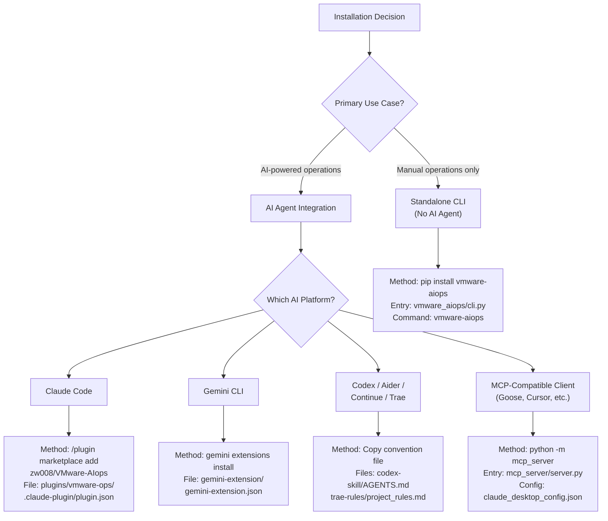
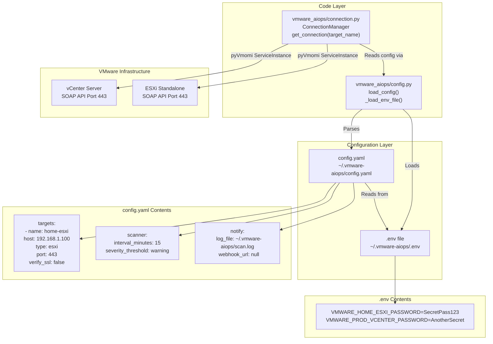
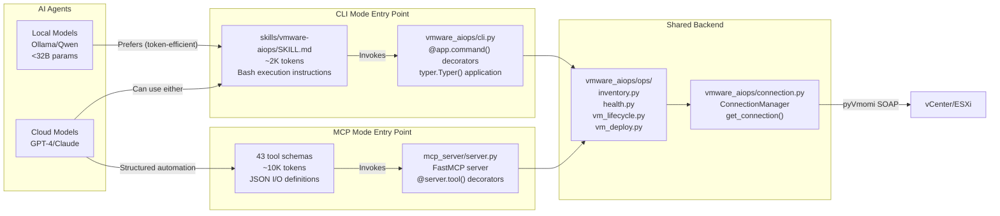
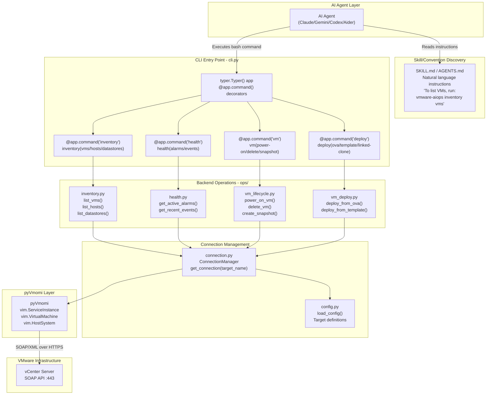
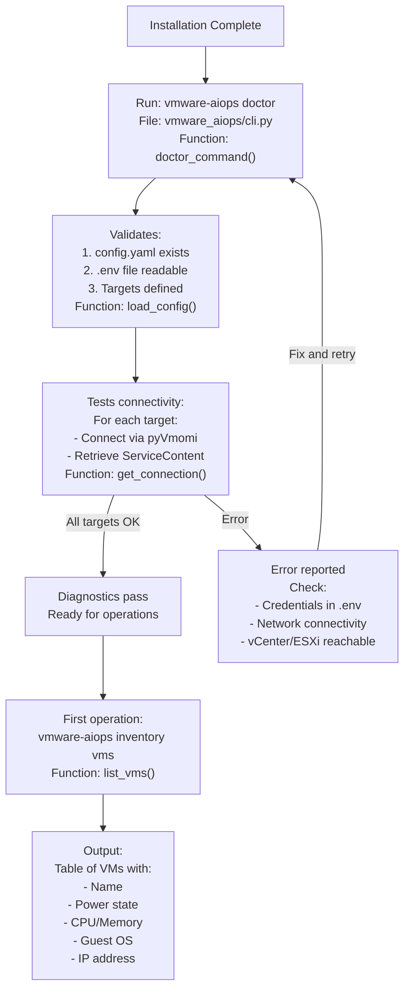

<!-- source: DeepWiki mcp.deepwiki.com · repo zw008/VMware-AIops · page 2 Getting Started · fetched 2026-10-26 -->

# Getting Started

<details>
<summary>Relevant source files</summary>

The following files were used as context for generating this wiki page:

- [README.md](README.md)
- [pyproject.toml](pyproject.toml)
- [vmware_aiops/__init__.py](vmware_aiops/__init__.py)

</details>


This page provides a comprehensive overview of the initial setup process for VMware AIops, including installation, configuration, and first-time usage. It covers the key decisions you need to make before deploying the system and provides a roadmap through the setup process.

**Scope**: This page covers the high-level workflow from a clean system to your first successful operation. For detailed installation instructions, see [Installation](#2.1). For configuration file structure and credential management, see [Configuration](#2.2). For a hands-on walkthrough with examples, see [Quick Start](#2.3).

Related pages: For architectural concepts like CLI vs MCP mode selection, see [Dual-Mode Architecture](#3.1). For understanding read-only vs full operations, see [Dual-Skill Architecture](#3.2).

---

## Prerequisites

Before installing VMware AIops, ensure your system meets these requirements:

| Requirement | Version | Verification Command | Notes |
|-------------|---------|---------------------|-------|
| Python | 3.10+ | `python3 --version` | Required for vmware-aiops CLI and MCP server |
| Node.js | 18+ | `node --version` | Required for Gemini CLI, Codex CLI, and Skills.sh installation |
| VMware Infrastructure | vSphere 6.5+ | N/A | vCenter Server or standalone ESXi host |
| Network Access | N/A | N/A | HTTPS (port 443) to vCenter/ESXi |

**Sources**: [README.md:320-328]()

---

## Installation Pathways

VMware AIops supports multiple installation methods depending on your intended integration target. The core system is identical across all methods; only the integration wrapper differs.

### Installation Method Decision Tree



**Sources**: [README.md:15-51](), [README.md:383-611]()

### Quick Install Commands

All installation methods share the same Python backend at [vmware_aiops/]() but differ in how AI agents discover and invoke the functionality:

| Installation Method | Command | Files Involved | Target Audience |
|---------------------|---------|----------------|-----------------|
| **Skills.sh** (Universal) | `npx skills add zw008/VMware-AIops` | [skills/vmware-aiops/SKILL.md]() | Works with 30+ AI agents |
| **ClawHub** (Universal) | `clawhub install vmware-aiops` | [skills/vmware-aiops/SKILL.md]() | Universal skill platform |
| **PyPI** (Direct) | `pip install vmware-aiops` | N/A | Python environments without GitHub |
| **Claude Code Marketplace** | `/plugin marketplace add zw008/VMware-AIops` | [plugins/vmware-ops/.claude-plugin/plugin.json]() | Claude Code native integration |
| **Gemini Extension** | `gemini extensions install ./gemini-extension` | [gemini-extension/gemini-extension.json]() | Gemini CLI users |
| **Git Clone** (Development) | `git clone https://github.com/zw008/VMware-AIops.git` | All | Contributors and customization |

**Sources**: [README.md:15-38](), [README.md:383-611]()

---

## Configuration Overview

After installation, the system requires configuration to connect to your VMware infrastructure. Configuration consists of two files:

### Configuration Files Architecture



### Configuration Steps Summary

1. **Copy template**: `cp config.example.yaml ~/.vmware-aiops/config.yaml`
2. **Define targets**: Edit `config.yaml` to specify vCenter/ESXi endpoints (hostnames, ports, type)
3. **Set credentials**: Create `~/.vmware-aiops/.env` with password environment variables
4. **Secure permissions**: `chmod 600 ~/.vmware-aiops/.env` to restrict access

**Environment Variable Naming Convention**:
```
VMWARE_{TARGET_NAME_UPPER}_PASSWORD
```
Where `{TARGET_NAME_UPPER}` is the target name from `config.yaml` converted to uppercase with hyphens replaced by underscores.

Examples:
- Target `home-esxi` → `VMWARE_HOME_ESXI_PASSWORD`
- Target `prod-vcenter` → `VMWARE_PROD_VCENTER_PASSWORD`

**Sources**: [README.md:343-382](), [vmware_aiops/config.py]()

For complete configuration file structure and advanced options, see [Configuration](#2.2).

---

## Operational Mode Selection

VMware AIops operates in two distinct modes with different trade-offs. Choose based on your token budget and automation requirements.

### CLI Mode vs MCP Mode



### Mode Selection Criteria

| Scenario | Recommended Mode | Reasoning |
|----------|------------------|-----------|
| Local models (<32B params) | CLI | ~2K token context vs ~10K for MCP; reduces model confusion |
| Token-sensitive workflows | CLI | SKILL.md + Bash tool = minimal overhead |
| Cost optimization | CLI | Smaller prompts = lower API costs |
| Cloud LLMs (GPT-4/Claude) | Either | Both viable; MCP provides structured JSON I/O |
| Automated pipelines | MCP | Type-safe parameters, no shell output parsing |
| Agent chaining | MCP | Structured tool outputs for next agent in chain |
| Human-in-loop operations | CLI | Natural bash command syntax |

**Sources**: [README.md:57-66](), [vmware_aiops/cli.py](), [mcp_server/server.py]()

For architectural details, see [Dual-Mode Architecture: CLI vs MCP](#3.1).

---

## Skill Version Selection

The system provides two skill variants with different safety profiles:

### vmware-monitor vs vmware-aiops

| Skill | Operations | Safety Mechanism | Use Case |
|-------|-----------|------------------|----------|
| **vmware-monitor** | Read-only: inventory, health, alarms, events | **Code-level prevention**: destructive functions do not exist | Production monitoring, compliance-critical environments |
| **vmware-aiops** | Full operations: monitor + VM lifecycle, deployment, cluster management | **Runtime controls**: double confirmation, audit logging, dry-run mode | Development, testing, controlled automation |

**Independent Repository**: The `vmware-monitor` skill is maintained as a separate repository at [https://github.com/zw008/VMware-Monitor](https://github.com/zw008/VMware-Monitor) with completely isolated codebase.

**This repository** (`vmware-aiops`) provides both monitoring and full operations capabilities. The safety architecture is detailed in [Dual-Skill Architecture: Monitor vs AIops](#3.2) and [Safety Features](#3.3).

**Sources**: [README.md:8](), [README.md:954-958]()

---

## Entry Points and Code Flow

Understanding how commands reach the VMware infrastructure helps troubleshooting and customization.

### Request Flow from AI Agent to vSphere



**Key Code Entities**:

- **Entry point**: [vmware_aiops/cli.py]() - `app = typer.Typer()` application instance
- **Commands**: CLI commands defined with `@app.command()` decorators in [vmware_aiops/cli.py]()
- **Operations layer**: [vmware_aiops/ops/]() directory contains functional modules
- **Connection management**: [vmware_aiops/connection.py]() - `ConnectionManager` class maintains session pool
- **Configuration**: [vmware_aiops/config.py]() - `load_config()` function parses YAML and .env
- **pyVmomi objects**: `vim.VirtualMachine`, `vim.HostSystem`, `vim.Datastore` from pyvmomi library

**Sources**: [vmware_aiops/cli.py](), [vmware_aiops/ops/](), [vmware_aiops/connection.py](), [vmware_aiops/config.py](), [README.md:70-82]()

---

## First Operation Workflow

After installation and configuration, verify connectivity and perform your first operation.

### Verification Steps



**Command Reference**:

1. **Diagnostics**: 
   ```bash
   vmware-aiops doctor
   ```
   - Defined in [vmware_aiops/cli.py]()
   - Validates configuration via [vmware_aiops/config.py:load_config()]()
   - Tests connections via [vmware_aiops/connection.py:ConnectionManager.get_connection()]()

2. **First inventory query**:
   ```bash
   vmware-aiops inventory vms --target home-esxi
   ```
   - Defined in [vmware_aiops/cli.py]()
   - Calls [vmware_aiops/ops/inventory.py:list_vms()]()
   - Returns `List[Dict[str, Any]]` with VM properties

3. **First health check**:
   ```bash
   vmware-aiops health alarms --target home-esxi
   ```
   - Defined in [vmware_aiops/cli.py]()
   - Calls [vmware_aiops/ops/health.py:get_active_alarms()]()
   - Queries `vim.alarm.AlarmManager` via pyVmomi

**Sources**: [vmware_aiops/cli.py](), [vmware_aiops/ops/inventory.py](), [vmware_aiops/ops/health.py](), [README.md:776-863]()

---

## Next Steps

Once you have completed initial setup and verified connectivity:

1. **Detailed Installation**: See [Installation](#2.1) for platform-specific installation procedures, alternative methods, and troubleshooting
2. **Configuration Deep Dive**: See [Configuration](#2.2) for multi-target configuration, scanner settings, webhook integration, and security best practices
3. **Hands-On Tutorial**: See [Quick Start](#2.3) for a complete walkthrough from installation to common operations
4. **Understand Architecture**: See [Core Concepts](#3) to understand dual-mode architecture, safety mechanisms, and operational patterns
5. **AI Agent Integration**: See [AI Agent Integration](#6) for platform-specific setup guides (Claude Code, Gemini, Codex, MCP clients)
6. **Operations Reference**: See [CLI Command Reference](#4.1) or [MCP Tools Reference](#5.2) for complete command documentation

**Sources**: [README.md](), table of contents structure

---

