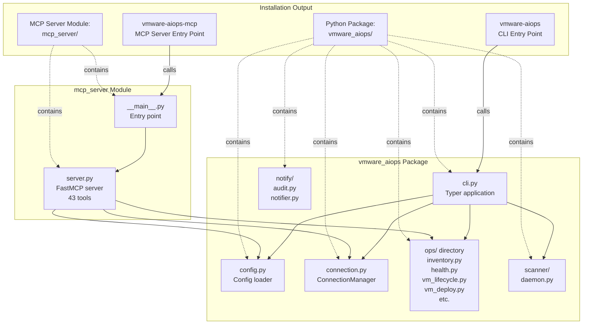
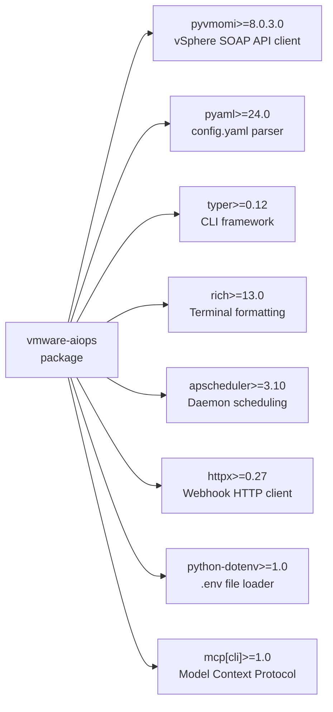
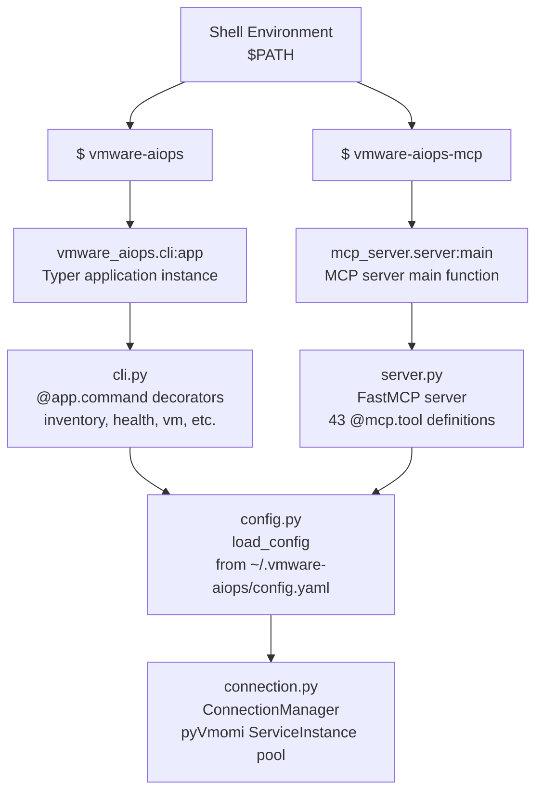

<!-- source: DeepWiki mcp.deepwiki.com · repo zw008/VMware-AIops · page 2.1 Installation · fetched 2026-10-26 -->

# Installation

<details>
<summary>Relevant source files</summary>

The following files were used as context for generating this wiki page:

- [README.md](README.md)
- [pyproject.toml](pyproject.toml)

</details>


This page covers the installation of the `vmware-aiops` Python package and its command-line tools. For configuration of vCenter/ESXi targets and credentials, see [Configuration](#2.2). For AI agent integration setup, see [AI Agent Integration](#6).

**Scope**: This document focuses on installing the core Python backend that provides the `vmware-aiops` CLI and `vmware-aiops-mcp` server entry points. After following these instructions, you will have the vmware-aiops commands available in your shell environment.

---

## Prerequisites

The vmware-aiops package requires Python 3.10 or higher and uses several core dependencies for VMware API interaction and CLI presentation.

### System Requirements

| Requirement | Minimum Version | Purpose |
|-------------|----------------|---------|
| Python | 3.10+ | Runtime environment |
| pip or uv | Latest stable | Package installation |
| Node.js | 18+ | Required only for Gemini CLI and Codex CLI integrations (see [AI Agent Integration](#6)) |

**Verify your Python version**:

```bash
python3 --version
# Expected output: Python 3.10.x or higher
```

**Sources**: [README.md:320-328]()

---

## Installation Methods

The vmware-aiops package can be installed through multiple channels depending on your use case. All methods install the same Python backend with identical functionality.

### Method Comparison

| Method | Use Case | Pros | Cons | Updates |
|--------|----------|------|------|---------|
| **PyPI (uv/pip)** | Standalone CLI usage, MCP server | Simple, no GitHub required, fast with uv | Requires manual updates | `uv tool install vmware-aiops --force` |
| **Git Clone** | Development, customization | Full source access, easy to modify | Requires Git, manual dependency management | `git pull && pip install -e .` |
| **Skills.sh / ClawHub** | AI agent integration | Automatic AI tool registration | Requires npm | `npx skills add zw008/VMware-AIops` |

**Sources**: [README.md:15-38](), [README.md:613-625]()

---

## PyPI Installation (Recommended for CLI/MCP Use)

This is the recommended method for users who want to use the CLI directly or run the MCP server without AI agent integration.

### Using uv (Faster)

```bash
# Install uv if not already installed
pip install uv

# Install vmware-aiops as an isolated tool
uv tool install vmware-aiops
```

The `uv tool install` command:
- Creates an isolated virtual environment
- Installs vmware-aiops and all dependencies
- Adds `vmware-aiops` and `vmware-aiops-mcp` to your PATH

### Using pip

```bash
# Standard installation
pip install vmware-aiops

# China mainland users (faster mirror)
pip install vmware-aiops -i https://pypi.tuna.tsinghua.edu.cn/simple
```

**Sources**: [README.md:27-38]()

---

## Git Clone Installation (For Development)

Use this method if you plan to modify the code or contribute to development.

```bash
# Clone the repository
git clone https://github.com/zw008/VMware-AIops.git
cd VMware-AIops

# Create and activate virtual environment
python3 -m venv .venv
source .venv/bin/activate  # On Windows: .venv\Scripts\activate

# Install in editable mode with all dependencies
pip install -e .

# Optional: Install development dependencies
pip install -e ".[dev]"
```

The `-e` (editable) flag creates a link to your local source code, so changes you make are immediately reflected without reinstalling.

**Sources**: [README.md:330-340]()

---

## Skills.sh / ClawHub Installation (For AI Agents)

These installation methods automatically register the skill with AI coding assistants. They still install the Python backend, but also configure AI agent integration.

```bash
# Via Skills.sh (works with Claude Code, Cursor, Codex, etc.)
npx skills add zw008/VMware-AIops

# Via ClawHub
clawhub install vmware-aiops
```

These commands:
1. Install the Python package via pip/uv
2. Copy skill definition files (SKILL.md, AGENTS.md) to agent-specific directories
3. Register the skill in the agent's configuration

For detailed AI agent setup, see [AI Agent Integration](#6).

**Sources**: [README.md:19-25]()

---

## Package Structure After Installation

The following diagram shows the key components installed by the package and their relationship to the codebase:

**Diagram: Installed Package Components**



**Sources**: [pyproject.toml:31-33](), [README.md:887-932]()

---

## Dependency Installation

The package installation automatically installs the following core dependencies as defined in `pyproject.toml`:

**Diagram: Core Dependencies**



| Dependency | Version Constraint | Purpose |
|------------|-------------------|---------|
| `pyvmomi` | >=8.0.3.0, <10.0 | VMware vSphere SOAP API client library |
| `pyaml` | >=24.0, <27.0 | YAML configuration file parsing |
| `typer` | >=0.12, <1.0 | CLI framework with type hints and auto-completion |
| `rich` | >=13.0, <15.0 | Rich text and table formatting in terminal |
| `apscheduler` | >=3.10, <4.0 | Background scheduler for daemon mode |
| `httpx` | >=0.27, <1.0 | Async HTTP client for webhooks and Aria Operations REST API |
| `python-dotenv` | >=1.0, <2.0 | Load credentials from `.env` file |
| `mcp[cli]` | >=1.0, <2.0 | Model Context Protocol server implementation |

**Sources**: [pyproject.toml:13-22]()

---

## Entry Points Created

After installation, two command-line entry points are registered in your environment:

**Diagram: Entry Point Execution Flow**



### `vmware-aiops` CLI

Entry point definition: `vmware-aiops = "vmware_aiops.cli:app"`

This command provides access to all CLI operations:
- `vmware-aiops inventory vms`
- `vmware-aiops health alarms`
- `vmware-aiops vm power-on <name>`
- etc.

The entry point calls the Typer application instance defined in [vmware_aiops/cli.py](), which registers all subcommands using `@app.command()` decorators.

### `vmware-aiops-mcp` Server

Entry point definition: `vmware-aiops-mcp = "mcp_server.server:main"`

This command starts the MCP (Model Context Protocol) server that exposes 43 tools for AI agent integration. The server runs in stdio mode and communicates via JSON-RPC.

The entry point calls the `main()` function in [mcp_server/server.py](), which initializes the FastMCP server and registers all tools using `@mcp.tool()` decorators.

**Sources**: [pyproject.toml:31-33](), [README.md:563-598]()

---

## Verification

After installation, verify that the package is correctly installed and accessible:

```bash
# Check vmware-aiops CLI is available
vmware-aiops --version
# Expected output: vmware-aiops, version 1.0.16

# Check vmware-aiops-mcp is available
which vmware-aiops-mcp
# Expected output: /path/to/python/bin/vmware-aiops-mcp

# Test CLI with doctor command (requires config - see Configuration)
vmware-aiops doctor --skip-auth
# This checks Python environment and config file presence
```

The `doctor` command performs diagnostic checks including:
- Python version verification
- Config file presence at `~/.vmware-aiops/config.yaml`
- `.env` file presence and permissions
- Dependency imports

With `--skip-auth`, it skips vCenter/ESXi connectivity tests, allowing verification before configuration.

**Sources**: [README.md:776-778]()

---

## Next Steps

After successful installation:

1. **Configure vCenter/ESXi targets**: See [Configuration](#2.2) to set up `~/.vmware-aiops/config.yaml` and `~/.vmware-aiops/.env` with your infrastructure credentials.

2. **Test basic connectivity**: See [Quick Start](#2.3) for a walkthrough of your first operations.

3. **Set up AI agent integration** (optional): See [AI Agent Integration](#6) to configure Claude Code, Gemini CLI, or other AI platforms.

4. **Set up MCP server** (optional): See [MCP Mode Usage](#5) if you want to use the MCP protocol with AI agents.

---

## Updating / Upgrading

To upgrade to the latest version, re-run the installation command for your chosen method:

| Installation Method | Update Command |
|---------------------|----------------|
| uv | `uv tool install vmware-aiops --force` |
| pip | `pip install --upgrade vmware-aiops` |
| Git clone | `cd VMware-AIops && git pull && pip install -e .` |
| Skills.sh | `npx skills add zw008/VMware-AIops` (overwrites) |
| ClawHub | `clawhub install vmware-aiops` (overwrites) |

Check your current version:
```bash
vmware-aiops --version
```

**Sources**: [README.md:613-625](), [pyproject.toml:7]()

---

## Troubleshooting Installation

### Python Version Too Old

**Symptom**: `ERROR: This package requires Python >=3.10`

**Solution**: Install Python 3.10 or higher. Use pyenv or your system's package manager.

### Permission Denied During pip Install

**Symptom**: `PermissionError: [Errno 13] Permission denied`

**Solution**: Use `uv tool install` (creates isolated environment) or `pip install --user vmware-aiops` (user-level install).

### Import Error After Installation

**Symptom**: `ImportError: No module named 'vmware_aiops'`

**Solution**: Ensure you're using the same Python environment where you installed the package:
```bash
which python3
which vmware-aiops
# These should point to the same environment
```

### Entry Point Not Found

**Symptom**: `command not found: vmware-aiops`

**Solution**: The installation directory is not in your PATH. With uv tool install, this is automatic. With pip, ensure `~/.local/bin` is in your PATH:
```bash
export PATH="$HOME/.local/bin:$PATH"
```

For persistent configuration, add to `~/.bashrc` or `~/.zshrc`.

**Sources**: [README.md:961-963]()

---

