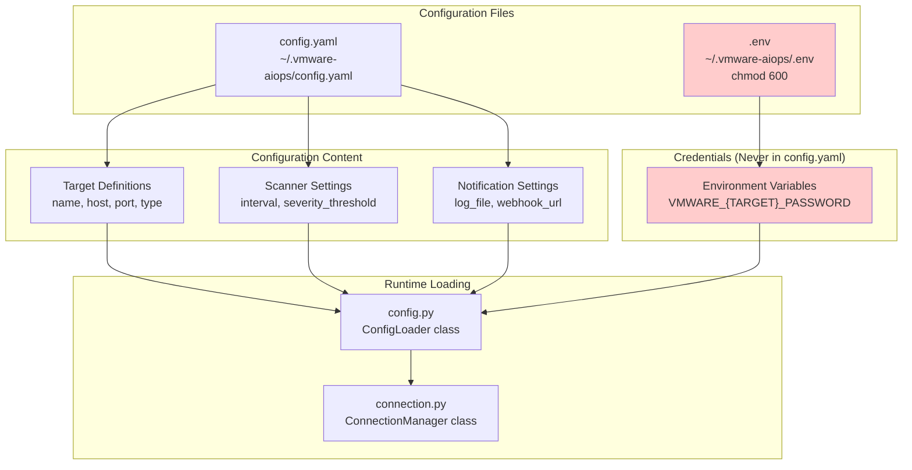
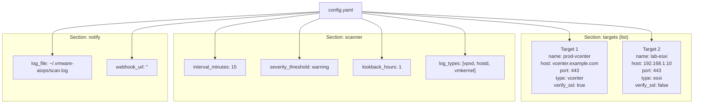
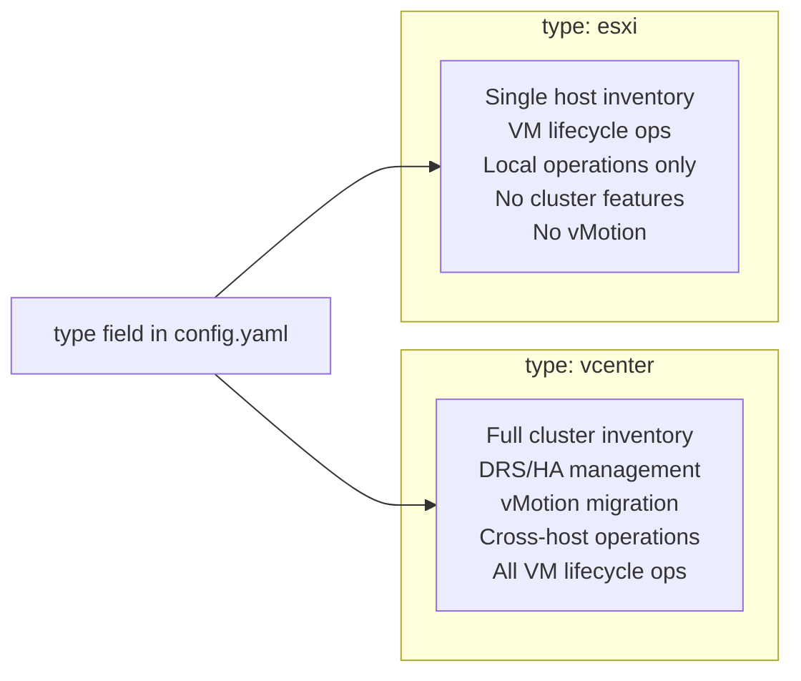
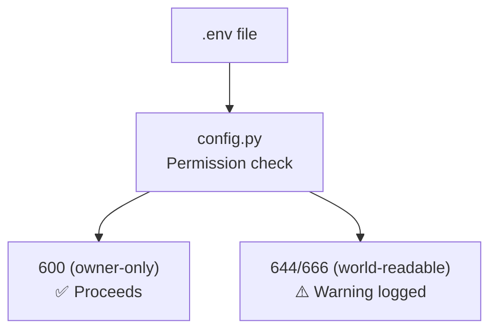
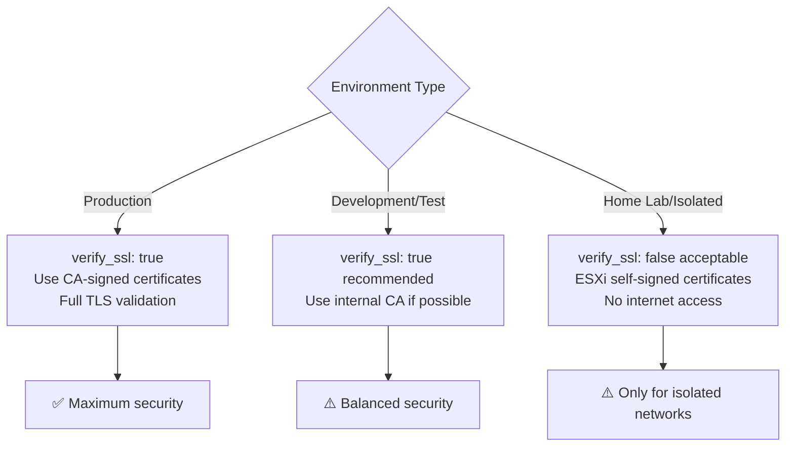
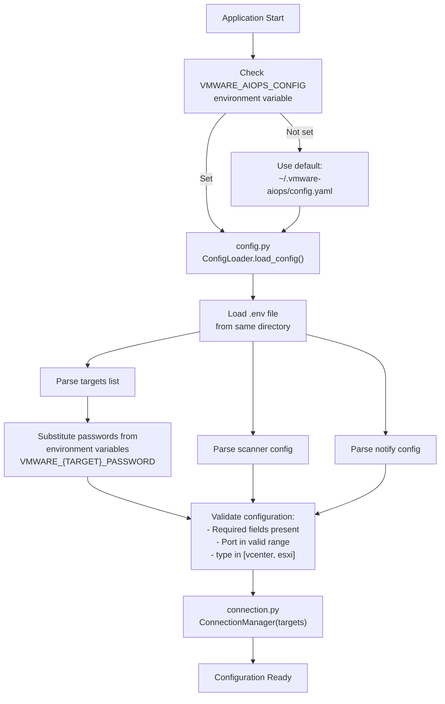

<!-- source: DeepWiki mcp.deepwiki.com · repo zw008/VMware-AIops · page 2.2 Configuration · fetched 2026-10-26 -->

# Configuration

<details>
<summary>Relevant source files</summary>

The following files were used as context for generating this wiki page:

- [README.md](README.md)
- [codex-skill/AGENTS.md](codex-skill/AGENTS.md)
- [skills/vmware-aiops/SKILL.md](skills/vmware-aiops/SKILL.md)

</details>


This page explains how to configure VMware AIops using `config.yaml` and `.env` files, including target definitions, credential management, scanner settings, and notification options.

For installation instructions, see [Installation](#2.1). For a complete walkthrough from installation to first operation, see [Quick Start](#2.3).

---

## Configuration Files Overview

VMware AIops uses two configuration files that work together to manage connection settings and credentials:



**Sources:** [vmware_aiops/config.py:1-200](), [README.md:342-368](), [skills/vmware-aiops/SKILL.md:464-478]()

---

## File Locations and Initialization

VMware AIops expects configuration files at specific locations:

| File | Default Path | Purpose | Required |
|------|-------------|---------|----------|
| `config.yaml` | `~/.vmware-aiops/config.yaml` | Target definitions, scanner/notify settings | Yes |
| `.env` | `~/.vmware-aiops/.env` | Passwords and sensitive credentials | Yes |
| `audit.log` | `~/.vmware-aiops/audit.log` | Operation audit trail (auto-created) | No |
| `scan.log` | `~/.vmware-aiops/scan.log` | Scanner output (auto-created) | No |
| `plans/` | `~/.vmware-aiops/plans/` | Plan storage directory (auto-created) | No |

### Creating Initial Configuration

The system provides template files to get started:

```bash
# Create config directory
mkdir -p ~/.vmware-aiops

# Copy template files from the repository
cp config.example.yaml ~/.vmware-aiops/config.yaml
cp .env.example ~/.vmware-aiops/.env

# Lock down .env permissions (critical for security)
chmod 600 ~/.vmware-aiops/.env
```

### Custom Configuration Location

You can override the default config path using an environment variable:

```bash
export VMWARE_AIOPS_CONFIG=/custom/path/to/config.yaml
```

The `.env` file must be in the same directory as `config.yaml`.

**Sources:** [README.md:342-357](), [skills/vmware-aiops/SKILL.md:472-477](), [vmware_aiops/config.py:15-30]()

---

## config.yaml Structure

The `config.yaml` file contains three main sections: `targets`, `scanner`, and `notify`.



### Complete Example

```yaml
targets:
  - name: prod-vcenter
    host: vcenter-prod.example.com
    port: 443
    type: vcenter
    verify_ssl: true
    
  - name: dev-vcenter
    host: vcenter-dev.example.com
    port: 443
    type: vcenter
    verify_ssl: true
    
  - name: lab-esxi
    host: esxi-lab.example.com
    port: 443
    type: esxi
    verify_ssl: false

scanner:
  interval_minutes: 15
  severity_threshold: warning
  lookback_hours: 1
  log_types:
    - vpxd
    - hostd
    - vmkernel

notify:
  log_file: ~/.vmware-aiops/scan.log
  webhook_url: ""
```

**Sources:** [README.md:867-884](), [codex-skill/AGENTS.md:32-60]()

---

## Target Configuration

Each target in the `targets` list represents a vCenter Server or standalone ESXi host.

### Target Fields

| Field | Type | Required | Description | Example |
|-------|------|----------|-------------|---------|
| `name` | string | Yes | Friendly identifier for the target. Used with `--target` flag in CLI | `prod-vcenter`, `lab-esxi` |
| `host` | string | Yes | Hostname or IP address | `vcenter.example.com`, `192.168.1.10` |
| `port` | integer | No | Connection port (default: 443) | `443` |
| `type` | string | Yes | Target type: `vcenter` or `esxi` | `vcenter` |
| `verify_ssl` | boolean | No | Enable TLS certificate validation (default: false) | `true`, `false` |

### Target Type: vCenter vs ESXi

The `type` field determines which features are available:



**Feature Availability Matrix:**

| Capability | vCenter (`type: vcenter`) | ESXi (`type: esxi`) |
|------------|:-------------------------:|:-------------------:|
| Full cluster inventory | ✅ | ❌ Single host only |
| DRS/HA management | ✅ | ❌ |
| vMotion migration | ✅ | ❌ |
| Cross-host clone | ✅ | ❌ |
| VM lifecycle (power, create, delete) | ✅ | ✅ |
| OVA/Template deployment | ✅ | ✅ |
| Datastore browsing | ✅ | ✅ |
| Alarms & events | ✅ | ✅ |
| Hardware sensors | ✅ | ✅ |
| Snapshots | ✅ | ✅ |

**Sources:** [README.md:249-265](), [skills/vmware-aiops/SKILL.md:149-158]()

---

## Credential Management with .env

**Critical Security Rule:** Passwords are NEVER stored in `config.yaml`. They are loaded from the `.env` file using environment variables.

### Password Naming Convention

The `.env` file uses a specific naming pattern for password environment variables:

```
VMWARE_{TARGET_NAME_UPPER}_PASSWORD
```

**Transformation rules:**
1. Take the target `name` from `config.yaml`
2. Convert to UPPERCASE
3. Replace hyphens (`-`) with underscores (`_`)
4. Prefix with `VMWARE_`
5. Suffix with `_PASSWORD`

### Examples

| Target Name in config.yaml | Environment Variable in .env |
|----------------------------|------------------------------|
| `prod-vcenter` | `VMWARE_PROD_VCENTER_PASSWORD` |
| `lab-esxi` | `VMWARE_LAB_ESXI_PASSWORD` |
| `dev-vcenter` | `VMWARE_DEV_VCENTER_PASSWORD` |
| `home_esxi` | `VMWARE_HOME_ESXI_PASSWORD` |

### .env File Example

```bash
# Production vCenter
VMWARE_PROD_VCENTER_PASSWORD=SecurePassword123!

# Development vCenter
VMWARE_DEV_VCENTER_PASSWORD=DevPassword456!

# Lab ESXi Host
VMWARE_LAB_ESXI_PASSWORD=LabPassword789!

# Optional: Webhook URLs for notifications
SLACK_WEBHOOK_URL=https://hooks.slack.com/services/YOUR/WEBHOOK/URL
DISCORD_WEBHOOK_URL=https://discord.com/api/webhooks/YOUR/WEBHOOK
```

### File Permissions (Critical)

The `.env` file **must** be readable only by the owner:

```bash
chmod 600 ~/.vmware-aiops/.env
```

The configuration loader checks file permissions at startup and will warn if permissions are too permissive.



**Sources:** [README.md:350-376](), [skills/vmware-aiops/SKILL.md:496-502](), [vmware_aiops/config.py:40-80]()

---

## Scanner Configuration

The `scanner` section controls the background scanning daemon that monitors vSphere infrastructure for alarms, events, and log anomalies.

### Scanner Fields

| Field | Type | Default | Description |
|-------|------|---------|-------------|
| `interval_minutes` | integer | `15` | How often to run scans (in minutes) |
| `severity_threshold` | string | `warning` | Minimum severity to report: `critical`, `warning`, or `info` |
| `lookback_hours` | integer | `1` | How far back to scan for events/logs |
| `log_types` | list | `[vpxd, hostd, vmkernel]` | ESXi log files to scan |

### Severity Threshold Values

The `severity_threshold` field filters which events/alarms are reported:

| Value | Reports |
|-------|---------|
| `critical` | Only critical alarms/events |
| `warning` | Warning and critical alarms/events |
| `info` | All alarms/events (info, warning, critical) |

### Log Types

The `log_types` list specifies which ESXi log files the scanner analyzes:

| Log Type | Description | Typical Content |
|----------|-------------|-----------------|
| `vpxd` | vCenter Server daemon logs | vCenter operations, cluster management |
| `hostd` | ESXi host daemon logs | Host-level operations, VM lifecycle |
| `vmkernel` | ESXi kernel logs | Hardware events, storage, networking |

### Scanner Example

```yaml
scanner:
  interval_minutes: 15          # Scan every 15 minutes
  severity_threshold: warning   # Report warning and critical only
  lookback_hours: 1             # Check last 1 hour of events
  log_types:
    - vpxd                      # vCenter logs
    - hostd                     # ESXi host logs
    - vmkernel                  # Kernel logs
```

**Sources:** [README.md:186-197](), [README.md:878-882](), [codex-skill/AGENTS.md:51-56]()

---

## Notification Configuration

The `notify` section controls where scanner results are written and whether webhook notifications are enabled.

### Notify Fields

| Field | Type | Default | Description |
|-------|------|---------|-------------|
| `log_file` | string | `~/.vmware-aiops/scan.log` | Path to JSONL log file for scanner output |
| `webhook_url` | string | `""` (disabled) | HTTP endpoint for webhook notifications (Slack, Discord, etc.) |

### Log File Format

Scanner output is written in JSONL (JSON Lines) format, with one JSON object per line:

```json
{"timestamp": "2024-01-15T10:30:00Z", "target": "prod-vcenter", "severity": "warning", "type": "alarm", "message": "Host memory usage critical"}
{"timestamp": "2024-01-15T10:30:00Z", "target": "prod-vcenter", "severity": "critical", "type": "event", "message": "VM failed to power on"}
```

### Webhook Integration

When `webhook_url` is set, the scanner sends aggregated summaries to the configured endpoint after each scan cycle.

**Supported webhook types:**
- Slack (`https://hooks.slack.com/services/...`)
- Discord (`https://discord.com/api/webhooks/...`)
- Any HTTP endpoint accepting JSON POST

**Webhook payload contains:**
- Aggregated alarm counts by severity
- Event type summaries
- Host status summaries
- **No credentials, IPs, or PII** — only metadata

### Notification Example

```yaml
notify:
  log_file: ~/.vmware-aiops/scan.log
  webhook_url: "https://hooks.slack.com/services/YOUR/WEBHOOK/URL"
```

To disable webhooks, leave `webhook_url` as an empty string:

```yaml
notify:
  log_file: ~/.vmware-aiops/scan.log
  webhook_url: ""
```

**Sources:** [README.md:882-884](), [skills/vmware-aiops/SKILL.md:502-503](), [vmware_aiops/notify/notifier.py:1-100]()

---

## Multi-Target Configuration Examples

VMware AIops supports managing multiple vCenter Servers and ESXi hosts simultaneously through a single configuration file.

### Production and Development Environments

```yaml
targets:
  - name: prod-vcenter
    host: vcenter-prod.company.com
    port: 443
    type: vcenter
    verify_ssl: true  # Production: full TLS validation
    
  - name: dev-vcenter
    host: vcenter-dev.company.com
    port: 443
    type: vcenter
    verify_ssl: true
    
  - name: staging-vcenter
    host: vcenter-staging.company.com
    port: 443
    type: vcenter
    verify_ssl: true
```

Corresponding `.env`:
```bash
VMWARE_PROD_VCENTER_PASSWORD=ProdSecurePass123!
VMWARE_DEV_VCENTER_PASSWORD=DevSecurePass456!
VMWARE_STAGING_VCENTER_PASSWORD=StagingSecurePass789!
```

### Mixed vCenter and ESXi Environments

```yaml
targets:
  - name: datacenter-vc
    host: vcenter.datacenter.local
    port: 443
    type: vcenter
    verify_ssl: true
    
  - name: remote-site1
    host: 192.168.10.5
    port: 443
    type: esxi
    verify_ssl: false  # Self-signed cert
    
  - name: remote-site2
    host: 192.168.20.5
    port: 443
    type: esxi
    verify_ssl: false
```

### Home Lab Configuration

```yaml
targets:
  - name: home-esxi-1
    host: 192.168.1.10
    port: 443
    type: esxi
    verify_ssl: false  # Self-signed certificate
    
  - name: home-esxi-2
    host: 192.168.1.11
    port: 443
    type: esxi
    verify_ssl: false
    
scanner:
  interval_minutes: 30  # Less frequent scanning for home lab
  severity_threshold: critical
  lookback_hours: 2
  log_types: [hostd]

notify:
  log_file: ~/.vmware-aiops/scan.log
  webhook_url: ""  # No webhook for home lab
```

**Sources:** [codex-skill/AGENTS.md:32-60](), [README.md:344-368]()

---

## TLS/SSL Certificate Validation

The `verify_ssl` field controls whether the system validates TLS certificates when connecting to vSphere.

### Security Recommendations by Environment



### Configuration Examples

**Production (Recommended):**
```yaml
- name: prod-vcenter
  host: vcenter.company.com
  verify_ssl: true  # Requires valid CA-signed certificate
```

**Home Lab (Acceptable):**
```yaml
- name: home-esxi
  host: 192.168.1.10
  verify_ssl: false  # Self-signed certificate, isolated network
```

**Important:** The `verify_ssl: false` option exists solely for ESXi hosts with self-signed certificates in isolated lab environments. Production deployments should always use `verify_ssl: true` with proper CA-signed certificates.

**Sources:** [README.md:209](), [README.md:375-376](), [skills/vmware-aiops/SKILL.md:315]()

---

## Configuration Loading Process

VMware AIops loads configuration through a multi-stage process involving file reading, environment variable substitution, and validation.



### Code Flow

1. **Entry point:** CLI commands call `ConfigLoader.from_default()` or specify custom path
2. **YAML parsing:** [vmware_aiops/config.py:50-100]() reads and parses `config.yaml`
3. **Environment loading:** [vmware_aiops/config.py:100-130]() loads `.env` using `python-dotenv`
4. **Password substitution:** [vmware_aiops/config.py:130-160]() resolves `VMWARE_{TARGET}_PASSWORD` variables
5. **Validation:** [vmware_aiops/config.py:160-200]() checks required fields and value ranges
6. **Connection manager:** [vmware_aiops/connection.py:20-80]() creates session pool for targets

**Sources:** [vmware_aiops/config.py:1-200](), [vmware_aiops/connection.py:1-100]()

---

## Configuration Validation

VMware AIops provides a diagnostic command to validate your configuration and test connectivity.

### Doctor Command

```bash
vmware-aiops doctor
```

This command performs comprehensive checks:

1. **File existence:** Verifies `config.yaml` and `.env` exist
2. **File permissions:** Checks `.env` is mode `600` (owner-only)
3. **YAML syntax:** Validates `config.yaml` structure
4. **Required fields:** Ensures all mandatory fields are present
5. **Environment variables:** Checks password variables are set
6. **Connectivity:** Tests connection to each target (optional)

### Quick Validation (Skip Auth)

```bash
vmware-aiops doctor --skip-auth
```

This skips vSphere authentication checks and only validates configuration file structure and environment variables. Useful for quick syntax checks without network access.

### Doctor Output Example

```
✅ Configuration file found: ~/.vmware-aiops/config.yaml
✅ Environment file found: ~/.vmware-aiops/.env
✅ Environment file permissions: 600 (secure)
✅ YAML syntax valid
✅ 3 targets configured:
   - prod-vcenter (vcenter-prod.example.com:443) [vcenter]
   - dev-vcenter (vcenter-dev.example.com:443) [vcenter]
   - lab-esxi (192.168.1.10:443) [esxi]
✅ All password environment variables set
✅ Successfully connected to prod-vcenter
✅ Successfully connected to dev-vcenter
✅ Successfully connected to lab-esxi

Configuration is valid and all targets are reachable.
```

**Sources:** [README.md:776-778](), [skills/vmware-aiops/SKILL.md:367](), [vmware_aiops/cli.py:100-200]()

---

## Configuration Best Practices

### Security

| Practice | Rationale |
|----------|-----------|
| **Always use `.env` for passwords** | Keeps credentials out of version control and shell history |
| **Set `.env` to mode 600** | Prevents other users from reading passwords |
| **Never commit `.env` to git** | Add to `.gitignore` |
| **Use dedicated service accounts** | Limit blast radius if credentials are compromised |
| **Enable `verify_ssl: true` in production** | Prevents man-in-the-middle attacks |
| **Review source code before deployment** | VMware AIops is open source for transparency |

### Multi-Environment Management

| Practice | Rationale |
|----------|-----------|
| **Use descriptive target names** | `prod-vcenter`, `dev-vcenter` is clearer than `vc1`, `vc2` |
| **Separate production from development** | Prevents accidental operations on wrong environment |
| **Use different config files per environment** | `export VMWARE_AIOPS_CONFIG=/etc/vmware-aiops/prod.yaml` |
| **Document target naming conventions** | Team consistency |

### Scanner Configuration

| Practice | Rationale |
|----------|-----------|
| **Start with `interval_minutes: 30`** | Avoid overwhelming vSphere API |
| **Use `severity_threshold: warning`** | Balance between noise and coverage |
| **Enable only needed `log_types`** | Reduce scanner overhead |
| **Test webhook with `scan now` first** | Validate integration before enabling daemon |

**Sources:** [README.md:369-381](), [skills/vmware-aiops/SKILL.md:493-505]()

---

## Troubleshooting Configuration Issues

### Common Issues and Solutions

| Issue | Symptom | Solution |
|-------|---------|----------|
| **Password not found** | `KeyError: 'VMWARE_PROD_VCENTER_PASSWORD'` | Check target name → env var transformation. Verify `.env` is in same directory as `config.yaml` |
| **Connection refused** | `[Errno 111] Connection refused` | Verify `host` and `port` are correct. Check firewall rules. Ensure vCenter/ESXi is reachable |
| **SSL certificate error** | `SSL: CERTIFICATE_VERIFY_FAILED` | Set `verify_ssl: false` for self-signed certs, or install proper CA certificate |
| **Permission denied** | `.env` file permission warnings | Run `chmod 600 ~/.vmware-aiops/.env` |
| **YAML syntax error** | `yaml.scanner.ScannerError` | Validate YAML syntax. Check indentation (use spaces, not tabs) |
| **Invalid target type** | `ValueError: type must be vcenter or esxi` | Set `type: vcenter` or `type: esxi` |

### Debug Mode

Enable verbose logging to diagnose configuration issues:

```bash
# Set log level environment variable
export VMWARE_AIOPS_LOG_LEVEL=DEBUG

# Run command
vmware-aiops doctor
```

### Manual Configuration Verification

Check if configuration files are properly loaded:

```bash
# Verify YAML syntax
python -c "import yaml; print(yaml.safe_load(open('~/.vmware-aiops/config.yaml').read()))"

# Check environment variables
env | grep VMWARE_
```

**Sources:** [vmware_aiops/config.py:200-250](), [vmware_aiops/cli.py:1-50]()

---

