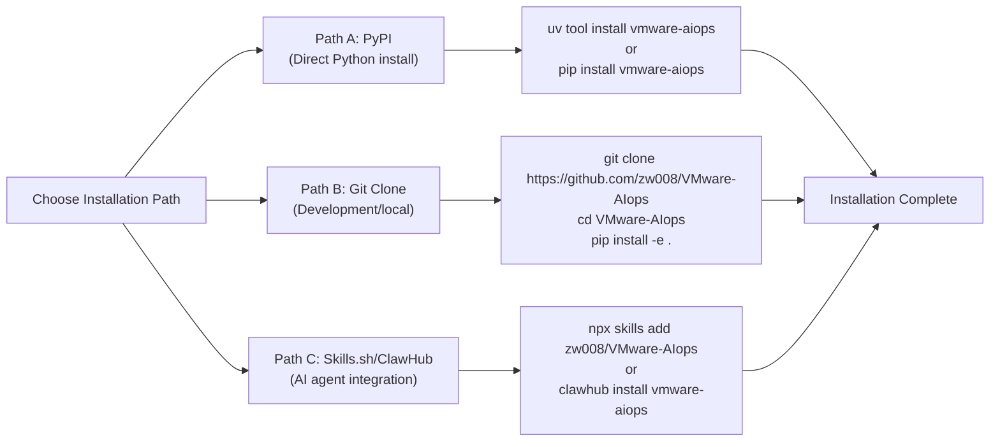
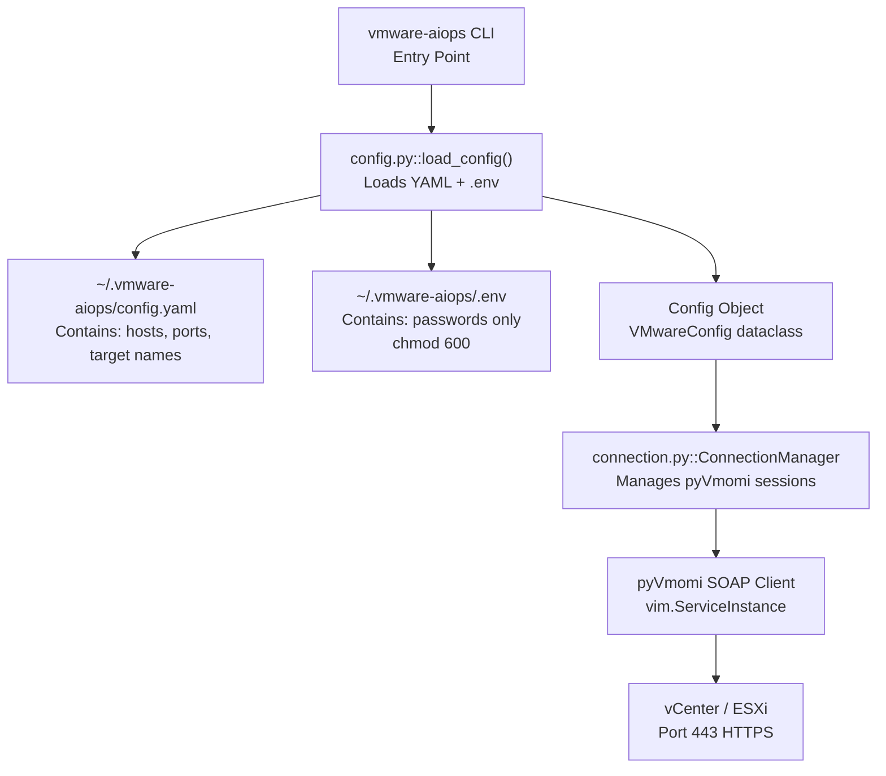
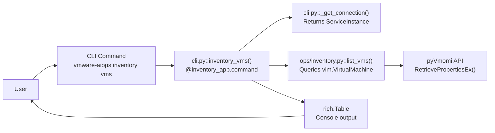
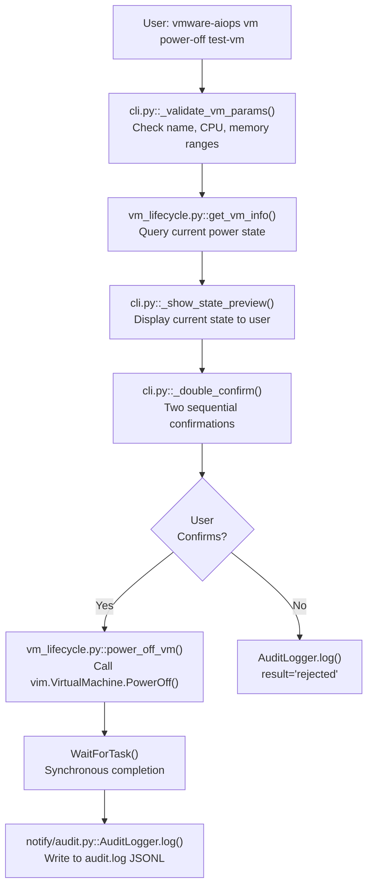

<!-- source: DeepWiki mcp.deepwiki.com · repo zw008/VMware-AIops · page 2.3 Quick Start · fetched 2026-10-26 -->

# Quick Start

<details>
<summary>Relevant source files</summary>

The following files were used as context for generating this wiki page:

- [README.md](README.md)
- [vmware_aiops/cli.py](vmware_aiops/cli.py)

</details>


This page provides a hands-on walkthrough to get VMware AIops installed, configured, and running your first operations in under 10 minutes. By the end of this guide, you will have executed both read and write operations against your vCenter or ESXi infrastructure.

For detailed installation options and troubleshooting, see [Installation](#2.1). For comprehensive configuration including multi-target setups and advanced options, see [Configuration](#2.2).

---

## Prerequisites Check

Before installing VMware AIops, verify your environment meets the minimum requirements:

```bash
# Python 3.10+ required
python3 --version
# Should output: Python 3.10.x or higher

# Optional: Node.js 18+ for Gemini/Codex CLI integrations
node --version
# Should output: v18.x.x or higher
```

**Infrastructure Access Requirements:**
- Network connectivity to vCenter Server (port 443) or ESXi host (port 443)
- vSphere user account with appropriate privileges (read-only for monitoring, administrator for full operations)

Sources: [README.md:320-328]()

---

## Installation: Three Paths

VMware AIops can be installed through multiple channels depending on your use case. Choose one:



### Path A: PyPI Installation (Recommended for Standalone Use)

```bash
# Install via uv (fast, isolated)
uv tool install vmware-aiops

# Or via pip
pip install vmware-aiops

# Verify installation
vmware-aiops --version
```

### Path B: Git Clone (Recommended for Development)

```bash
git clone https://github.com/zw008/VMware-AIops.git
cd VMware-AIops
python3 -m venv .venv
source .venv/bin/activate
pip install -e .

# Verify installation
vmware-aiops --version
```

### Path C: Skills.sh / ClawHub (For AI Agent Integration)

```bash
# Via Skills.sh (works with Claude Code, Cursor, Codex, etc.)
npx skills add zw008/VMware-AIops

# Via ClawHub
clawhub install vmware-aiops

# This installs both the Python backend and AI agent skill files
```

Sources: [README.md:15-38](), [README.md:318-340]()

---

## Configuration: Minimal Setup

VMware AIops stores configuration in `~/.vmware-aiops/config.yaml` and credentials in `~/.vmware-aiops/.env`.

### Step 1: Create Configuration Directory

```bash
mkdir -p ~/.vmware-aiops
```

### Step 2: Create config.yaml

Create `~/.vmware-aiops/config.yaml` with your target infrastructure:

```yaml
targets:
  - name: home-esxi
    host: 192.168.1.100
    type: esxi
    port: 443
    verify_ssl: false  # Set true if using CA-signed certificates

scanner:
  interval_minutes: 15
  severity_threshold: warning

notify:
  log_file: ~/.vmware-aiops/scan.log
```

**Key Fields:**
- `name`: Friendly identifier for this target (used with `--target` flag)
- `host`: IP address or hostname of vCenter/ESXi
- `type`: `vcenter` or `esxi`
- `verify_ssl`: `false` for self-signed certificates (lab environments only)

### Step 3: Create .env for Credentials

Create `~/.vmware-aiops/.env` with your credentials:

```bash
# ESXi target named "home-esxi" → VMWARE_HOME_ESXI_PASSWORD
VMWARE_HOME_ESXI_PASSWORD=your_password_here
```

**Naming Convention:**
```
VMWARE_{TARGET_NAME_UPPERCASE}_PASSWORD
# Replace hyphens with underscores
# Example: "prod-vcenter" → VMWARE_PROD_VCENTER_PASSWORD
```

Lock permissions:
```bash
chmod 600 ~/.vmware-aiops/.env
```

Sources: [README.md:342-376](), [vmware_aiops/config.py:1-100]()

---

## Configuration Architecture



**Key Components:**
- `load_config()` at [vmware_aiops/config.py:50-80]() reads YAML and merges environment variables
- `ConnectionManager` at [vmware_aiops/connection.py:15-100]() creates pyVmomi sessions with auto-retry
- Passwords **never** appear in config.yaml - only in `.env` file
- Session pooling enables multi-target operations without re-authentication

Sources: [vmware_aiops/config.py:1-150](), [vmware_aiops/connection.py:1-200]()

---

## First Connection Test: Doctor Command

The `doctor` command verifies environment, configuration, and connectivity:

```bash
vmware-aiops doctor
```

**Output Interpretation:**

| Check | Status | Meaning |
|-------|--------|---------|
| ✅ Python version | PASS | Python 3.10+ detected |
| ✅ Config file | PASS | `config.yaml` found and valid |
| ✅ Credentials | PASS | `.env` file found, permissions correct |
| ✅ vSphere connection | PASS | Successfully authenticated to target |
| ✅ Daemon status | INFO | Scanner daemon running (or not) |

**Common Issues:**

```bash
# Skip authentication check (faster, only validates config syntax)
vmware-aiops doctor --skip-auth

# If connection fails, verify:
# 1. Host is reachable: ping 192.168.1.100
# 2. Port 443 is open: telnet 192.168.1.100 443
# 3. Credentials are correct in .env
# 4. SSL setting matches certificate type (verify_ssl: false for self-signed)
```

The `doctor` command implementation is at [vmware_aiops/cli.py:1830-1841]() which calls `run_doctor()` from the doctor module.

Sources: [vmware_aiops/cli.py:1830-1841](), [README.md:776-777]()

---

## Your First Read Operation: List VMs

Read operations are safe - they query infrastructure state without making changes.

```bash
# List all VMs
vmware-aiops inventory vms --target home-esxi

# Filter powered-on VMs only
vmware-aiops inventory vms --power-state poweredOn

# Show top 10 VMs by memory
vmware-aiops inventory vms --limit 10 --sort-by memory_mb
```

**Sample Output:**

| Name | Power | CPUs | Memory (MB) | Guest OS | IP Address |
|------|-------|------|-------------|----------|------------|
| web-01 | poweredOn | 4 | 8192 | Ubuntu 22.04 | 192.168.1.50 |
| db-master | poweredOn | 8 | 16384 | CentOS 7 | 192.168.1.51 |
| test-vm | poweredOff | 2 | 4096 | Windows Server 2019 | - |

**Other Read Operations:**

```bash
# List ESXi hosts
vmware-aiops inventory hosts

# List datastores with capacity
vmware-aiops inventory datastores

# Check active alarms
vmware-aiops health alarms

# View recent events (last 24 hours)
vmware-aiops health events --hours 24 --severity warning

# Get detailed VM info
vmware-aiops vm info web-01
```

### CLI Command Flow to Backend Modules



**Code Path Trace:**
1. CLI entry at [vmware_aiops/cli.py:168-216]() defines `inventory vms` command
2. `_get_connection()` at [vmware_aiops/cli.py:92-99]() loads config and creates pyVmomi session
3. `list_vms()` at [vmware_aiops/ops/inventory.py:20-100]() uses pyVmomi to query `vim.VirtualMachine` objects
4. Results formatted with `rich.Table` at [vmware_aiops/cli.py:193-213]()

Sources: [vmware_aiops/cli.py:168-216](), [vmware_aiops/ops/inventory.py:1-150]()

---

## Your First Write Operation: Power On a VM

Write operations modify infrastructure state and include multiple safety layers.

### Dry-Run Mode (Safe Preview)

Always preview destructive operations with `--dry-run`:

```bash
vmware-aiops vm power-on test-vm --target home-esxi --dry-run
```

**Output:**
```
[DRY-RUN] No changes will be made.
  Target:    home-esxi
  VM:        test-vm
  Operation: power_on
  API Call:  vim.VirtualMachine.PowerOn()
  Current:   {'power_state': 'poweredOff'}
  Expected:  {'power_state': 'poweredOn'}
  Run without --dry-run to execute.
```

### Execute Power-On

```bash
vmware-aiops vm power-on test-vm --target home-esxi
```

**What Happens:**

1. **Pre-operation validation**: Verifies VM exists and is powered off
2. **API call**: `vim.VirtualMachine.PowerOn()` via pyVmomi
3. **Task wait**: Synchronously waits for vSphere task completion
4. **Audit log**: Records operation in `~/.vmware-aiops/audit.log`
5. **Console output**: `✅ VM 'test-vm' powered on successfully.`

### Safety Features in Action



**Double Confirmation Example:**

```
⚠️  即将执行: 关机 VM 'test-vm'

📋 Current state of VM 'test-vm':
  power_state: poweredOn
  cpu: 2
  memory_mb: 4096
  guest_os: Ubuntu Linux (64-bit)

第 1 次确认: 确定要关机 'test-vm'? [y/N]: y
第 2 次确认: 再次确认关机 'test-vm'，此操作不可撤销? [y/N]: y

✅ VM 'test-vm' powered off successfully.
```

**Audit Trail:**

All operations are logged to `~/.vmware-aiops/audit.log` in JSONL format:

```json
{
  "timestamp": "2024-01-15T10:30:00Z",
  "target": "home-esxi",
  "operation": "power_off",
  "resource": "test-vm",
  "parameters": {"force": false},
  "before_state": {"power_state": "poweredOn"},
  "after_state": {"power_state": "poweredOff"},
  "result": "VM 'test-vm' powered off successfully.",
  "user": "admin"
}
```

Sources: [vmware_aiops/cli.py:398-433](), [vmware_aiops/cli.py:141-163](), [vmware_aiops/notify/audit.py:1-100]()

---

## Command-to-Module Mapping Reference

This table maps CLI commands to their backend implementation for code navigation:

| CLI Command | Typer Function | Backend Module | pyVmomi API |
|-------------|----------------|----------------|-------------|
| `inventory vms` | `cli.py::inventory_vms()` [168-216]() | `ops/inventory.py::list_vms()` | `vim.VirtualMachine` |
| `inventory hosts` | `cli.py::inventory_hosts()` [218-240]() | `ops/inventory.py::list_hosts()` | `vim.HostSystem` |
| `health alarms` | `cli.py::health_alarms()` [298-322]() | `ops/health.py::get_active_alarms()` | `vim.alarm.AlarmManager` |
| `vm power-on` | `cli.py::vm_power_on()` [366-396]() | `ops/vm_lifecycle.py::power_on_vm()` | `vim.VirtualMachine.PowerOn()` |
| `vm power-off` | `cli.py::vm_power_off()` [398-433]() | `ops/vm_lifecycle.py::power_off_vm()` | `vim.VirtualMachine.PowerOff()` |
| `vm create` | `cli.py::vm_create()` [435-479]() | `ops/vm_lifecycle.py::create_vm()` | `vim.Folder.CreateVM_Task()` |
| `vm delete` | `cli.py::vm_delete()` [481-521]() | `ops/vm_lifecycle.py::delete_vm()` | `vim.VirtualMachine.Destroy_Task()` |
| `deploy ova` | `cli.py::deploy_ova_cmd()` [1040-1077]() | `ops/vm_deploy.py::deploy_ova()` | `vim.OvfManager.CreateImportSpec()` |
| `datastore browse` | `cli.py::ds_browse()` [955-980]() | `ops/datastore_browser.py::browse_datastore()` | `vim.host.DatastoreBrowser` |

**Helper Functions:**

| Function | Purpose | Location |
|----------|---------|----------|
| `_get_connection()` | Load config, create pyVmomi session | [cli.py:92-99]() |
| `_double_confirm()` | Two-step confirmation for destructive ops | [cli.py:141-163]() |
| `_validate_vm_params()` | Input validation (CPU 1-128, memory 128-1048576 MB) | [cli.py:120-139]() |
| `_dry_run_print()` | Preview API calls without execution | [cli.py:57-90]() |
| `_show_state_preview()` | Display current VM state before changes | [cli.py:107-118]() |

Sources: [vmware_aiops/cli.py:1-1846]()

---

## Next Steps

You've now installed VMware AIops, configured it, and executed both read and write operations. Here's what to explore next:

### For CLI Users

- **Full command reference**: See [CLI Command Reference](#4.1) for all available commands
- **VM lifecycle operations**: [VM Lifecycle Management](#7.2) covers snapshots, cloning, migration
- **Deployment workflows**: [VM Deployment](#7.3) explains OVA, templates, linked clones, batch operations
- **Safety features deep dive**: [Safety Features](#3.3) documents double confirmation, dry-run, audit logging

### For AI Agent Integration

- **Choose your AI platform**: [AI Agent Integration](#6) covers Claude Code, Gemini, Codex, Aider, Continue, local models
- **MCP server setup**: [MCP Server Setup](#5.1) for automated pipelines and agent chaining
- **Dual-mode architecture**: [Dual-Mode Architecture: CLI vs MCP](#3.1) explains when to use CLI mode vs MCP mode

### For Advanced Use Cases

- **Multi-target configuration**: [Configuration](#2.2) covers managing multiple vCenter/ESXi targets
- **Background scanning**: [Scheduled Scanning and Daemon](#8) for proactive monitoring
- **vSAN and Aria Operations**: [Advanced Features](#7.8) for enterprise integrations

### Production Deployment Checklist

Before deploying to production infrastructure:

1. **Use read-only skill**: Consider [VMware-Monitor](https://github.com/zw008/VMware-Monitor) for zero-risk monitoring
2. **Review audit logs**: Enable audit logging in [Configuration](#2.2)
3. **Test in dev environment**: Always validate operations in non-production first
4. **Configure TLS**: Set `verify_ssl: true` with CA-signed certificates
5. **Least privilege**: Create dedicated service accounts with minimal required permissions
6. **Review safety mechanisms**: Understand [Safety Features](#3.3) including double confirmation and dry-run mode

Sources: [README.md:1-968]()

---

