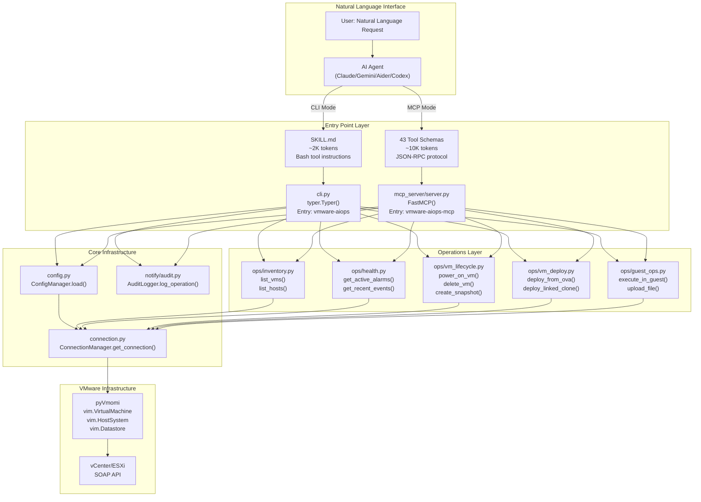
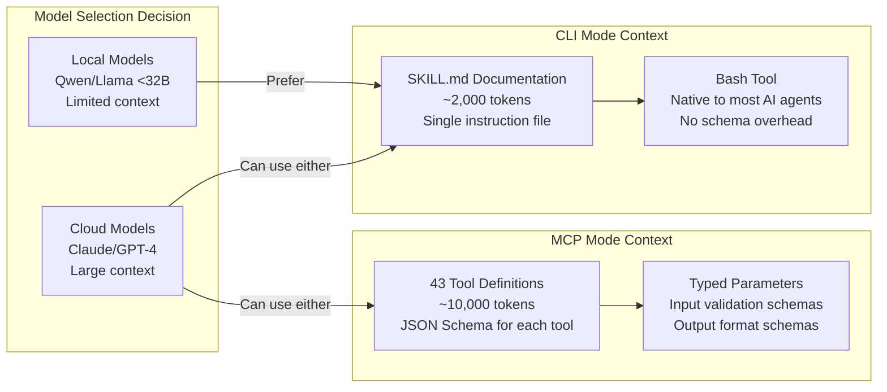
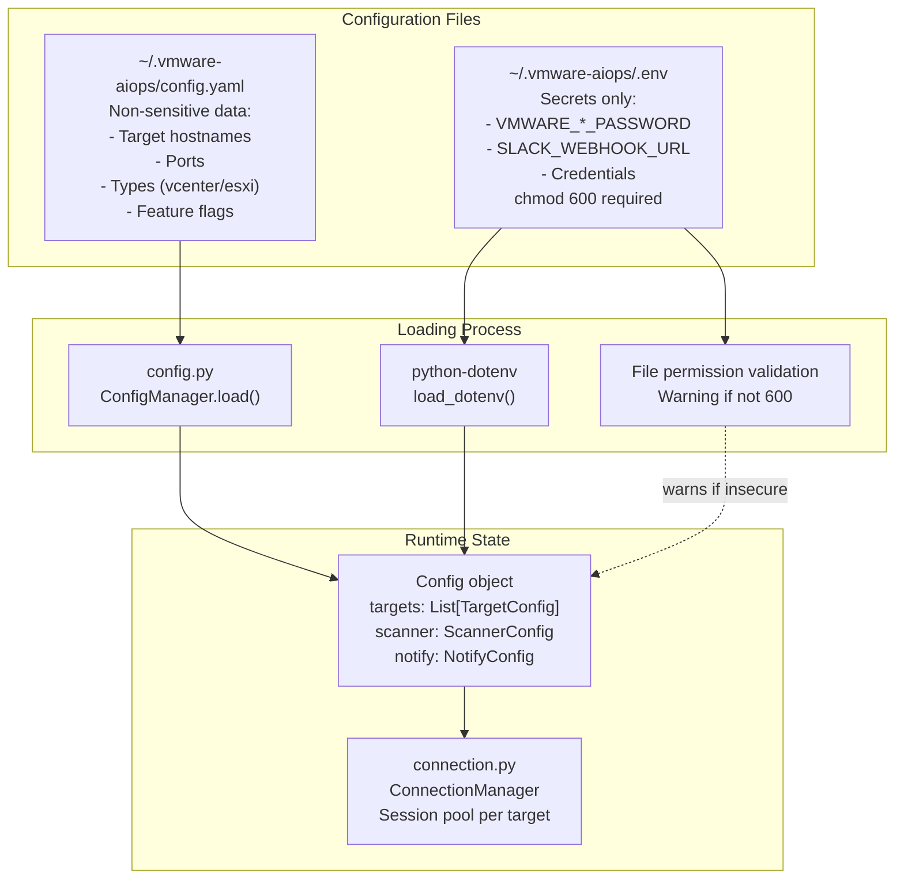
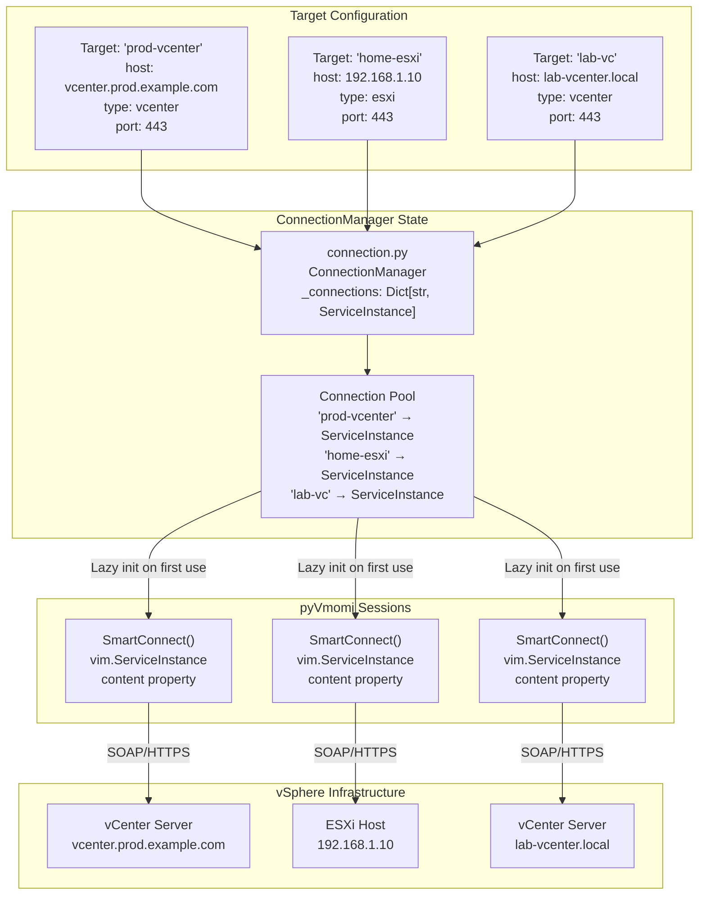
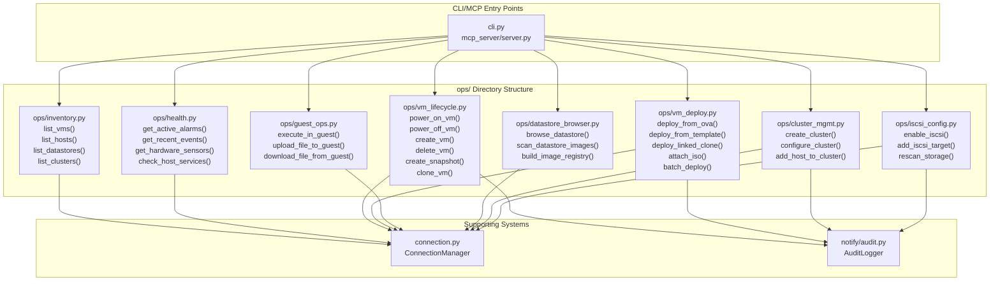
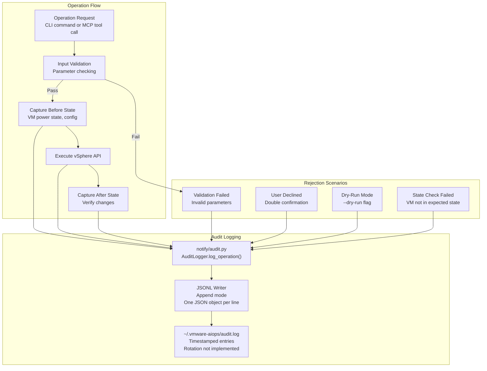
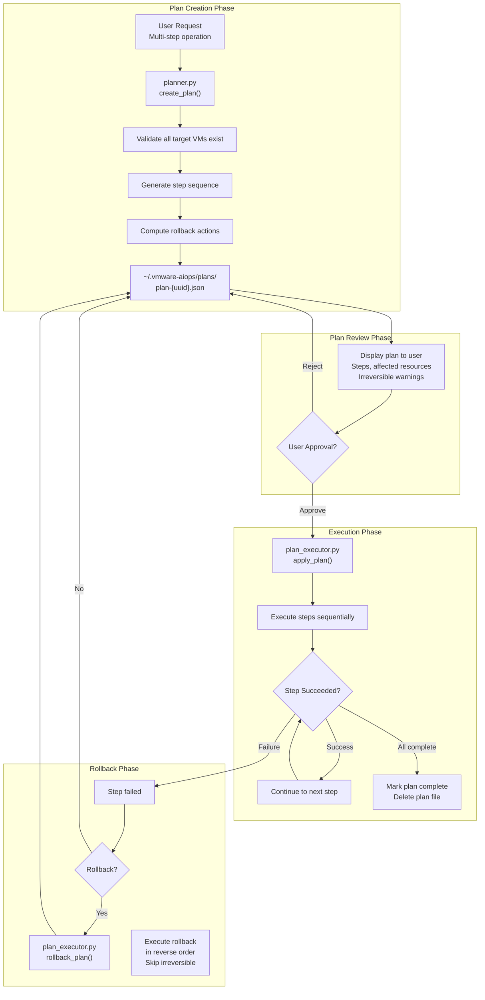
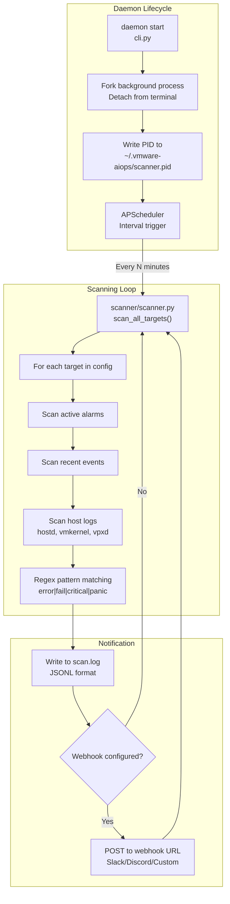

<!-- source: DeepWiki mcp.deepwiki.com · repo zw008/VMware-AIops · page 3 Core Concepts · fetched 2026-10-26 -->

# Core Concepts

<details>
<summary>Relevant source files</summary>

The following files were used as context for generating this wiki page:

- [README-CN.md](README-CN.md)
- [README.md](README.md)
- [skills/vmware-aiops/SKILL.md](skills/vmware-aiops/SKILL.md)

</details>


This document explains the fundamental architectural patterns and design decisions that define how VMware AIops operates. Understanding these concepts is essential before using the system or extending its functionality.

This page provides an overview of the four key architectural patterns:
- **Dual-Mode Architecture** - CLI and MCP operational modes for different token budgets and automation needs (detailed in [3.1](#3.1))
- **Dual-Skill Architecture** - Read-only monitoring versus full operations for different risk tolerances (detailed in [3.2](#3.2))
- **Safety Features** - Multi-layered protection mechanisms to prevent accidental infrastructure damage (detailed in [3.3](#3.3))
- **Plan → Apply → Rollback Workflow** - Structured multi-step operation pattern for complex changes (detailed in [3.4](#3.4))

For installation instructions, see [Getting Started](#2). For detailed usage of CLI commands, see [CLI Mode Usage](#4). For MCP server setup, see [MCP Mode Usage](#5).

---

## System Entry Points and Operational Flow

The VMware AIops system has two distinct entry points that serve different use cases. Both ultimately execute the same backend operations but differ in how they receive instructions and present results.



**Sources:** [vmware_aiops/cli.py:1-50](), [mcp_server/server.py:1-100](), [vmware_aiops/config.py:1-50](), [vmware_aiops/connection.py:1-100](), [vmware_aiops/notify/audit.py:1-50](), [skills/vmware-aiops/SKILL.md:1-100]()

The system flow operates as follows:

1. **User Intent** - User expresses infrastructure operation in natural language
2. **AI Agent Interpretation** - AI agent reads either `SKILL.md` (CLI mode) or 43 MCP tool schemas (MCP mode)
3. **Entry Point Selection** - Agent invokes either `vmware-aiops` CLI commands via bash or calls MCP tools via JSON-RPC
4. **Configuration Loading** - `ConfigManager.load()` reads `~/.vmware-aiops/config.yaml` and loads credentials from `.env`
5. **Connection Management** - `ConnectionManager.get_connection()` establishes pyVmomi session to target vCenter/ESXi
6. **Operation Execution** - Operations modules in `ops/` directory execute vSphere API calls
7. **Audit Logging** - `AuditLogger.log_operation()` writes JSONL records to `~/.vmware-aiops/audit.log`

---

## Token Budget and Context Window Considerations

The choice between CLI and MCP modes is primarily driven by token economics. Different AI models have different context window sizes and token costs, which directly impacts which mode is more efficient.



**Sources:** [README.md:57-66](), [skills/vmware-aiops/SKILL.md:60-76]()

| Aspect | CLI Mode | MCP Mode |
|--------|----------|----------|
| **Initial Context Load** | ~2K tokens (SKILL.md) | ~10K tokens (43 tool schemas) |
| **Per-Operation Overhead** | Command string + shell output parsing | JSON request + JSON response |
| **Type Safety** | String-based, parsed by CLI | Schema-validated JSON |
| **Best For** | Token-sensitive scenarios, local models <32B params | Automation pipelines, cloud LLMs |
| **Documentation File** | `SKILL.md` or `AGENTS.md` | MCP tool registration in `server.py` |

The 5x token difference becomes significant when:
- Using local models with limited context windows (e.g., Qwen 7B, Llama 13B)
- Running many operations in a single conversation (context accumulates)
- Cost-optimizing cloud API usage (tokens = money)

**Sources:** [README.md:57-66](), [skills/vmware-aiops/SKILL.md:60-76]()

---

## Configuration and Credential Management

The system uses a two-file configuration pattern that separates connection topology from secrets.



**Sources:** [vmware_aiops/config.py:1-100](), [vmware_aiops/connection.py:1-50](), [README.md:342-380]()

**Password Environment Variable Naming Convention:**

The system uses a consistent naming pattern for target-specific passwords:

```
VMWARE_{TARGET_NAME_UPPERCASE}_PASSWORD
```

Where `TARGET_NAME_UPPERCASE` is the target name from `config.yaml` with:
- All characters converted to uppercase
- Hyphens replaced with underscores

Examples:
- Target `home-esxi` → Environment variable `VMWARE_HOME_ESXI_PASSWORD`
- Target `prod-vcenter` → Environment variable `VMWARE_PROD_VCENTER_PASSWORD`
- Target `lab_host_01` → Environment variable `VMWARE_LAB_HOST_01_PASSWORD`

**Configuration Loading Sequence:**

1. `ConfigManager.load()` called at startup ([vmware_aiops/config.py:20-50]())
2. Reads `~/.vmware-aiops/config.yaml` or path from `VMWARE_AIOPS_CONFIG` env var
3. Validates YAML structure against expected schema
4. Calls `load_dotenv()` to import `~/.vmware-aiops/.env` ([vmware_aiops/config.py:30-40]())
5. Checks `.env` file permissions, warns if not `chmod 600`
6. Maps target names to environment variables using naming convention
7. Returns `Config` object with all settings populated

**Sources:** [vmware_aiops/config.py:1-100](), [README.md:361-367](), [config.example.yaml:1-50]()

---

## Connection Management and Multi-Target Support

The `ConnectionManager` class implements session pooling and lazy connection establishment for multiple vCenter/ESXi targets.



**Sources:** [vmware_aiops/connection.py:1-150]()

**Key Methods:**

| Method | Purpose | Implementation |
|--------|---------|----------------|
| `get_connection(target_name)` | Retrieve or create connection to target | [vmware_aiops/connection.py:50-80]() |
| `_establish_connection(target)` | Create new pyVmomi ServiceInstance | [vmware_aiops/connection.py:90-120]() |
| `disconnect(target_name)` | Explicitly close connection | [vmware_aiops/connection.py:130-140]() |
| `disconnect_all()` | Close all pooled connections | [vmware_aiops/connection.py:145-150]() |

**Connection Lifecycle:**

1. Operations modules call `ConnectionManager.get_connection('target-name')`
2. If connection exists in `_connections` dict, return cached `ServiceInstance`
3. If not exists, call `_establish_connection()`:
   - Load target config from `ConfigManager`
   - Retrieve password from environment using naming convention
   - Call `SmartConnect()` from pyVmomi with credentials
   - Store `ServiceInstance` in `_connections` dict
   - Return `ServiceInstance`
4. All subsequent operations on same target reuse the cached connection
5. Connections persist until explicit disconnect or process termination

**Sources:** [vmware_aiops/connection.py:1-150]()

---

## Operations Module Organization

The `ops/` directory contains functionally-organized modules that implement vSphere operations. Each module focuses on a specific domain and operates through the shared `ConnectionManager`.



**Sources:** [vmware_aiops/ops/inventory.py:1-50](), [vmware_aiops/ops/health.py:1-50](), [vmware_aiops/ops/vm_lifecycle.py:1-50](), [vmware_aiops/ops/vm_deploy.py:1-50]()

**Module Responsibilities:**

| Module | Primary Operations | Read-Only | Destructive |
|--------|-------------------|-----------|-------------|
| `inventory.py` | List VMs, hosts, datastores, clusters, networks | Yes | No |
| `health.py` | Query alarms, events, hardware sensors | Yes | No |
| `vm_lifecycle.py` | VM power ops, create, delete, snapshot, clone, migrate | No | Yes |
| `vm_deploy.py` | Deploy from OVA/template/linked-clone, batch operations | No | Moderate |
| `guest_ops.py` | Execute commands in guest OS, file transfer | No | Depends |
| `datastore_browser.py` | Browse files, scan images, build registry | Yes | No |
| `cluster_mgmt.py` | Create/delete clusters, configure HA/DRS | No | Yes |
| `iscsi_config.py` | Enable iSCSI, manage targets | No | Moderate |

All operations modules follow a consistent pattern:

1. Accept `target: str` parameter (defaults to first target in config)
2. Call `ConnectionManager.get_connection(target)` to get `ServiceInstance`
3. Access `service_instance.content` to navigate vSphere API object tree
4. Execute pyVmomi API calls on `vim.*` managed objects
5. Wait for async tasks using `wait_for_task()` helper
6. Return structured results (lists, dicts, or simple values)
7. For destructive operations, log to `AuditLogger` before and after

**Sources:** [vmware_aiops/ops/inventory.py:1-200](), [vmware_aiops/ops/vm_lifecycle.py:1-300]()

---

## Audit Trail and Compliance Logging

All operations are logged to a JSONL (JSON Lines) file for audit, compliance, and troubleshooting purposes. The audit log captures both successful operations and rejected attempts.



**Sources:** [vmware_aiops/notify/audit.py:1-100](), [README.md:205-213]()

**JSONL Entry Structure:**

Each line in `audit.log` is a complete JSON object with the following schema:

```json
{
  "timestamp": "2024-01-15T14:23:45.123456Z",
  "target": "prod-vcenter",
  "operation": "vm_power_off",
  "resource": "web-server-01",
  "parameters": {
    "force": false,
    "graceful_timeout": 300
  },
  "before_state": {
    "power_state": "poweredOn",
    "connection_state": "connected"
  },
  "after_state": {
    "power_state": "poweredOff",
    "connection_state": "connected"
  },
  "result": "success",
  "user": "vmware_admin",
  "rejection_reason": null,
  "duration_seconds": 12.34
}
```

**Logged Events:**

| Event Type | Example | `result` Value | `rejection_reason` Populated |
|------------|---------|----------------|------------------------------|
| Successful operation | VM powered off | `"success"` | No |
| Validation failure | Invalid CPU count | `"validation_failed"` | Yes |
| User rejection | Declined confirmation | `"user_rejected"` | Yes |
| Dry-run preview | `--dry-run` flag used | `"dry_run"` | No (informational) |
| State check failure | VM already powered off | `"state_mismatch"` | Yes |
| API error | vSphere API exception | `"error"` | Yes (exception details) |

**Sources:** [vmware_aiops/notify/audit.py:1-100](), [vmware_aiops/cli.py:100-150]()

---

## Planning System for Multi-Step Operations

Complex operations involving multiple steps or multiple VMs use a plan-apply-rollback workflow to ensure atomicity and recoverability.



**Sources:** [vmware_aiops/planner.py:1-100](), [vmware_aiops/plan_executor.py:1-150](), [README.md:153-164]()

**Plan Structure:**

Plans are stored as JSON files in `~/.vmware-aiops/plans/` with this structure:

```json
{
  "plan_id": "550e8400-e29b-41d4-a716-446655440000",
  "created_at": "2024-01-15T14:00:00Z",
  "target": "prod-vcenter",
  "status": "pending",
  "steps": [
    {
      "step_id": 1,
      "action": "vm_snapshot_create",
      "resource": "web-server-01",
      "parameters": {"name": "pre-upgrade"},
      "reversible": true,
      "rollback_action": "vm_snapshot_delete",
      "rollback_parameters": {"name": "pre-upgrade"}
    },
    {
      "step_id": 2,
      "action": "vm_power_off",
      "resource": "web-server-01",
      "parameters": {"force": false},
      "reversible": true,
      "rollback_action": "vm_power_on",
      "rollback_parameters": {}
    },
    {
      "step_id": 3,
      "action": "vm_reconfigure",
      "resource": "web-server-01",
      "parameters": {"cpu": 8, "memory": 16384},
      "reversible": true,
      "rollback_action": "vm_reconfigure",
      "rollback_parameters": {"cpu": 4, "memory": 8192}
    }
  ],
  "irreversible_warnings": [
    "Snapshot creation cannot be automatically rolled back if disk space is insufficient"
  ]
}
```

**Plan Lifecycle:**

1. **Creation** - `create_plan()` validates targets, generates steps, computes rollback ([vmware_aiops/planner.py:20-80]())
2. **Validation** - Check all target VMs exist in vSphere before proceeding
3. **Storage** - Write plan to `~/.vmware-aiops/plans/plan-{uuid}.json`
4. **Review** - Present plan to user with warnings about irreversible steps
5. **Execution** - `apply_plan()` executes steps sequentially ([vmware_aiops/plan_executor.py:20-100]())
6. **Completion** - Delete plan file on success
7. **Failure Handling** - If step fails, prompt for rollback
8. **Rollback** - `rollback_plan()` reverses executed steps in reverse order ([vmware_aiops/plan_executor.py:110-150]())
9. **Cleanup** - Plans older than 24 hours are automatically deleted

**Sources:** [vmware_aiops/planner.py:1-100](), [vmware_aiops/plan_executor.py:1-150](), [README.md:153-164]()

---

## Background Scanning Daemon

The scanner daemon provides proactive monitoring by periodically scanning all configured targets for alarms, events, and log patterns.



**Sources:** [vmware_aiops/scanner/scanner.py:1-200](), [vmware_aiops/notify/notifier.py:1-100](), [README.md:186-197]()

**Scanner Configuration:**

The scanner is configured in `~/.vmware-aiops/config.yaml`:

```yaml
scanner:
  interval_minutes: 15  # How often to scan
  severity_threshold: warning  # critical|warning|info
  lookback_hours: 1  # How far back to scan events
  log_types:  # Which host logs to scan
    - vpxd
    - hostd
    - vmkernel
```

**Daemon Commands:**

| Command | Purpose | Implementation |
|---------|---------|----------------|
| `vmware-aiops daemon start` | Start scanner in background | [vmware_aiops/cli.py:500-530]() |
| `vmware-aiops daemon stop` | Stop running scanner | [vmware_aiops/cli.py:535-550]() |
| `vmware-aiops daemon status` | Check if scanner is running | [vmware_aiops/cli.py:555-570]() |

**Log Pattern Detection:**

The scanner uses regex patterns to identify problematic log entries:

```python
ERROR_PATTERNS = [
    r'\berror\b',
    r'\bfail(ed)?\b',
    r'\bcritical\b',
    r'\bpanic\b',
    r'\btimeout\b',
    r'\bcorrupt(ed)?\b',
    r'\bdisk\s+full\b',
    r'\bout\s+of\s+memory\b'
]
```

Matched entries are logged to `~/.vmware-aiops/scan.log` with metadata:

```json
{
  "timestamp": "2024-01-15T14:30:00Z",
  "target": "prod-vcenter",
  "type": "host_log",
  "source": "hostd",
  "hostname": "esxi-01.prod.example.com",
  "severity": "error",
  "message": "Failed to power on VM: insufficient resources",
  "pattern_matched": "fail"
}
```

**Sources:** [vmware_aiops/scanner/scanner.py:1-200](), [vmware_aiops/notify/notifier.py:1-100]()

---

## Summary

VMware AIops is built on four core architectural patterns:

1. **Dual-Mode Architecture** - CLI and MCP modes optimize for different token budgets and automation needs. CLI mode uses ~2K tokens via `SKILL.md`, MCP mode uses ~10K tokens via 43 tool schemas. Details in [3.1](#3.1).

2. **Dual-Skill Architecture** - Separate `vmware-monitor` and `vmware-aiops` skills provide read-only versus full operations. Monitor achieves safety through code-level prevention; aiops through runtime controls. Details in [3.2](#3.2).

3. **Safety Features** - Multi-layered protection including input validation, state checks, double confirmation, dry-run mode, and comprehensive audit logging. Details in [3.3](#3.3).

4. **Plan-Apply-Rollback** - Structured workflow for multi-step operations with automatic rollback generation and execution. Plans stored as JSON files with rollback metadata. Details in [3.4](#3.4).

All modes and skills share the same backend infrastructure:
- `config.py` for YAML+.env configuration loading
- `connection.py` for pyVmomi session pooling
- `ops/` directory for functionally-organized operation modules
- `notify/audit.py` for JSONL audit logging
- `scanner/scanner.py` for background monitoring daemon

**Sources:** [vmware_aiops/cli.py:1-100](), [mcp_server/server.py:1-100](), [vmware_aiops/config.py:1-100](), [vmware_aiops/connection.py:1-150](), [vmware_aiops/ops/inventory.py:1-50](), [vmware_aiops/notify/audit.py:1-100](), [vmware_aiops/planner.py:1-100](), [vmware_aiops/scanner/scanner.py:1-100]()

---

