<!-- source: DeepWiki mcp.deepwiki.com · repo zw008/VMware-AIops · page 3.1 Dual-Mode Architecture: CLI vs MCP · fetched 2026-10-26 -->

# Dual-Mode Architecture: CLI vs MCP

<details>
<summary>Relevant source files</summary>

The following files were used as context for generating this wiki page:

- [README-CN.md](README-CN.md)
- [README.md](README.md)
- [plugins/vmware-ops/skills/vmware-aiops/SKILL.md](plugins/vmware-ops/skills/vmware-aiops/SKILL.md)
- [skills/vmware-aiops/SKILL.md](skills/vmware-aiops/SKILL.md)

</details>


## Purpose and Scope

This document explains the dual-mode operational architecture of VMware AIops, which provides two distinct interfaces for AI agent integration: **CLI mode** and **MCP mode**. The choice between these modes represents a fundamental architectural decision that affects token consumption, integration complexity, and operational characteristics.

For information about how to install and configure each mode, see [Getting Started](#2). For specific usage patterns and tool reference, see [CLI Mode Usage](#4) and [MCP Mode Usage](#5). For AI agent integration examples, see [AI Agent Integration](#6).

---

## Architectural Overview

VMware AIops implements two parallel operational modes that share the same backend infrastructure but expose different interfaces to AI agents. Both modes ultimately invoke the same Python operations modules, but differ in how they package functionality for consumption by AI systems.

### System-Level Architecture

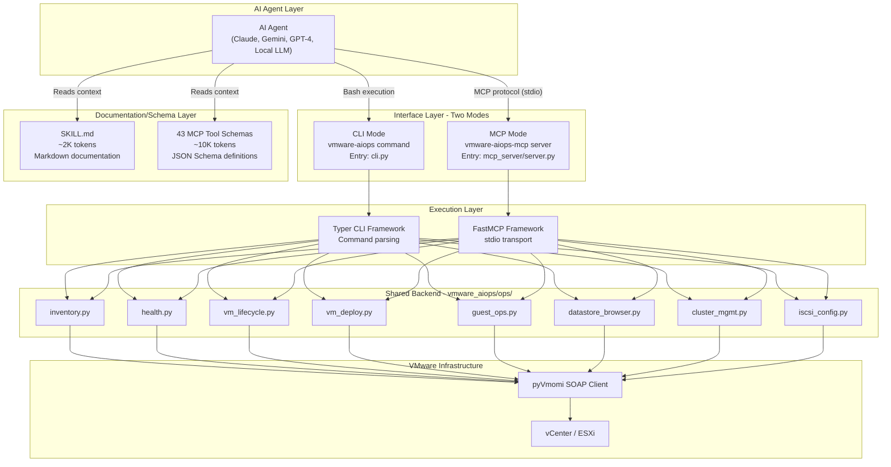

**Sources:** [README.md:55-83](), [plugins/vmware-ops/skills/vmware-aiops/SKILL.md:59-76]()

---

## CLI Mode: Token-Efficient Command Execution

### Architecture

CLI mode exposes functionality through a traditional command-line interface built with the Typer framework. AI agents read operation documentation from `SKILL.md` files and execute operations by invoking shell commands.

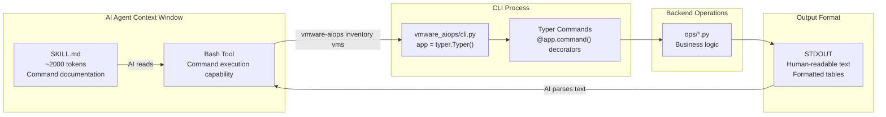

**Sources:** [vmware_aiops/cli.py:1-50](), [skills/vmware-aiops/SKILL.md:78-94]()

### Technical Characteristics

| Characteristic | Implementation | Impact |
|---------------|----------------|---------|
| **Entry Point** | `vmware_aiops/cli.py` with Typer framework | Single executable with subcommands |
| **Context Size** | SKILL.md ~2000 tokens | Minimal context window usage |
| **Command Syntax** | `vmware-aiops <group> <command> [options]` | Familiar shell interface |
| **Output Format** | Plain text, formatted tables (Rich library) | Requires text parsing by AI |
| **State Management** | Stateless per invocation | Each command starts fresh |
| **Configuration** | `~/.vmware-aiops/config.yaml` + `.env` files | File-based configuration |

**Sources:** [vmware_aiops/cli.py:1-100](), [README.md:773-863]()

### Token Consumption Analysis

The CLI mode's low token consumption comes from a single documentation file that describes all operations:

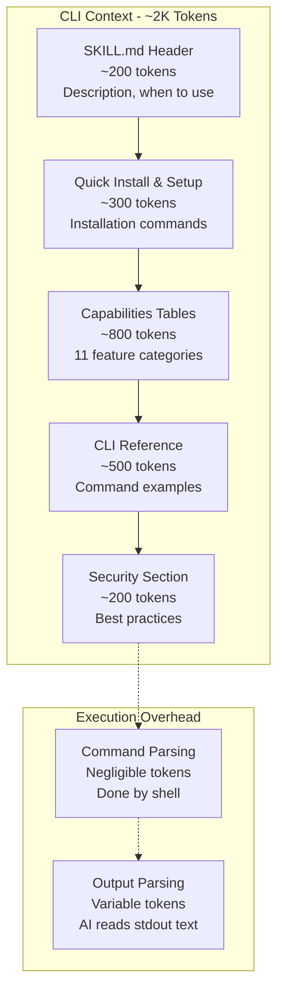

**Sources:** [skills/vmware-aiops/SKILL.md:1-509]()

### Integration Patterns

CLI mode integrates with AI platforms through skill/convention files that instruct the AI to execute bash commands:

| Platform | Integration Method | Configuration File |
|----------|-------------------|-------------------|
| Claude Code | SKILL.md skill definition | `plugins/vmware-ops/skills/vmware-aiops/SKILL.md` |
| Aider | Conventions file | `codex-skill/AGENTS.md` |
| Continue | Rules file | `codex-skill/AGENTS.md` |
| Trae IDE | Project rules | `trae-rules/project_rules.md` |
| Kimi Code | Skill definition | `kimi-skill/SKILL.md` |

**Sources:** [README.md:268-281](), [README.md:386-561]()

---

## MCP Mode: Structured Tool Protocol

### Architecture

MCP (Model Context Protocol) mode exposes functionality through a standardized server that communicates via JSON-RPC over stdio. AI agents interact with structured tool definitions rather than parsing command documentation.

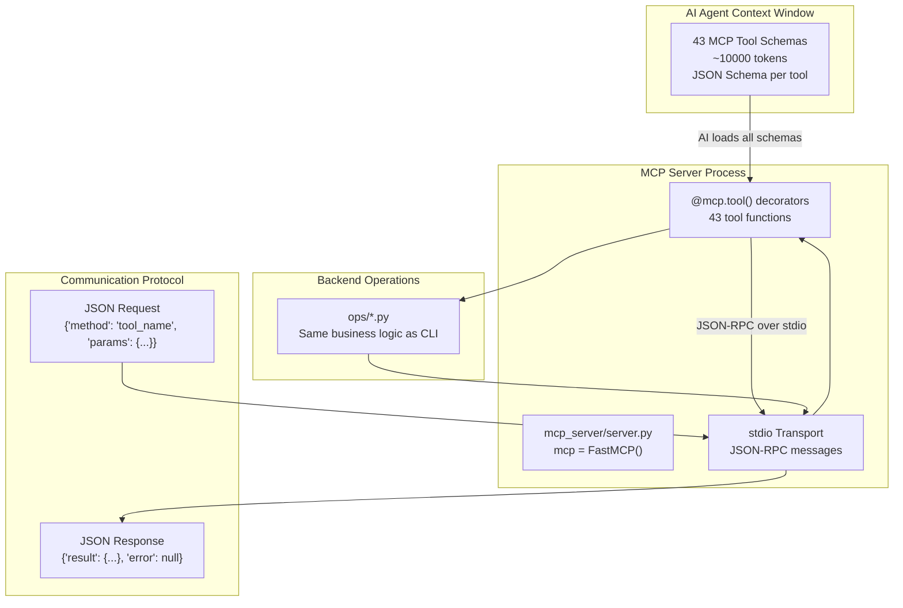

**Sources:** [mcp_server/server.py:1-100](), [README.md:562-598]()

### Technical Characteristics

| Characteristic | Implementation | Impact |
|---------------|----------------|---------|
| **Entry Point** | `mcp_server/server.py` with FastMCP framework | Long-running server process |
| **Context Size** | 43 tool schemas ~10000 tokens | High context window usage |
| **Communication** | JSON-RPC over stdio | Structured data exchange |
| **Output Format** | JSON with type safety | No parsing required by AI |
| **State Management** | Server persists between calls | Connection pooling possible |
| **Configuration** | Same config.yaml + .env | Shared with CLI mode |

**Sources:** [mcp_server/server.py:1-200](), [plugins/vmware-ops/skills/vmware-aiops/SKILL.md:96-129]()

### Tool Categories

The MCP server exposes 43 tools organized into 8 functional categories:

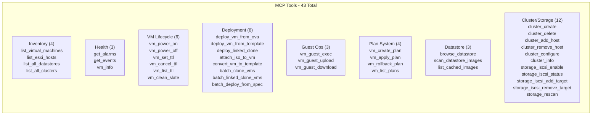

**Sources:** [plugins/vmware-ops/skills/vmware-aiops/SKILL.md:115-128]()

### Integration Patterns

MCP mode integrates with MCP-compatible clients through standardized configuration files:

| Client | Configuration Location | Transport |
|--------|----------------------|-----------|
| Claude Desktop | `claude_desktop_config.json` | stdio |
| Cursor | `cursor.json` | stdio |
| VS Code Copilot | `vscode-copilot.json` | stdio |
| Goose | `goose.json` | stdio |
| LocalCowork | `localcowork.json` | stdio |
| Continue | `continue.yaml` | stdio |

**Sources:** [README.md:293-314](), [examples/mcp-configs/]()

---

## Decision Criteria: When to Use Each Mode

### Recommendation Matrix

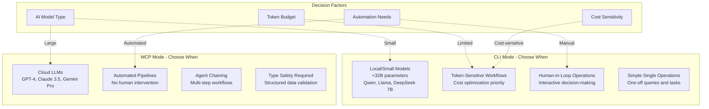

**Sources:** [README.md:57-66](), [skills/vmware-aiops/SKILL.md:60-76]()

### Detailed Comparison Table

| Factor | CLI Mode | MCP Mode |
|--------|----------|----------|
| **Token Consumption** | ~2K tokens (SKILL.md) | ~10K tokens (43 tool schemas) |
| **Model Size Recommendation** | <32B parameters optimal | 32B+ parameters recommended |
| **Local Model Compatibility** | Excellent (Ollama, LM Studio) | Poor (schema overload) |
| **Cloud Model Compatibility** | Good | Excellent |
| **Output Parsing** | AI must parse text | Structured JSON |
| **Type Safety** | Runtime validation only | Schema-enforced types |
| **Error Handling** | Exit codes + stderr | JSON error objects |
| **Execution Overhead** | Process spawn per command | Persistent server |
| **Integration Complexity** | Low (bash + SKILL.md) | Medium (MCP configuration) |
| **Best For** | Cost optimization, small models | Automation, large models |

**Sources:** [README.md:57-66](), [plugins/vmware-ops/skills/vmware-aiops/SKILL.md:60-76]()

---

## Token Consumption Comparison

### CLI Mode Context Footprint

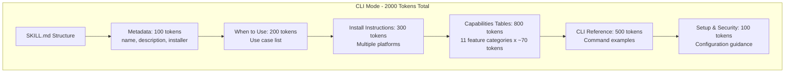

### MCP Mode Context Footprint

```mermaid
graph TB
    subgraph "MCP Mode - 10000 Tokens Total"
        M1["Tool Schema Structure"]
        M2["Tool Metadata: 500 tokens<br/>Server info, capabilities"]
        M3["Inventory Tools: 1000 tokens<br/>4 tools x 250 tokens"]
        M4["Health Tools: 750 tokens<br/>3 tools x 250 tokens"]
        M5["Lifecycle Tools: 1500 tokens<br/>6 tools x 250 tokens"]
        M6["Deployment Tools: 2000 tokens<br/>8 tools x 250 tokens"]
        M7["Guest Ops Tools: 750 tokens<br/>3 tools x 250 tokens"]
        M8["Plan Tools: 1000 tokens<br/>4 tools x 250 tokens"]
        M9["Datastore Tools: 750 tokens<br/>3 tools x 250 tokens"]
        M10["Cluster/Storage Tools: 1750 tokens<br/>12 tools x 145 tokens"]
    end
    
    M1 --> M2
    M2 --> M3
    M3 --> M4
    M4 --> M5
    M5 --> M6
    M6 --> M7
    M7 --> M8
    M8 --> M9
    M9 --> M10
```

**Sources:** [skills/vmware-aiops/SKILL.md:1-509](), [README.md:57-66]()

### Impact on Model Performance

The token overhead difference has significant implications for model performance:

| Model Size | CLI Mode Performance | MCP Mode Performance |
|------------|---------------------|---------------------|
| **7B-13B params** | Good - can process 2K context | Poor - struggles with 10K schemas |
| **32B params** | Excellent - minimal overhead | Fair - high but manageable |
| **70B+ params** | Excellent - trivial overhead | Good - handles complexity well |
| **Cloud LLMs** | Excellent - but costs per token | Excellent - better structured I/O |

**Sources:** [README.md:60-66](), [skills/vmware-aiops/SKILL.md:66-67]()

---

## Request/Response Flow Comparison

### CLI Mode Execution Flow

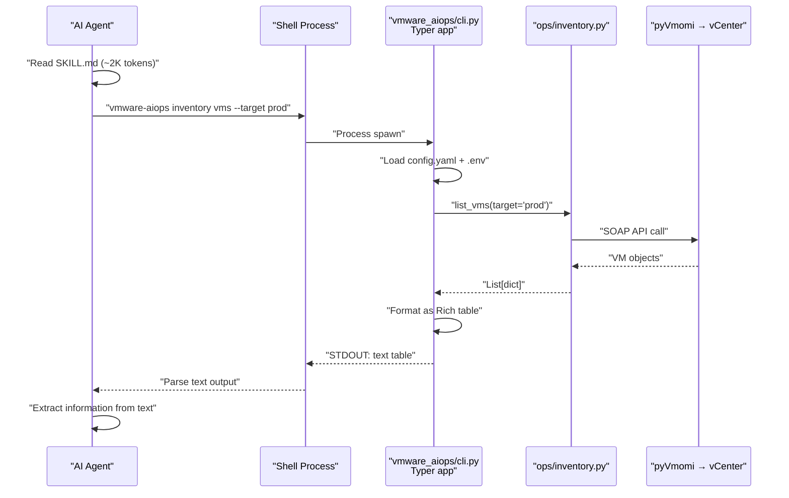

### MCP Mode Execution Flow

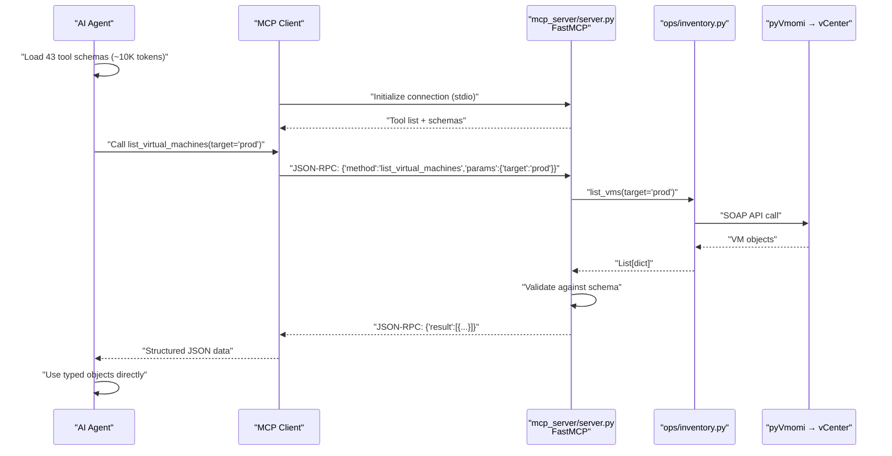

**Sources:** [mcp_server/server.py:1-200](), [vmware_aiops/cli.py:1-200]()

---

## Implementation Entry Points

### CLI Mode Entry Point

The CLI mode is implemented as a Typer application with command groups:

**File:** `vmware_aiops/cli.py`

Key components:
- `app = typer.Typer()` - Main application instance
- Command groups: `inventory`, `health`, `vm`, `deploy`, `datastore`, `cluster`, `storage`, `vsan`, `ops`, `vks`, `daemon`, `scan`, `plan`, `doctor`, `mcp-config`
- Configuration loading via `ConfigManager.get_instance()`
- Output formatting via Rich library

**Sources:** [vmware_aiops/cli.py:1-100]()

### MCP Mode Entry Point

The MCP mode is implemented as a FastMCP server with tool decorators:

**File:** `mcp_server/server.py`

Key components:
- `mcp = FastMCP("vmware-aiops")` - Server instance
- `@mcp.tool()` decorators for each of 43 tools
- Same ConfigManager as CLI mode
- JSON Schema validation for inputs/outputs
- stdio transport for communication

**Sources:** [mcp_server/server.py:1-100](), [mcp_server/__main__.py:1-20]()

---

## Shared Backend Architecture

Both modes share identical backend implementation to ensure functional consistency:

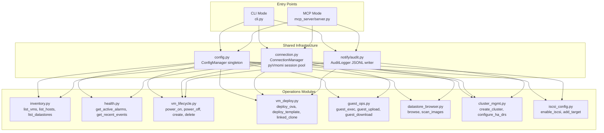

**Sources:** [vmware_aiops/config.py:1-50](), [vmware_aiops/connection.py:1-50](), [vmware_aiops/notify/audit.py:1-50]()

This shared backend ensures that:
- Both modes have identical functional capabilities
- Configuration is consistent across modes
- Audit logging works the same way
- Connection pooling benefits both modes
- Bug fixes apply to both interfaces

**Sources:** [vmware_aiops/ops/]()

---

## Configuration and Environment

Both modes use identical configuration mechanisms:

### Configuration Files

| File | Purpose | Location |
|------|---------|----------|
| `config.yaml` | Target definitions, scanner settings | `~/.vmware-aiops/config.yaml` |
| `.env` | Credentials (passwords, tokens) | `~/.vmware-aiops/.env` |
| `audit.log` | Operation audit trail | `~/.vmware-aiops/audit.log` |
| `image_registry.json` | Cached datastore image index | `~/.vmware-aiops/image_registry.json` |

### Environment Variables

| Variable | Purpose | Used By |
|----------|---------|---------|
| `VMWARE_AIOPS_CONFIG` | Path to config.yaml | Both modes |
| `VMWARE_{TARGET}_PASSWORD` | Target-specific credentials | Both modes (via .env) |
| `SLACK_WEBHOOK_URL` | Scanner notifications | Both modes (optional) |
| `DISCORD_WEBHOOK_URL` | Scanner notifications | Both modes (optional) |

**Sources:** [vmware_aiops/config.py:1-100](), [README.md:343-380]()

---

## Performance Characteristics

### Startup Time

| Mode | Startup Time | Reason |
|------|-------------|--------|
| **CLI** | ~200-500ms per invocation | Process spawn, config load, execute, exit |
| **MCP** | ~500-1000ms initial, then persistent | Server initialization, then reuses process |

### Memory Footprint

| Mode | Memory Usage | Characteristics |
|------|-------------|-----------------|
| **CLI** | ~30-50MB per invocation | Ephemeral, released on exit |
| **MCP** | ~50-80MB persistent | Connection pooling, schema caching |

### Throughput

| Mode | Operations/Minute | Limiting Factor |
|------|------------------|-----------------|
| **CLI** | ~30-60 operations | Process spawn overhead |
| **MCP** | ~100-200 operations | JSON-RPC overhead, but no process spawn |

**Sources:** [vmware_aiops/cli.py:1-50](), [mcp_server/server.py:1-50]()

---

## Practical Usage Examples

### CLI Mode Example Session

```bash
# AI agent reads SKILL.md (~2K tokens), then executes:

# List all VMs
vmware-aiops inventory vms --target prod-vcenter

# Check health
vmware-aiops health alarms --target prod-vcenter

# Power on a VM
vmware-aiops vm power-on my-vm --target prod-vcenter

# Each command spawns a new process, no state persists
```

### MCP Mode Example Session

```json
// AI agent loads all 43 tool schemas (~10K tokens), then calls:

// List all VMs
{
  "jsonrpc": "2.0",
  "method": "tools/call",
  "params": {
    "name": "list_virtual_machines",
    "arguments": {"target": "prod-vcenter"}
  }
}

// Check health
{
  "jsonrpc": "2.0",
  "method": "tools/call",
  "params": {
    "name": "get_alarms",
    "arguments": {"target": "prod-vcenter"}
  }
}

// Server persists, connection pooled
```

**Sources:** [README.md:773-863](), [plugins/vmware-ops/skills/vmware-aiops/SKILL.md:363-461]()

---

## Hybrid Usage Patterns

Both modes can coexist and be used by the same AI agent depending on context:

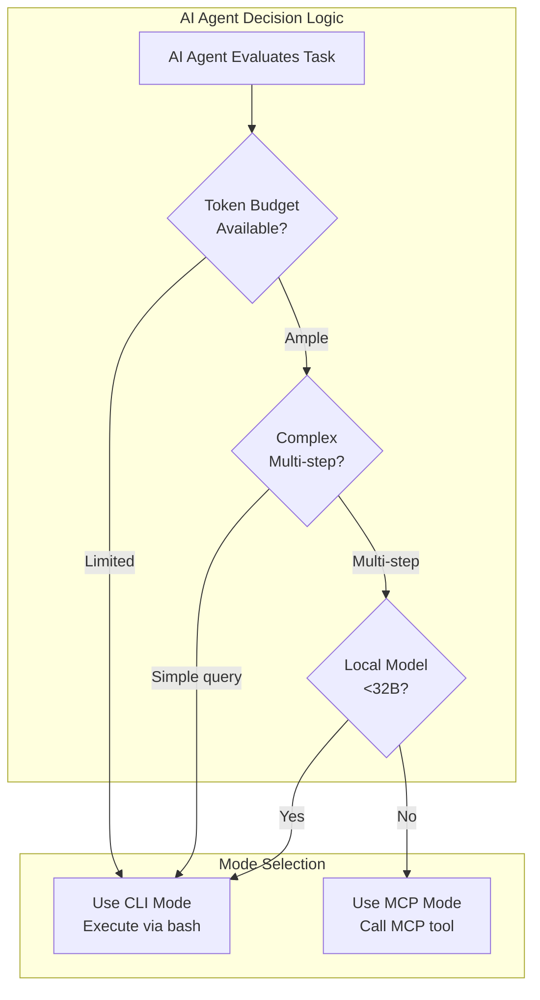

**Sources:** [README.md:57-66](), [skills/vmware-aiops/SKILL.md:60-76]()

Some AI platforms (Claude Code, Cursor) support both modes simultaneously and can dynamically choose based on the task characteristics.

**Sources:** [README.md:268-314]()

---

