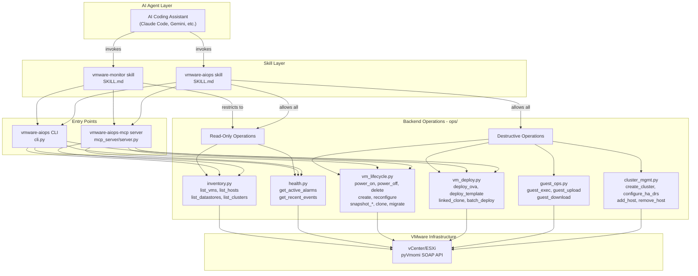
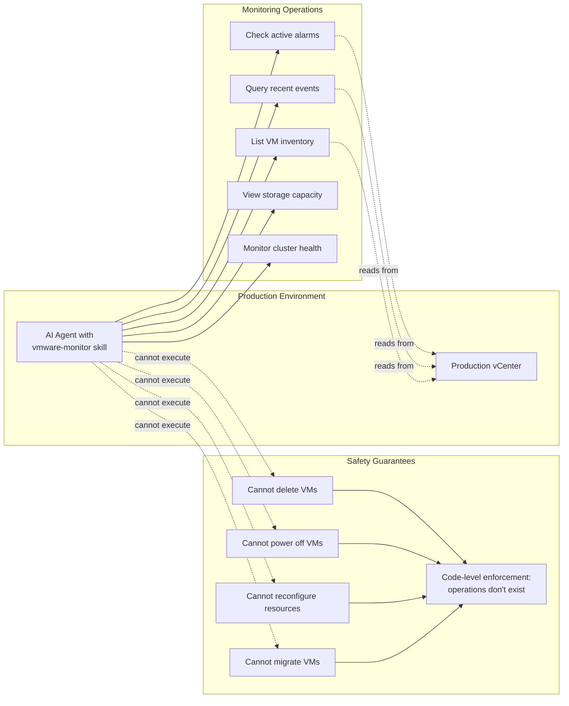
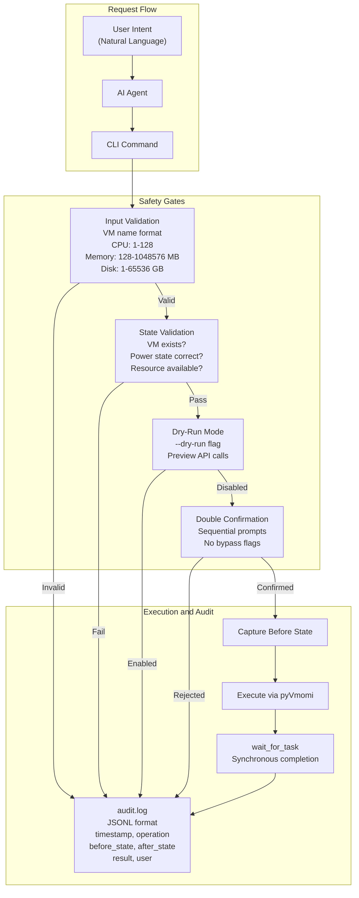
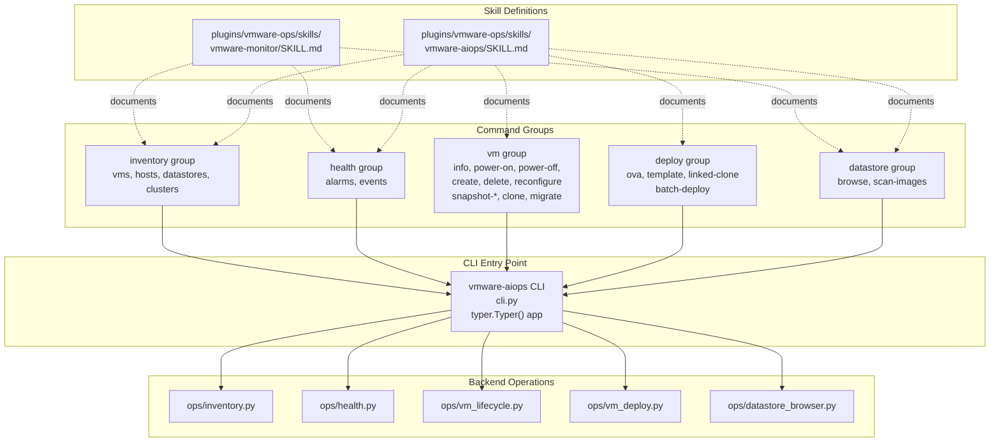
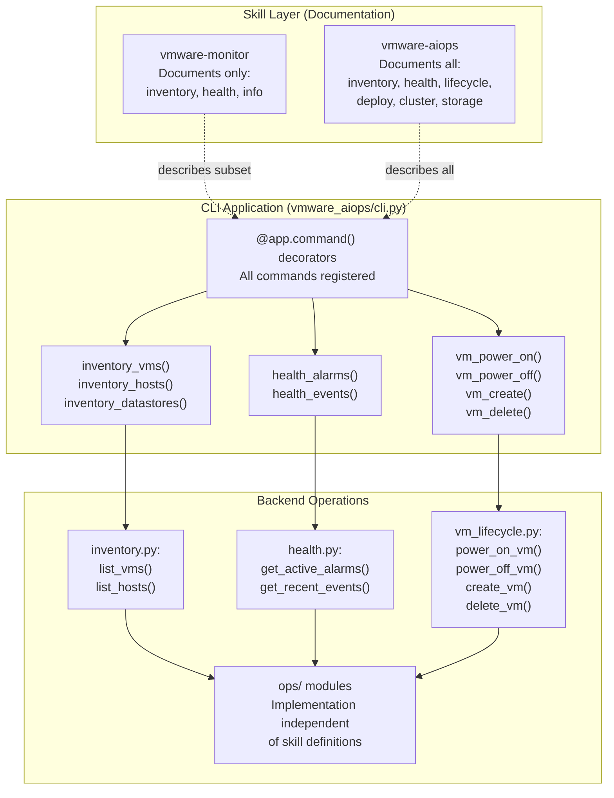
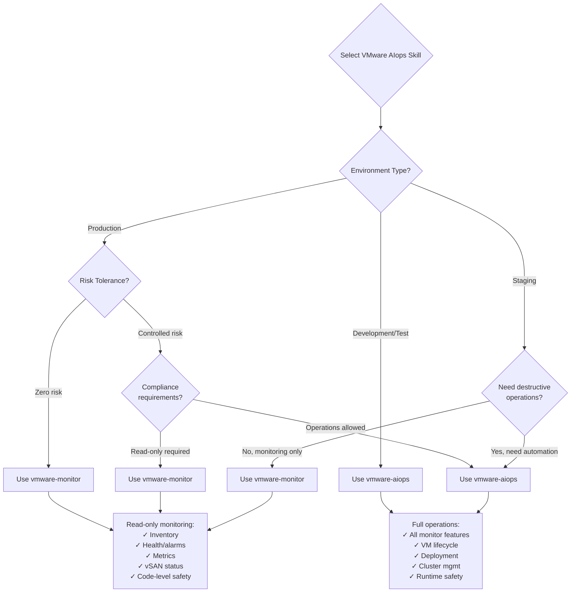

<!-- source: DeepWiki mcp.deepwiki.com · repo zw008/VMware-AIops · page 3.2 Dual-Skill Architecture: Monitor vs AIops · fetched 2026-10-26 -->

# Dual-Skill Architecture: Monitor vs AIops

<details>
<summary>Relevant source files</summary>

The following files were used as context for generating this wiki page:

- [README-CN.md](README-CN.md)
- [README.md](README.md)

</details>


This document explains the dual-skill architecture in VMware AIops, which provides two separate skill definitions for different operational safety levels: `vmware-monitor` (read-only) and `vmware-aiops` (full operations). The architecture enables organizations to deploy monitoring capabilities to production environments while restricting destructive operations, or to use full operational capabilities in development/test environments with appropriate safety controls.

For information about the CLI vs MCP operational modes, see [Dual-Mode Architecture: CLI vs MCP](#3.1). For safety features across both skills, see [Safety Features](#3.3).

---

## Architecture Overview

The dual-skill architecture provides defense-in-depth safety through **two distinct skill definitions** that expose different subsets of operations from the same Python backend:



**Sources:** [README.md:1-968](), [README-CN.md:1-618]()

---

## vmware-monitor: Read-Only Skill

### Purpose and Safety Model

The `vmware-monitor` skill provides **code-level safety** by exposing only read-only operations. Unlike runtime safety mechanisms (confirmation prompts, audit logs), code-level safety means that destructive operations **do not exist** in the skill definition. An AI agent using this skill cannot accidentally execute destructive operations, even if it misinterprets user intent.

### Exposed Operations

| Category | Operations | CLI Commands |
|----------|-----------|--------------|
| **Inventory** | List VMs, hosts, datastores, clusters, networks | `vmware-aiops inventory vms`<br/>`vmware-aiops inventory hosts`<br/>`vmware-aiops inventory datastores`<br/>`vmware-aiops inventory clusters` |
| **Health Monitoring** | Active alarms, recent events, hardware sensors, host services | `vmware-aiops health alarms`<br/>`vmware-aiops health events --hours 24` |
| **VM Information** | VM details, power state, IP address, resource usage | `vmware-aiops vm info <name>` |
| **Datastore Browsing** | Browse datastore contents, scan for images | `vmware-aiops datastore browse <name>`<br/>`vmware-aiops datastore scan-images` |
| **vSAN Monitoring** | Health checks, capacity, disk groups, performance | `vmware-aiops vsan health`<br/>`vmware-aiops vsan capacity` |
| **Aria Operations** | Alerts, metrics, capacity planning (read-only) | `vmware-aiops ops alerts`<br/>`vmware-aiops ops metrics <resource>` |

### Use Cases



**Typical use cases:**
- Production environment monitoring with zero risk
- Compliance environments requiring read-only access
- Delegating monitoring tasks to AI agents without operational risk
- Multi-tenant environments where some users need monitoring only
- Scheduled scanning and alerting without write access

**Sources:** [README.md:8-8](), [README.md:381-381](), [README.md:954-957]()

---

## vmware-aiops: Full Operations Skill

### Purpose and Safety Model

The `vmware-aiops` skill provides **full operational capabilities** including all monitoring features plus VM lifecycle management, deployment, and infrastructure operations. Safety is enforced through **runtime controls**: double confirmation, input validation, audit logging, and optional dry-run mode.

### Exposed Operations

| Category | Operations | Safety Controls |
|----------|-----------|-----------------|
| **All Monitor Operations** | Everything in vmware-monitor | Read-only, no confirmation |
| **Power Operations** | Power on, power off (graceful/force), reset, suspend | Double confirmation for power-off |
| **VM Lifecycle** | Create, delete, reconfigure CPU/memory | Double confirmation for delete/reconfigure |
| **Snapshots** | Create, list, revert, delete snapshots | No confirmation (reversible) |
| **Cloning** | Clone VM, linked clone, batch clone | Double confirmation |
| **Migration** | vMotion to different host | Double confirmation |
| **Deployment** | Deploy OVA, template, linked-clone, batch deploy | Validation + confirmation |
| **Guest Operations** | Execute commands, upload/download files in guest OS | Requires VMware Tools |
| **Cluster Management** | Create cluster, configure HA/DRS, add/remove hosts | Double confirmation |
| **Storage Management** | Configure iSCSI, add targets, rescan storage | Validation + confirmation |

### Safety Mechanisms



**Runtime Safety Features:**
- **Input Validation**: All parameters validated before execution ([vmware_aiops/ops/vm_lifecycle.py:1-800]())
- **Double Confirmation**: Sequential confirmation prompts with no bypass option ([vmware_aiops/cli.py:1-1200]())
- **Dry-Run Mode**: Preview exact API calls with `--dry-run` flag
- **Audit Trail**: All operations logged to `~/.vmware-aiops/audit.log` ([vmware_aiops/notify/audit.py:1-200]())
- **State Capture**: Before/after state recorded for all operations
- **Task Waiting**: Synchronous completion with result reporting

**Sources:** [README.md:124-150](), [README.md:199-213](), [vmware_aiops/cli.py:1-1200]()

---

## Operations Comparison

### Complete Feature Matrix

| Operation | vmware-monitor | vmware-aiops | Notes |
|-----------|:--------------:|:------------:|-------|
| **Inventory** | | | |
| List VMs | ✅ | ✅ | Name, power state, CPU, memory, IP |
| List Hosts | ✅ | ✅ | CPU, memory, version, VM count |
| List Datastores | ✅ | ✅ | Capacity, type, usage % |
| List Clusters | ✅ | ✅ | Host count, DRS/HA status |
| **Health & Monitoring** | | | |
| Active Alarms | ✅ | ✅ | Severity, entity, timestamp |
| Event Query | ✅ | ✅ | Filter by time, severity |
| Hardware Sensors | ✅ | ✅ | Temperature, voltage, fan status |
| Host Services | ✅ | ✅ | Running/stopped status |
| **VM Information** | | | |
| VM Details | ✅ | ✅ | Config, guest OS, tools status |
| Snapshot List | ✅ | ✅ | Snapshot tree structure |
| TTL Status | ✅ | ✅ | Auto-deletion timer |
| **VM Lifecycle** | | | |
| Power On | ❌ | ✅ | No confirmation |
| Power Off | ❌ | ✅ | Double confirmation |
| Create VM | ❌ | ✅ | Input validation |
| Delete VM | ❌ | ✅ | Double confirmation |
| Reconfigure | ❌ | ✅ | Double confirmation |
| **Snapshots** | | | |
| Create Snapshot | ❌ | ✅ | No confirmation (reversible) |
| Revert Snapshot | ❌ | ✅ | No confirmation (reversible) |
| Delete Snapshot | ❌ | ✅ | No confirmation |
| **Advanced Operations** | | | |
| Clone VM | ❌ | ✅ | Double confirmation |
| vMotion | ❌ | ✅ | Double confirmation |
| Deploy OVA | ❌ | ✅ | Validation + confirmation |
| Guest Exec | ❌ | ✅ | Requires VMware Tools |
| Clean Slate | ❌ | ✅ | Double confirmation |
| Set TTL | ❌ | ✅ | No confirmation |
| **Cluster Management** | | | |
| Create Cluster | ❌ | ✅ | Double confirmation |
| Configure HA/DRS | ❌ | ✅ | Double confirmation |
| Add/Remove Hosts | ❌ | ✅ | Double confirmation |
| **Storage** | | | |
| Configure iSCSI | ❌ | ✅ | Validation + confirmation |
| Rescan Storage | ❌ | ✅ | No confirmation |
| **Datastore** | | | |
| Browse Files | ✅ | ✅ | Read-only |
| Scan Images | ✅ | ✅ | Read-only |
| **vSAN** | | | |
| Health Check | ✅ | ✅ | Read-only |
| Capacity | ✅ | ✅ | Read-only |
| Disk Groups | ✅ | ✅ | Read-only |
| Performance | ✅ | ✅ | Read-only |
| **Aria Operations** | | | |
| Alerts | ✅ | ✅ | Read-only |
| Metrics | ✅ | ✅ | Read-only |
| Recommendations | ✅ | ✅ | Read-only |

**Sources:** [README.md:95-265](), [README-CN.md:104-223]()

---

## Implementation Architecture

### Skill Definition Files

Both skills are defined in separate SKILL.md files that expose different command sets:



**Key files:**
- **vmware-monitor skill**: `plugins/vmware-ops/skills/vmware-monitor/SKILL.md`
- **vmware-aiops skill**: `plugins/vmware-ops/skills/vmware-aiops/SKILL.md`
- **CLI entry point**: [vmware_aiops/cli.py:1-1200]()
- **Backend operations**: [vmware_aiops/ops/]()

### Shared Backend Implementation

Both skills use the **same Python backend**. The differentiation happens at the skill definition level, not in the backend code:



**Key insight:** The safety boundary is enforced by **documentation scope**, not code access control. The `vmware-monitor` skill documentation instructs AI agents to use only read-only commands. All commands technically exist in the CLI, but the monitor skill does not expose destructive commands to the AI agent.

**Sources:** [vmware_aiops/cli.py:1-1200](), [vmware_aiops/ops/inventory.py:1-500](), [vmware_aiops/ops/health.py:1-400](), [vmware_aiops/ops/vm_lifecycle.py:1-800]()

---

## Deployment Strategies

### Production vs Development Environments

```mermaid
graph TB
    subgraph "Production Environment"
        ProdStrategy["Strategy: Zero Risk"]
        ProdSkill["Skill: vmware-monitor"]
        ProdOps["Operations: Read-only<br/>inventory, health, alarms"]
        ProdvCenter["Production vCenter"]
        ProdBenefit["Benefits:<br/>✓ No accidental changes<br/>✓ Compliance-friendly<br/>✓ Code-level safety<br/>✓ Audit trail"]
    end
    
    subgraph "Development Environment"
        DevStrategy["Strategy: Full Automation"]
        DevSkill["Skill: vmware-aiops"]
        DevOps["Operations: All features<br/>lifecycle, deploy, cluster"]
        DevvCenter["Dev/Test vCenter"]
        DevBenefit["Benefits:<br/>✓ Full automation<br/>✓ Rapid iteration<br/>✓ Testing scenarios<br/>✓ Double-confirm safety"]
    end
    
    subgraph "Staging Environment"
        StagingStrategy["Strategy: Mixed"]
        StagingChoice{Operational<br/>Needs?}
        StagingMonitor["vmware-monitor<br/>for monitoring only"]
        StagingAiops["vmware-aiops<br/>for testing deployments"]
    end
    
    ProdStrategy --> ProdSkill
    ProdSkill --> ProdOps
    ProdOps --> ProdvCenter
    ProdvCenter --> ProdBenefit
    
    DevStrategy --> DevSkill
    DevSkill --> DevOps
    DevOps --> DevvCenter
    DevvCenter --> DevBenefit
    
    StagingStrategy --> StagingChoice
    StagingChoice -->|Monitoring| StagingMonitor
    StagingChoice -->|Testing| StagingAiops
```



### Environment-Based Recommendations

| Environment | Recommended Skill | Rationale |
|-------------|:----------------:|-----------|
| **Production** | `vmware-monitor` | Zero risk of accidental changes; monitoring alerts and capacity planning without operational capability |
| **Staging** | `vmware-monitor` or `vmware-aiops` | Monitor for production-like safety; aiops for pre-production validation of deployment workflows |
| **Development** | `vmware-aiops` | Full automation capabilities for rapid iteration; double-confirm prevents accidents |
| **Testing/Lab** | `vmware-aiops` | Unrestricted operations for testing scenarios; TTL auto-cleanup useful for ephemeral VMs |
| **Compliance/Audit** | `vmware-monitor` | Read-only access satisfies audit requirements; all queries logged without change capability |
| **Multi-tenant** | Both | Monitor for tenants needing visibility only; aiops for operators needing full control |

**Sources:** [README.md:381-381](), [README-CN.md:338-338]()

---

## Switching Between Skills

### Claude Code

In Claude Code, both skills are available as separate invocations:

```bash
# Monitor skill (read-only)
/vmware-ops:vmware-monitor
> Show me all VMs with CPU usage over 80%

# AIops skill (full operations)
/vmware-ops:vmware-aiops
> Create a new VM named test-vm with 4 CPUs and 8GB memory
```

**Switching:** Type the alternate skill invocation command. The AI agent context switches to use only the commands documented in that skill.

### Gemini CLI, Codex, Aider, Continue

For convention-based integrations, copy the appropriate SKILL.md file:

```bash
# For monitor skill (read-only)
cp plugins/vmware-ops/skills/vmware-monitor/SKILL.md ~/.codex/skills/vmware-monitor/SKILL.md

# For aiops skill (full operations)
cp plugins/vmware-ops/skills/vmware-aiops/SKILL.md ~/.codex/skills/vmware-aiops/SKILL.md
```

**Switching:** Replace the SKILL.md file in your AI tool's skills directory and restart the tool.

### MCP Server

The MCP server exposes all operations as separate tools. To restrict to monitor operations only, configure the MCP client to filter tools:

```json
{
  "mcpServers": {
    "vmware-monitor": {
      "command": "python",
      "args": ["-m", "mcp_server"],
      "env": {
        "VMWARE_AIOPS_CONFIG": "/path/to/config.yaml"
      },
      "allowedTools": [
        "vmware_inventory_vms",
        "vmware_inventory_hosts",
        "vmware_inventory_datastores",
        "vmware_health_alarms",
        "vmware_health_events",
        "vmware_vm_info"
      ]
    }
  }
}
```

**Note:** MCP tool filtering is client-specific. Refer to your MCP client's documentation for tool filtering configuration.

**Sources:** [README.md:42-51](), [README.md:565-591](), [mcp_server/server.py:1-800]()

---

## Skill Selection Decision Tree



**Sources:** [README.md:8-8](), [README.md:249-265](), [README-CN.md:8-13]()

---

## Related Projects

The dual-skill architecture in this repository differs from the standalone **VMware-Monitor** project:

| Aspect | VMware-Monitor (separate repo) | vmware-monitor skill (this repo) |
|--------|-------------------------------|----------------------------------|
| **Codebase** | Completely separate codebase with zero destructive code | Skill definition restricting access to shared backend |
| **Safety Level** | Code-level: destructive functions don't exist | Documentation-level: destructive functions exist but not exposed to AI |
| **Installation** | `clawhub install vmware-monitor` | Part of vmware-aiops installation |
| **Repository** | https://github.com/zw008/VMware-Monitor | Skill file in this repository |
| **Use Case** | Maximum safety for production | Convenience for multi-environment deployments |

**When to use the standalone VMware-Monitor:**
- Regulatory/compliance environments requiring code audit
- Maximum paranoia about code-level safety
- Standalone installation with minimal dependencies
- Production environments where destructive code must not be present in the codebase

**When to use vmware-monitor skill in this repo:**
- Single installation supporting both monitoring and operations
- Different environments using different skills
- Simplified deployment and updates
- Trust in documentation-based access control

**Sources:** [README.md:8-8](), [README.md:950-957](), [README-CN.md:599-605]()

---

