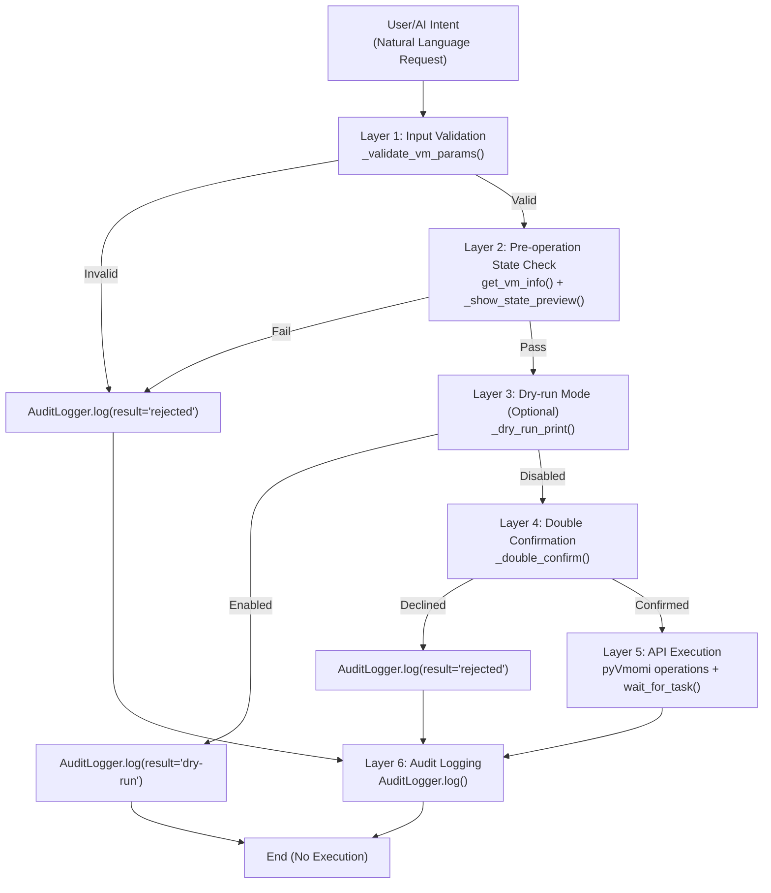
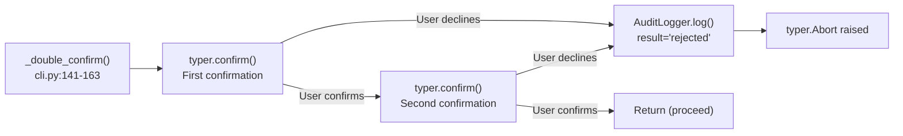
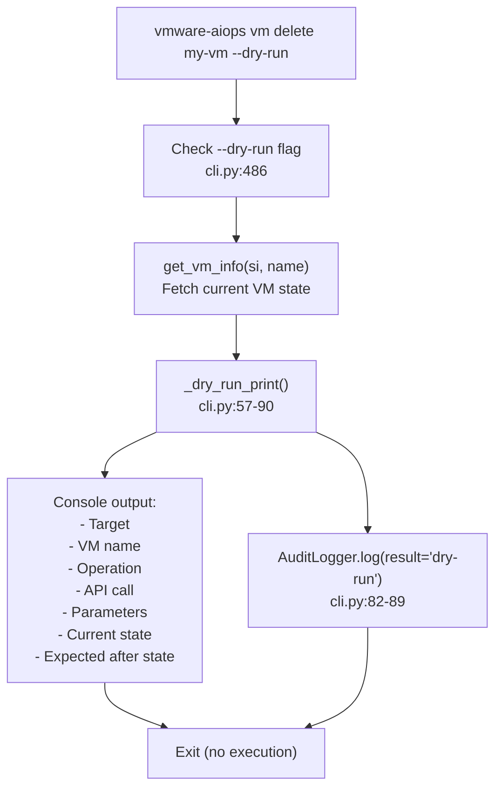
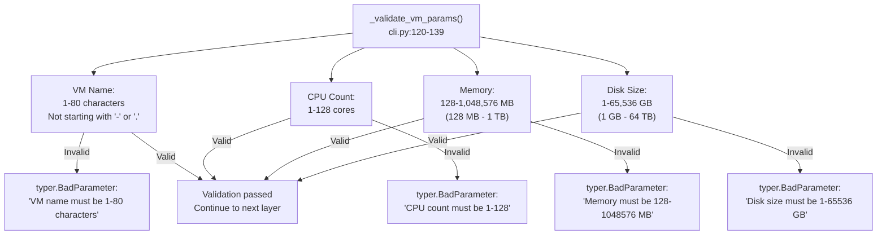
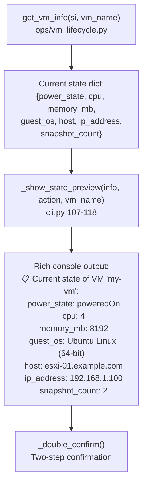
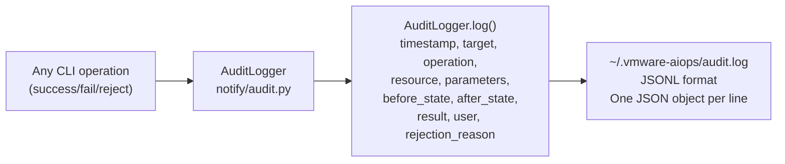
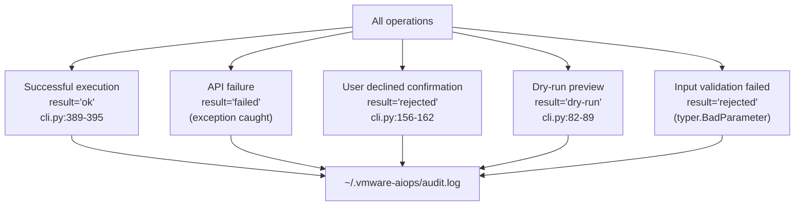
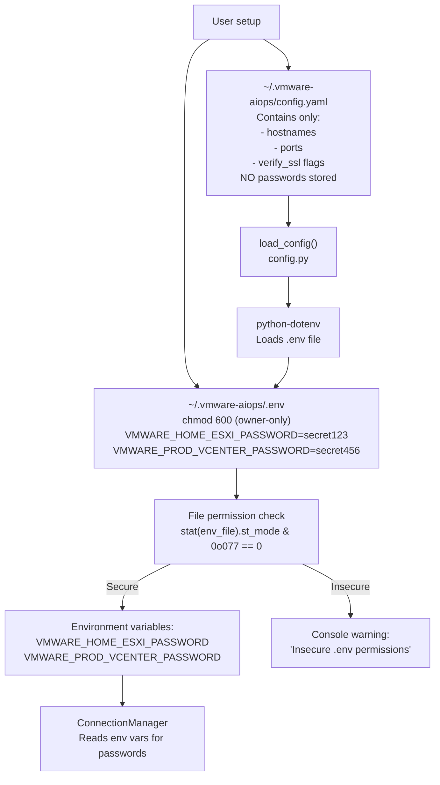

<!-- source: DeepWiki mcp.deepwiki.com · repo zw008/VMware-AIops · page 3.3 Safety Features · fetched 2026-10-26 -->

# Safety Features

<details>
<summary>Relevant source files</summary>

The following files were used as context for generating this wiki page:

- [README.md](README.md)
- [skills/vmware-aiops/SKILL.md](skills/vmware-aiops/SKILL.md)
- [vmware_aiops/cli.py](vmware_aiops/cli.py)

</details>


This page describes the safety mechanisms implemented in VMware AIops to prevent accidental or malicious destructive operations. These features provide defense-in-depth protection through input validation, double confirmation, state preview, dry-run mode, and comprehensive audit logging.

For the broader plan-apply-rollback workflow used for multi-step operations, see [Plan → Apply → Rollback Workflow](#3.4). For the dual-skill architecture that provides code-level safety through read-only operations, see [Dual-Skill Architecture: Monitor vs AIops](#3.2).

---

## Safety Architecture Overview

VMware AIops implements a **six-layer defense-in-depth safety architecture** that validates, previews, confirms, executes, and audits all operations. Every destructive operation must pass through multiple gates before execution.

### Safety Layers Flow



**Sources:** [vmware_aiops/cli.py:57-163](), [README.md:199-214](), [skills/vmware-aiops/SKILL.md:305-318]()

---

## Double Confirmation Mechanism

All destructive operations require **two sequential confirmations** with no bypass option. This prevents accidental execution due to single-click mistakes, AI misinterpretation, or prompt injection attacks.

### Implementation

The `_double_confirm()` function enforces two-step confirmation:



**Operations requiring double confirmation:**
- `vm power-off` (graceful and forced) - [vmware_aiops/cli.py:398-433]()
- `vm delete` - [vmware_aiops/cli.py:481-521]()
- `vm reconfigure` - [vmware_aiops/cli.py:523-579]()
- `vm snapshot-revert` - [vmware_aiops/cli.py:632-666]()
- `vm snapshot-delete` - [vmware_aiops/cli.py:668-698]()
- `vm clone` - [vmware_aiops/cli.py:700-734]()
- `vm migrate` - [vmware_aiops/cli.py:736-772]()
- `vm clean-slate` - [vmware_aiops/cli.py:834-867]()
- `cluster delete` - [vmware_aiops/cli.py:1359-1386]()
- `cluster add-host` / `remove-host` - [vmware_aiops/cli.py:1388-1444]()
- `cluster configure` - [vmware_aiops/cli.py:1446-1487]()
- `storage iscsi-*` operations - [vmware_aiops/cli.py:1492-1606]()
- `deploy ova` / `template` / `linked-clone` - [vmware_aiops/cli.py:1040-1153]()

### No Bypass Flags

The system intentionally provides **no command-line flags** to bypass double confirmation (e.g., no `--force`, `--yes`, or `--skip-confirm` flags). This design prevents automation scripts from accidentally executing destructive operations and forces deliberate human interaction.

**Sources:** [vmware_aiops/cli.py:141-163](), [README.md:204](), [skills/vmware-aiops/SKILL.md:310]()

---

## Dry-Run Mode

The `--dry-run` flag allows users to preview the exact API calls that would be executed without making any changes to the VMware infrastructure.

### Dry-Run Flow



### Dry-Run Output Format

When `--dry-run` is used, the system displays:

| Field | Example | Source |
|-------|---------|--------|
| **Target** | `home-esxi` | Specified via `--target` flag |
| **Resource** | `my-vm` | VM name or cluster name |
| **Operation** | `delete_vm` | Operation identifier |
| **API Call** | `vim.VirtualMachine.Destroy_Task()` | pyVmomi method |
| **Parameters** | `{"force": true}` | Operation-specific parameters |
| **Current State** | `{"power_state": "poweredOn", "cpu": 4, "memory_mb": 8192}` | Fetched via `get_vm_info()` |
| **Expected After** | `{"power_state": "poweredOff"}` | Predicted final state |

**Supported on all destructive commands:**
- All `vm` commands (power-off, delete, reconfigure, clone, migrate, clean-slate)
- All `cluster` commands (create, delete, add-host, remove-host, configure)
- All `storage` commands (iscsi-enable, iscsi-add-target, iscsi-remove-target, rescan)
- All `deploy` commands (ova, template, linked-clone, batch)

**Sources:** [vmware_aiops/cli.py:52-90](), [vmware_aiops/cli.py:404-419](), [vmware_aiops/cli.py:486-504]()

---

## Input Validation

The `_validate_vm_params()` function enforces parameter ranges **before** any vSphere API calls are made. Invalid input raises `typer.BadParameter` immediately, preventing malformed requests from reaching the infrastructure.

### Validation Rules



### Validation Enforcement Points

| Command | Validated Parameters | Code Location |
|---------|---------------------|---------------|
| `vm create` | name, cpu, memory_mb, disk_gb | [vmware_aiops/cli.py:451]() |
| `vm reconfigure` | cpu, memory_mb | [vmware_aiops/cli.py:535]() |

**Range limits:**
- **VM Name:** 1-80 characters, cannot start with `-` or `.`
- **CPU:** 1-128 vCPUs
- **Memory:** 128 MB - 1,048,576 MB (1 TB)
- **Disk:** 1 GB - 65,536 GB (64 TB)

These limits align with VMware vSphere API constraints and prevent common input errors that would cause API failures.

**Sources:** [vmware_aiops/cli.py:120-139](), [README.md:207](), [skills/vmware-aiops/SKILL.md:313]()

---

## State Validation and Preview

Before executing destructive operations, the system fetches and displays the **current state** of the target resource. This allows users to verify they are operating on the correct VM/cluster/host before confirming changes.

### State Preview Implementation



### Operations with State Preview

The following commands display current state before confirmation:

- `vm power-off` - [vmware_aiops/cli.py:410-420]()
- `vm delete` - [vmware_aiops/cli.py:492-505]()
- `vm reconfigure` - [vmware_aiops/cli.py:537-550]()
- `vm snapshot-revert` - [vmware_aiops/cli.py:644-653]()
- `vm clone` - [vmware_aiops/cli.py:712-721]()
- `vm migrate` - [vmware_aiops/cli.py:748-758]()
- `vm clean-slate` - [vmware_aiops/cli.py:853-854]()

**State keys displayed:**
- `power_state` - poweredOn / poweredOff / suspended
- `cpu` - Number of vCPUs
- `memory_mb` - Memory allocation in MB
- `guest_os` - Guest operating system identifier
- `host` - ESXi host where VM is running
- `ip_address` - Guest IP address (requires VMware Tools)
- `snapshot_count` - Number of snapshots

**Sources:** [vmware_aiops/cli.py:107-118](), [README.md:213](), [skills/vmware-aiops/SKILL.md:317]()

---

## Audit Logging

All operations—whether successful, failed, or rejected—are logged to `~/.vmware-aiops/audit.log` in **JSONL** (JSON Lines) format. Each line is a complete JSON object representing a single operation.

### Audit Trail Architecture



### Audit Log Entry Structure

Each audit entry contains:

| Field | Type | Description | Example |
|-------|------|-------------|---------|
| `timestamp` | ISO 8601 string | UTC timestamp | `"2024-01-15T14:23:45.123Z"` |
| `target` | string | vCenter/ESXi target name | `"home-esxi"` or `"default"` |
| `operation` | string | Operation identifier | `"delete_vm"`, `"power_off"`, `"reconfigure_vm"` |
| `resource` | string | Resource name | `"my-vm"`, `"my-cluster"` |
| `parameters` | object | Operation-specific parameters | `{"force": true, "cpu": 4}` |
| `before_state` | object | State before operation | `{"power_state": "poweredOn", "cpu": 2}` |
| `after_state` | object | State after operation | `{"power_state": "poweredOff"}` |
| `result` | string | Outcome | `"ok"`, `"failed"`, `"rejected"`, `"dry-run"` |
| `user` | string | System user executing | `"ubuntu"` (from `os.getlogin()`) |
| `rejection_reason` | string | Why operation was rejected | `"user_declined_confirmation"` |

### Audit Logging Points



**Logged operations include:**
- All VM lifecycle operations (power, create, delete, reconfigure, snapshot, clone, migrate)
- All deployment operations (OVA, template, linked-clone, batch)
- All cluster operations (create, delete, add-host, remove-host, configure)
- All storage operations (iSCSI enable/add/remove, rescan)
- Guest operations (exec, upload, download)
- TTL management (set-ttl, cancel-ttl)
- All user rejections (declined confirmations)
- All dry-run previews

**Sources:** [vmware_aiops/notify/audit.py](), [vmware_aiops/cli.py:82-89](), [vmware_aiops/cli.py:156-162](), [vmware_aiops/cli.py:389-395](), [README.md:206](), [skills/vmware-aiops/SKILL.md:312]()

---

## Password and Credential Protection

VMware AIops enforces secure credential management to prevent passwords from appearing in shell history, process listings, or configuration files.

### Credential Storage Architecture



### Password Environment Variable Naming Convention

The system uses a strict naming convention to map targets to password environment variables:

**Pattern:** `VMWARE_{TARGET_NAME_UPPER}_PASSWORD`

**Transformation rules:**
1. Take target name from `config.yaml`
2. Replace hyphens (`-`) with underscores (`_`)
3. Convert to uppercase
4. Prepend `VMWARE_`
5. Append `_PASSWORD`

**Examples:**

| Target Name (config.yaml) | Environment Variable |
|---------------------------|----------------------|
| `home-esxi` | `VMWARE_HOME_ESXI_PASSWORD` |
| `prod-vcenter` | `VMWARE_PROD_VCENTER_PASSWORD` |
| `lab-cluster-01` | `VMWARE_LAB_CLUSTER_01_PASSWORD` |
| `default` | `VMWARE_DEFAULT_PASSWORD` |

### Security Properties

1. **Never in Shell History:**
   - Passwords loaded from file, not passed as CLI arguments
   - No `export VMWARE_*_PASSWORD=secret` commands needed (loaded automatically)

2. **Never in Process List:**
   - Not passed as command-line arguments
   - Not visible in `ps aux` output

3. **Never in Config Files:**
   - `config.yaml` contains only hostnames and connection parameters
   - Passwords stored exclusively in `.env` file

4. **File Permission Enforcement:**
   - System checks `.env` file permissions at startup
   - Warns if permissions are not `600` (owner-only read/write)

5. **Excluded from Version Control:**
   - `.env` file listed in `.gitignore`
   - Only `.env.example` template committed to repository

**Sources:** [README.md:351-360](), [README.md:369-382](), [skills/vmware-aiops/SKILL.md:314-315](), [skills/vmware-aiops/SKILL.md:496-501]()

---

## Additional Safety Features

### Prompt Injection Protection

All content fetched from vSphere (event messages, host logs, VM names) is **sanitized before output** to prevent prompt injection attacks when consumed by AI agents:

- **Truncation:** Long messages truncated to prevent context overflow
- **Control Character Stripping:** Removes non-printable characters (`\x00`-`\x1F`, `\x7F`)
- **Boundary Markers:** Content wrapped in `[VSPHERE_EVENT]` or `[VSPHERE_HOST_LOG]` markers to prevent escape attempts

**Implementation:** All event/log output functions apply sanitization before returning to CLI/MCP.

### SSL Certificate Validation

**Default behavior:** TLS certificate verification **enabled** for all connections.

**Lab environment option:** The `disableSslCertValidation` config option exists **solely** for ESXi hosts using self-signed certificates in isolated lab/home environments. Production deployments should use CA-signed certificates.

**Config location:** `config.yaml` per-target setting:
```yaml
targets:
  - name: lab-esxi
    host: 192.168.1.10
    verify_ssl: false  # Only for self-signed certs in isolated labs
```

### Task Synchronization

All asynchronous vSphere operations use `wait_for_task()` to ensure **synchronous completion** before returning:

1. Submit operation to vSphere API (returns `vim.Task` object)
2. Poll task status until completion
3. Report final result (success or failure)
4. Return to caller only after operation finishes

This prevents race conditions and ensures audit logs reflect actual final states.

**Sources:** [README.md:209-210](), [README.md:212-213](), [skills/vmware-aiops/SKILL.md:315-316]()

---

## Safety Feature Matrix

The following table summarizes which safety features apply to each operation category:

| Operation Category | Input Validation | State Preview | Double Confirm | Dry-Run | Audit Log |
|-------------------|:----------------:|:-------------:|:--------------:|:-------:|:---------:|
| **Inventory queries** | — | — | — | — | ✅ |
| **VM power-on** | — | — | — | ✅ | ✅ |
| **VM power-off** | — | ✅ | ✅ | ✅ | ✅ |
| **VM create** | ✅ | — | — | ✅ | ✅ |
| **VM delete** | — | ✅ | ✅ | ✅ | ✅ |
| **VM reconfigure** | ✅ | ✅ | ✅ | ✅ | ✅ |
| **VM snapshot-create** | — | — | — | ✅ | ✅ |
| **VM snapshot-revert** | — | ✅ | ✅ | ✅ | ✅ |
| **VM snapshot-delete** | — | — | ✅ | ✅ | ✅ |
| **VM clone** | — | ✅ | ✅ | ✅ | ✅ |
| **VM migrate** | — | ✅ | ✅ | ✅ | ✅ |
| **VM clean-slate** | — | ✅ | ✅ | ✅ | ✅ |
| **Guest operations** | — | — | — | — | ✅ |
| **Deploy (OVA/template)** | — | — | ✅ | ✅ | ✅ |
| **Cluster create** | — | — | — | ✅ | ✅ |
| **Cluster delete** | — | — | ✅ | ✅ | ✅ |
| **Cluster add/remove host** | — | — | ✅ | ✅ | ✅ |
| **Cluster configure** | — | — | ✅ | ✅ | ✅ |
| **Storage iSCSI ops** | — | — | ✅ | ✅ | ✅ |

**Sources:** [vmware_aiops/cli.py](), [README.md:199-214](), [skills/vmware-aiops/SKILL.md:305-318]()

---

## Code Entity Reference

The following code entities implement the safety features described in this document:

| Component | File Path | Key Functions/Classes |
|-----------|-----------|----------------------|
| **Double Confirmation** | [vmware_aiops/cli.py:141-163]() | `_double_confirm(action, vm_name, target, resource_type)` |
| **Dry-Run Mode** | [vmware_aiops/cli.py:57-90]() | `_dry_run_print(target, vm_name, operation, api_call, ...)` |
| **Input Validation** | [vmware_aiops/cli.py:120-139]() | `_validate_vm_params(name, cpu, memory_mb, disk_gb)` |
| **State Preview** | [vmware_aiops/cli.py:107-118]() | `_show_state_preview(info, action, vm_name)` |
| **Audit Logging** | [vmware_aiops/notify/audit.py]() | `AuditLogger`, `AuditLogger.log(...)` |
| **Config Loading** | [vmware_aiops/config.py]() | `load_config(config_path)`, dotenv integration |
| **Connection Manager** | [vmware_aiops/connection.py]() | `ConnectionManager`, password retrieval from env vars |

All CLI commands that require safety features call these helper functions before executing vSphere API operations.

**Sources:** [vmware_aiops/cli.py:1-1846](), [vmware_aiops/notify/audit.py](), [vmware_aiops/config.py](), [vmware_aiops/connection.py]()

---

