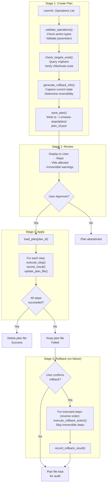
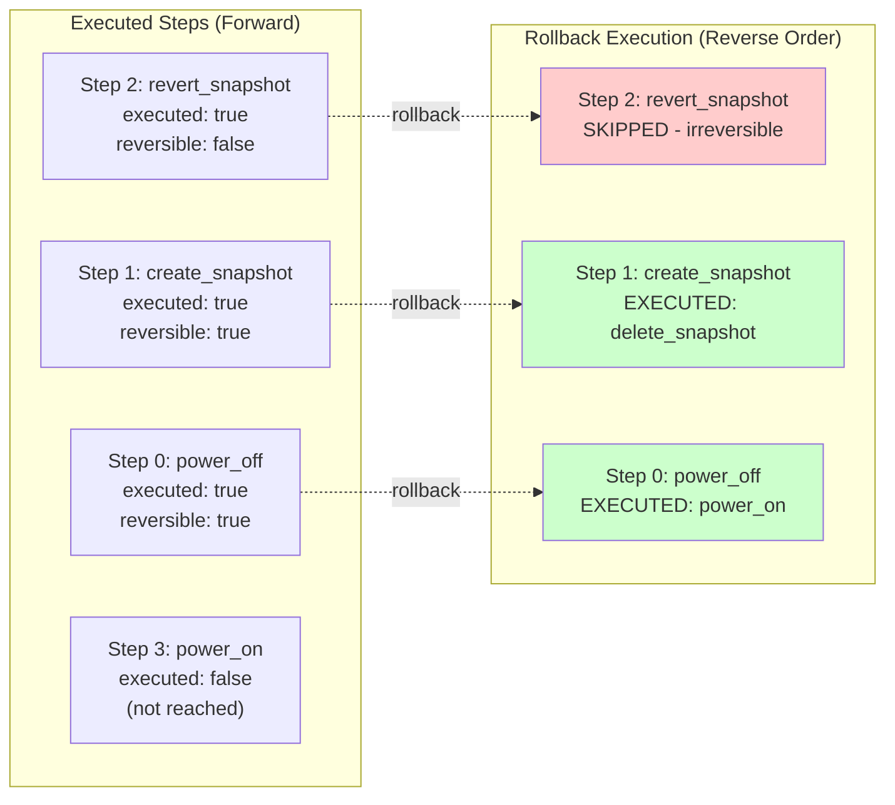
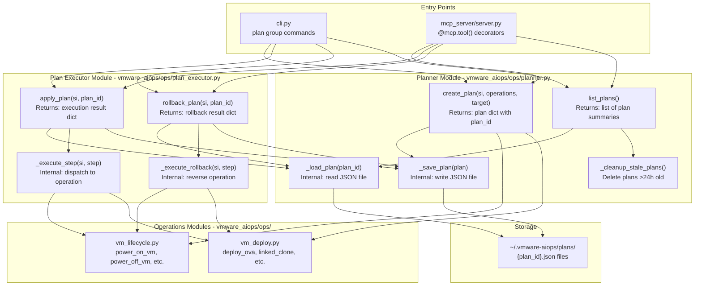
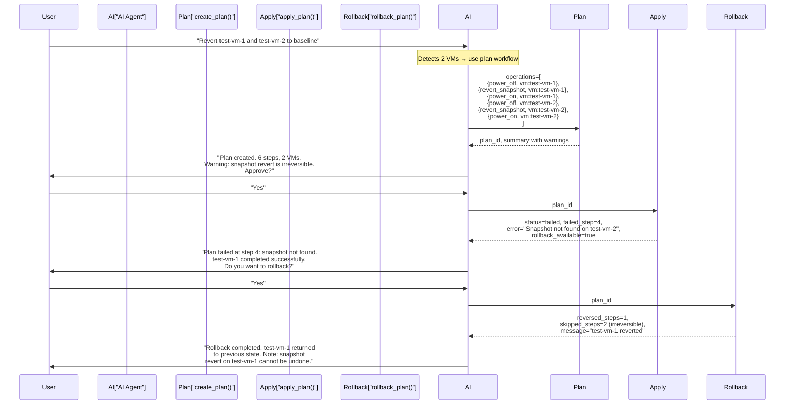

<!-- source: DeepWiki mcp.deepwiki.com · repo zw008/VMware-AIops · page 3.4 Plan → Apply → Rollback Workflow · fetched 2026-10-26 -->

# Plan → Apply → Rollback Workflow

<details>
<summary>Relevant source files</summary>

The following files were used as context for generating this wiki page:

- [README.md](README.md)
- [mcp_server/server.py](mcp_server/server.py)
- [plugins/vmware-ops/skills/vmware-aiops/SKILL.md](plugins/vmware-ops/skills/vmware-aiops/SKILL.md)
- [skills/vmware-aiops/SKILL.md](skills/vmware-aiops/SKILL.md)

</details>


This document explains the plan-based execution system for complex multi-step operations in VMware AIops. The Plan → Apply → Rollback workflow provides a structured, auditable, and reversible approach to executing operations that involve multiple VMs or multiple sequential steps.

For information about individual VM lifecycle operations that do not require planning, see [VM Lifecycle Management](#7.2). For information about batch deployment operations, see [VM Deployment](#7.3). For details on the audit logging that captures all plan execution, see [Audit Logging](#10.2).

## Purpose and Scope

The Plan → Apply → Rollback workflow addresses a critical safety requirement: when an AI agent needs to perform operations on multiple VMs or execute a sequence of dependent steps, a simple command-by-command approach risks leaving infrastructure in an inconsistent state if any step fails. This workflow introduces a three-phase execution model:

1. **Plan phase**: Validate all operations upfront, check target existence in vSphere, generate rollback information
2. **Apply phase**: Execute steps sequentially with per-step result tracking
3. **Rollback phase**: Reverse executed steps if the plan fails (where technically feasible)

**When this workflow is used:**
- Operations involving 2 or more VMs
- Multi-step operations where later steps depend on earlier ones succeeding
- Operations where the user wants to review the full scope before execution
- Scenarios requiring rollback capability after partial completion

**When this workflow is NOT used:**
- Single VM, single operation commands (e.g., `vm power-on my-vm`)
- Read-only operations (inventory queries, health checks)
- Batch deployment from YAML specs (uses a different batch system)

Sources: [README.md:153-165](), [plugins/vmware-ops/skills/vmware-aiops/SKILL.md:207-219](), [mcp_server/server.py:877-969]()

## Workflow Stages



**Stage 1: Create Plan**

The create plan stage validates all operations before any execution occurs. This stage is implemented by `create_plan()` in [vmware_aiops/ops/planner.py]().

Key validation steps:
- **Action validation**: Verify each operation has a valid action type (power_on, power_off, create_vm, delete_vm, reconfigure, snapshot operations, clone, migrate, deploy operations)
- **Parameter validation**: Check required parameters for each action (vm_name, snapshot_name, cpu/memory ranges, etc.)
- **Target existence check**: Query vSphere to verify VMs, hosts, datastores, and other resources exist before proceeding
- **Rollback information generation**: For each step, capture the current state needed to reverse the operation (e.g., VM power state before power-off, snapshot list before deletion)

The plan is assigned a unique `plan_id` (timestamp-based) and stored as a JSON file.

**Stage 2: Review**

The AI agent displays the plan to the user for approval. The plan summary includes:
- Total number of steps
- List of affected VMs
- Operations to be performed
- Warning if any steps are irreversible
- Indication of whether rollback is available

This is a mandatory human-in-the-loop checkpoint. The plan file exists but is not executed until the user approves.

**Stage 3: Apply**

Plan execution is implemented by `apply_plan()` in [vmware_aiops/ops/plan_executor.py](). Each step executes sequentially:

1. Load the step's operation definition
2. Execute the corresponding operation function (e.g., `power_on_vm()`, `delete_vm()`)
3. Record the result (success/failure, error message, execution timestamp)
4. Update the plan file with per-step results
5. If failure: stop immediately and keep the plan file for potential rollback

On success: The plan file is deleted automatically. On failure: The plan file is preserved with execution results for each step.

**Stage 4: Rollback**

Rollback is implemented by `rollback_plan()` in [vmware_aiops/ops/plan_executor.py](). This stage only occurs if:
- Apply phase failed mid-execution
- User confirms they want to rollback
- At least one step was executed successfully

Rollback executes in reverse order (last executed step first). Each step attempts to restore the captured before-state. Irreversible operations are skipped with a warning.

Sources: [mcp_server/server.py:882-959](), [README.md:153-165]()

## Plan File Structure and Storage

Plans are stored as JSON files in `~/.vmware-aiops/plans/` with the filename format `{plan_id}.json`.

**Plan file structure:**

```json
{
  "plan_id": "20240115_143022_abc123",
  "created_at": "2024-01-15T14:30:22Z",
  "target": "prod-vcenter",
  "status": "pending",
  "operations": [
    {
      "step": 0,
      "action": "power_off",
      "vm_name": "test-vm-1",
      "params": {"force": false},
      "rollback_info": {
        "action": "power_on",
        "vm_name": "test-vm-1",
        "previous_power_state": "poweredOn"
      },
      "reversible": true,
      "executed": false,
      "result": null
    },
    {
      "step": 1,
      "action": "revert_snapshot",
      "vm_name": "test-vm-1",
      "params": {"snapshot_name": "baseline"},
      "rollback_info": null,
      "reversible": false,
      "executed": false,
      "result": null
    }
  ],
  "summary": {
    "total_steps": 2,
    "vms_affected": ["test-vm-1"],
    "irreversible_steps": 1,
    "rollback_available": false
  }
}
```

**Key fields:**
- `plan_id`: Unique identifier, used to reference the plan in apply/rollback operations
- `status`: `pending` (created but not executed), `executing` (apply in progress), `completed` (all steps succeeded), `failed` (stopped on error)
- `operations`: Array of step definitions, each with rollback information and execution tracking
- `reversible`: Boolean flag indicating if this specific step can be rolled back
- `executed`: Boolean flag set to true once the step runs
- `result`: Populated after execution with success/failure status and any error messages

**Plan lifecycle:**
1. **Created**: Plan file written to disk with `status: pending`
2. **Executing**: Status updated to `executing` when `apply_plan()` is called
3. **Per-step updates**: Each step's `executed` and `result` fields are updated as it completes
4. **Completed**: Plan file deleted if all steps succeed
5. **Failed**: Plan file kept with status `failed` and per-step results
6. **Auto-cleanup**: Plans older than 24 hours are automatically deleted

Sources: [mcp_server/server.py:882-915](), [README.md:153-165]()

## Rollback Capabilities and Limitations

### Reversible Operations

The following operations support rollback by restoring the captured before-state:

| Operation | Rollback Action | Before-State Captured |
|-----------|-----------------|----------------------|
| `power_on` | Power off the VM | Previous power state |
| `power_off` | Power on the VM | Previous power state (poweredOn) |
| `suspend` | Resume or power on | Previous power state |
| `create_vm` | Delete the created VM | N/A (new resource) |
| `reconfigure` | Restore previous CPU/memory | Previous CPU count, memory MB |
| `create_snapshot` | Delete the created snapshot | N/A (new snapshot) |
| `clone` | Delete the cloned VM | N/A (new VM) |
| `migrate` | Migrate back to original host | Previous host name |

### Irreversible Operations

The following operations **cannot** be rolled back because they permanently modify or destroy state:

| Operation | Why Irreversible | Rollback Behavior |
|-----------|-----------------|-------------------|
| `delete_vm` | VM and all disks destroyed | Skipped with warning |
| `revert_snapshot` | Overwrites current VM state | Skipped with warning |
| `delete_snapshot` | Snapshot data permanently removed | Skipped with warning |
| `convert_to_template` | Changes VM type (requires manual revert) | Skipped with warning |

### Rollback Execution Model



**Rollback process:**
1. Load the failed plan file
2. Identify steps where `executed: true`
3. Reverse the list order (last executed first)
4. For each step:
   - If `reversible: true`: Execute the rollback action from `rollback_info`
   - If `reversible: false`: Skip with warning message
5. Record rollback results in the plan file
6. Keep the plan file for audit purposes

**Critical limitation**: Rollback does not guarantee returning to the exact original state. It performs a best-effort reversal based on captured metadata. For example:
- Rolling back a `create_snapshot` deletes the snapshot, but disk changes that occurred between creation and rollback are not undone
- Rolling back a `reconfigure` restores CPU/memory, but does not restore other VM settings that may have changed
- Rolling back a `migrate` moves the VM back, but resource consumption during the forward migration is not recovered

Sources: [mcp_server/server.py:945-959]()

## Implementation Architecture



**Core modules:**

1. **planner.py**: Plan creation and listing
   - `create_plan()`: Entry point for plan creation, validates operations, queries vSphere, generates rollback info
   - `list_plans()`: Returns summaries of pending/failed plans
   - `_load_plan()`, `_save_plan()`: Internal file I/O
   - `_cleanup_stale_plans()`: Auto-cleanup of old plans

2. **plan_executor.py**: Plan execution and rollback
   - `apply_plan()`: Sequential step execution with failure handling
   - `rollback_plan()`: Reverse execution of completed steps
   - `_execute_step()`: Dispatches to the appropriate operation function based on action type
   - `_execute_rollback()`: Executes the rollback action from rollback_info

**Integration points:**

The planner and executor modules do not directly call vSphere APIs. Instead, they delegate to the existing operations modules:
- `vmware_aiops/ops/vm_lifecycle.py`: For power operations, create/delete VM, reconfigure, snapshots, clone, migrate
- `vmware_aiops/ops/vm_deploy.py`: For deploy_ova, deploy_from_template, linked_clone

This delegation ensures consistent behavior whether operations are executed individually or as part of a plan.

Sources: [mcp_server/server.py:48-54](), [README.md:907-913]()

## Usage in CLI Mode

**Create and execute a plan via CLI:**

The CLI does not currently expose dedicated `plan create`, `plan apply`, `plan rollback` commands. Instead, the AI agent orchestrates the workflow by detecting multi-step scenarios and calling the appropriate Python functions.

**Listing pending plans:**

```bash
vmware-aiops plan list
```

Output example:
```
Pending Plans:
  - Plan ID: 20240115_143022_abc123
    Created: 2024-01-15 14:30:22
    Status: pending
    Steps: 3
    VMs affected: test-vm-1, test-vm-2

Failed Plans:
  - Plan ID: 20240115_150033_def456
    Created: 2024-01-15 15:00:33
    Status: failed
    Steps: 5 (3 executed)
    VMs affected: prod-vm-1
    Rollback available: Yes
```

Sources: [plugins/vmware-ops/skills/vmware-aiops/SKILL.md:406-407]()

## Usage in MCP Mode

MCP exposes four tools for plan workflow integration.

### vm_create_plan

```json
{
  "name": "vm_create_plan",
  "arguments": {
    "operations": [
      {
        "action": "power_off",
        "vm_name": "test-vm-1"
      },
      {
        "action": "revert_snapshot",
        "vm_name": "test-vm-1",
        "snapshot_name": "baseline"
      },
      {
        "action": "power_on",
        "vm_name": "test-vm-1"
      }
    ],
    "target": "dev-vcenter"
  }
}
```

**Returns:**
```json
{
  "plan_id": "20240115_143022_abc123",
  "status": "pending",
  "summary": {
    "total_steps": 3,
    "vms_affected": ["test-vm-1"],
    "irreversible_steps": 1,
    "rollback_available": false
  },
  "steps": [
    {
      "step": 0,
      "action": "power_off",
      "vm_name": "test-vm-1",
      "reversible": true
    },
    {
      "step": 1,
      "action": "revert_snapshot",
      "vm_name": "test-vm-1",
      "snapshot_name": "baseline",
      "reversible": false,
      "warning": "Snapshot revert is irreversible"
    },
    {
      "step": 2,
      "action": "power_on",
      "vm_name": "test-vm-1",
      "reversible": true
    }
  ]
}
```

### vm_apply_plan

```json
{
  "name": "vm_apply_plan",
  "arguments": {
    "plan_id": "20240115_143022_abc123",
    "target": "dev-vcenter"
  }
}
```

**Success response:**
```json
{
  "status": "completed",
  "plan_id": "20240115_143022_abc123",
  "total_steps": 3,
  "executed_steps": 3,
  "message": "All steps completed successfully. Plan deleted."
}
```

**Failure response:**
```json
{
  "status": "failed",
  "plan_id": "20240115_143022_abc123",
  "total_steps": 3,
  "executed_steps": 1,
  "failed_step": 1,
  "error": "Snapshot 'baseline' not found on VM 'test-vm-1'",
  "rollback_available": true,
  "hint": "Plan failed. Ask the user: 'Do you want to rollback the already-executed steps?' If yes, call vm_rollback_plan."
}
```

### vm_rollback_plan

Only call after `vm_apply_plan` returns `status: failed` and user confirms rollback.

```json
{
  "name": "vm_rollback_plan",
  "arguments": {
    "plan_id": "20240115_143022_abc123",
    "target": "dev-vcenter"
  }
}
```

**Response:**
```json
{
  "status": "rolled_back",
  "plan_id": "20240115_143022_abc123",
  "reversed_steps": 1,
  "skipped_steps": 0,
  "message": "Rollback completed. VM 'test-vm-1' powered back on."
}
```

### vm_list_plans

```json
{
  "name": "vm_list_plans",
  "arguments": {}
}
```

**Response:**
```json
[
  {
    "plan_id": "20240115_143022_abc123",
    "created_at": "2024-01-15T14:30:22Z",
    "status": "failed",
    "total_steps": 3,
    "executed_steps": 1,
    "vms_affected": ["test-vm-1"],
    "rollback_available": true
  }
]
```

Sources: [mcp_server/server.py:882-969]()

## Supported Actions in Plans

The following actions are valid in the `operations` list for `vm_create_plan`:

| Action | Required Parameters | Optional Parameters | Reversible |
|--------|-------------------|-------------------|-----------|
| `power_on` | `vm_name` | — | ✅ |
| `power_off` | `vm_name` | `force` | ✅ |
| `reset` | `vm_name` | — | ✅ |
| `suspend` | `vm_name` | — | ✅ |
| `create_vm` | `vm_name`, `cpu`, `memory_mb`, `disk_gb`, `datastore` | `folder` | ✅ |
| `delete_vm` | `vm_name` | — | ❌ |
| `reconfigure` | `vm_name` | `cpu`, `memory_mb` | ✅ |
| `create_snapshot` | `vm_name`, `snapshot_name` | `description`, `memory` | ✅ |
| `delete_snapshot` | `vm_name`, `snapshot_name` | — | ❌ |
| `revert_snapshot` | `vm_name`, `snapshot_name` | — | ❌ |
| `clone` | `vm_name`, `new_name` | `datastore` | ✅ |
| `migrate` | `vm_name`, `to_host` | — | ✅ |
| `deploy_ova` | `ova_path`, `vm_name`, `datastore` | `network`, `power_on` | ✅ |
| `deploy_template` | `template_name`, `new_name` | `datastore`, `cpu`, `memory_mb`, `power_on` | ✅ |
| `linked_clone` | `source_vm_name`, `snapshot_name`, `new_name` | `cpu`, `memory_mb`, `power_on` | ✅ |
| `attach_iso` | `vm_name`, `iso_ds_path` | — | ✅ |
| `convert_to_template` | `vm_name` | — | ❌ |

Sources: [mcp_server/server.py:882-915]()

## AI Agent Workflow Pattern

**Typical interaction flow:**



**Key decision points for AI agents:**
1. **Plan creation trigger**: Detect when user intent involves multiple VMs or multiple dependent steps
2. **Show plan before execution**: Display steps, affected resources, and warnings to user
3. **Wait for approval**: Do not call `apply_plan()` without explicit user confirmation
4. **Handle failure gracefully**: If `apply_plan()` returns `status: failed` with `rollback_available: true`, ask user before calling `rollback_plan()`
5. **Communicate limitations**: Warn user that irreversible steps will be skipped during rollback

Sources: [mcp_server/server.py:882-969](), [plugins/vmware-ops/skills/vmware-aiops/SKILL.md:207-219]()

## Integration with Audit Logging

All plan operations are logged to the audit trail at `~/.vmware-aiops/audit.log` in JSONL format.

**Plan creation log entry:**
```json
{
  "timestamp": "2024-01-15T14:30:22Z",
  "target": "dev-vcenter",
  "operation": "create_plan",
  "resource": "plan:20240115_143022_abc123",
  "parameters": {
    "total_steps": 3,
    "vms_affected": ["test-vm-1"],
    "irreversible_steps": 1
  },
  "result": "success",
  "user": "operator@example.com"
}
```

**Plan execution log entry:**
```json
{
  "timestamp": "2024-01-15T14:32:15Z",
  "target": "dev-vcenter",
  "operation": "apply_plan",
  "resource": "plan:20240115_143022_abc123",
  "before_state": {
    "status": "pending",
    "executed_steps": 0
  },
  "after_state": {
    "status": "failed",
    "executed_steps": 1,
    "failed_step": 1
  },
  "result": "failed",
  "error": "Snapshot 'baseline' not found",
  "user": "operator@example.com"
}
```

**Rollback log entry:**
```json
{
  "timestamp": "2024-01-15T14:33:00Z",
  "target": "dev-vcenter",
  "operation": "rollback_plan",
  "resource": "plan:20240115_143022_abc123",
  "parameters": {
    "reversed_steps": 1,
    "skipped_steps": 0
  },
  "result": "success",
  "user": "operator@example.com"
}
```

Each step within a plan also generates individual operation log entries (power_off, revert_snapshot, etc.), providing a complete audit trail at both the plan level and the step level.

For more details on audit log structure and querying, see [Audit Logging](#10.2).

Sources: [README.md:206](), [README.md:312]()

## Best Practices

**For AI agents:**
- Always show the plan summary to the user before calling `apply_plan()`
- Highlight irreversible operations in the plan review
- If a plan fails, present the rollback option clearly but let the user decide
- Do not automatically retry a failed plan without modifying it
- Clean up stale plans by periodically calling `vm_list_plans()` and archiving/deleting old ones

**For operators:**
- Use plans for any change window involving multiple VMs
- Review the full plan before approval, especially checking for irreversible steps
- If a plan fails and rollback is available, consider the impact: rolling back may not fully restore state if irreversible steps were executed
- Keep failed plan files for post-incident review (they contain per-step results)
- For production changes, test the plan in a dev environment first

**Plan design patterns:**
- **Power management pattern**: power_off → operation → power_on (reversible if operation fails)
- **Snapshot-based testing**: create_snapshot → risky_operation → [success: delete_snapshot | failure: revert_snapshot]
- **Staged deployment**: deploy VMs → configure → power_on (reversible if configuration fails)

**Anti-patterns to avoid:**
- Mixing irreversible and reversible operations in the same plan without clear user communication
- Creating plans with hundreds of steps (split into multiple plans for better failure isolation)
- Using plans for simple single-VM operations (direct commands are more appropriate)

Sources: [README.md:153-165](), [mcp_server/server.py:882-969]()

---

