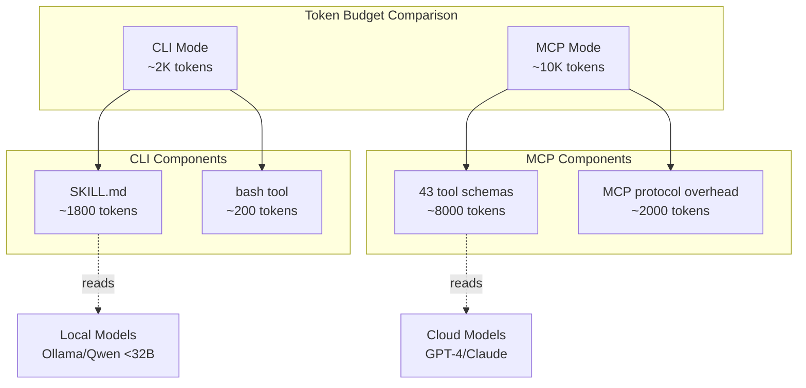
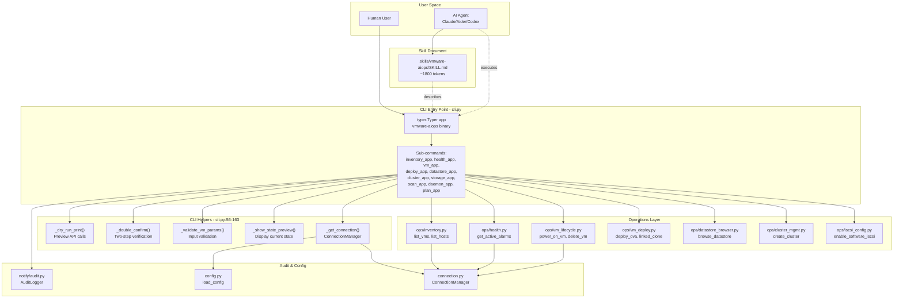
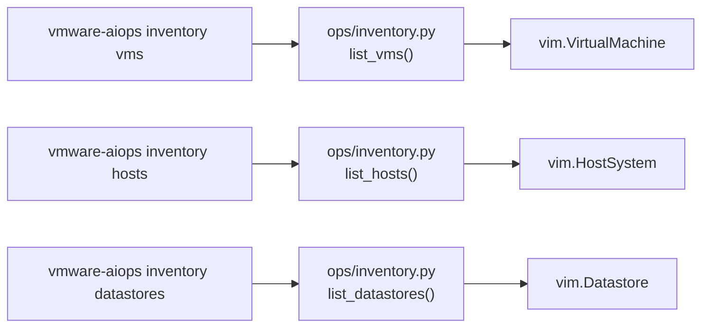
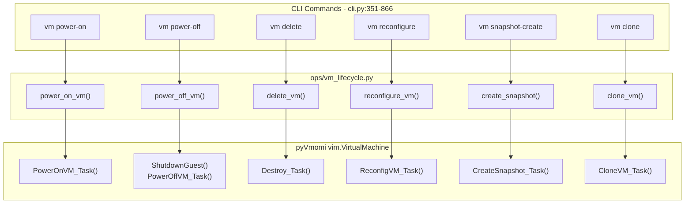

<!-- source: DeepWiki mcp.deepwiki.com · repo zw008/VMware-AIops · page 4 CLI Mode Usage · fetched 2026-10-26 -->

# CLI Mode Usage

<details>
<summary>Relevant source files</summary>

The following files were used as context for generating this wiki page:

- [README.md](README.md)
- [skills/vmware-aiops/SKILL.md](skills/vmware-aiops/SKILL.md)
- [vmware_aiops/cli.py](vmware_aiops/cli.py)

</details>


This page provides comprehensive guidance on using the VMware AIops command-line interface (CLI), which is one of two operational modes in the system. CLI mode is optimized for token efficiency (~2K tokens) and is the recommended mode for local/small AI models, token-sensitive workflows, and human-in-the-loop operations.

For detailed information about when to use CLI vs MCP mode, see [Dual-Mode Architecture: CLI vs MCP](#3.1). For a complete reference of all available commands, see [CLI Command Reference](#4.1). For details about CLI helper functions like double confirmation and dry-run mode, see [CLI Helper Functions](#4.2).

---

## What is CLI Mode?

CLI mode is a **token-efficient** operational interface where AI agents read a skill document ([skills/vmware-aiops/SKILL.md]()) that describes available operations, then execute commands via bash using the `vmware-aiops` binary. The CLI is built using the [Typer](https://typer.tiangolo.com/) framework and provides structured, human-readable output via the Rich library.

**Key characteristics:**

| Aspect | Details |
|--------|---------|
| **Token Cost** | ~2K tokens (SKILL.md + bash tool) vs ~10K for MCP |
| **Entry Point** | `vmware-aiops` binary → [vmware_aiops/cli.py:1-1845]() |
| **Framework** | Typer (CLI) + Rich (output formatting) |
| **Output** | Human-readable tables, formatted text, color-coded status |
| **Best For** | Local models <32B params, cost optimization, human interaction |
| **AI Integration** | Bash execution with shell output parsing |

Sources: [README.md:57-66](), [skills/vmware-aiops/SKILL.md:60-76](), [vmware_aiops/cli.py:1-23]()

---

## CLI vs MCP: Token Efficiency Trade-off

CLI mode sacrifices structured JSON I/O in favor of minimal token consumption:



**Diagram: Token Budget Comparison Between CLI and MCP Modes**

**When to use CLI mode:**

| Scenario | Why CLI is Better |
|----------|-------------------|
| **Local models** (Ollama, Qwen <32B) | Small models cannot effectively process 43 tool schemas |
| **Token-sensitive workflows** | Every conversation turn costs ~2K vs ~10K tokens |
| **Cost optimization** | Reduces API costs for cloud models by 5x |
| **Human-in-loop operations** | Readable output for review and confirmation |
| **Development/testing** | Direct command execution without protocol overhead |

Sources: [README.md:57-66](), [skills/vmware-aiops/SKILL.md:60-76](), [Diagram 2 from high-level overview]()

---

## CLI Architecture and Entry Points

### Component Diagram



**Diagram: CLI Architecture from Entry Point to Operations Layer**

### Entry Point Breakdown

The CLI is organized into **9 sub-command groups** (Typer apps), each handling a functional domain:

| Sub-command | Typer App Variable | Purpose |
|-------------|-------------------|---------|
| `inventory` | `inventory_app` | Query VMs, hosts, datastores, clusters |
| `health` | `health_app` | Alarms, events, hardware sensors |
| `vm` | `vm_app` | VM lifecycle: power, create, delete, snapshot, clone |
| `deploy` | `deploy_app` | VM deployment: OVA, template, linked clone, batch |
| `datastore` | `datastore_app` | Browse files, scan images |
| `cluster` | `cluster_app` | Cluster management: create, delete, configure HA/DRS |
| `storage` | `storage_app` | iSCSI configuration, rescan |
| `scan` | `scan_app` | One-time log scanning |
| `daemon` | `daemon_app` | Scanner daemon start/stop/status |
| `plan` | `plan_app` | Plan → Apply → Rollback workflow |

Sources: [vmware_aiops/cli.py:25-44](), [vmware_aiops/cli.py:1706-1710](), [vmware_aiops/cli.py:1742-1743]()

---

## Command Structure and Invocation

### Standard Command Pattern

All CLI commands follow this structure:

```
vmware-aiops <subcommand> <action> [ARGUMENTS] [OPTIONS]
```

**Examples:**

```bash
# Inventory: vmware-aiops inventory <action>
vmware-aiops inventory vms --target home-esxi --limit 10

# Health: vmware-aiops health <action>
vmware-aiops health alarms --target prod-vcenter

# VM lifecycle: vmware-aiops vm <action>
vmware-aiops vm power-on my-vm --target home-esxi --dry-run
vmware-aiops vm delete old-vm --target prod-vcenter

# Deploy: vmware-aiops deploy <action>
vmware-aiops deploy ova ./ubuntu.ova --name test-vm --datastore ds1
```

### Common Options

The following options are available across most commands:

| Option | Type | Purpose |
|--------|------|---------|
| `--target`, `-t` | `TargetOption` | Target name from config (default: first target) |
| `--config`, `-c` | `ConfigOption` | Path to config.yaml (default: `~/.vmware-aiops/config.yaml`) |
| `--dry-run` | `DryRunOption` | Preview API calls without executing |

**Type definitions:**

```python
# From cli.py:46-54
TargetOption = Annotated[str | None, typer.Option("--target", "-t", ...)]
ConfigOption = Annotated[Path | None, typer.Option("--config", "-c", ...)]
DryRunOption = Annotated[bool, typer.Option("--dry-run", ...)]
```

Sources: [vmware_aiops/cli.py:46-54]()

---

## AI Agent Integration with CLI Mode

### How AI Agents Use the CLI

```mermaid
sequenceDiagram
    participant User
    participant AI["AI Agent<br/>(Claude/Aider/Codex)"]
    participant SKILL["SKILL.md<br/>Documentation"]
    participant Bash["bash Tool"]
    participant CLI["vmware-aiops CLI"]
    participant Ops["ops/* Modules"]
    participant vSphere["vCenter/ESXi"]
    
    User->>AI: "Show me all VMs on home-esxi"
    AI->>SKILL: Read available commands
    SKILL-->>AI: inventory vms command syntax
    AI->>Bash: Execute: vmware-aiops inventory vms --target home-esxi
    Bash->>CLI: Run command
    CLI->>Ops: Call list_vms()
    Ops->>vSphere: SOAP API query
    vSphere-->>Ops: VM list data
    Ops-->>CLI: Structured dict
    CLI-->>Bash: Formatted table output
    Bash-->>AI: stdout: "Virtual Machines (15 total)..."
    AI->>AI: Parse table output
    AI-->>User: "Found 15 VMs on home-esxi: vm-01 (poweredOn), vm-02 (poweredOff), ..."
```

**Diagram: AI Agent CLI Interaction Flow**

### Integration Pattern by Platform

| AI Platform | Integration Method | Config Location |
|-------------|-------------------|-----------------|
| **Claude Code** | Native plugin + SKILL.md | `plugins/vmware-ops/skills/vmware-aiops/SKILL.md` |
| **Gemini CLI** | Extension + GEMINI.md | `gemini-extension/GEMINI.md` |
| **Codex CLI** | Skill + AGENTS.md | `codex-skill/AGENTS.md` copied to `~/.codex/skills/` |
| **Aider** | Conventions file | `aider --conventions codex-skill/AGENTS.md` |
| **Continue CLI** | Rules file | `codex-skill/AGENTS.md` copied to `.continue/rules/` |
| **Trae IDE** | Project rules | `trae-rules/project_rules.md` copied to `.trae/rules/` |
| **Kimi Code** | Skill file | `kimi-skill/SKILL.md` copied to `~/.kimi/skills/` |

**All platforms read the same core documentation** that describes CLI commands, then execute them via bash:

1. **Platform reads skill document** (SKILL.md or equivalent)
2. **AI model determines command** to execute based on user intent
3. **AI invokes bash tool** with `vmware-aiops <subcommand> <action> [options]`
4. **CLI executes operation** and returns formatted output
5. **AI parses stdout** and presents result to user

Sources: [README.md:269-281](), [skills/vmware-aiops/SKILL.md:78-94](), [skills/vmware-aiops/SKILL.md:330-342]()

---

## CLI Safety Features

CLI mode implements **six layers of safety** for destructive operations:

### 1. Input Validation

Parameter ranges are validated before vSphere API calls:

| Parameter | Validation Rule | Function |
|-----------|----------------|----------|
| VM name | 1-80 chars, no leading `-` or `.` | `_validate_vm_params()` |
| CPU count | 1-128 | `_validate_vm_params()` |
| Memory (MB) | 128-1,048,576 (128 MB - 1 TB) | `_validate_vm_params()` |
| Disk (GB) | 1-65,536 (1 GB - 64 TB) | `_validate_vm_params()` |

**Implementation:**

```python
# From cli.py:120-138
def _validate_vm_params(
    name: str | None = None,
    cpu: int | None = None,
    memory_mb: int | None = None,
    disk_gb: int | None = None,
) -> None:
    """Validate VM parameter ranges. Raises typer.BadParameter on invalid input."""
    if name is not None:
        if not name or len(name) > 80:
            raise typer.BadParameter(f"VM name must be 1-80 characters, got {len(name or '')}.")
        if name.startswith("-") or name.startswith("."):
            raise typer.BadParameter("VM name must not start with '-' or '.'.")
    if cpu is not None and not (1 <= cpu <= 128):
        raise typer.BadParameter(f"CPU count must be 1-128, got {cpu}.")
    # ... etc
```

Sources: [vmware_aiops/cli.py:120-138](), [README.md:207]()

### 2. Dry-Run Mode

Preview exact API calls without execution:

```bash
# Preview power-off operation
vmware-aiops vm power-off prod-db-01 --dry-run

# Output:
# [DRY-RUN] No changes will be made.
#   Target:    default
#   VM:        prod-db-01
#   Operation: power_off
#   API Call:  vim.VirtualMachine.ShutdownGuest()
#   Current:   {'power_state': 'poweredOn'}
#   Expected:  {'power_state': 'poweredOff'}
#   Run without --dry-run to execute.
```

**Implementation:** [vmware_aiops/cli.py:57-89]()

The `_dry_run_print()` function shows:
- Target vCenter/ESXi
- VM or resource name
- Operation type
- Exact pyVmomi API call
- Current state (before)
- Expected state (after)
- Parameters

Sources: [vmware_aiops/cli.py:57-89](), [vmware_aiops/cli.py:377-395]()

### 3. State Preview

Before destructive operations, CLI displays current VM state:

```python
# From cli.py:107-117
def _show_state_preview(info: dict, action: str, vm_name: str) -> None:
    """Display current VM state before a destructive operation."""
    console.print(f"\n[bold cyan]📋 Current state of VM '{vm_name}':[/]")
    state_keys = (
        "power_state", "cpu", "memory_mb", "guest_os",
        "host", "ip_address", "snapshot_count",
    )
    for key in state_keys:
        if key in info:
            console.print(f"  [cyan]{key}:[/] {info[key]}")
```

**Example output:**

```
📋 Current state of VM 'test-vm':
  power_state: poweredOn
  cpu: 4
  memory_mb: 8192
  guest_os: Ubuntu Linux (64-bit)
  host: esxi-01.example.com
  ip_address: 192.168.1.100
  snapshot_count: 2
```

Sources: [vmware_aiops/cli.py:107-117](), [vmware_aiops/cli.py:420]()

### 4. Double Confirmation

All destructive operations require **two sequential confirmations** with no bypass flag:

```python
# From cli.py:141-162
def _double_confirm(
    action: str,
    vm_name: str,
    target: str = "default",
    resource_type: str = "VM",
) -> None:
    """Require two confirmations for destructive operations.
    
    Logs a 'rejected' audit entry if the user declines at either step.
    """
    console.print(f"[bold yellow]⚠️  即将执行: {action} {resource_type} '{vm_name}'[/]")
    try:
        typer.confirm(f"第 1 次确认: 确定要{action} '{vm_name}'?", abort=True)
        typer.confirm(f"第 2 次确认: 再次确认{action} '{vm_name}'，此操作不可撤销?", abort=True)
    except typer.Abort:
        _audit.log(
            target=target,
            operation=action,
            resource=vm_name,
            result="rejected",
        )
        raise
```

**Destructive operations requiring double confirmation:**

| Operation | Command | Confirmation Action |
|-----------|---------|---------------------|
| Power off | `vm power-off` | 关机 (shutdown) |
| Delete VM | `vm delete` | 删除 (delete) |
| Reconfigure | `vm reconfigure` | 调整配置 (reconfigure) |
| Snapshot revert | `vm snapshot-revert` | 恢复快照 (revert snapshot) |
| Snapshot delete | `vm snapshot-delete` | 删除快照 (delete snapshot) |
| Clone | `vm clone` | 克隆 (clone) |
| Migrate | `vm migrate` | 迁移 (migrate) |
| Clean slate | `vm clean-slate` | 恢复基线快照 (restore baseline) |
| Deploy OVA | `deploy ova` | 部署 OVA (deploy OVA) |
| Deploy template | `deploy template` | 从模板部署 (deploy from template) |
| Linked clone | `deploy linked-clone` | 创建链接克隆 (create linked clone) |
| Batch deploy | `deploy batch` | 批量部署 (batch deploy) |
| Batch clone | `deploy batch-clone` | 批量克隆 (batch clone) |
| Mark template | `deploy mark-template` | 转换为模板 (convert to template) |
| Cluster delete | `cluster delete` | 删除集群 (delete cluster) |
| Cluster add host | `cluster add-host` | 添加主机到集群 (add host to cluster) |
| Cluster remove host | `cluster remove-host` | 从集群移除主机 (remove host from cluster) |
| Cluster configure | `cluster configure` | 重新配置集群 (reconfigure cluster) |
| iSCSI enable | `storage iscsi-enable` | 启用 iSCSI (enable iSCSI) |
| iSCSI add target | `storage iscsi-add-target` | 添加 iSCSI 目标 (add iSCSI target) |
| iSCSI remove target | `storage iscsi-remove-target` | 移除 iSCSI 目标 (remove iSCSI target) |

Sources: [vmware_aiops/cli.py:141-162](), [vmware_aiops/cli.py:421](), [vmware_aiops/cli.py:506](), [vmware_aiops/cli.py:564]()

### 5. Rejection Logging

If user declines at either confirmation step, the rejection is logged to the audit trail:

```python
# From cli.py:155-161
except typer.Abort:
    _audit.log(
        target=target,
        operation=action,
        resource=vm_name,
        result="rejected",
    )
    raise
```

Audit log entry format:

```json
{
  "timestamp": "2024-01-15T10:30:00Z",
  "target": "prod-vcenter",
  "operation": "delete_vm",
  "resource": "test-vm-01",
  "result": "rejected",
  "user": "admin"
}
```

This creates a **security trail** showing that destructive operations were attempted but not executed.

Sources: [vmware_aiops/cli.py:155-161](), [README.md:206]()

### 6. Audit Logging

All operations (success, failure, or rejection) are logged to `~/.vmware-aiops/audit.log`:

```python
# From cli.py:14-16
from vmware_aiops.notify.audit import AuditLogger

_audit = AuditLogger()
```

**What gets logged:**

| Field | Description |
|-------|-------------|
| `timestamp` | ISO 8601 timestamp (UTC) |
| `target` | vCenter/ESXi target name |
| `operation` | Operation type (e.g., `power_off`, `delete_vm`) |
| `resource` | VM name or resource identifier |
| `parameters` | Operation parameters (e.g., `{"force": true}`) |
| `before_state` | Resource state before operation |
| `after_state` | Resource state after operation (if successful) |
| `result` | Operation result: success message, error, or "rejected" |
| `user` | Username from config (if available) |

**Example log entries:**

```jsonl
{"timestamp":"2024-01-15T10:25:00Z","target":"home-esxi","operation":"power_on","resource":"test-vm","after_state":{"power_state":"poweredOn"},"result":"VM 'test-vm' powered on successfully"}
{"timestamp":"2024-01-15T10:30:00Z","target":"prod-vcenter","operation":"delete_vm","resource":"test-vm-01","result":"rejected"}
{"timestamp":"2024-01-15T10:35:00Z","target":"home-esxi","operation":"reconfigure_vm","resource":"dev-vm","parameters":{"cpu":8,"memory_mb":16384},"before_state":{"cpu":4,"memory_mb":8192},"after_state":{"cpu":8,"memory_mb":16384},"result":"VM 'dev-vm' reconfigured successfully"}
```

Sources: [vmware_aiops/cli.py:14-16](), [vmware_aiops/cli.py:389-395](), [vmware_aiops/cli.py:509-520](), [README.md:206]()

---

## Common CLI Workflows

### Workflow 1: Query and Monitor

**No confirmations required**, read-only operations:

```bash
# Check inventory
vmware-aiops inventory vms --target home-esxi --limit 20
vmware-aiops inventory hosts --target prod-vcenter
vmware-aiops inventory datastores --target home-esxi

# Check health
vmware-aiops health alarms --target prod-vcenter
vmware-aiops health events --hours 24 --severity warning

# Get VM details
vmware-aiops vm info my-vm --target home-esxi
vmware-aiops vm snapshot-list my-vm --target home-esxi
```

**AI agent conversation flow:**

```
User: "Show me all VMs on home-esxi, sorted by memory"
AI: [executes] vmware-aiops inventory vms --target home-esxi --sort-by memory_mb
AI: "Found 15 VMs. Top 5 by memory: prod-db (32GB), web-01 (16GB), ..."

User: "Are there any alarms?"
AI: [executes] vmware-aiops health alarms --target home-esxi
AI: "No active alarms on home-esxi."
```

Sources: [vmware_aiops/cli.py:168-216](), [vmware_aiops/cli.py:298-345]()

### Workflow 2: VM Lifecycle with Safety

**With dry-run, state preview, and double confirmation:**

```bash
# 1. Preview the operation
vmware-aiops vm power-off prod-db-01 --dry-run

# 2. Execute with confirmation
vmware-aiops vm power-off prod-db-01
# Output:
# 📋 Current state of VM 'prod-db-01':
#   power_state: poweredOn
#   cpu: 4
#   memory_mb: 8192
#   guest_os: Ubuntu Linux (64-bit)
#   host: esxi-01.example.com
# 
# ⚠️  即将执行: 关机 VM 'prod-db-01'
# 第 1 次确认: 确定要关机 'prod-db-01'? [y/N]: y
# 第 2 次确认: 再次确认关机 'prod-db-01'，此操作不可撤销? [y/N]: y
# ✓ VM 'prod-db-01' powered off successfully

# 3. Check audit log
tail -1 ~/.vmware-aiops/audit.log
# {"timestamp":"...","operation":"power_off","resource":"prod-db-01","result":"..."}
```

**AI agent conversation flow:**

```
User: "Power off prod-db-01 but show me what will happen first"
AI: [executes] vmware-aiops vm power-off prod-db-01 --dry-run
AI: "This will call vim.VirtualMachine.ShutdownGuest() to gracefully shut down prod-db-01 (currently poweredOn). Proceed?"

User: "Yes, do it"
AI: [executes] vmware-aiops vm power-off prod-db-01
AI: [sees confirmation prompts in output]
AI: [responds to first prompt] y
AI: [responds to second prompt] y
AI: "Successfully powered off prod-db-01."
```

Sources: [vmware_aiops/cli.py:398-432]()

### Workflow 3: Batch Deployment

**Multi-step operation with single confirmation:**

```bash
# 1. Create deploy spec
cat > deploy-spec.yaml <<EOF
vms:
  - name: web-01
    method: linked_clone
    source_vm: golden-ubuntu
    snapshot: baseline
    cpu: 2
    memory_mb: 4096
    power_on: true
  - name: web-02
    method: linked_clone
    source_vm: golden-ubuntu
    snapshot: baseline
    cpu: 2
    memory_mb: 4096
    power_on: true
EOF

# 2. Preview
vmware-aiops deploy batch deploy-spec.yaml --dry-run

# 3. Execute
vmware-aiops deploy batch deploy-spec.yaml
# Output:
# 批量部署 2 台 VM: web-01, web-02
# ⚠️  即将执行: 批量部署 2 台 VM VM 'web-01, web-02'
# 第 1 次确认: 确定要批量部署 2 台 VM 'web-01, web-02'? [y/N]: y
# 第 2 次确认: 再次确认批量部署 2 台 VM 'web-01, web-02'，此操作不可撤销? [y/N]: y
# [Deployment progress...]
# Result: 2/2 VMs deployed successfully.
```

**AI agent conversation flow:**

```
User: "Deploy 5 VMs named test-01 to test-05, each with 4 CPU and 8GB RAM, based on the golden-ubuntu template"
AI: "I'll create a batch deployment. First, let me check available templates and snapshots."
AI: [executes] vmware-aiops inventory vms --target home-esxi
AI: [finds golden-ubuntu]
AI: [executes] vmware-aiops vm snapshot-list golden-ubuntu
AI: [finds 'baseline' snapshot]
AI: "Creating batch deployment spec with linked clones from golden-ubuntu@baseline..."
AI: [creates deploy-spec.yaml]
AI: [executes] vmware-aiops deploy batch deploy-spec.yaml
AI: [handles confirmation prompts]
AI: "Successfully deployed 5 VMs in 45 seconds."
```

Sources: [vmware_aiops/cli.py:1155-1203](), [vmware_aiops/cli.py:1206-1253]()

### Workflow 4: Plan → Apply → Rollback

**For complex multi-step operations:**

```bash
# This workflow is typically initiated via MCP mode or direct Python API
# CLI provides plan listing:
vmware-aiops plan list

# Output:
# Operation Plans
# ┌──────────┬─────────────────────┬─────────┬───────┬──────────────────────┐
# │ Plan ID  │ Created             │ Status  │ Steps │ VMs Affected         │
# ├──────────┼─────────────────────┼─────────┼───────┼──────────────────────┤
# │ plan_001 │ 2024-01-15T10:00:00 │ pending │ 3     │ web-01, web-02       │
# │ plan_002 │ 2024-01-15T09:30:00 │ failed  │ 5     │ db-01, db-02, db-03  │
# └──────────┴─────────────────────┴─────────┴───────┴──────────────────────┘
```

**Note:** Plan creation and execution are primarily MCP features. The CLI provides the `plan list` command for viewing plan status. For detailed plan workflow information, see [Plan → Apply → Rollback Workflow](#3.4).

Sources: [vmware_aiops/cli.py:1706-1737]()

---

## CLI Command Categories and Function Mapping

### Inventory Commands → ops/inventory.py

| CLI Command | Function Called | pyVmomi Objects |
|-------------|----------------|----------------|
| `inventory vms` | `list_vms(si, limit, sort_by, power_state)` | `vim.VirtualMachine` |
| `inventory hosts` | `list_hosts(si)` | `vim.HostSystem` |
| `inventory datastores` | `list_datastores(si)` | `vim.Datastore` |
| `inventory clusters` | `list_clusters(si)` | `vim.ClusterComputeResource` |



**Diagram: Inventory Commands to pyVmomi Object Mapping**

Sources: [vmware_aiops/cli.py:168-292]()

### Health Commands → ops/health.py

| CLI Command | Function Called | pyVmomi Objects |
|-------------|----------------|----------------|
| `health alarms` | `get_active_alarms(si)` | `vim.alarm.AlarmManager`, `vim.alarm.AlarmState` |
| `health events` | `get_recent_events(si, hours, severity)` | `vim.event.EventManager` |

Sources: [vmware_aiops/cli.py:298-345]()

### VM Lifecycle Commands → ops/vm_lifecycle.py

| CLI Command | Function Called | pyVmomi Methods |
|-------------|----------------|-----------------|
| `vm info` | `get_vm_info(si, name)` | Property collection |
| `vm power-on` | `power_on_vm(si, name)` | `vim.VirtualMachine.PowerOnVM_Task()` |
| `vm power-off` | `power_off_vm(si, name, force)` | `vim.VirtualMachine.ShutdownGuest()` or `PowerOffVM_Task()` |
| `vm create` | `create_vm(si, vm_name, cpu, memory_mb, disk_gb, ...)` | `vim.Folder.CreateVM_Task()` |
| `vm delete` | `delete_vm(si, name)` | `vim.VirtualMachine.Destroy_Task()` |
| `vm reconfigure` | `reconfigure_vm(si, name, cpu, memory_mb)` | `vim.VirtualMachine.ReconfigVM_Task()` |
| `vm snapshot-create` | `create_snapshot(si, vm_name, snap_name, description, memory)` | `vim.VirtualMachine.CreateSnapshot_Task()` |
| `vm snapshot-list` | `list_snapshots(si, vm_name)` | Property: `snapshot.rootSnapshotList` |
| `vm snapshot-revert` | `revert_to_snapshot(si, vm_name, snap_name)` | `vim.vm.Snapshot.RevertToSnapshot_Task()` |
| `vm snapshot-delete` | `delete_snapshot(si, vm_name, snap_name)` | `vim.vm.Snapshot.RemoveSnapshot_Task()` |
| `vm clone` | `clone_vm(si, name, new_name)` | `vim.VirtualMachine.CloneVM_Task()` |
| `vm migrate` | `migrate_vm(si, name, to_host)` | `vim.VirtualMachine.RelocateVM_Task()` |
| `vm clean-slate` | `clean_slate(si, vm_name, snapshot_name)` | `PowerOff()` + `RevertToSnapshot_Task()` |



**Diagram: VM Lifecycle Commands to pyVmomi API Mapping**

Sources: [vmware_aiops/cli.py:351-866]()

### Deployment Commands → ops/vm_deploy.py

| CLI Command | Function Called | pyVmomi Objects/Methods |
|-------------|----------------|------------------------|
| `deploy ova` | `deploy_ova(si, ova_path, vm_name, ...)` | `vim.OvfManager.CreateImportSpec()`, `vim.HttpNfcLease.HttpNfcLeaseProgress()` |
| `deploy template` | `deploy_from_template(si, template_name, new_name, ...)` | `vim.VirtualMachine.CloneVM_Task()` |
| `deploy linked-clone` | `linked_clone(si, source_vm_name, new_name, snapshot_name, ...)` | `vim.VirtualMachine.CloneVM_Task()` with `diskMoveType=createNewChildDiskBacking` |
| `deploy iso` | `attach_iso(si, vm_name, iso)` | `vim.VirtualMachine.ReconfigVM_Task()` (CD-ROM backing) |
| `deploy mark-template` | `convert_to_template(si, name)` | `vim.VirtualMachine.MarkAsTemplate()` |
| `deploy batch-clone` | `batch_clone(si, source_vm_name, vm_names, ...)` | Multiple `CloneVM_Task()` calls |
| `deploy batch` | `batch_deploy(si, spec)` | Multiple operations from YAML spec |

Sources: [vmware_aiops/cli.py:1040-1292]()

### Datastore Commands → ops/datastore_browser.py

| CLI Command | Function Called | pyVmomi Objects |
|-------------|----------------|----------------|
| `datastore browse` | `browse_datastore(si, name, path, pattern)` | `vim.host.DatastoreBrowser.SearchDatastore()` |
| `datastore scan-images` | `update_registry(si)` | Iterates all datastores, searches for OVA/ISO/OVF/VMDK |
| `datastore images` | `list_images(image_type, datastore)` | Reads `~/.vmware-aiops/image_registry.json` |

Sources: [vmware_aiops/cli.py:955-1034]()

### Cluster Commands → ops/cluster_mgmt.py

| CLI Command | Function Called | pyVmomi Methods |
|-------------|----------------|-----------------|
| `cluster info` | `get_cluster_info(si, name)` | Property collection from `vim.ClusterComputeResource` |
| `cluster create` | `create_cluster(si, cluster_name, datacenter_name, ...)` | `vim.Folder.CreateClusterEx()` |
| `cluster delete` | `delete_cluster(si, name)` | `vim.ClusterComputeResource.Destroy_Task()` |
| `cluster add-host` | `add_host_to_cluster(si, cluster_name, host_name)` | `vim.ClusterComputeResource.MoveInto_Task()` |
| `cluster remove-host` | `remove_host_from_cluster(si, cluster_name, host_name)` | `vim.Folder.MoveInto_Task()` |
| `cluster configure` | `configure_cluster(si, cluster_name, ha_enabled, drs_enabled, ...)` | `vim.ClusterComputeResource.ReconfigureComputeResource_Task()` |

Sources: [vmware_aiops/cli.py:1297-1486]()

### Storage Commands → ops/iscsi_config.py

| CLI Command | Function Called | pyVmomi Methods |
|-------------|----------------|-----------------|
| `storage iscsi-enable` | `enable_software_iscsi(si, host)` | `vim.host.StorageSystem.UpdateSoftwareInternetScsiEnabled(True)` |
| `storage iscsi-status` | `get_iscsi_status(si, host)` | Property collection from `vim.host.InternetScsiHba` |
| `storage iscsi-add-target` | `add_iscsi_target(si, host, address, port)` | `vim.host.StorageSystem.AddInternetScsiSendTargets()` |
| `storage iscsi-remove-target` | `remove_iscsi_target(si, host, address, port)` | `vim.host.StorageSystem.RemoveInternetScsiSendTargets()` |
| `storage rescan` | `rescan_storage(si, host)` | `vim.host.StorageSystem.RescanAllHba()`, `RescanVmfs()` |

Sources: [vmware_aiops/cli.py:1492-1631]()

---

## Output Formatting and Parsing

### Rich Library Tables

CLI uses the [Rich](https://rich.readthedocs.io/) library for formatted output:

```python
# From cli.py:10-11, 23
from rich.console import Console
from rich.table import Table

console = Console()
```

**Example: VM inventory table**

```python
# From cli.py:193-213
table = Table(title=title)
table.add_column("Name", style="cyan")
table.add_column("Power")
table.add_column("CPUs", justify="right")
table.add_column("Memory (MB)", justify="right")
if mode == "full":
    table.add_column("Guest OS")
    table.add_column("IP Address")
for vm in vms:
    power_style = "green" if vm["power_state"] == "poweredOn" else "red"
    row = [
        vm["name"],
        f"[{power_style}]{vm['power_state']}[/]",
        str(vm.get("cpu", "-")),
        str(vm.get("memory_mb", "-")),
    ]
    if mode == "full":
        row.append(vm.get("guest_os", "-"))
        row.append(vm.get("ip_address") or "-")
    table.add_row(*row)
console.print(table)
```

**Output:**

```
Virtual Machines (15 total)
┌──────────────┬────────────┬──────┬─────────────┬────────────────────────┬─────────────────┐
│ Name         │ Power      │ CPUs │ Memory (MB) │ Guest OS               │ IP Address      │
├──────────────┼────────────┼──────┼─────────────┼────────────────────────┼─────────────────┤
│ web-01       │ poweredOn  │ 2    │ 4096        │ Ubuntu Linux (64-bit)  │ 192.168.1.10    │
│ db-01        │ poweredOn  │ 8    │ 32768       │ Ubuntu Linux (64-bit)  │ 192.168.1.20    │
│ test-vm      │ poweredOff │ 1    │ 2048        │ Ubuntu Linux (64-bit)  │ -               │
└──────────────┴────────────┴──────┴─────────────┴────────────────────────┴─────────────────┘
```

### Color Coding

| Color | Usage | Example |
|-------|-------|---------|
| `[cyan]` | Resource names, labels | VM names, column headers |
| `[green]` | Success states | `poweredOn`, confirmation messages |
| `[red]` | Error states | `poweredOff`, critical alarms |
| `[yellow]` | Warnings, info | Pending actions, info messages |
| `[bold]` | Emphasis | Section headers, important text |
| `[dim]` | Less important | Timestamps, secondary info |

**AI agents parse:**
- Table structure (rows and columns)
- Color codes (via ANSI escape sequences or text markers)
- Status indicators (✓, ⚠️, ❌)
- Structured data in JSON-like format

Sources: [vmware_aiops/cli.py:193-215](), [vmware_aiops/cli.py:308-321]()

---

## CLI Configuration and Connection

### Connection Helper

All CLI commands use the `_get_connection()` helper:

```python
# From cli.py:92-99
def _get_connection(target: str | None, config_path: Path | None = None):
    """Helper to get a pyVmomi connection."""
    from vmware_aiops.config import load_config
    from vmware_aiops.connection import ConnectionManager
    
    cfg = load_config(config_path)
    mgr = ConnectionManager(cfg)
    return mgr.connect(target), cfg
```

**Flow:**

1. Load config from `~/.vmware-aiops/config.yaml` (or `--config` path)
2. Load credentials from `~/.vmware-aiops/.env`
3. Create `ConnectionManager` with config
4. Connect to specified `--target` (or default target)
5. Return `ServiceInstance` (pyVmomi connection) and config object

For detailed configuration information, see [Configuration](#2.2).

Sources: [vmware_aiops/cli.py:92-99]()

### Target Resolution

```python
# From cli.py:102-104
def _resolve_target(target: str | None) -> str:
    """Return a display name for the target (used in audit logs)."""
    return target or "default"
```

If no `--target` is specified, CLI uses the **first target** in `config.yaml` and labels it as "default" in audit logs.

Sources: [vmware_aiops/cli.py:102-104]()

---

## CLI Diagnostics

### Doctor Command

The `doctor` command checks environment, configuration, and connectivity:

```bash
vmware-aiops doctor
vmware-aiops doctor --skip-auth  # Skip vSphere auth check (faster)
```

**What it checks:**

1. **Python version** (3.10+ required)
2. **Config file** existence and validity
3. **Credentials** (`.env` file and permissions)
4. **Installed packages** (pyVmomi, Typer, Rich, etc.)
5. **vSphere connectivity** (optional, skipped with `--skip-auth`)
6. **Daemon status** (PID file check)

**Implementation:** [vmware_aiops/doctor.py]() (called from [vmware_aiops/cli.py:1830-1841]())

**Example output:**

```
Checking VMware AIops Environment...
✓ Python version: 3.11.5
✓ Config file: ~/.vmware-aiops/config.yaml
✓ Credentials: ~/.vmware-aiops/.env (permissions: 0600)
✓ Required packages installed
✓ vSphere connection: home-esxi (192.168.1.100) - connected
✓ Daemon status: not running
```

Sources: [vmware_aiops/cli.py:1830-1841]()

---

## Summary: CLI Mode Key Points

| Aspect | Details |
|--------|---------|
| **Token Cost** | ~2K (vs ~10K for MCP) |
| **Best For** | Local models, cost optimization, human interaction |
| **Entry Point** | `vmware-aiops` binary → [vmware_aiops/cli.py]() |
| **Framework** | Typer (CLI) + Rich (output) |
| **Command Groups** | 9 sub-commands: inventory, health, vm, deploy, datastore, cluster, storage, scan, daemon, plan |
| **Safety Layers** | 6: input validation, dry-run, state preview, double confirm, rejection logging, audit trail |
| **Output Format** | Human-readable tables with color coding |
| **AI Integration** | Bash execution + stdout parsing |
| **Skill Document** | [skills/vmware-aiops/SKILL.md]() (~1800 tokens) |
| **Config** | `~/.vmware-aiops/config.yaml` + `.env` |
| **Audit Log** | `~/.vmware-aiops/audit.log` (JSONL format) |

**When to use CLI mode:**
- Working with local models (Ollama, Qwen <32B)
- Cost-sensitive workflows (minimize token usage)
- Human-in-the-loop operations (readable output)
- Development and testing (direct command access)

**When to use MCP mode instead:**
- Automated pipelines (structured JSON I/O)
- Agent chaining (type-safe parameters)
- Cloud models with large context windows (GPT-4, Claude)
- Production automation (no shell parsing)

For detailed command syntax, see [CLI Command Reference](#4.1). For information about helper functions like double confirmation and dry-run mode, see [CLI Helper Functions](#4.2).

Sources: [README.md:57-66](), [skills/vmware-aiops/SKILL.md:1-508](), [vmware_aiops/cli.py:1-1845]()

---

