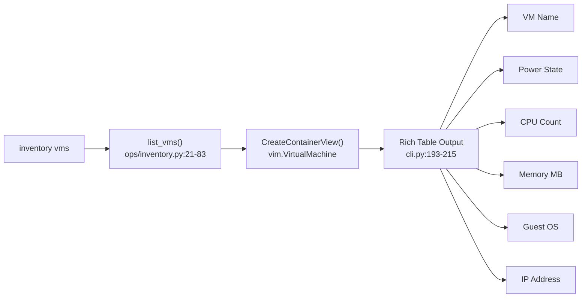
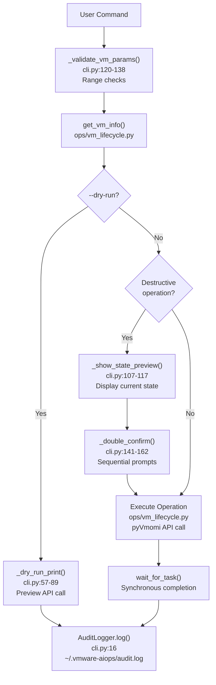

<!-- source: DeepWiki mcp.deepwiki.com · repo zw008/VMware-AIops · page 4.1 CLI Command Reference · fetched 2026-10-26 -->

# CLI Command Reference

<details>
<summary>Relevant source files</summary>

The following files were used as context for generating this wiki page:

- [README.md](README.md)
- [codex-skill/AGENTS.md](codex-skill/AGENTS.md)
- [vmware_aiops/cli.py](vmware_aiops/cli.py)

</details>


## Purpose and Scope

This page provides a complete reference of all CLI commands available in the `vmware-aiops` command-line interface. These commands enable direct terminal access to VMware vCenter and ESXi operations including inventory queries, VM lifecycle management, deployment, health monitoring, and infrastructure configuration.

**Related pages:**
- For AI agent integration patterns using SKILL.md, see [AI Agent Integration](#6)
- For the MCP server interface as an alternative to CLI mode, see [MCP Mode Usage](#5)
- For CLI helper functions (dry-run, double-confirmation, state preview), see [CLI Helper Functions](#4.2)
- For safety mechanisms and audit logging, see [Safety Features](#3.3)

---

## CLI Architecture Overview

```mermaid
graph TB
    Entry["vmware-aiops CLI Entry Point<br/>cli.py:18-22<br/>typer.Typer app"]
    
    subgraph "Command Categories (Sub-Apps)"
        Inv["inventory_app<br/>cli.py:26<br/>Query vCenter/ESXi inventory"]
        Health["health_app<br/>cli.py:27<br/>Alarms, events, sensors"]
        VM["vm_app<br/>cli.py:28<br/>VM lifecycle operations"]
        Deploy["deploy_app<br/>cli.py:29<br/>OVA, templates, batch"]
        DS["datastore_app<br/>cli.py:30<br/>Browse, scan images"]
        Cluster["cluster_app<br/>cli.py:31<br/>Cluster management"]
        Storage["storage_app<br/>cli.py:32<br/>iSCSI configuration"]
        Scan["scan_app<br/>cli.py:33<br/>On-demand scanning"]
        Daemon["daemon_app<br/>cli.py:34<br/>Background daemon"]
        Plan["plan_app<br/>cli.py:1709<br/>Multi-step operations"]
        MCP["mcp_config_app<br/>cli.py:1742<br/>MCP config generator"]
    end
    
    subgraph "Shared Infrastructure"
        Conn["_get_connection()<br/>cli.py:92-99<br/>ConnectionManager + config"]
        Val["_validate_vm_params()<br/>cli.py:120-138<br/>Input validation"]
        Confirm["_double_confirm()<br/>cli.py:141-162<br/>Two-stage confirmation"]
        DryRun["_dry_run_print()<br/>cli.py:57-89<br/>Preview mode"]
        State["_show_state_preview()<br/>cli.py:107-117<br/>Display current state"]
        Audit["AuditLogger<br/>cli.py:16<br/>JSONL logging"]
    end
    
    subgraph "Backend Operations Modules"
        OpsInv["ops/inventory.py<br/>list_vms, list_hosts"]
        OpsHealth["ops/health.py<br/>get_active_alarms, events"]
        OpsLife["ops/vm_lifecycle.py<br/>power, create, delete"]
        OpsDeploy["ops/vm_deploy.py<br/>deploy_ova, linked_clone"]
        OpsBrowser["ops/datastore_browser.py<br/>browse, scan_images"]
        OpsCluster["ops/cluster_mgmt.py<br/>create_cluster, configure"]
        OpsStorage["ops/iscsi_config.py<br/>enable_software_iscsi"]
    end
    
    Entry --> Inv
    Entry --> Health
    Entry --> VM
    Entry --> Deploy
    Entry --> DS
    Entry --> Cluster
    Entry --> Storage
    Entry --> Scan
    Entry --> Daemon
    Entry --> Plan
    Entry --> MCP
    
    Inv --> Conn
    Health --> Conn
    VM --> Conn
    VM --> Val
    VM --> Confirm
    VM --> DryRun
    VM --> State
    Deploy --> Conn
    Deploy --> Confirm
    DS --> Conn
    Cluster --> Conn
    Cluster --> Confirm
    Storage --> Conn
    
    Conn --> OpsInv
    Conn --> OpsHealth
    Conn --> OpsLife
    Conn --> OpsDeploy
    Conn --> OpsBrowser
    Conn --> OpsCluster
    Conn --> OpsStorage
    
    VM --> Audit
    Deploy --> Audit
    Cluster --> Audit
```



**Sources:** [vmware_aiops/cli.py:1-100]()

---

## Command Structure

All CLI commands follow this hierarchical pattern:

```bash
vmware-aiops [OPTIONS] <category> <operation> [ARGUMENTS] [OPTIONS]
```

**Global Options:**
- `--target`, `-t`: Target name from config (e.g., `prod-vcenter`, `lab-esxi`)
- `--config`, `-c`: Custom config file path
- `--dry-run`: Preview API calls without executing (destructive commands only)

**Sources:** [vmware_aiops/cli.py:46-54]()

---

## Inventory Commands

Query vCenter/ESXi infrastructure resources.

### Command Table

| Command | Arguments | Options | Description |
|---------|-----------|---------|-------------|
| `inventory vms` | — | `--limit <n>`<br/>`--sort-by <field>`<br/>`--power-state <state>` | List all VMs with optional filtering/sorting |
| `inventory hosts` | — | — | List all ESXi hosts |
| `inventory datastores` | — | — | List all datastores with capacity info |
| `inventory clusters` | — | — | List all clusters with HA/DRS status |

### Examples

```bash
# List all VMs
vmware-aiops inventory vms --target prod-vcenter

# Top 10 VMs by memory usage
vmware-aiops inventory vms --limit 10 --sort-by memory_mb

# Only powered-on VMs
vmware-aiops inventory vms --power-state poweredOn

# List hosts
vmware-aiops inventory hosts --target lab-esxi

# List datastores
vmware-aiops inventory datastores --target prod-vcenter

# List clusters
vmware-aiops inventory clusters --target prod-vcenter
```

### Output Format



**Sources:** [vmware_aiops/cli.py:168-293](), [vmware_aiops/ops/inventory.py:1-200]()

---

## Health Monitoring Commands

Monitor infrastructure health, alarms, and events.

### Command Table

| Command | Arguments | Options | Description |
|---------|-----------|---------|-------------|
| `health alarms` | — | — | Show all active alarms |
| `health events` | — | `--hours <n>`<br/>`--severity <level>` | Show recent events (default: 24h, warning+) |

### Examples

```bash
# Active alarms
vmware-aiops health alarms --target prod-vcenter

# Events from last 24 hours, warning and above
vmware-aiops health events --hours 24 --severity warning

# Critical events from last hour
vmware-aiops health events --hours 1 --severity error
```

### Event Severity Levels

- `info` - Informational events
- `warning` - Warning-level events (default threshold)
- `error` - Critical errors only

**Sources:** [vmware_aiops/cli.py:298-346](), [vmware_aiops/ops/health.py:1-150]()

---

## VM Lifecycle Commands

Core VM operations including power management, creation, deletion, snapshots, and migration.

### Command Table

| Command | Arguments | Key Options | Confirmation | Description |
|---------|-----------|-------------|:------------:|-------------|
| `vm info` | `<vm-name>` | — | — | Display detailed VM information |
| `vm power-on` | `<vm-name>` | `--dry-run` | — | Power on a VM |
| `vm power-off` | `<vm-name>` | `--force`<br/>`--dry-run` | ✓✓ | Graceful shutdown (or force) |
| `vm create` | `<vm-name>` | `--cpu <n>`<br/>`--memory <mb>`<br/>`--disk <gb>`<br/>`--network <name>`<br/>`--datastore <name>` | — | Create new VM |
| `vm delete` | `<vm-name>` | `--dry-run` | ✓✓ | Delete VM (destructive) |
| `vm reconfigure` | `<vm-name>` | `--cpu <n>`<br/>`--memory <mb>`<br/>`--dry-run` | ✓✓ | Modify CPU/memory |
| `vm snapshot-create` | `<vm-name>` | `--name <snap>`<br/>`--description <desc>`<br/>`--memory/--no-memory` | — | Create snapshot |
| `vm snapshot-list` | `<vm-name>` | — | — | List all snapshots |
| `vm snapshot-revert` | `<vm-name>` | `--name <snap>`<br/>`--dry-run` | ✓✓ | Revert to snapshot |
| `vm snapshot-delete` | `<vm-name>` | `--name <snap>`<br/>`--dry-run` | ✓✓ | Delete snapshot |
| `vm clone` | `<vm-name>` | `--new-name <name>`<br/>`--dry-run` | ✓✓ | Clone VM |
| `vm migrate` | `<vm-name>` | `--to-host <host>`<br/>`--dry-run` | ✓✓ | vMotion to another host |

**Note:** ✓✓ indicates double confirmation required (sequential prompts, no bypass)

### Examples

```bash
# VM information
vmware-aiops vm info my-vm --target prod-vcenter

# Power operations
vmware-aiops vm power-on my-vm
vmware-aiops vm power-off my-vm            # Graceful shutdown
vmware-aiops vm power-off my-vm --force    # Force power off

# Create VM
vmware-aiops vm create test-vm \
  --cpu 4 --memory 8192 --disk 100 \
  --network "VM Network" --datastore datastore1

# Delete VM (preview first)
vmware-aiops vm delete old-vm --dry-run
vmware-aiops vm delete old-vm  # Requires 2x confirmation

# Reconfigure
vmware-aiops vm reconfigure my-vm --cpu 8 --memory 16384

# Snapshots
vmware-aiops vm snapshot-create my-vm --name "before-upgrade"
vmware-aiops vm snapshot-list my-vm
vmware-aiops vm snapshot-revert my-vm --name "before-upgrade"
vmware-aiops vm snapshot-delete my-vm --name "old-snapshot"

# Clone
vmware-aiops vm clone base-vm --new-name clone-01

# Migrate (vMotion)
vmware-aiops vm migrate my-vm --to-host esxi-02
```

### Input Validation Rules

The CLI validates all VM parameters before execution:

| Parameter | Valid Range | Error Code |
|-----------|-------------|------------|
| VM Name | 1-80 characters, no leading `-` or `.` | `typer.BadParameter` |
| CPU Count | 1-128 cores | `typer.BadParameter` |
| Memory | 128-1048576 MB | `typer.BadParameter` |
| Disk Size | 1-65536 GB | `typer.BadParameter` |

**Sources:** [vmware_aiops/cli.py:120-138]()

### VM Operation Flow Diagram



**Sources:** [vmware_aiops/cli.py:350-771](), [vmware_aiops/ops/vm_lifecycle.py:1-500]()

---

## TTL and Clean Slate Commands

Automated VM lifecycle management.

### Command Table

| Command | Arguments | Options | Description |
|---------|-----------|---------|-------------|
| `vm set-ttl` | `<vm-name>` | `--minutes <n>` | Schedule VM for auto-deletion |
| `vm cancel-ttl` | `<vm-name>` | — | Cancel scheduled deletion |
| `vm list-ttl` | — | — | Show all VMs with TTLs |
| `vm clean-slate` | `<vm-name>` | `--snapshot <name>`<br/>`--dry-run` | Revert to baseline snapshot |

### Examples

```bash
# Set VM to auto-delete in 60 minutes
vmware-aiops vm set-ttl test-vm --minutes 60

# Cancel TTL
vmware-aiops vm cancel-ttl test-vm

# List all TTLs
vmware-aiops vm list-ttl

# Clean slate: power off + revert to baseline
vmware-aiops vm clean-slate lab-vm --snapshot baseline
```

**Sources:** [vmware_aiops/cli.py:777-866](), [vmware_aiops/ops/ttl.py]()

---

## Guest Operations Commands

Execute commands and transfer files inside VMs via VMware Tools.

### Command Table

| Command | Arguments | Options | Requires |
|---------|-----------|---------|----------|
| `vm guest-exec` | `<vm-name>` | `--cmd <path>`<br/>`--args <string>`<br/>`--user <username>`<br/>`--password <pwd>` | VMware Tools |
| `vm guest-upload` | `<vm-name>` | `--local <path>`<br/>`--guest <path>`<br/>`--user <username>`<br/>`--password <pwd>` | VMware Tools |
| `vm guest-download` | `<vm-name>` | `--guest <path>`<br/>`--local <path>`<br/>`--user <username>`<br/>`--password <pwd>` | VMware Tools |

### Examples

```bash
# Execute command inside VM
vmware-aiops vm guest-exec my-vm \
  --cmd /bin/bash \
  --args "-c 'df -h'" \
  --user root

# Upload file to VM
vmware-aiops vm guest-upload my-vm \
  --local ./script.sh \
  --guest /tmp/script.sh \
  --user root

# Download file from VM
vmware-aiops vm guest-download my-vm \
  --guest /var/log/syslog \
  --local ./syslog.txt \
  --user root
```

**Prerequisites:**
- VMware Tools must be installed and running in guest OS
- Valid guest OS credentials required
- VM must be powered on

**Sources:** [vmware_aiops/cli.py:872-949](), [vmware_aiops/ops/guest_ops.py:1-200]()

---

## Deployment Commands

Deploy VMs from OVA, templates, linked clones, and batch operations.

### Command Table

| Command | Arguments | Key Options | Confirmation | Speed |
|---------|-----------|-------------|:------------:|-------|
| `deploy ova` | `<ova-path>` | `--name <vm>`<br/>`--datastore <ds>`<br/>`--network <net>`<br/>`--power-on`<br/>`--snapshot <name>` | ✓✓ | Minutes |
| `deploy template` | `<template>` | `--name <vm>`<br/>`--datastore <ds>`<br/>`--cpu <n>`<br/>`--memory <mb>`<br/>`--power-on` | ✓✓ | Minutes |
| `deploy linked-clone` | — | `--source <vm>`<br/>`--snapshot <snap>`<br/>`--name <vm>`<br/>`--cpu <n>`<br/>`--memory <mb>`<br/>`--power-on`<br/>`--baseline <snap>` | ✓✓ | Seconds |
| `deploy iso` | `<vm-name>` | `--iso <ds-path>` | — | Instant |
| `deploy mark-template` | `<vm-name>` | — | ✓✓ | Instant |
| `deploy batch-clone` | — | `--source <vm>`<br/>`--prefix <name>`<br/>`--count <n>`<br/>`--cpu <n>`<br/>`--memory <mb>`<br/>`--snapshot <name>`<br/>`--power-on` | ✓✓ | Minutes |
| `deploy batch` | `<spec.yaml>` | — | ✓✓ | Auto |

### Examples

```bash
# Deploy from OVA
vmware-aiops deploy ova ./ubuntu-22.04.ova \
  --name my-vm \
  --datastore datastore1 \
  --network "VM Network" \
  --power-on \
  --snapshot baseline

# Deploy from template
vmware-aiops deploy template golden-ubuntu \
  --name new-vm \
  --datastore datastore1 \
  --cpu 4 \
  --memory 8192

# Linked clone (instant, minimal disk)
vmware-aiops deploy linked-clone \
  --source base-vm \
  --snapshot clean \
  --name test-vm \
  --power-on \
  --baseline clean

# Attach ISO to existing VM
vmware-aiops deploy iso my-vm \
  --iso "[datastore1] iso/ubuntu-22.04.iso"

# Convert VM to template
vmware-aiops deploy mark-template golden-vm

# Batch clone 5 VMs
vmware-aiops deploy batch-clone \
  --source base-vm \
  --prefix lab \
  --count 5 \
  --power-on

# Batch deploy from YAML spec
vmware-aiops deploy batch deploy-spec.yaml
```

### Deployment Speed Comparison

| Method | Speed | Disk Usage | Use Case |
|--------|-------|------------|----------|
| Linked Clone | **Seconds** | Minimal (delta only) | Test/dev, rapid provisioning |
| Template | Minutes | Full disk copy | Production deployments |
| OVA | Minutes | Full disk copy | Initial image import |
| Batch Clone | Minutes | Full disk × count | Lab environments |

**Sources:** [vmware_aiops/cli.py:1040-1292](), [vmware_aiops/ops/vm_deploy.py:1-600]()

---

## Datastore Commands

Browse datastore contents and discover deployable images.

### Command Table

| Command | Arguments | Options | Description |
|---------|-----------|---------|-------------|
| `datastore browse` | `<datastore>` | `--path <dir>`<br/>`--pattern <glob>` | List files in datastore path |
| `datastore scan-images` | — | — | Scan all datastores for ISO/OVA/OVF/VMDK |
| `datastore images` | — | `--type <ext>`<br/>`--ds <name>` | List cached images from registry |

### Examples

```bash
# Browse datastore
vmware-aiops datastore browse datastore1 --path "iso/"

# Scan all datastores for deployable images
vmware-aiops datastore scan-images --target prod-vcenter

# List all ISO images
vmware-aiops datastore images --type iso

# List images on specific datastore
vmware-aiops datastore images --ds datastore1
```

### Image Registry

The `scan-images` command builds a local cache at `~/.vmware-aiops/image_registry.json`:

```json
{
  "last_scan": "2024-01-15T10:30:00Z",
  "images": [
    {
      "datastore": "datastore1",
      "name": "ubuntu-22.04.iso",
      "type": "iso",
      "size_mb": 1450,
      "ds_path": "[datastore1] iso/ubuntu-22.04.iso"
    }
  ]
}
```

**Sources:** [vmware_aiops/cli.py:955-1035](), [vmware_aiops/ops/datastore_browser.py:1-300]()

---

## Cluster Management Commands

Create, delete, and configure vSphere clusters with HA/DRS.

### Command Table

| Command | Arguments | Options | Confirmation | Description |
|---------|-----------|---------|:------------:|-------------|
| `cluster info` | `<cluster>` | — | — | Show cluster details |
| `cluster create` | `<cluster>` | `--ha`<br/>`--drs`<br/>`--drs-behavior <mode>`<br/>`--datacenter <name>` | — | Create new cluster |
| `cluster delete` | `<cluster>` | `--dry-run` | ✓✓ | Delete empty cluster |
| `cluster add-host` | `<cluster>` | `--host <name>`<br/>`--dry-run` | ✓✓ | Move host into cluster |
| `cluster remove-host` | `<cluster>` | `--host <name>`<br/>`--dry-run` | ✓✓ | Remove host from cluster |
| `cluster configure` | `<cluster>` | `--ha/--no-ha`<br/>`--drs/--no-drs`<br/>`--drs-behavior <mode>`<br/>`--dry-run` | ✓✓ | Modify HA/DRS settings |

### DRS Behaviors

- `fullyAutomated` - Automatic migration (recommended)
- `partiallyAutomated` - User approval required
- `manual` - Recommendations only

### Examples

```bash
# Cluster info
vmware-aiops cluster info production-cluster

# Create cluster with HA and DRS
vmware-aiops cluster create new-cluster \
  --ha \
  --drs \
  --drs-behavior fullyAutomated \
  --datacenter DC1

# Add host to cluster
vmware-aiops cluster add-host production-cluster \
  --host esxi-03.example.com

# Remove host (must be in maintenance mode)
vmware-aiops cluster remove-host production-cluster \
  --host esxi-old.example.com

# Configure cluster
vmware-aiops cluster configure production-cluster \
  --ha \
  --drs \
  --drs-behavior fullyAutomated

# Delete empty cluster
vmware-aiops cluster delete old-cluster --dry-run
vmware-aiops cluster delete old-cluster
```

**Sources:** [vmware_aiops/cli.py:1297-1486](), [vmware_aiops/ops/cluster_mgmt.py:1-400]()

---

## Storage Management Commands

Configure iSCSI adapters and manage storage on ESXi hosts.

### Command Table

| Command | Arguments | Options | Confirmation | Description |
|---------|-----------|---------|:------------:|-------------|
| `storage iscsi-enable` | `<host>` | `--dry-run` | ✓✓ | Enable software iSCSI adapter |
| `storage iscsi-status` | `<host>` | — | — | Show iSCSI status and targets |
| `storage iscsi-add-target` | `<host>` | `--address <ip>`<br/>`--port <n>`<br/>`--dry-run` | ✓✓ | Add iSCSI send target |
| `storage iscsi-remove-target` | `<host>` | `--address <ip>`<br/>`--port <n>`<br/>`--dry-run` | ✓✓ | Remove iSCSI send target |
| `storage rescan` | `<host>` | `--dry-run` | — | Rescan all HBAs and VMFS |

### Examples

```bash
# Enable iSCSI on host
vmware-aiops storage iscsi-enable esxi-01.example.com

# Check iSCSI status
vmware-aiops storage iscsi-status esxi-01.example.com

# Add iSCSI target
vmware-aiops storage iscsi-add-target esxi-01.example.com \
  --address 10.0.1.50 \
  --port 3260

# Remove iSCSI target
vmware-aiops storage iscsi-remove-target esxi-01.example.com \
  --address 10.0.1.50 \
  --port 3260

# Rescan storage
vmware-aiops storage rescan esxi-01.example.com
```

**Sources:** [vmware_aiops/cli.py:1492-1631](), [vmware_aiops/ops/iscsi_config.py:1-300]()

---

## Scan and Daemon Commands

On-demand scanning and background daemon management.

### Command Table

| Command | Arguments | Options | Description |
|---------|-----------|---------|-------------|
| `scan now` | — | — | Run immediate scan of alarms/events/logs |
| `daemon start` | — | `--config <path>` | Start background scanner daemon |
| `daemon status` | — | — | Check daemon status |
| `daemon stop` | — | — | Stop daemon (graceful SIGTERM) |

### Examples

```bash
# One-time scan
vmware-aiops scan now --target prod-vcenter

# Daemon management
vmware-aiops daemon start
vmware-aiops daemon status
vmware-aiops daemon stop
```

### Daemon Behavior

The daemon:
- Runs on configurable interval (default: 15 minutes)
- Scans all configured targets sequentially
- Writes structured JSONL to `~/.vmware-aiops/scan.log`
- Stores PID in `~/.vmware-aiops/daemon.pid`
- Handles SIGTERM for graceful shutdown

**Sources:** [vmware_aiops/cli.py:1637-1703](), [vmware_aiops/scanner/scheduler.py]()

---

## Plan Management Commands

View and manage multi-step operation plans.

### Command Table

| Command | Arguments | Description |
|---------|-----------|-------------|
| `plan list` | — | List all pending/failed operation plans |

### Example

```bash
# List all plans
vmware-aiops plan list
```

**Note:** Plans are created programmatically via the Plan → Apply workflow. See [Plan → Apply → Rollback Workflow](#3.4) for details.

**Sources:** [vmware_aiops/cli.py:1709-1737](), [vmware_aiops/ops/planner.py:1-200]()

---

## MCP Config Generator Commands

Generate MCP server configuration for local AI agents.

### Command Table

| Command | Arguments | Options | Description |
|---------|-----------|---------|-------------|
| `mcp-config generate` | — | `--agent <name>`<br/>`--path <install-dir>`<br/>`--output <file>` | Generate MCP config for agent |
| `mcp-config list` | — | — | List supported agents |

### Supported Agents

- `goose` - Goose agent config
- `cursor` - Cursor IDE config
- `claude-code` - Claude Desktop config
- `continue` - Continue CLI config
- `vscode-copilot` - VS Code Copilot config
- `localcowork` - LocalCowork config
- `mcp-agent` - mcp-agent config

### Examples

```bash
# List supported agents
vmware-aiops mcp-config list

# Generate config for Goose
vmware-aiops mcp-config generate --agent goose

# Generate config with custom install path
vmware-aiops mcp-config generate \
  --agent goose \
  --path /opt/VMware-AIops

# Write to file
vmware-aiops mcp-config generate \
  --agent claude-code \
  --output ~/claude_desktop_config.json
```

**Sources:** [vmware_aiops/cli.py:1742-1827](), [examples/mcp-configs/]()

---

## Diagnostic Commands

System health and configuration validation.

### Command Table

| Command | Arguments | Options | Description |
|---------|-----------|---------|-------------|
| `doctor` | — | `--skip-auth` | Check environment, config, connectivity, daemon |

### Example

```bash
# Full diagnostic check
vmware-aiops doctor

# Skip authentication check (faster)
vmware-aiops doctor --skip-auth
```

### Diagnostic Checks

The `doctor` command verifies:
1. Python version and dependencies
2. Config file existence and validity
3. Environment variable configuration
4. `.env` file permissions (must be 600)
5. vSphere connectivity (unless `--skip-auth`)
6. Daemon status
7. Audit log accessibility

**Sources:** [vmware_aiops/cli.py:1830-1841](), [vmware_aiops/doctor.py:1-200]()

---

## Command-to-Code Mapping

This diagram shows how CLI commands map to backend operation functions:

```mermaid
graph TB
    subgraph "CLI Layer (cli.py)"
        InvCmd["inventory_vms<br/>cli.py:168"]
        HealthCmd["health_alarms<br/>cli.py:298"]
        VMPowerCmd["vm_power_on<br/>cli.py:366"]
        VMCreateCmd["vm_create<br/>cli.py:435"]
        VMDeleteCmd["vm_delete<br/>cli.py:481"]
        VMSnapCmd["vm_snapshot_create<br/>cli.py:581"]
        DeployOVA["deploy_ova_cmd<br/>cli.py:1040"]
        DeployLinked["deploy_linked_clone_cmd<br/>cli.py:1117"]
        DSBrowse["ds_browse<br/>cli.py:955"]
        DSScan["ds_scan_images<br/>cli.py:982"]
        ClusterCreate["cluster_create_cmd<br/>cli.py:1322"]
        StorageISCSI["storage_iscsi_enable_cmd<br/>cli.py:1492"]
    end
    
    subgraph "Operations Layer (ops/)"
        ListVMs["list_vms()<br/>inventory.py:21"]
        GetAlarms["get_active_alarms()<br/>health.py:15"]
        PowerOnVM["power_on_vm()<br/>vm_lifecycle.py:85"]
        CreateVM["create_vm()<br/>vm_lifecycle.py:150"]
        DeleteVM["delete_vm()<br/>vm_lifecycle.py:220"]
        CreateSnap["create_snapshot()<br/>vm_lifecycle.py:300"]
        DeployOVAOp["deploy_ova()<br/>vm_deploy.py:50"]
        LinkedCloneOp["linked_clone()<br/>vm_deploy.py:200"]
        BrowseDS["browse_datastore()<br/>datastore_browser.py:25"]
        UpdateReg["update_registry()<br/>datastore_browser.py:80"]
        CreateCluster["create_cluster()<br/>cluster_mgmt.py:30"]
        EnableISCSI["enable_software_iscsi()<br/>iscsi_config.py:20"]
    end
    
    subgraph "pyVmomi API Layer"
        API1["vim.VirtualMachine"]
        API2["vim.AlarmManager"]
        API3["vim.Folder.CreateVM_Task()"]
        API4["vim.VirtualMachine.Destroy_Task()"]
        API5["vim.VirtualMachine.CreateSnapshot_Task()"]
        API6["vim.OvfManager"]
        API7["vim.host.DatastoreBrowser"]
        API8["vim.ClusterComputeResource"]
        API9["vim.HostStorageSystem"]
    end
    
    InvCmd --> ListVMs
    HealthCmd --> GetAlarms
    VMPowerCmd --> PowerOnVM
    VMCreateCmd --> CreateVM
    VMDeleteCmd --> DeleteVM
    VMSnapCmd --> CreateSnap
    DeployOVA --> DeployOVAOp
    DeployLinked --> LinkedCloneOp
    DSBrowse --> BrowseDS
    DSScan --> UpdateReg
    ClusterCreate --> CreateCluster
    StorageISCSI --> EnableISCSI
    
    ListVMs --> API1
    GetAlarms --> API2
    PowerOnVM --> API1
    CreateVM --> API3
    DeleteVM --> API4
    CreateSnap --> API5
    DeployOVAOp --> API6
    LinkedCloneOp --> API1
    BrowseDS --> API7
    UpdateReg --> API7
    CreateCluster --> API8
    EnableISCSI --> API9
```



**Sources:** [vmware_aiops/cli.py:1-1846](), [vmware_aiops/ops/*.py]()

---

## Common Option Patterns

### Target Selection

All commands support `--target` to specify which vCenter/ESXi from config:

```bash
# Use default target (first in config)
vmware-aiops inventory vms

# Specify target explicitly
vmware-aiops inventory vms --target prod-vcenter
vmware-aiops vm power-on test-vm --target lab-esxi
```

**Sources:** [vmware_aiops/cli.py:46-48](), [vmware_aiops/config.py:40-80]()

### Dry-Run Mode

Preview destructive operations without execution:

```bash
# Preview VM deletion
vmware-aiops vm delete my-vm --dry-run

# Preview cluster reconfiguration
vmware-aiops cluster configure prod-cluster --drs --dry-run

# Preview batch clone
vmware-aiops deploy batch-clone --source base-vm --count 10 --dry-run
```

Dry-run output shows:
- Target environment
- VM/resource name
- Operation type
- Exact API call
- Current state
- Expected after-state

**Sources:** [vmware_aiops/cli.py:52-54](), [vmware_aiops/cli.py:57-89]()

---

## Exit Codes

| Code | Meaning |
|------|---------|
| 0 | Success |
| 1 | Command error or invalid arguments |
| 130 | User aborted (Ctrl+C or confirmation declined) |

**Sources:** [vmware_aiops/cli.py:1841]()

---

