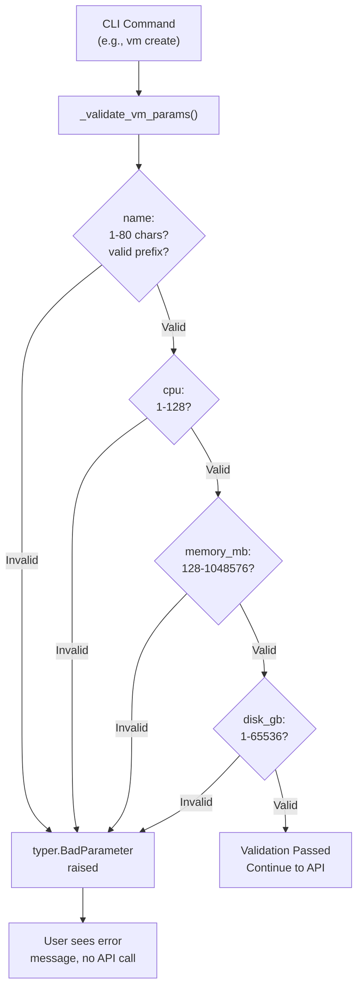
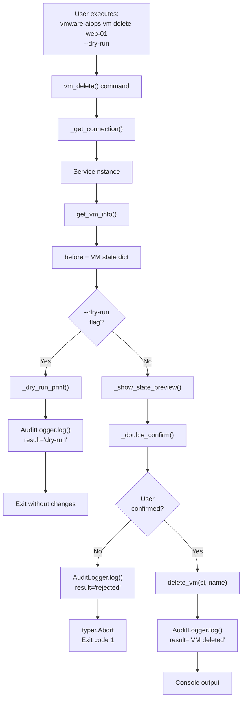
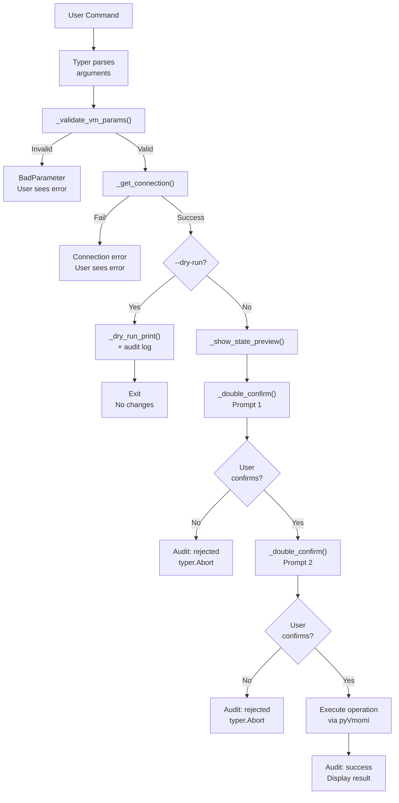

<!-- source: DeepWiki mcp.deepwiki.com · repo zw008/VMware-AIops · page 4.2 CLI Helper Functions · fetched 2026-10-26 -->

# CLI Helper Functions

<details>
<summary>Relevant source files</summary>

The following files were used as context for generating this wiki page:

- [vmware_aiops/cli.py](vmware_aiops/cli.py)

</details>


This page documents the internal helper functions used by the `vmware-aiops` CLI to provide consistent safety features, input validation, and user experience across all commands. These are utility functions defined in [vmware_aiops/cli.py]() that implement core CLI patterns like dry-run mode, double confirmation, state previews, and parameter validation.

For information about the actual CLI commands themselves, see [CLI Command Reference](#4.1). For safety features and architecture, see [Safety Features](#3.3).

---

## Overview

The CLI helper functions provide reusable infrastructure for all `vmware-aiops` commands. They implement the safety and usability patterns that appear consistently across inventory, VM lifecycle, deployment, and infrastructure management commands. All helpers are private functions (prefixed with `_`) and are called internally by the CLI command implementations.

**Key Helper Categories:**

| Category | Functions | Purpose |
|----------|-----------|---------|
| Connection Management | `_get_connection`, `_resolve_target` | Establish pyVmomi sessions and resolve target names |
| Input Validation | `_validate_vm_params` | Validate parameter ranges before vSphere API calls |
| Safety Gates | `_double_confirm` | Enforce two-step confirmation for destructive operations |
| State Preview | `_show_state_preview` | Display current resource state before changes |
| Dry-Run | `_dry_run_print` | Preview operations without execution |

**Sources:** [vmware_aiops/cli.py:46-163]()

---

## Connection and Configuration Helpers

### `_get_connection(target, config_path)`

Establishes a pyVmomi connection to vCenter/ESXi and returns the `ServiceInstance` along with the loaded configuration. This is the entry point for all CLI commands that need to communicate with VMware infrastructure.

**Function Signature:**
```python
def _get_connection(target: str | None, config_path: Path | None = None)
```

**Parameters:**
- `target`: Target name from `config.yaml` (or `None` for default)
- `config_path`: Optional path to custom config file

**Returns:** Tuple of `(ServiceInstance, Config)`

**Usage Pattern:**
```python
si, cfg = _get_connection(target, config)
# si is now ready to use for pyVmomi operations
```

This helper encapsulates the two-step process of loading configuration and establishing a connection, ensuring all commands follow the same connection pattern.

**Sources:** [vmware_aiops/cli.py:92-99]()

---

### `_resolve_target(target)`

Converts a target name to a display-friendly string for use in audit logs and console output. Returns `"default"` when `target` is `None`.

**Function Signature:**
```python
def _resolve_target(target: str | None) -> str
```

This simple helper ensures consistent target naming across all audit log entries, making logs easier to search and filter.

**Sources:** [vmware_aiops/cli.py:102-104]()

---

## Input Validation Helpers

### `_validate_vm_params(name, cpu, memory_mb, disk_gb)`

Validates VM parameter ranges before passing them to vSphere API calls. Raises `typer.BadParameter` if any parameter is outside the allowed range, which Typer converts to a user-friendly error message.

**Function Signature:**
```python
def _validate_vm_params(
    *,
    name: str | None = None,
    cpu: int | None = None,
    memory_mb: int | None = None,
    disk_gb: int | None = None,
) -> None
```

**Validation Rules:**

| Parameter | Valid Range | Additional Constraints |
|-----------|-------------|------------------------|
| `name` | 1-80 characters | Cannot start with `-` or `.` |
| `cpu` | 1-128 cores | Integer only |
| `memory_mb` | 128-1,048,576 MB | 128 MB to 1 TB |
| `disk_gb` | 1-65,536 GB | 1 GB to 64 TB |

**Example Usage:**
```python
# Before calling create_vm or reconfigure_vm
_validate_vm_params(name=vm_name, cpu=cpu, memory_mb=memory, disk_gb=disk)
# If validation passes, proceed with API call
```

**Error Handling:**
When validation fails, Typer catches the `BadParameter` exception and displays a clean error message to the user without a stack trace. This provides immediate feedback on invalid input before any network calls to vSphere.

**Sources:** [vmware_aiops/cli.py:120-138]()

---

## Parameter Validation Flow



**Sources:** [vmware_aiops/cli.py:120-138]()

---

## Safety Helpers

### `_double_confirm(action, vm_name, target, resource_type)`

Enforces two-step confirmation for destructive operations. Prompts the user twice to confirm the action. If the user aborts at either step, logs a `'rejected'` audit entry and raises `typer.Abort`.

**Function Signature:**
```python
def _double_confirm(
    action: str,
    vm_name: str,
    target: str = "default",
    resource_type: str = "VM",
) -> None
```

**Parameters:**
- `action`: Chinese description of the action (e.g., `"删除"`, `"关机"`)
- `vm_name`: Name of the resource being operated on
- `target`: Target name for audit logging
- `resource_type`: Type of resource (`"VM"`, `"Cluster"`, `"Host"`)

**Behavior:**
1. Displays warning message with action and resource name
2. Prompts: "第 1 次确认: 确定要{action} '{vm_name}'?"
3. If confirmed, prompts: "第 2 次确认: 再次确认{action} '{vm_name}'，此操作不可撤销?"
4. If user declines at either step:
   - Logs audit entry with `result="rejected"`
   - Raises `typer.Abort` (displays "Aborted!" and exits with code 1)
5. If both confirmations succeed, function returns normally

**Example Usage:**
```python
# Before deleting a VM
_show_state_preview(vm_info, "删除", vm_name)
_double_confirm("删除", vm_name, _resolve_target(target))
result = delete_vm(si, vm_name)  # Only reached if confirmed
```

**Audit Trail:**
Even when users reject an operation, an audit entry is created:
```json
{
  "timestamp": "2024-01-15T10:30:00Z",
  "target": "production",
  "operation": "delete_vm",
  "resource": "test-vm-01",
  "result": "rejected"
}
```

**Sources:** [vmware_aiops/cli.py:141-162]()

---

### `_show_state_preview(info, action, vm_name)`

Displays the current state of a VM before a destructive operation. This provides users with context about what they're about to change or destroy.

**Function Signature:**
```python
def _show_state_preview(info: dict, action: str, vm_name: str) -> None
```

**Parameters:**
- `info`: Dictionary containing VM state (from `get_vm_info`)
- `action`: Chinese description of the action
- `vm_name`: VM name being operated on

**Displayed Fields:**
- `power_state`: Current power state (`poweredOn`, `poweredOff`, `suspended`)
- `cpu`: Number of vCPUs
- `memory_mb`: Memory in MB
- `guest_os`: Guest OS identifier
- `host`: ESXi host where VM is running
- `ip_address`: Guest IP address (if available)
- `snapshot_count`: Number of snapshots

**Example Output:**
```
📋 Current state of VM 'production-db':
  power_state: poweredOn
  cpu: 8
  memory_mb: 16384
  guest_os: ubuntu64Guest
  host: esxi01.lab.local
  ip_address: 192.168.1.100
  snapshot_count: 3
```

**Usage Pattern:**
Always called before `_double_confirm` to give users full context:
```python
before = get_vm_info(si, name)
_show_state_preview(before, "删除", name)
_double_confirm("删除", name, _resolve_target(target))
```

**Sources:** [vmware_aiops/cli.py:107-117]()

---

## Dry-Run Helper

### `_dry_run_print(target, vm_name, operation, api_call, parameters, before_state, expected_after, resource_label)`

Prints a detailed preview of the operation that would be executed, without actually making any changes. This is called when the `--dry-run` flag is passed to any command.

**Function Signature:**
```python
def _dry_run_print(
    *,
    target: str,
    vm_name: str,
    operation: str,
    api_call: str,
    parameters: dict | None = None,
    before_state: dict | None = None,
    expected_after: dict | None = None,
    resource_label: str = "VM",
) -> None
```

**Parameters:**
- `target`: Target name
- `vm_name`: Resource name
- `operation`: Operation identifier (e.g., `"power_on"`, `"delete_vm"`)
- `api_call`: vSphere API method that would be called (e.g., `"vim.VirtualMachine.PowerOn()"`)
- `parameters`: Optional dict of operation parameters
- `before_state`: Optional dict of current state
- `expected_after`: Optional dict of expected state after operation
- `resource_label`: Type of resource (default: `"VM"`)

**Output Format:**
```
[DRY-RUN] No changes will be made.
  Target:    production
  VM:        web-server-01
  Operation: reconfigure_vm
  API Call:  vim.VirtualMachine.ReconfigVM_Task()
  Param:     cpu = 4
  Param:     memory_mb = 8192
  Current:   {'cpu': 2, 'memory_mb': 4096}
  Expected:  {'cpu': 4, 'memory_mb': 8192}
  Run without --dry-run to execute.
```

**Audit Logging:**
Dry-run operations are logged with `result="dry-run"`, creating a complete audit trail of all preview operations:
```python
_audit.log(
    target=target,
    operation=operation,
    resource=vm_name,
    parameters={"dry_run": True, **(parameters or {})},
    before_state=before_state or {},
    result="dry-run",
)
```

**Sources:** [vmware_aiops/cli.py:57-89]()

---

## Helper Function Integration



**Sources:** [vmware_aiops/cli.py:481-520]()

---

## Common Usage Patterns

### Pattern 1: Simple Read-Only Command
```python
@inventory_app.command("vms")
def inventory_vms(target: TargetOption = None, config: ConfigOption = None):
    si, _ = _get_connection(target, config)
    # No validation, no confirmation needed
    result = list_vms(si)
    # Display result
```

**Used by:** `inventory vms`, `inventory hosts`, `inventory datastores`, `health alarms`

**Sources:** [vmware_aiops/cli.py:168-216]()

---

### Pattern 2: Destructive Operation with Full Safety
```python
@vm_app.command("delete")
def vm_delete(name: str, target: TargetOption = None, 
              config: ConfigOption = None, dry_run: DryRunOption = False):
    si, _ = _get_connection(target, config)
    before = get_vm_info(si, name)
    
    if dry_run:
        _dry_run_print(
            target=_resolve_target(target), vm_name=name,
            operation="delete_vm", api_call="vim.VirtualMachine.Destroy_Task()",
            before_state={"power_state": before.get("power_state"), ...}
        )
        return
    
    _show_state_preview(before, "删除", name)
    _double_confirm("删除", name, _resolve_target(target))
    result = delete_vm(si, name)
    
    _audit.log(
        target=_resolve_target(target), operation="delete_vm",
        resource=name, before_state={...}, result=result
    )
```

**Used by:** `vm delete`, `vm power-off`, `cluster delete`, `snapshot delete`

**Sources:** [vmware_aiops/cli.py:481-520]()

---

### Pattern 3: Create Operation with Validation
```python
@vm_app.command("create")
def vm_create(name: str, cpu: int = 2, memory: int = 4096, disk: int = 40,
              target: TargetOption = None, config: ConfigOption = None,
              dry_run: DryRunOption = False):
    _validate_vm_params(name=name, cpu=cpu, memory_mb=memory, disk_gb=disk)
    
    if dry_run:
        _dry_run_print(
            target=_resolve_target(target), vm_name=name,
            operation="create_vm", api_call="vim.Folder.CreateVM_Task()",
            parameters={"cpu": cpu, "memory_mb": memory, "disk_gb": disk, ...}
        )
        return
    
    si, _ = _get_connection(target, config)
    result = create_vm(si, vm_name=name, cpu=cpu, memory_mb=memory, disk_gb=disk, ...)
    
    _audit.log(
        target=_resolve_target(target), operation="create_vm",
        resource=name, parameters={...}, result=result
    )
```

**Used by:** `vm create`, `vm reconfigure`, `deploy ova`, `deploy template`

**Sources:** [vmware_aiops/cli.py:435-478]()

---

### Pattern 4: Modify Operation with State Tracking
```python
@vm_app.command("reconfigure")
def vm_reconfigure(name: str, cpu: int | None = None, memory: int | None = None,
                   target: TargetOption = None, config: ConfigOption = None,
                   dry_run: DryRunOption = False):
    _validate_vm_params(cpu=cpu, memory_mb=memory)
    si, _ = _get_connection(target, config)
    before = get_vm_info(si, name)
    
    if dry_run:
        _dry_run_print(
            target=_resolve_target(target), vm_name=name,
            operation="reconfigure_vm", api_call="vim.VirtualMachine.ReconfigVM_Task()",
            parameters={"cpu": cpu or "(unchanged)", ...},
            before_state={"cpu": before.get("cpu"), "memory_mb": before.get("memory_mb")},
            expected_after={"cpu": cpu or before.get("cpu"), ...}
        )
        return
    
    _show_state_preview(before, "调整配置", name)
    _double_confirm(f"调整配置({changes})", name, _resolve_target(target))
    result = reconfigure_vm(si, name, cpu=cpu, memory_mb=memory)
    
    _audit.log(
        target=_resolve_target(target), operation="reconfigure_vm",
        resource=name, parameters={...},
        before_state={...}, after_state={...}, result=result
    )
```

**Used by:** `vm reconfigure`, `vm migrate`, `cluster configure`

**Sources:** [vmware_aiops/cli.py:523-578]()

---

## Helper Function Reference Table

| Function | When Called | Raises Exception | Logs Audit | Returns Value |
|----------|-------------|------------------|------------|---------------|
| `_get_connection` | Every command start | Yes (connection fails) | No | `(ServiceInstance, Config)` |
| `_resolve_target` | Audit logging | No | No | `str` |
| `_validate_vm_params` | Before create/modify | Yes (`BadParameter`) | No | `None` |
| `_double_confirm` | Before destructive ops | Yes (`Abort`) | Yes (if rejected) | `None` |
| `_show_state_preview` | Before destructive ops | No | No | `None` |
| `_dry_run_print` | When `--dry-run` flag | No | Yes | `None` |

**Sources:** [vmware_aiops/cli.py:57-162]()

---

## Integration with Global CLI Objects

The helper functions work in conjunction with several module-level objects defined in `cli.py`:

### `app` - Main Typer Application
```python
app = typer.Typer(
    name="vmware-aiops",
    help="VMware vCenter/ESXi AI-powered monitoring and operations.",
    no_args_is_help=True,
)
```

All sub-applications are registered with this main app.

**Sources:** [vmware_aiops/cli.py:18-22]()

---

### `console` - Rich Console Instance
```python
console = Console()
```

Used by all helper functions for formatted output. Provides colored output, tables, and emoji support.

**Sources:** [vmware_aiops/cli.py:23]()

---

### `_audit` - Global AuditLogger Instance
```python
_audit = AuditLogger()
```

All helper functions that log audit entries (e.g., `_dry_run_print`, `_double_confirm`) use this shared logger instance. This ensures consistent audit logging format across all CLI operations.

**Sources:** [vmware_aiops/cli.py:16]()

---

## Type Annotations for Common Options

The CLI defines several `Annotated` type aliases for common command options:

```python
TargetOption = Annotated[
    str | None, typer.Option("--target", "-t", help="Target name from config")
]
ConfigOption = Annotated[
    Path | None, typer.Option("--config", "-c", help="Config file path")
]
DryRunOption = Annotated[
    bool, typer.Option("--dry-run", help="Print API calls without executing")
]
```

These are used consistently across all commands to provide uniform option naming and help text.

**Sources:** [vmware_aiops/cli.py:46-54]()

---

## Safety Architecture Flow



**Sources:** [vmware_aiops/cli.py:57-162](), [vmware_aiops/cli.py:481-520]()

---

## Error Handling Strategy

Helper functions use different exception types to signal different kinds of failures:

| Exception Type | Raised By | Meaning | User Experience |
|----------------|-----------|---------|-----------------|
| `typer.BadParameter` | `_validate_vm_params` | Invalid input parameter | Clean error message, no stack trace |
| `typer.Abort` | `_double_confirm` | User cancelled operation | "Aborted!" message, exit code 1 |
| `ConnectionError` | `_get_connection` | Cannot connect to vSphere | Stack trace with connection details |
| `ValueError` | ops modules | Operation failed (e.g., VM not found) | Stack trace with operation details |

Typer automatically handles `BadParameter` and `Abort` exceptions by displaying clean messages without stack traces, providing a better user experience for expected error conditions.

**Sources:** [vmware_aiops/cli.py:120-162]()

---

## Best Practices for Helper Function Usage

### When to Use Each Helper

1. **Always use `_get_connection`** as the first step in any command that needs vSphere access
2. **Always use `_validate_vm_params`** before operations that accept CPU/memory/disk parameters
3. **Always use `_double_confirm`** for operations that:
   - Delete resources
   - Modify critical settings
   - Affect multiple resources
   - Are irreversible
4. **Always use `_show_state_preview`** before `_double_confirm` for VM operations
5. **Always use `_dry_run_print`** when a command accepts the `--dry-run` flag

### Audit Logging Requirements

Every command should log at least one audit entry:
- **Dry-run operations**: Log with `result="dry-run"`
- **Rejected operations**: Log with `result="rejected"` (handled by `_double_confirm`)
- **Successful operations**: Log with `result=<descriptive message>`
- **Failed operations**: Log with `result=<error message>` (in exception handlers)

### Console Output Consistency

Use Rich Console formatting consistently:
- `[green]`: Success messages
- `[yellow]`: Warnings and informational messages
- `[red]`: Errors
- `[cyan]`: Data labels and headers
- `[bold yellow]`: Action prompts and confirmations
- `[dim]`: Secondary information

**Sources:** [vmware_aiops/cli.py:1-1846]()

---

