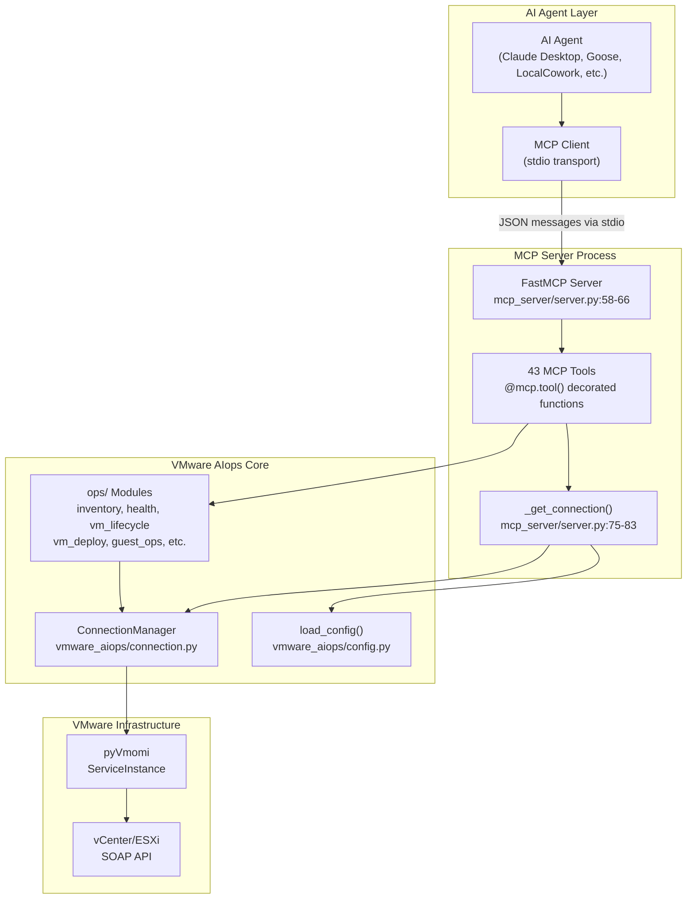
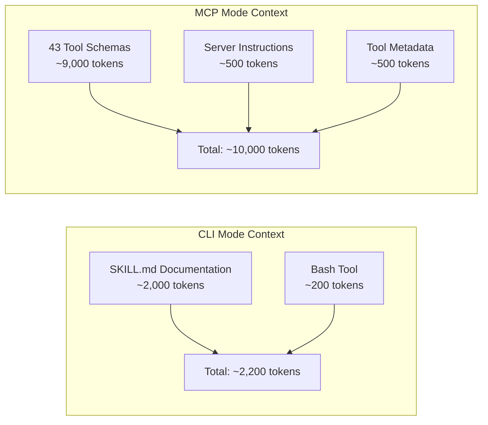
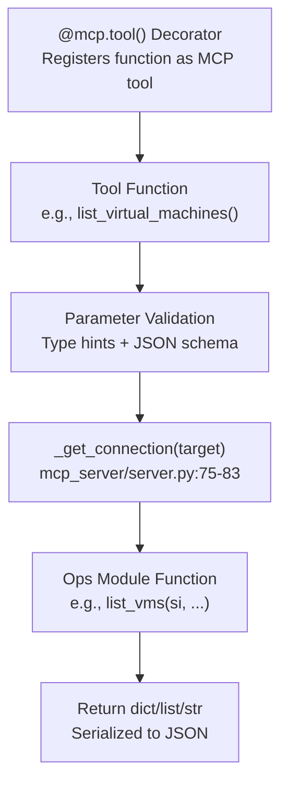
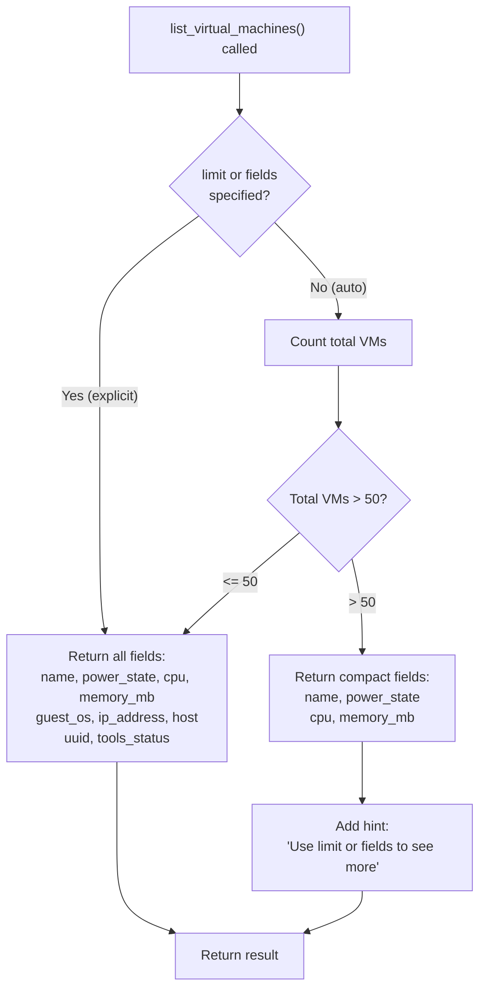

<!-- source: DeepWiki mcp.deepwiki.com · repo zw008/VMware-AIops · page 5 MCP Mode Usage · fetched 2026-10-26 -->

# MCP Mode Usage

<details>
<summary>Relevant source files</summary>

The following files were used as context for generating this wiki page:

- [README.md](README.md)
- [mcp_server/server.py](mcp_server/server.py)
- [plugins/vmware-ops/skills/vmware-aiops/SKILL.md](plugins/vmware-ops/skills/vmware-aiops/SKILL.md)

</details>


This page provides an overview of using VMware AIops in **MCP (Model Context Protocol) mode**, an alternative operational mode to the standard CLI mode. MCP mode exposes VMware operations as structured tools via the stdio transport protocol, enabling integration with MCP-compatible AI agents and automation pipelines.

For detailed MCP server installation and configuration instructions, see [MCP Server Setup](#5.1). For a complete reference of all available MCP tools with parameters and examples, see [MCP Tools Reference](#5.2). For CLI mode usage, see [CLI Mode Usage](#4). For understanding when to choose between CLI and MCP modes, see [Dual-Mode Architecture: CLI vs MCP](#3.1).

---

## What is MCP Mode

MCP mode runs VMware AIops as an **MCP (Model Context Protocol) server** that communicates with AI agents via stdio transport. Instead of the AI agent reading SKILL.md documentation and executing bash commands, the MCP server exposes 43+ structured tools that accept JSON input and return JSON output.

The MCP server is implemented in [mcp_server/server.py:1-980]() as a thin wrapper around the core `vmware_aiops` Python package. Each MCP tool delegates directly to the corresponding function in the ops modules.

**Key Characteristics:**

| Aspect | MCP Mode |
|--------|----------|
| **Entry Point** | `python -m mcp_server` or `vmware-aiops-mcp` |
| **Transport** | stdio (local only, no network listener) |
| **Interface** | 43 structured JSON tools |
| **Context Cost** | ~10K tokens (all tool schemas loaded) |
| **Target Audience** | Cloud LLMs (Claude, GPT-4o), automation pipelines |
| **Type Safety** | Full parameter validation via JSON schema |
| **Output Format** | Structured JSON (no shell parsing needed) |

**Sources:** [mcp_server/server.py:1-66](), [README.md:57-66](), [plugins/vmware-ops/skills/vmware-aiops/SKILL.md:60-76]()

---

## MCP Server Architecture

The following diagram shows how the MCP server integrates with AI agents and the VMware infrastructure:



**Architecture Flow:**

1. **AI Agent** sends tool invocation request via stdio transport
2. **FastMCP Server** receives JSON message, deserializes parameters
3. **Tool Function** (`@mcp.tool()` decorated) validates inputs
4. **Connection Helper** lazily initializes ConnectionManager from config
5. **Ops Modules** execute VMware operations via pyVmomi
6. **Results** serialized to JSON and returned to agent via stdio

The MCP server maintains a **single global ConnectionManager instance** ([mcp_server/server.py:72-83]()) that is lazily initialized on first connection. All subsequent tool calls reuse this connection pool, enabling efficient multi-target operations.

**Sources:** [mcp_server/server.py:1-84](), [vmware_aiops/connection.py](), [vmware_aiops/config.py]()

---

## When to Use MCP Mode vs CLI Mode

The dual-mode architecture exists because different scenarios have different trade-offs. The following table summarizes when to choose each mode:

| Scenario | Recommended Mode | Reason |
|----------|:----------------:|--------|
| **Cloud LLMs** (Claude, GPT-4o, Gemini) | Either | Both work well; MCP provides structured I/O |
| **Local/Small Models** (<32B params) | **CLI** | ~2K tokens vs ~10K; small models struggle with 43 tool schemas |
| **Token-Sensitive Workflows** | **CLI** | SKILL.md + bash = minimal context overhead |
| **Cost Optimization** | **CLI** | Lower token consumption per interaction |
| **Automated Pipelines** | **MCP** | Type-safe parameters, structured output, no shell parsing |
| **Agent Chaining** | **MCP** | JSON I/O enables reliable multi-agent workflows |
| **Human-in-Loop Operations** | **CLI** | Interactive confirmations, immediate feedback |
| **Production Automation** | **MCP** | Structured logs, machine-readable outputs |

**Token Consumption Comparison:**



**Small Model Performance:**

Local models under 32B parameters (e.g., Qwen2.5-Coder:7B, DeepSeek-Coder:16B) often **struggle to correctly select and invoke tools** when presented with 43+ MCP tool definitions. The cognitive load of parsing tool schemas, understanding parameter constraints, and selecting the right tool from a large set exceeds their reasoning capacity.

CLI mode solves this by presenting operations as natural language documentation (~2K tokens) and letting the model execute simple bash commands. The model doesn't need to understand complex JSON schemas—it just reads instructions and runs commands.

**Sources:** [README.md:57-66](), [plugins/vmware-ops/skills/vmware-aiops/SKILL.md:60-76]()

---

## MCP Tool Categories

The MCP server exposes 43 tools organized into 8 functional categories:

### Tool Categories Overview

| Category | Tool Count | Read-Only | Write/Mutate | Example Tools |
|----------|:----------:|:---------:|:------------:|---------------|
| **Inventory** | 4 | ✅ | — | `list_virtual_machines`, `list_esxi_hosts`, `list_all_datastores`, `list_all_clusters` |
| **Health** | 3 | ✅ | — | `get_alarms`, `get_events`, `vm_info` |
| **VM Lifecycle** | 6 | ❌ | ✅ | `vm_power_on`, `vm_power_off`, `vm_set_ttl`, `vm_cancel_ttl`, `vm_list_ttl`, `vm_clean_slate` |
| **Deployment** | 8 | ❌ | ✅ | `deploy_vm_from_ova`, `deploy_vm_from_template`, `deploy_linked_clone`, `batch_deploy_from_spec` |
| **Datastore** | 3 | ✅ | — | `browse_datastore`, `scan_datastore_images`, `list_cached_images` |
| **Cluster** | 6 | 1 read | 5 write | `cluster_info`, `cluster_create`, `cluster_delete`, `cluster_configure` |
| **Storage/iSCSI** | 5 | 1 read | 4 write | `storage_iscsi_status`, `storage_iscsi_enable`, `storage_iscsi_add_target` |
| **Plan → Apply** | 4 | 1 read | 3 write | `vm_create_plan`, `vm_apply_plan`, `vm_rollback_plan`, `vm_list_plans` |
| **Guest Ops** | 3 | ❌ | ✅ | `vm_guest_exec`, `vm_guest_upload`, `vm_guest_download` |
| **TTL & Clean Slate** | *included above* | — | — | Grouped under VM Lifecycle |

**Read-Only Tools** are safe for production monitoring use. **Write/Mutate Tools** modify infrastructure state and should be gated by confirmation flows in the AI agent.

**Sources:** [mcp_server/server.py:87-969](), [plugins/vmware-ops/skills/vmware-aiops/SKILL.md:115-128]()

---

## Tool Implementation Pattern

All MCP tools follow a consistent implementation pattern:



**Example Tool Implementation:**

The `list_virtual_machines` tool ([mcp_server/server.py:91-116]()) demonstrates this pattern:

1. **Decorator:** `@mcp.tool()` registers the function with FastMCP
2. **Type Hints:** Python type hints define parameter types and optionality
3. **Docstring:** Parsed by FastMCP to generate tool description and parameter docs
4. **Connection:** `_get_connection(target)` returns a pyVmomi ServiceInstance
5. **Delegation:** Calls `list_vms(si, ...)` from `vmware_aiops.ops.inventory`
6. **Return:** Returns structured dict with `{total, mode, vms, hint}`

**Key Implementation Details:**

- **Lazy Connection Initialization:** The global `_conn_mgr` is initialized only on first tool invocation ([mcp_server/server.py:72-83]())
- **Config Path:** Loaded from `VMWARE_AIOPS_CONFIG` environment variable ([mcp_server/server.py:79]())
- **Target Parameter:** All tools accept optional `target` parameter to select vCenter/ESXi from config
- **No Business Logic:** Tools are thin wrappers—all logic resides in ops modules

**Sources:** [mcp_server/server.py:75-116](), [vmware_aiops/ops/inventory.py]()

---

## Target Parameter Convention

All MCP tools accept an optional `target` parameter to select which vCenter/ESXi host to operate on:

| Target Value | Behavior | Config Example |
|--------------|----------|----------------|
| `None` (omitted) | Uses first target in `config.yaml` | Default behavior |
| `"prod-vcenter"` | Connects to target named "prod-vcenter" | `targets: [name: prod-vcenter]` |
| `"home-esxi"` | Connects to target named "home-esxi" | `targets: [name: home-esxi]` |

**Multi-Target Usage Example:**

```json
// Query production vCenter
{"tool": "list_virtual_machines", "target": "prod-vcenter", "limit": 10}

// Query development ESXi
{"tool": "list_virtual_machines", "target": "dev-esxi", "limit": 10}

// Use default target (first in config)
{"tool": "list_virtual_machines", "limit": 10}
```

The `ConnectionManager` ([vmware_aiops/connection.py]()) maintains a connection pool indexed by target name, enabling efficient multi-target operations without reconnecting.

**Sources:** [mcp_server/server.py:75-83](), [vmware_aiops/connection.py](), [vmware_aiops/config.py]()

---

## MCP-Compatible AI Agents

The MCP server works with any MCP-compatible AI agent or tool. The following agents have tested configurations:

| Agent / Tool | Local Model Support | Config Location | Integration Status |
|-------------|:-------------------:|-----------------|:------------------:|
| **Claude Desktop** | ❌ Cloud only | `claude_desktop_config.json` | ✅ Native |
| **Goose** (Block) | ✅ Ollama, LM Studio | `examples/mcp-configs/goose.json` | ✅ Tested |
| **LocalCowork** (Liquid AI) | ✅ Fully offline | `examples/mcp-configs/localcowork.json` | ✅ Tested |
| **mcp-agent** (LastMile AI) | ✅ Ollama, vLLM | `examples/mcp-configs/mcp-agent.yaml` | ✅ Tested |
| **VS Code Copilot** | ❌ Cloud only | `examples/mcp-configs/vscode-copilot.json` | ✅ Tested |
| **Cursor** | ❌ Cloud only | `examples/mcp-configs/cursor.json` | ✅ Tested |
| **Continue** | ✅ Ollama | `examples/mcp-configs/continue.yaml` | ✅ Tested |

**Configuration Pattern:**

All agents follow a similar JSON/YAML configuration pattern:

```json
{
  "mcpServers": {
    "vmware-aiops": {
      "command": "python",
      "args": ["-m", "mcp_server"],
      "env": {
        "VMWARE_AIOPS_CONFIG": "/path/to/config.yaml"
      }
    }
  }
}
```

Ready-to-use configuration templates for each agent are provided in [examples/mcp-configs/]().

**Sources:** [README.md:291-314](), [plugins/vmware-ops/skills/vmware-aiops/SKILL.md:96-112](), [plugins/vmware-ops/skills/vmware-aiops/SKILL.md:344-362]()

---

## Auto-Compaction for Large Inventories

The `list_virtual_machines` tool implements **automatic field compaction** when inventory size exceeds 50 VMs:



**Behavior:**

- **No limit/fields + inventory ≤ 50 VMs:** Returns all 9 fields per VM
- **No limit/fields + inventory > 50 VMs:** Returns 4 compact fields (name, power_state, cpu, memory_mb) with hint
- **Explicit limit or fields:** Always returns requested fields, regardless of inventory size

This prevents context overflow in large environments while maintaining usability. The hint guides the AI agent to use filtering parameters when needed.

**Sources:** [mcp_server/server.py:91-116](), [vmware_aiops/ops/inventory.py]()

---

## Plan → Apply → Rollback Workflow

The MCP server exposes a **structured multi-step operation workflow** for complex operations involving 2+ VMs or 2+ sequential steps:

```mermaid
sequenceDiagram
    participant Agent as "AI Agent"
    participant Create as "vm_create_plan<br/>mcp_server/server.py:882-915"
    participant Planner as "create_plan()<br/>vmware_aiops/ops/planner.py"
    participant Apply as "vm_apply_plan<br/>mcp_server/server.py:918-942"
    participant Executor as "apply_plan()<br/>vmware_aiops/ops/plan_executor.py"
    participant Rollback as "vm_rollback_plan<br/>mcp_server/server.py:945-958"
    
    Agent->>Create: operations=[{action:power_off},{action:revert_snapshot}]
    Create->>Planner: validate + generate plan
    Planner-->>Create: {plan_id, steps, summary}
    Create-->>Agent: return plan (show to user)
    
    Agent->>Agent: User reviews + confirms
    
    Agent->>Apply: plan_id
    Apply->>Executor: execute steps sequentially
    Executor-->>Apply: {status:failed, step:2, rollback_available:true}
    Apply-->>Agent: result + hint: "Ask user about rollback"
    
    Agent->>Agent: User decides to rollback
    
    Agent->>Rollback: plan_id
    Rollback->>Executor: reverse executed steps
    Executor-->>Rollback: {status:success, reversed:1, skipped:0}
    Rollback-->>Agent: rollback complete
```

**Workflow Steps:**

1. **Create Plan:** `vm_create_plan` validates operations, checks targets in vSphere, generates plan with rollback info
2. **Review:** Agent shows plan to user: affected VMs, irreversible steps, warnings
3. **Apply:** `vm_apply_plan` executes steps sequentially; stops on first failure
4. **Rollback (if failed):** Agent asks user, then calls `vm_rollback_plan` to reverse executed steps

**Irreversible Operations:**

The following operations **cannot be rolled back** and are flagged in the plan summary:
- `delete_vm` (VM is destroyed)
- `revert_snapshot` (current state lost)
- `delete_snapshot` (snapshot deleted)
- `convert_to_template` (VM becomes immutable)

Plans are stored in `~/.vmware-aiops/plans/` ([vmware_aiops/ops/planner.py]()), auto-deleted on success, and auto-cleaned after 24 hours.

**Sources:** [mcp_server/server.py:882-968](), [vmware_aiops/ops/planner.py](), [vmware_aiops/ops/plan_executor.py](), [README.md:154-164]()

---

## Security and Credential Handling

The MCP server implements several security patterns:

| Security Feature | Implementation | Location |
|-----------------|----------------|----------|
| **Credential Storage** | `.env` file with `chmod 600` | `~/.vmware-aiops/.env` |
| **Config Loading** | Environment variable `VMWARE_AIOPS_CONFIG` | [mcp_server/server.py:79]() |
| **Transport** | stdio only (local process, no network) | [mcp_server/server.py:979]() |
| **Connection Isolation** | Per-target connection pools | [vmware_aiops/connection.py]() |
| **No Credential Exposure** | Credentials never in MCP messages | [mcp_server/server.py:1-26]() |

**Credential Flow:**

1. MCP server reads `VMWARE_AIOPS_CONFIG` env var pointing to `config.yaml`
2. `config.yaml` references `.env` file for credential storage
3. `load_config()` loads credentials from `.env` using `python-dotenv`
4. Credentials stored in memory in ConnectionManager
5. Never transmitted via MCP protocol

**Transport Security:**

- **stdio transport:** MCP server communicates via stdin/stdout with parent process
- **No network listener:** Cannot be accessed remotely
- **Process isolation:** Credentials confined to MCP server process memory

**Sources:** [mcp_server/server.py:1-26](), [mcp_server/server.py:75-83](), [vmware_aiops/config.py](), [plugins/vmware-ops/skills/vmware-aiops/SKILL.md:493-504]()

---

## Key Differences from CLI Mode

| Aspect | CLI Mode | MCP Mode |
|--------|----------|----------|
| **Entry Point** | `vmware-aiops` command | `python -m mcp_server` |
| **Interface** | 70+ CLI subcommands | 43 MCP tools |
| **Input Format** | Command-line arguments | JSON parameters |
| **Output Format** | Rich terminal output | Structured JSON |
| **Confirmation** | Interactive prompts (double confirm) | Agent-implemented confirmation |
| **Documentation** | SKILL.md (~2K tokens) | Tool schemas (~10K tokens) |
| **Target Audience** | Humans + local models | Automation + cloud models |
| **Shell Parsing** | Required (agent parses output) | Not needed (JSON structure) |
| **Token Cost** | Low (~2K) | High (~10K) |
| **Type Safety** | CLI validation only | JSON schema + CLI validation |
| **Error Handling** | Exit codes + stderr | Structured error dicts |
| **Audit Logging** | `~/.vmware-aiops/audit.log` | Same (shared backend) |

Both modes share the same backend ([vmware_aiops/ops/]()) and produce identical audit logs. The choice between them is purely about interface preferences and token budgets.

**Sources:** [README.md:57-66](), [plugins/vmware-ops/skills/vmware-aiops/SKILL.md:60-76](), [mcp_server/server.py:1-66]()

---

## Running the MCP Server

The MCP server can be started via multiple entry points:

```bash
# Via Python module (recommended)
python -m mcp_server

# Via installed entry point
vmware-aiops-mcp

# With custom config path
VMWARE_AIOPS_CONFIG=/path/to/config.yaml python -m mcp_server

# With explicit venv activation
/path/to/venv/bin/python -m mcp_server
```

The server runs indefinitely, processing tool invocation requests via stdio until the parent process terminates or sends EOF.

For complete setup instructions including config generation and agent integration, see [MCP Server Setup](#5.1). For detailed tool documentation with parameter schemas and examples, see [MCP Tools Reference](#5.2).

**Sources:** [mcp_server/server.py:976-980](), [README.md:564-596](), [mcp_server/__main__.py]()

---

