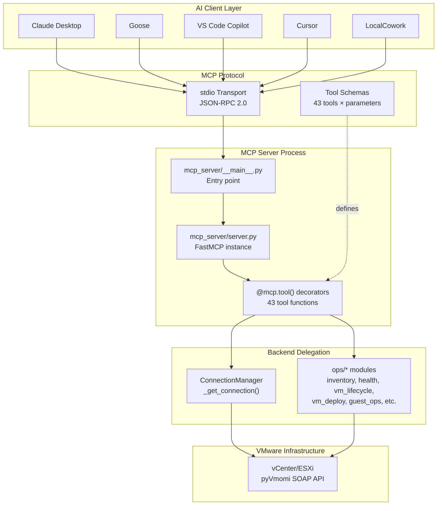
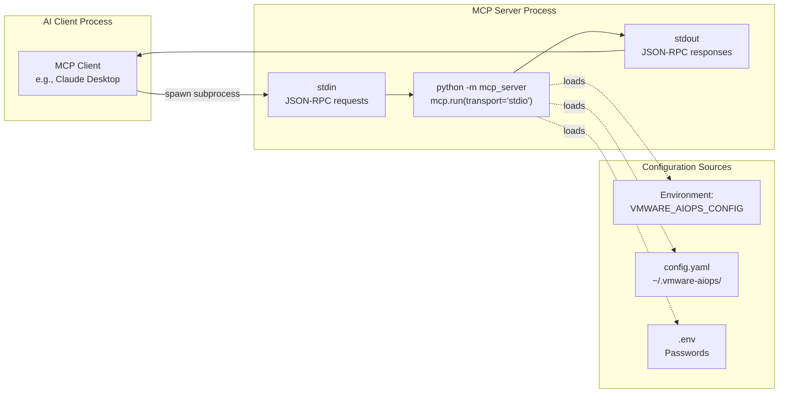
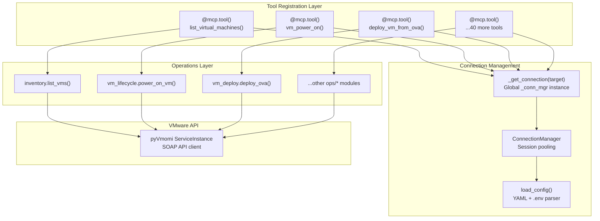

<!-- source: DeepWiki mcp.deepwiki.com · repo zw008/VMware-AIops · page 5.1 MCP Server Setup · fetched 2026-10-26 -->

# MCP Server Setup

<details>
<summary>Relevant source files</summary>

The following files were used as context for generating this wiki page:

- [mcp_server/__init__.py](mcp_server/__init__.py)
- [mcp_server/__main__.py](mcp_server/__main__.py)
- [mcp_server/server.py](mcp_server/server.py)
- [server.json](server.json)
- [smithery.yaml](smithery.yaml)

</details>


This document provides step-by-step instructions for installing, configuring, and running the VMware AIops MCP (Model Context Protocol) server. The MCP server exposes VMware operations as structured tools that AI agents can invoke via JSON-RPC over stdio transport.

For information about the MCP tools themselves and their parameters, see [MCP Tools Reference](#5.2). For choosing between CLI mode and MCP mode, see [Dual-Mode Architecture: CLI vs MCP](#3.1). For integrating specific AI clients with the MCP server, see [MCP Client Integration](#6.5).

---

## Purpose and Architecture

The MCP server is a **stdio-based JSON-RPC server** that wraps VMware AIops functionality into 43 structured tools. Unlike CLI mode (which uses bash execution and ~2K token SKILL.md context), MCP mode provides:

- **Structured JSON I/O**: No shell parsing required
- **Type-safe parameters**: JSON schema validation for all tools
- **Agent chaining**: Multi-step workflows with state preservation
- **Programmatic integration**: Direct API-style invocation from AI agents



**Sources**: [mcp_server/__main__.py:1-6](), [mcp_server/server.py:1-66](), [mcp_server/server.py:72-84]()

---

## Prerequisites

Before setting up the MCP server, ensure you have:

| Requirement | Minimum Version | Purpose |
|-------------|----------------|---------|
| Python | 3.10+ | MCP server runtime |
| pip | 20.0+ | Package installation |
| VMware environment | vCenter 7.0+ or ESXi 7.0+ | Target infrastructure |
| Network access | HTTPS (443) to vCenter/ESXi | pyVmomi API connectivity |
| Credentials | vCenter/ESXi username + password | Authentication |

**Sources**: [mcp_server/server.py:35]()

---

## Installation

### Method 1: Install from PyPI

The simplest installation method is via pip:

```bash
pip install vmware-aiops
```

This installs:
- The `vmware-aiops` CLI package
- The `mcp_server` Python module
- All dependencies including `mcp` (FastMCP library) and `pyvmomi`

**Sources**: [server.json:11-20]()

### Method 2: Install from Source

For development or to use unreleased features:

```bash
git clone https://github.com/zw008/VMware-AIops.git
cd VMware-AIops
pip install -e .
```

The `-e` flag installs in editable mode, allowing you to modify the code.

### Verifying Installation

Confirm the MCP server module is available:

```bash
python -m mcp_server --help
```

If installed correctly, this should display the MCP server help text or start the server (depending on the implementation).

**Sources**: [mcp_server/__main__.py:1-6]()

---

## Configuration

The MCP server requires two configuration components:

### 1. VMware Credentials and Targets

Create `~/.vmware-aiops/config.yaml`:

```yaml
default_target: "vcenter-prod"

targets:
  vcenter-prod:
    host: "vcenter.example.com"
    port: 443
    username: "administrator@vsphere.local"
    # Password loaded from environment variable
    
  esxi-dev:
    host: "192.168.1.100"
    port: 443
    username: "root"
    # Password loaded from environment variable
```

Create `~/.vmware-aiops/.env` with passwords:

```bash
VMWARE_PASSWORD_vcenter_prod="YourSecurePassword123"
VMWARE_PASSWORD_esxi_dev="DevPassword456"
```

**Important**: Never commit `.env` files to version control. The MCP server loads credentials exclusively from environment variables or `.env` files, never from MCP messages.

**Sources**: [mcp_server/server.py:17-19](), [mcp_server/server.py:79-81]()

### 2. Optional: Custom Config Path

By default, the server looks for config at `~/.vmware-aiops/config.yaml`. To use a custom path, set the `VMWARE_AIOPS_CONFIG` environment variable:

```bash
export VMWARE_AIOPS_CONFIG="/path/to/custom/config.yaml"
```

This environment variable is checked in the `_get_connection()` helper function:

**Sources**: [mcp_server/server.py:79-81]()

---

## Running the MCP Server

The MCP server runs as a **stdio-based process** - it reads JSON-RPC requests from stdin and writes responses to stdout. This design enables secure local-only communication with AI clients.



**Sources**: [mcp_server/server.py:976-979]()

### Method 1: Direct Invocation

Run the server directly from the command line (primarily for testing):

```bash
python -m mcp_server
```

The server will:
1. Load configuration from `~/.vmware-aiops/config.yaml` (or `VMWARE_AIOPS_CONFIG` if set)
2. Initialize the `ConnectionManager` with lazy connection pooling
3. Listen on stdin for JSON-RPC 2.0 messages
4. Write responses to stdout

**Note**: This method is usually not run manually - AI clients spawn this process automatically.

**Sources**: [mcp_server/__main__.py:1-6](), [mcp_server/server.py:976-979]()

### Method 2: AI Client Configuration

AI clients like Claude Desktop spawn the MCP server as a subprocess. Example configuration for `claude_desktop_config.json`:

```json
{
  "mcpServers": {
    "vmware-aiops": {
      "command": "python",
      "args": ["-m", "mcp_server"],
      "env": {
        "VMWARE_AIOPS_CONFIG": "/path/to/config.yaml"
      }
    }
  }
}
```

The client will:
1. Spawn `python -m mcp_server` as a subprocess
2. Send JSON-RPC `initialize` request
3. Discover available tools via `tools/list`
4. Invoke tools via `tools/call` messages

**Sources**: [smithery.yaml:1-16]()

### Method 3: Smithery Registry

The server is registered in the Smithery MCP registry with standardized metadata:

```yaml
startCommand:
  type: stdio
  configSchema:
    type: object
    properties:
      config_path:
        type: string
        description: "Path to vmware-aiops config.yaml"
  commandFunction: |
    (config) => ({
      command: "python",
      args: ["-m", "mcp_server"],
      env: config.config_path ? { VMWARE_AIOPS_CONFIG: config.config_path } : {}
    })
```

This enables one-command installation in compatible clients:

```bash
# Example: Install in Claude Desktop via Smithery
mcp install io.github.zw008/vmware-aiops
```

**Sources**: [smithery.yaml:1-16](), [server.json:1-21]()

---

## Server Architecture and Connection Flow

The MCP server follows a **thin adapter pattern** - each `@mcp.tool()` function is a lightweight wrapper that:

1. Obtains a pyVmomi connection via `_get_connection(target)`
2. Delegates to the corresponding function in `vmware_aiops.ops.*`
3. Returns the result as JSON-serializable data



**Sources**: [mcp_server/server.py:72-84](), [mcp_server/server.py:91-117](), [mcp_server/server.py:202-229](), [mcp_server/server.py:293-326]()

### Connection Lifecycle

The `_get_connection()` helper implements **lazy initialization** with a global singleton:

| Step | Code Entity | Behavior |
|------|-------------|----------|
| 1. First tool invocation | `_conn_mgr is None` | Triggers initialization |
| 2. Load config | `load_config(config_path)` | Parses YAML and .env |
| 3. Create manager | `ConnectionManager(config)` | Initializes session pool |
| 4. Connect | `_conn_mgr.connect(target)` | Returns `ServiceInstance` |
| 5. Subsequent calls | `_conn_mgr` cached | Reuses existing connections |

**Sources**: [mcp_server/server.py:75-84]()

---

## Tool Categories and Mapping

The 43 MCP tools are organized into functional categories. Each tool delegates to a corresponding function in the `vmware_aiops.ops.*` modules:

| Category | MCP Tools | Backend Module | Example |
|----------|-----------|----------------|---------|
| **Inventory** | `list_virtual_machines`, `list_esxi_hosts`, `list_all_datastores`, `list_all_clusters` | `ops.inventory` | `list_virtual_machines()` → `inventory.list_vms()` |
| **Health** | `get_alarms`, `get_events` | `ops.health` | `get_alarms()` → `health.get_active_alarms()` |
| **VM Lifecycle** | `vm_info`, `vm_power_on`, `vm_power_off` | `ops.vm_lifecycle` | `vm_power_on()` → `vm_lifecycle.power_on_vm()` |
| **Datastore** | `browse_datastore`, `scan_datastore_images`, `list_cached_images` | `ops.datastore_browser` | `browse_datastore()` → `datastore_browser.browse_datastore()` |
| **Deployment** | `deploy_vm_from_ova`, `deploy_vm_from_template`, `deploy_linked_clone`, `batch_*` | `ops.vm_deploy` | `deploy_vm_from_ova()` → `vm_deploy.deploy_ova()` |
| **Cluster** | `cluster_create`, `cluster_delete`, `cluster_add_host`, `cluster_configure`, `cluster_info` | `ops.cluster_mgmt` | `cluster_create()` → `cluster_mgmt.create_cluster()` |
| **Storage** | `storage_iscsi_enable`, `storage_iscsi_add_target`, `storage_rescan` | `ops.iscsi_config` | `storage_iscsi_enable()` → `iscsi_config.enable_software_iscsi()` |
| **TTL & Clean Slate** | `vm_set_ttl`, `vm_cancel_ttl`, `vm_list_ttl`, `vm_clean_slate` | `ops.ttl`, `ops.vm_lifecycle` | `vm_set_ttl()` → `ttl.set_ttl()` |
| **Guest Ops** | `vm_guest_exec`, `vm_guest_upload`, `vm_guest_download` | `ops.guest_ops` | `vm_guest_exec()` → `guest_ops.guest_exec()` |
| **Planning** | `vm_create_plan`, `vm_apply_plan`, `vm_rollback_plan`, `vm_list_plans` | `ops.planner`, `ops.plan_executor` | `vm_create_plan()` → `planner.create_plan()` |

**Sources**: [mcp_server/server.py:41-54](), [mcp_server/server.py:88-150](), [mcp_server/server.py:156-183](), [mcp_server/server.py:190-229](), [mcp_server/server.py:236-286](), [mcp_server/server.py:293-512](), [mcp_server/server.py:519-631](), [mcp_server/server.py:638-715](), [mcp_server/server.py:722-783](), [mcp_server/server.py:790-875](), [mcp_server/server.py:882-968]()

---

## Verifying the Server

### Test 1: Check Server Metadata

Query the server's self-description:

```bash
echo '{"jsonrpc":"2.0","id":1,"method":"initialize","params":{}}' | python -m mcp_server
```

Expected response includes:

```json
{
  "jsonrpc": "2.0",
  "id": 1,
  "result": {
    "protocolVersion": "2024-11-05",
    "serverInfo": {
      "name": "vmware-aiops",
      "version": "0.7.0"
    },
    "capabilities": {
      "tools": {}
    }
  }
}
```

**Sources**: [mcp_server/server.py:58-66](), [server.json:1-21]()

### Test 2: List Available Tools

Request the tool list:

```bash
echo '{"jsonrpc":"2.0","id":2,"method":"tools/list","params":{}}' | python -m mcp_server
```

Expected response contains 43 tools with schemas, including:

```json
{
  "tools": [
    {
      "name": "list_virtual_machines",
      "description": "List virtual machines with optional filtering...",
      "inputSchema": {
        "type": "object",
        "properties": {
          "target": {"type": "string"},
          "limit": {"type": "integer"},
          "sort_by": {"type": "string"},
          ...
        }
      }
    },
    ...
  ]
}
```

### Test 3: Invoke a Read-Only Tool

Test inventory listing (requires valid config):

```bash
echo '{
  "jsonrpc":"2.0",
  "id":3,
  "method":"tools/call",
  "params":{
    "name":"list_virtual_machines",
    "arguments":{"limit":5}
  }
}' | python -m mcp_server
```

Expected: List of VMs from your vCenter/ESXi environment.

**Sources**: [mcp_server/server.py:91-117]()

---

## Security Considerations

The MCP server implements several security best practices:

| Security Layer | Implementation | Location |
|----------------|----------------|----------|
| **Credential isolation** | Credentials never in MCP messages; loaded from env/`.env` only | [mcp_server/server.py:17-19]() |
| **Local-only transport** | stdio transport - no network listener, subprocess only | [mcp_server/server.py:979]() |
| **Input validation** | Parameter validation in ops modules (delegated) | Backend ops/* modules |
| **No bypass flags** | Destructive operations require confirmation in agent flow | [mcp_server/server.py:11-14]() |

**Warning**: The MCP server has **full access** to the VMware environment specified in `config.yaml`. Destructive tools like `vm_power_off`, `deploy_*`, and `batch_*` can create/modify/delete resources. Always:

1. Use the **vmware-monitor skill** (read-only) in production if available
2. Configure AI agents to require confirmation before destructive operations
3. Review the audit log (`~/.vmware-aiops/audit.log`) regularly
4. Use separate configs for dev/test vs. production environments

**Sources**: [mcp_server/server.py:16-22]()

---

## Troubleshooting

### Issue: "No module named 'mcp_server'"

**Cause**: Package not installed or virtual environment not activated.

**Solution**:
```bash
pip install vmware-aiops
# Or if installed from source:
pip install -e /path/to/VMware-AIops
```

### Issue: "Failed to connect to vCenter"

**Cause**: Invalid credentials, network issues, or misconfigured `config.yaml`.

**Solution**:
1. Verify credentials in `.env` match vCenter/ESXi
2. Test network connectivity: `ping vcenter.example.com`
3. Check `config.yaml` syntax and target definitions
4. Enable debug logging: `export VMWARE_AIOPS_LOG_LEVEL=DEBUG`

### Issue: "Tool not found"

**Cause**: Client requesting an invalid tool name or incompatible MCP protocol version.

**Solution**:
1. Verify tool name matches exactly (see [MCP Tools Reference](#5.2))
2. Ensure client and server use compatible MCP protocol versions
3. Check tool list: `echo '{"jsonrpc":"2.0","id":1,"method":"tools/list"}' | python -m mcp_server`

### Issue: Server hangs or doesn't respond

**Cause**: stdin/stdout buffering issues or blocking operations.

**Solution**:
1. Ensure client is sending valid JSON-RPC 2.0 messages
2. Check for network timeouts to vCenter (default: 30s)
3. Review server logs if enabled
4. Test with minimal request: `initialize` method first

**Sources**: [mcp_server/server.py:72-84](), [mcp_server/server.py:976-979]()

---

## Next Steps

After setting up the MCP server:

1. **Explore available tools**: See [MCP Tools Reference](#5.2) for all 43 tools with examples
2. **Integrate with AI clients**: Configure Claude Desktop, Goose, or other MCP clients ([MCP Client Integration](#6.5))
3. **Review safety features**: Understand double confirmation, dry-run mode, and audit logging ([Safety Features](#3.3))
4. **Learn planning workflows**: Use multi-step operations with rollback support ([Plan → Apply → Rollback Workflow](#3.4))

**Sources**: All sections above

---

