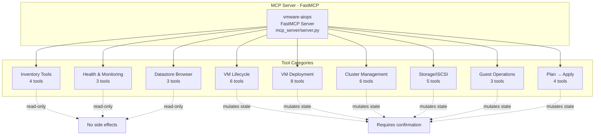
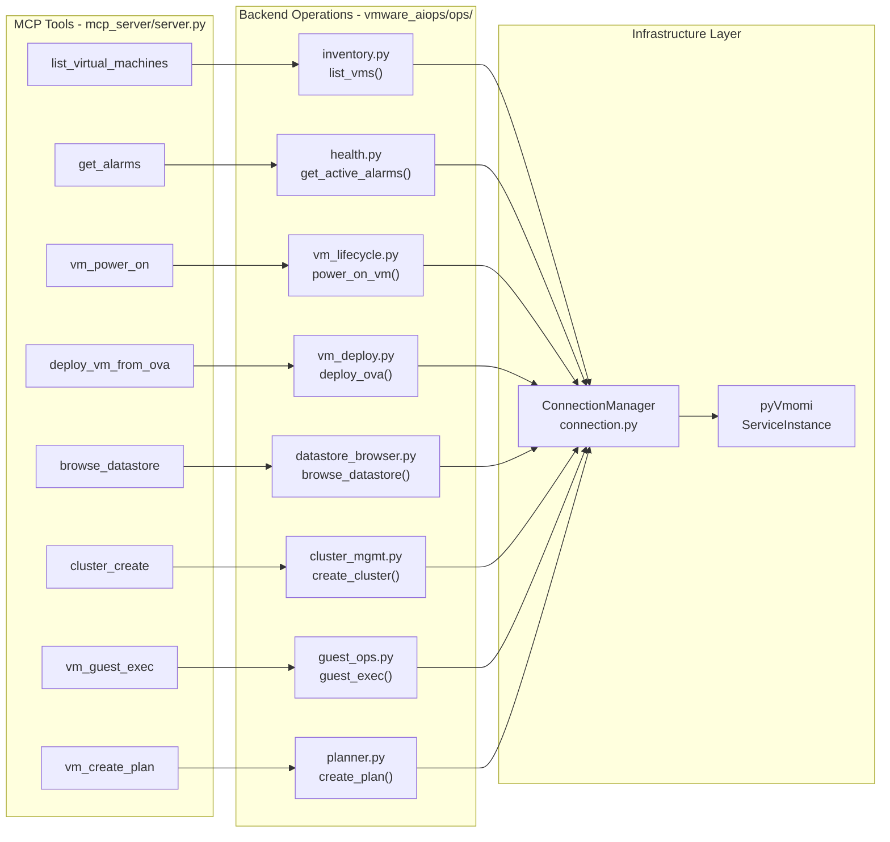
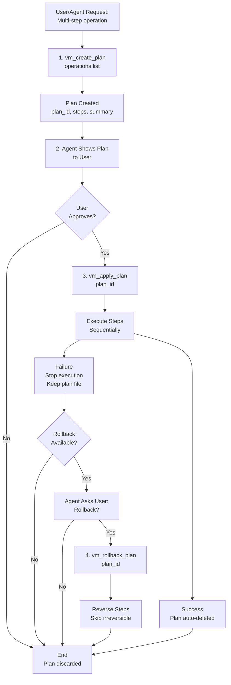

<!-- source: DeepWiki mcp.deepwiki.com · repo zw008/VMware-AIops · page 5.2 MCP Tools Reference · fetched 2026-10-26 -->

# MCP Tools Reference

<details>
<summary>Relevant source files</summary>

The following files were used as context for generating this wiki page:

- [mcp_server/server.py](mcp_server/server.py)
- [plugins/vmware-ops/skills/vmware-aiops/SKILL.md](plugins/vmware-ops/skills/vmware-aiops/SKILL.md)

</details>


This page provides a complete reference for all MCP tools exposed by the `vmware-aiops-mcp` server. These tools enable AI agents to interact with VMware vCenter and ESXi infrastructure using structured JSON input/output via the Model Context Protocol (MCP).

For information about setting up the MCP server, see [MCP Server Setup](#5.1). For CLI command reference, see [CLI Command Reference](#4.1). For conceptual information about MCP mode versus CLI mode, see [Dual-Mode Architecture: CLI vs MCP](#3.1).

---

## Overview

The MCP server exposes **42 tools** organized into 10 functional categories. All tools are defined in [mcp_server/server.py]() and delegate to backend operations modules in the `vmware_aiops.ops` package. Each tool accepts an optional `target` parameter to specify which vCenter/ESXi instance to operate against (uses default target from config if omitted).

**Sources:** [mcp_server/server.py:1-980](), [plugins/vmware-ops/skills/vmware-aiops/SKILL.md:115-128]()

---

## Tool Categories



**Tool Safety Classification**

| Safety Level | Categories | Characteristics |
|--------------|-----------|-----------------|
| **Read-only** (no side effects) | Inventory, Health, Datastore (browse/list) | Safe to call automatically; no infrastructure changes |
| **Write** (mutates state) | VM Lifecycle, Deployment, Cluster, Storage, Guest Ops, Plan/Apply | Should be gated by agent confirmation flow; creates/modifies/deletes resources |

**Sources:** [mcp_server/server.py:8-22](), [mcp_server/server.py:87-969]()

---

## MCP Tool to Backend Module Mapping



**Delegation Pattern:** Each MCP tool is a thin adapter (10-30 lines) that:
1. Calls `_get_connection(target)` to obtain a `pyVmomi.ServiceInstance` via `ConnectionManager`
2. Delegates to the corresponding function in `vmware_aiops.ops.*` 
3. Returns the result directly (no transformation)

**Sources:** [mcp_server/server.py:75-83](), [mcp_server/server.py:91-980]()

---

## 1. Inventory Tools

Query VMware infrastructure inventory (VMs, hosts, datastores, clusters). All tools are read-only.

| Tool Name | Parameters | Returns | Description |
|-----------|------------|---------|-------------|
| `list_virtual_machines` | `target`, `limit`, `sort_by`, `power_state`, `fields` | `dict` | List VMs with auto-compacting for large inventories (>50 VMs). Returns `{total, mode, vms, hint}` |
| `list_esxi_hosts` | `target` | `list[dict]` | List ESXi hosts with CPU cores, memory, version, VM count, uptime |
| `list_all_datastores` | `target` | `list[dict]` | List datastores with capacity, free space, type (VMFS/NFS), VM count |
| `list_all_clusters` | `target` | `list[dict]` | List vSphere clusters with host count, DRS/HA status, resource totals |

### list_virtual_machines

```python
{
  "target": "home-esxi",         # Optional: target name from config
  "limit": 50,                   # Optional: max VMs to return
  "sort_by": "name",             # "name" | "cpu" | "memory_mb" | "power_state"
  "power_state": "poweredOn",    # Optional: filter by power state
  "fields": ["name", "cpu"]      # Optional: return only these fields
}
```

**Auto-compacting behavior:** When `limit` and `fields` are both `None` and total inventory >50 VMs, returns compact fields (`name`, `power_state`, `cpu`, `memory_mb`) to reduce token usage. Set `limit` or `fields` explicitly to override.

**Available fields:** `name`, `power_state`, `cpu`, `memory_mb`, `guest_os`, `ip_address`, `host`, `uuid`, `tools_status`

**Return structure:**
```json
{
  "total": 127,
  "mode": "compact",
  "vms": [...],
  "hint": "Showing compact fields for 127 VMs. Use limit or fields to see more."
}
```

**Sources:** [mcp_server/server.py:91-116](), [vmware_aiops/ops/inventory.py]()

### list_esxi_hosts

Returns detailed host information including CPU cores, memory, ESXi version, VM count, and uptime in hours.

**Sources:** [mcp_server/server.py:119-127](), [vmware_aiops/ops/inventory.py]()

### list_all_datastores

Returns datastore inventory with capacity metrics (total, free, used) in GB, usage percentage, type (VMFS/NFS/vSAN), and number of VMs stored.

**Sources:** [mcp_server/server.py:130-138](), [vmware_aiops/ops/inventory.py]()

### list_all_clusters

Returns cluster information including host count, DRS enabled/behavior, HA enabled/failover level, and aggregated CPU/memory resources.

**Sources:** [mcp_server/server.py:141-149](), [vmware_aiops/ops/inventory.py]()

---

## 2. Health & Monitoring Tools

Query alarms, events, and VM health status. All tools are read-only.

| Tool Name | Parameters | Returns | Description |
|-----------|------------|---------|-------------|
| `get_alarms` | `target` | `list[dict]` | Get all active/triggered alarms with severity, entity, timestamp |
| `get_events` | `hours`, `severity`, `target` | `list[dict]` | Get recent vCenter/ESXi events filtered by severity (info/warning/critical) |
| `vm_info` | `vm_name`, `target` | `dict` | Get detailed VM info: CPU, memory, disks, NICs, snapshots, power state |

### get_alarms

Returns active alarms across the entire VMware inventory (VMs, hosts, datastores, clusters).

**Return fields per alarm:** `entity_name`, `entity_type`, `alarm_name`, `severity` (yellow/red/gray), `status` (triggered/acknowledged), `time`

**Sources:** [mcp_server/server.py:157-165](), [vmware_aiops/ops/health.py]()

### get_events

```python
{
  "hours": 24,                   # How many hours back to query (default 24)
  "severity": "warning",         # "critical" | "warning" | "info"
  "target": "prod-vcenter"       # Optional target
}
```

Queries vCenter/ESXi event logs. Severity filter: `critical` (errors only), `warning` (warnings + errors), `info` (all events).

**Monitored event types:** VM failures (`VmFailedToPowerOnEvent`, `VmDiskFailedEvent`), host issues (`HostConnectionLostEvent`, `HostShutdownEvent`), storage events, HA/DRS events, authentication events.

**Sources:** [mcp_server/server.py:168-182](), [vmware_aiops/ops/health.py]()

### vm_info

Returns comprehensive VM configuration and state:
- Hardware: CPU count, memory MB, disk sizes/types, network adapters
- State: power state, guest OS, IP addresses, VMware Tools status
- Snapshots: snapshot tree with names, descriptions, creation times
- Host: current ESXi host assignment

**Sources:** [mcp_server/server.py:190-199](), [vmware_aiops/ops/vm_lifecycle.py]()

---

## 3. VM Lifecycle Tools

Power control and state management for VMs. **Note:** These tools modify VM state and should be gated by confirmation.

| Tool Name | Parameters | Returns | Description |
|-----------|------------|---------|-------------|
| `vm_power_on` | `vm_name`, `target` | `str` | Power on a VM |
| `vm_power_off` | `vm_name`, `force`, `target` | `str` | Power off a VM (graceful or forced) |
| `vm_set_ttl` | `vm_name`, `minutes`, `target` | `str` | Set auto-deletion timer (requires daemon running) |
| `vm_cancel_ttl` | `vm_name` | `str` | Cancel TTL to prevent auto-deletion |
| `vm_list_ttl` | - | `list[dict]` | List all VMs with active TTLs |
| `vm_clean_slate` | `vm_name`, `snapshot_name`, `target` | `str` | Power off and revert to baseline snapshot |

### vm_power_on

Powers on a VM. Waits for the task to complete and returns success/failure message.

**Sources:** [mcp_server/server.py:202-211](), [vmware_aiops/ops/vm_lifecycle.py]()

### vm_power_off

```python
{
  "vm_name": "test-vm",
  "force": false,               # false = graceful shutdown, true = hard power off
  "target": "home-esxi"
}
```

- `force=false` (default): Attempts graceful guest OS shutdown via VMware Tools
- `force=true`: Hard power off (equivalent to pulling the power plug)

**Sources:** [mcp_server/server.py:214-228](), [vmware_aiops/ops/vm_lifecycle.py]()

### vm_set_ttl

```python
{
  "vm_name": "temp-lab-vm",
  "minutes": 120,               # Auto-delete in 2 hours
  "target": "dev-vcenter"
}
```

Sets a Time-To-Live for automatic VM deletion. **Requires the scanner daemon to be running** (`vmware-aiops daemon start`). TTLs are persisted in `~/.vmware-aiops/ttl.json`.

**Use case:** Temporary lab VMs that should auto-cleanup after testing.

**Sources:** [mcp_server/server.py:722-739](), [vmware_aiops/ops/ttl.py]()

### vm_cancel_ttl

Removes the TTL entry for a VM, preventing scheduled auto-deletion.

**Sources:** [mcp_server/server.py:742-750](), [vmware_aiops/ops/ttl.py]()

### vm_list_ttl

Returns list of VMs with active TTLs, including:
- `vm_name`
- `expires_at` (ISO timestamp)
- `remaining_minutes`
- `expired` (boolean)
- `target`

**Sources:** [mcp_server/server.py:753-760](), [vmware_aiops/ops/ttl.py]()

### vm_clean_slate

```python
{
  "vm_name": "dev-workstation",
  "snapshot_name": "baseline",  # Default: "baseline"
  "target": "home-esxi"
}
```

Reverts a VM to a clean baseline snapshot. Powers off the VM first if running, then reverts to the specified snapshot. 

**Use case:** Reset lab/dev VMs to known-good state after testing or development tasks.

**Sources:** [mcp_server/server.py:763-782](), [vmware_aiops/ops/vm_lifecycle.py]()

---

## 4. Datastore Browser Tools

Browse datastore contents and scan for deployable images. All tools are read-only except for registry update.

| Tool Name | Parameters | Returns | Description |
|-----------|------------|---------|-------------|
| `browse_datastore` | `datastore_name`, `path`, `pattern`, `target` | `list[dict]` | List files/folders in a datastore directory with glob pattern filtering |
| `scan_datastore_images` | `target` | `dict` | Scan all datastores for OVA/ISO/OVF/VMDK files and cache results |
| `list_cached_images` | `image_type`, `datastore` | `list[dict]` | Query local registry cache for deployable images |

### browse_datastore

```python
{
  "datastore_name": "datastore1",
  "path": "iso",                # Subdirectory (empty string for root)
  "pattern": "*.iso",           # Glob pattern: "*.ova", "*.iso", "*"
  "target": "prod-vcenter"
}
```

Returns list of files/folders with:
- `name`: Filename
- `path`: Full datastore path
- `size`: Size in bytes (for files)
- `type`: `"file"` or `"folder"`
- `modified`: Last modification timestamp

**Sources:** [mcp_server/server.py:236-255](), [vmware_aiops/ops/datastore_browser.py]()

### scan_datastore_images

Scans all accessible datastores for deployable images (`.ova`, `.iso`, `.ovf`, `.vmdk`). Results are cached in `~/.vmware-aiops/image_registry.json` for fast lookup.

**Returns:** `{datastores_scanned, images_found, registry_path, scan_timestamp}`

**Performance:** Initial scan can take several minutes for large datastores. Registry is persistent across MCP server restarts.

**Sources:** [mcp_server/server.py:258-269](), [vmware_aiops/ops/datastore_browser.py]()

### list_cached_images

```python
{
  "image_type": "ova",          # Optional filter: "ova" | "iso" | "ovf" | "vmdk"
  "datastore": "datastore1"     # Optional filter: specific datastore
}
```

Queries the local registry cache populated by `scan_datastore_images`. Returns list of images with:
- `name`: Filename
- `datastore_path`: Full `[datastore] path` syntax
- `type`: File extension
- `datastore`: Datastore name
- `size`: Size in bytes

**Sources:** [mcp_server/server.py:272-285](), [vmware_aiops/ops/datastore_browser.py]()

---

## 5. VM Deployment Tools

Deploy VMs from various sources: OVA files, templates, linked clones, and batch specifications. **All tools mutate infrastructure state.**

| Tool Name | Key Parameters | Speed | Description |
|-----------|----------------|-------|-------------|
| `deploy_vm_from_ova` | `ova_path`, `vm_name`, `datastore_name` | Minutes | Upload and deploy from local OVA file |
| `deploy_vm_from_template` | `template_name`, `new_name` | Minutes | Clone from vSphere template |
| `deploy_linked_clone` | `source_vm_name`, `snapshot_name`, `new_name` | Seconds | Create copy-on-write linked clone |
| `attach_iso_to_vm` | `vm_name`, `iso_ds_path` | Instant | Attach ISO to VM CD-ROM |
| `convert_vm_to_template` | `vm_name` | Instant | Convert powered-off VM to template |
| `batch_clone_vms` | `source_vm_name`, `vm_names` | Minutes | Full-copy batch cloning |
| `batch_linked_clone_vms` | `source_vm_name`, `snapshot_name`, `vm_names` | Seconds | Batch linked clone creation |
| `batch_deploy_from_spec` | `spec_path` | Auto | Deploy from YAML specification |

### deploy_vm_from_ova

```python
{
  "ova_path": "/tmp/ubuntu-22.04.ova",
  "vm_name": "web-server-01",
  "datastore_name": "datastore1",
  "network_name": "VM Network",   # Default: "VM Network"
  "folder_path": null,            # Optional: VM folder in vCenter
  "power_on": false,              # Power on after deployment
  "snapshot_name": null,          # Optional: create baseline snapshot
  "target": "prod-vcenter"
}
```

Parses OVF descriptor from OVA, creates import spec, uploads VMDK files via HTTP NFC lease. Supports optional post-deployment power-on and baseline snapshot creation.

**Sources:** [mcp_server/server.py:293-325](), [vmware_aiops/ops/vm_deploy.py]()

### deploy_vm_from_template

```python
{
  "template_name": "ubuntu-22-template",
  "new_name": "app-server-03",
  "datastore_name": null,         # Optional: uses template's datastore if omitted
  "cpu": 4,                       # Optional: override CPU count
  "memory_mb": 8192,              # Optional: override memory
  "power_on": false,
  "snapshot_name": "baseline",    # Optional
  "target": "prod-vcenter"
}
```

Clones a VM from a vSphere template with optional CPU/memory customization.

**Sources:** [mcp_server/server.py:328-356](), [vmware_aiops/ops/vm_deploy.py]()

### deploy_linked_clone

```python
{
  "source_vm_name": "golden-image",
  "snapshot_name": "clean-state",
  "new_name": "dev-clone-01",
  "cpu": null,                    # Optional override
  "memory_mb": null,              # Optional override
  "power_on": true,
  "baseline_snapshot": "initial", # Optional: snapshot the new clone
  "target": "dev-vcenter"
}
```

Creates a linked clone from a VM snapshot. **Fastest provisioning method** — completes in seconds. Linked clones share the parent disk and use delta disks for changes (copy-on-write).

**Important:** Source VM must have at least one snapshot. The specified snapshot becomes the base disk for the clone.

**Sources:** [mcp_server/server.py:359-390](), [vmware_aiops/ops/vm_deploy.py]()

### attach_iso_to_vm

```python
{
  "vm_name": "test-vm",
  "iso_ds_path": "[datastore1] iso/ubuntu-22.04.iso",
  "target": "home-esxi"
}
```

Attaches an ISO file from a datastore to the VM's CD-ROM drive. Uses datastore path syntax: `[datastore_name] path/to/file.iso`.

**Sources:** [mcp_server/server.py:393-407](), [vmware_aiops/ops/vm_deploy.py]()

### convert_vm_to_template

```python
{
  "vm_name": "configured-ubuntu",
  "target": "prod-vcenter"
}
```

Converts a powered-off VM into a vSphere template. After conversion, the VM cannot be powered on — it serves only as a clone source for `deploy_vm_from_template`.

**Prerequisite:** VM must be powered off.

**Sources:** [mcp_server/server.py:410-425](), [vmware_aiops/ops/vm_deploy.py]()

### batch_clone_vms

```python
{
  "source_vm_name": "gold-image",
  "vm_names": ["app-01", "app-02", "app-03"],
  "cpu": 2,                       # Optional: override for all clones
  "memory_mb": 4096,              # Optional: override for all clones
  "snapshot_name": "baseline",    # Optional: snapshot each clone
  "power_on": false,
  "target": "prod-vcenter"
}
```

Creates multiple full-copy clones from a source VM. Each clone: full copy → optional reconfigure → optional snapshot → optional power-on.

**Returns:** List of results per VM: `{vm_name, status, message}`

**Sources:** [mcp_server/server.py:428-456](), [vmware_aiops/ops/vm_deploy.py]()

### batch_linked_clone_vms

```python
{
  "source_vm_name": "golden-image",
  "snapshot_name": "clean-state",
  "vm_names": ["dev-01", "dev-02", "dev-03"],
  "cpu": null,
  "memory_mb": null,
  "power_on": true,
  "baseline_snapshot": "initial",
  "target": "dev-vcenter"
}
```

Creates multiple linked clones from a VM snapshot. **Fastest batch provisioning** — all clones share the parent disk.

**Sources:** [mcp_server/server.py:459-489](), [vmware_aiops/ops/vm_deploy.py]()

### batch_deploy_from_spec

```python
{
  "spec_path": "/path/to/deploy.yaml",
  "target": "prod-vcenter"
}
```

Deploys VMs from a YAML specification file. Supports all provisioning channels:
- `source`: Clone from an existing VM
- `template`: Clone from a vSphere template
- `linked_clone`: Create linked clone from snapshot
- `ova`: Deploy from OVA file (per-VM)
- Empty VM creation with optional ISO attachment

**YAML spec structure:** Each VM entry can specify `name`, `cpu`, `memory_mb`, `disk_gb`, `datastore`, `network`, `source`/`template`/`linked_clone`, `ova`, `iso`, `power_on`, `snapshot`.

**Returns:** List of results per VM with status and any error messages.

**Sources:** [mcp_server/server.py:492-511](), [vmware_aiops/ops/vm_deploy.py]()

---

## 6. Cluster Management Tools

Create and manage vSphere clusters with HA/DRS configuration. **vCenter only** — not supported on standalone ESXi.

| Tool Name | Parameters | Description |
|-----------|------------|-------------|
| `cluster_create` | `name`, `datacenter`, `ha`, `drs`, `drs_behavior` | Create new cluster with HA/DRS settings |
| `cluster_delete` | `name` | Delete empty cluster (no hosts must remain) |
| `cluster_add_host` | `cluster_name`, `host_name` | Move host into cluster |
| `cluster_remove_host` | `cluster_name`, `host_name` | Remove host from cluster (requires maintenance mode) |
| `cluster_configure` | `name`, `ha`, `drs`, `drs_behavior` | Reconfigure cluster HA/DRS settings |
| `cluster_info` | `name` | Get cluster details (hosts, HA/DRS config, resources) |

### cluster_create

```python
{
  "name": "Production-Cluster",
  "datacenter": "DC1",            # Optional: uses first datacenter if omitted
  "ha": true,                     # Enable vSphere HA
  "drs": true,                    # Enable DRS
  "drs_behavior": "fullyAutomated", # "fullyAutomated" | "partiallyAutomated" | "manual"
  "target": "prod-vcenter"
}
```

Creates a new cluster in the specified datacenter with optional HA and DRS configuration.

**DRS behaviors:**
- `fullyAutomated`: DRS automatically migrates VMs for load balancing
- `partiallyAutomated`: DRS recommends migrations; admin approves
- `manual`: DRS only provides initial placement recommendations

**Sources:** [mcp_server/server.py:519-543](), [vmware_aiops/ops/cluster_mgmt.py]()

### cluster_delete

Deletes an empty cluster. **Prerequisite:** All hosts must be removed from the cluster first.

**Sources:** [mcp_server/server.py:546-556](), [vmware_aiops/ops/cluster_mgmt.py]()

### cluster_add_host

```python
{
  "cluster_name": "Production-Cluster",
  "host_name": "esxi-03.lab.local",
  "target": "prod-vcenter"
}
```

Moves an ESXi host into a cluster. The host can be standalone or in another cluster.

**Sources:** [mcp_server/server.py:559-574](), [vmware_aiops/ops/cluster_mgmt.py]()

### cluster_remove_host

```python
{
  "cluster_name": "Production-Cluster",
  "host_name": "esxi-03.lab.local",
  "target": "prod-vcenter"
}
```

Removes an ESXi host from a cluster. **Prerequisite:** Host must be in maintenance mode (no running VMs).

**Sources:** [mcp_server/server.py:577-592](), [vmware_aiops/ops/cluster_mgmt.py]()

### cluster_configure

```python
{
  "name": "Production-Cluster",
  "ha": true,                     # null = leave unchanged
  "drs": true,                    # null = leave unchanged
  "drs_behavior": "fullyAutomated",
  "target": "prod-vcenter"
}
```

Reconfigures HA/DRS settings on an existing cluster. Parameters set to `null` are left unchanged.

**Sources:** [mcp_server/server.py:595-617](), [vmware_aiops/ops/cluster_mgmt.py]()

### cluster_info

Returns detailed cluster information:
- Host list with names and status
- HA configuration (enabled, failover level, admission control)
- DRS configuration (enabled, automation level, behavior)
- Aggregated resources (total CPU MHz, total memory MB)
- VM count

**Sources:** [mcp_server/server.py:620-630](), [vmware_aiops/ops/cluster_mgmt.py]()

---

## 7. Storage & iSCSI Configuration Tools

Configure iSCSI adapters and manage storage on ESXi hosts. **All tools mutate host configuration.**

| Tool Name | Parameters | Description |
|-----------|------------|-------------|
| `storage_iscsi_enable` | `host_name` | Enable software iSCSI adapter on ESXi host |
| `storage_iscsi_status` | `host_name` | Get iSCSI adapter status, IQN, configured targets |
| `storage_iscsi_add_target` | `host_name`, `address`, `port` | Add iSCSI send target and rescan storage |
| `storage_iscsi_remove_target` | `host_name`, `address`, `port` | Remove iSCSI send target and rescan storage |
| `storage_rescan` | `host_name` | Rescan all HBAs and VMFS volumes |

### storage_iscsi_enable

```python
{
  "host_name": "esxi-01.lab.local",
  "target": "prod-vcenter"
}
```

Enables the software iSCSI adapter (`vmhba33` or similar) on an ESXi host. Required before adding iSCSI targets.

**Sources:** [mcp_server/server.py:638-648](), [vmware_aiops/ops/iscsi_config.py]()

### storage_iscsi_status

Returns iSCSI adapter information:
- `enabled`: Boolean status
- `iqn`: iSCSI Qualified Name (initiator IQN)
- `targets`: List of configured send targets with address/port

**Sources:** [mcp_server/server.py:651-661](), [vmware_aiops/ops/iscsi_config.py]()

### storage_iscsi_add_target

```python
{
  "host_name": "esxi-01.lab.local",
  "address": "192.168.1.100",
  "port": 3260,                   # Default iSCSI port
  "target": "prod-vcenter"
}
```

Adds an iSCSI send target to the host's software adapter and triggers storage rescan to discover LUNs.

**Sources:** [mcp_server/server.py:664-681](), [vmware_aiops/ops/iscsi_config.py]()

### storage_iscsi_remove_target

Removes an iSCSI send target from the host's configuration and rescans storage.

**Sources:** [mcp_server/server.py:684-701](), [vmware_aiops/ops/iscsi_config.py]()

### storage_rescan

```python
{
  "host_name": "esxi-01.lab.local",
  "target": "prod-vcenter"
}
```

Rescans all HBAs (host bus adapters) and refreshes VMFS volume information. Use after adding/removing storage or iSCSI targets.

**Sources:** [mcp_server/server.py:704-714](), [vmware_aiops/ops/iscsi_config.py]()

---

## 8. Guest Operations Tools

Execute commands and transfer files inside VM guest OS via VMware Tools. **Requires VMware Tools running in guest.**

| Tool Name | Parameters | Description |
|-----------|------------|-------------|
| `vm_guest_exec` | `vm_name`, `command`, `arguments`, `username`, `password` | Execute command in guest OS |
| `vm_guest_upload` | `vm_name`, `local_path`, `guest_path`, `username`, `password` | Upload file to guest OS |
| `vm_guest_download` | `vm_name`, `guest_path`, `local_path`, `username`, `password` | Download file from guest OS |

### vm_guest_exec

```python
{
  "vm_name": "web-server",
  "command": "/bin/bash",
  "arguments": "-c 'whoami'",
  "username": "root",
  "password": "********",
  "working_directory": null,      # Optional
  "target": "prod-vcenter"
}
```

Executes a command inside the guest OS via VMware Tools.

**Important limitations:**
- VMware Guest Operations API does **not capture stdout/stderr directly**
- Returns only `exit_code`, `pid`, and `timed_out` flag
- To capture output: redirect to a file and use `vm_guest_download`

**Example capturing output:**
```python
{
  "command": "/bin/bash",
  "arguments": "-c 'ls -la /tmp > /tmp/output.txt 2>&1'",
  ...
}
# Then download /tmp/output.txt
```

**Platform-specific command paths:**
- Linux/Unix: `/bin/bash`, `/usr/bin/python`, `/usr/bin/ls`
- Windows: `C:\\Windows\\System32\\cmd.exe`, `C:\\Windows\\System32\\WindowsPowerShell\\v1.0\\powershell.exe`

**Sources:** [mcp_server/server.py:790-824](), [vmware_aiops/ops/guest_ops.py]()

### vm_guest_upload

```python
{
  "vm_name": "web-server",
  "local_path": "/tmp/deploy-script.sh",
  "guest_path": "/opt/app/deploy.sh",
  "username": "root",
  "password": "********",
  "target": "prod-vcenter"
}
```

Uploads a file from the local machine (where MCP server runs) to the guest OS.

**Authentication:** Guest OS credentials, not vSphere credentials.

**Sources:** [mcp_server/server.py:827-849](), [vmware_aiops/ops/guest_ops.py]()

### vm_guest_download

```python
{
  "vm_name": "web-server",
  "guest_path": "/var/log/application.log",
  "local_path": "/tmp/app.log",
  "username": "root",
  "password": "********",
  "target": "prod-vcenter"
}
```

Downloads a file from the guest OS to the local machine.

**Sources:** [mcp_server/server.py:852-874](), [vmware_aiops/ops/guest_ops.py]()

---

## 9. Plan → Apply → Rollback Tools

Multi-step operation workflow for complex changes involving multiple VMs or sequential steps. Provides validation, preview, and rollback capabilities.

| Tool Name | Parameters | Description |
|-----------|------------|-------------|
| `vm_create_plan` | `operations`, `target` | Validate operations and create execution plan with rollback info |
| `vm_apply_plan` | `plan_id`, `target` | Execute plan sequentially; stop on first failure |
| `vm_rollback_plan` | `plan_id`, `target` | Reverse executed steps of a failed plan |
| `vm_list_plans` | - | List pending/failed plans (auto-cleans stale plans >24h) |

### Plan Workflow Pattern



**Sources:** [mcp_server/server.py:882-968](), [vmware_aiops/ops/planner.py](), [vmware_aiops/ops/plan_executor.py]()

### vm_create_plan

```python
{
  "operations": [
    {"action": "power_off", "vm_name": "web-01"},
    {"action": "revert_snapshot", "vm_name": "web-01", "snapshot_name": "baseline"},
    {"action": "power_on", "vm_name": "web-01"},
    {"action": "power_off", "vm_name": "web-02"},
    {"action": "revert_snapshot", "vm_name": "web-02", "snapshot_name": "baseline"},
    {"action": "power_on", "vm_name": "web-02"}
  ],
  "target": "prod-vcenter"
}
```

Creates an execution plan after validating:
- Action syntax and required parameters
- Target VM/cluster existence in vSphere
- Current state compatibility (e.g., VM exists for power operations)

**Supported actions:**
- `power_on`, `power_off`, `reset`, `suspend`
- `create_vm`, `delete_vm`, `reconfigure`
- `create_snapshot`, `delete_snapshot`, `revert_snapshot`
- `clone`, `migrate`
- `deploy_ova`, `deploy_template`, `linked_clone`
- `attach_iso`, `convert_to_template`

**Returns plan structure:**
```json
{
  "plan_id": "plan_20240115_143022_abc123",
  "target": "prod-vcenter",
  "created_at": "2024-01-15T14:30:22Z",
  "steps": [
    {
      "step_id": 1,
      "action": "power_off",
      "vm_name": "web-01",
      "rollback_action": "power_on",
      "irreversible": false
    },
    {
      "step_id": 2,
      "action": "revert_snapshot",
      "vm_name": "web-01",
      "snapshot_name": "baseline",
      "rollback_action": null,
      "irreversible": true
    }
  ],
  "summary": {
    "total_steps": 6,
    "vms_affected": ["web-01", "web-02"],
    "irreversible_steps": 2,
    "rollback_available": true
  }
}
```

**Irreversible actions:** `delete_vm`, `revert_snapshot`, `delete_snapshot`, `convert_to_template` cannot be undone automatically.

**Sources:** [mcp_server/server.py:882-915](), [vmware_aiops/ops/planner.py]()

### vm_apply_plan

```python
{
  "plan_id": "plan_20240115_143022_abc123",
  "target": "prod-vcenter"
}
```

Executes plan steps sequentially. Behavior:
- **On success:** Deletes plan file, returns `{status: "completed", steps_executed: N}`
- **On failure:** Stops immediately, keeps plan file with per-step results, returns `{status: "failed", failed_step: N, rollback_available: true/false}`

**Agent hint:** If `rollback_available` is true, the return value includes a `hint` field suggesting the agent ask the user about rollback.

**Sources:** [mcp_server/server.py:918-942](), [vmware_aiops/ops/plan_executor.py]()

### vm_rollback_plan

```python
{
  "plan_id": "plan_20240115_143022_abc123",
  "target": "prod-vcenter"
}
```

Reverses executed steps of a failed plan in reverse order. 

**Behavior:**
- Only executed steps are reversed (skips unexecuted steps)
- Irreversible steps (marked in plan) are skipped with warning
- Returns summary of rollback results per step

**Example:** If plan fails at step 4 of 6:
- Attempts to reverse steps 3, 2, 1 (in that order)
- Steps 4, 5, 6 are not reversed (never executed or currently executing)
- Irreversible steps (e.g., `revert_snapshot`) are skipped

**Sources:** [mcp_server/server.py:945-958](), [vmware_aiops/ops/plan_executor.py]()

### vm_list_plans

Lists all pending/failed plans with summary information:
- `plan_id`
- `created_at`
- `status` (`pending`, `in_progress`, `failed`)
- `steps_count`
- `vms_affected`

**Auto-cleanup:** Plans older than 24 hours are automatically deleted during listing.

**Sources:** [mcp_server/server.py:961-968](), [vmware_aiops/ops/planner.py]()

---

## Common Patterns

### The `target` Parameter

All tools accept an optional `target` parameter to specify which vCenter/ESXi instance to operate against.

**Behavior:**
- `target=null` or omitted: Uses default target from `config.yaml`
- `target="home-esxi"`: Uses the named target from `config.yaml`
- Invalid target name: Tool raises error

**Configuration:** Targets are defined in `~/.vmware-aiops/config.yaml`. See [Configuration](#2.2) for details.

**Sources:** [mcp_server/server.py:75-83]()

### Connection Management

All tools use a shared `ConnectionManager` instance that:
1. Loads config from `VMWARE_AIOPS_CONFIG` environment variable
2. Maintains pyVmomi session pool (one session per target)
3. Auto-reconnects on session timeout

**Connection lifecycle:**
```python
# Lazy initialization on first tool call
_conn_mgr = ConnectionManager(config)

# Each tool call:
si = _conn_mgr.connect(target)  # Returns cached or new ServiceInstance
# ... delegate to ops module ...
# Session remains open for subsequent calls
```

**Sources:** [mcp_server/server.py:72-83](), [vmware_aiops/connection.py]()

### Return Types

| Return Type | Used By | Structure |
|-------------|---------|-----------|
| `str` | Power operations, deployment, configuration | Success/failure message |
| `list[dict]` | Inventory queries, batch operations | List of entities/results |
| `dict` | VM info, cluster info, plans | Structured data with nested fields |

**Error handling:** Tools raise exceptions on failure. MCP framework converts exceptions to error responses with message and stack trace.

**Sources:** [mcp_server/server.py:91-968]()

### Task Synchronization

All operations that trigger vSphere async tasks use `wait_for_task()` helper to block until completion. The MCP tool returns only after the vSphere task finishes (success or failure).

**Example flow:**
```
vm_power_on call
  → power_on_vm(si, vm_name)
    → vm.PowerOnVM_Task()  # Async task
    → wait_for_task(task)   # Blocks until complete
    → return "Success"
  → return to MCP client
```

This ensures the AI agent receives deterministic results and can sequence operations correctly.

**Sources:** [vmware_aiops/ops/vm_lifecycle.py](), [vmware_aiops/wait_for_task.py]()

---

## Tool Reference Summary Table

| Category | Read-Only Tools | Write/Mutate Tools | Total |
|----------|----------------|-------------------|-------|
| **Inventory** | `list_virtual_machines`, `list_esxi_hosts`, `list_all_datastores`, `list_all_clusters` | - | 4 |
| **Health** | `get_alarms`, `get_events`, `vm_info` | - | 3 |
| **VM Lifecycle** | - | `vm_power_on`, `vm_power_off`, `vm_set_ttl`, `vm_cancel_ttl`, `vm_list_ttl`, `vm_clean_slate` | 6 |
| **Datastore** | `browse_datastore`, `list_cached_images` | `scan_datastore_images` (writes cache) | 3 |
| **Deployment** | - | `deploy_vm_from_ova`, `deploy_vm_from_template`, `deploy_linked_clone`, `attach_iso_to_vm`, `convert_vm_to_template`, `batch_clone_vms`, `batch_linked_clone_vms`, `batch_deploy_from_spec` | 8 |
| **Cluster** | `cluster_info` | `cluster_create`, `cluster_delete`, `cluster_add_host`, `cluster_remove_host`, `cluster_configure` | 6 |
| **Storage** | `storage_iscsi_status` | `storage_iscsi_enable`, `storage_iscsi_add_target`, `storage_iscsi_remove_target`, `storage_rescan` | 5 |
| **Guest Ops** | - | `vm_guest_exec`, `vm_guest_upload`, `vm_guest_download` | 3 |
| **Plan/Apply** | `vm_list_plans` | `vm_create_plan`, `vm_apply_plan`, `vm_rollback_plan` | 4 |
| **Total** | **11** | **31** | **42** |

**Sources:** [mcp_server/server.py:1-980](), [plugins/vmware-ops/skills/vmware-aiops/SKILL.md:115-128]()

---

