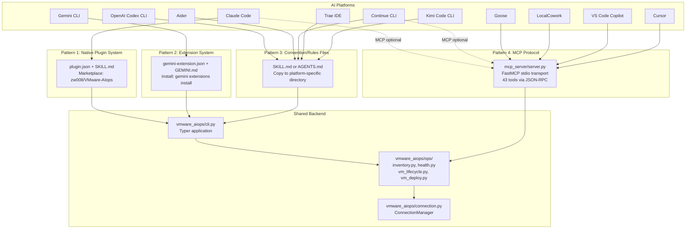
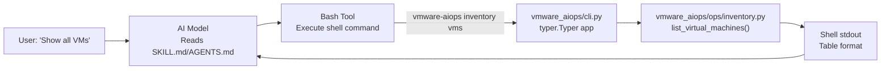
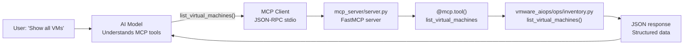
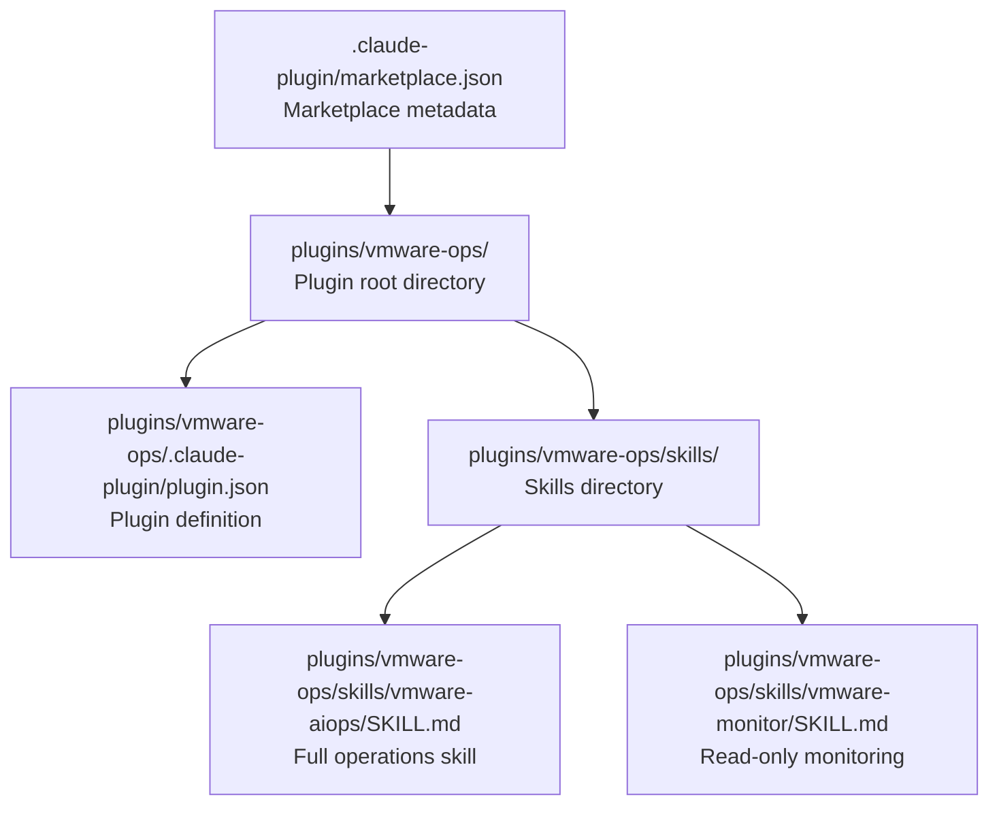
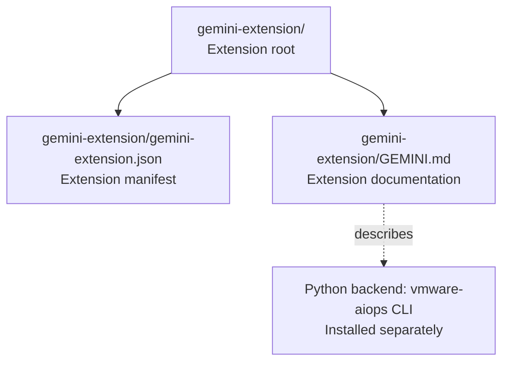
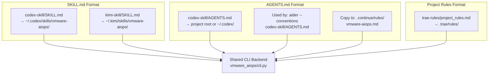
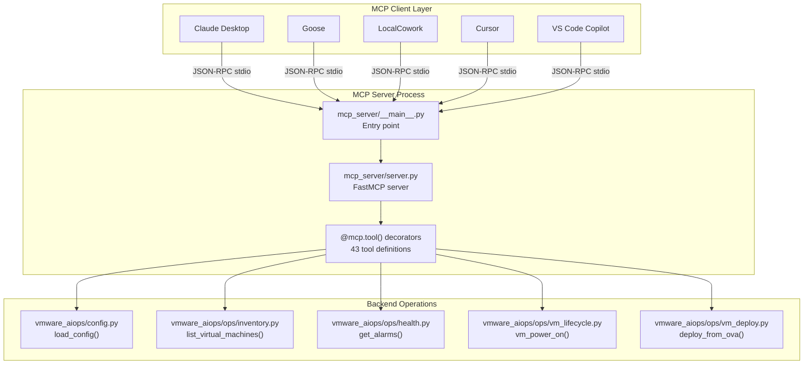
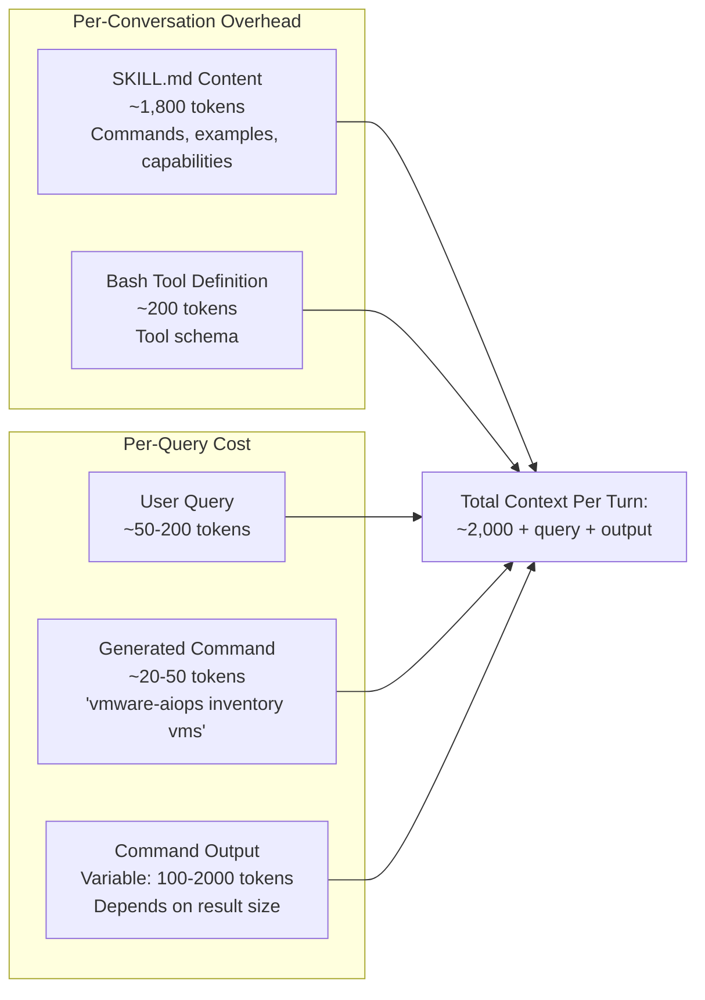
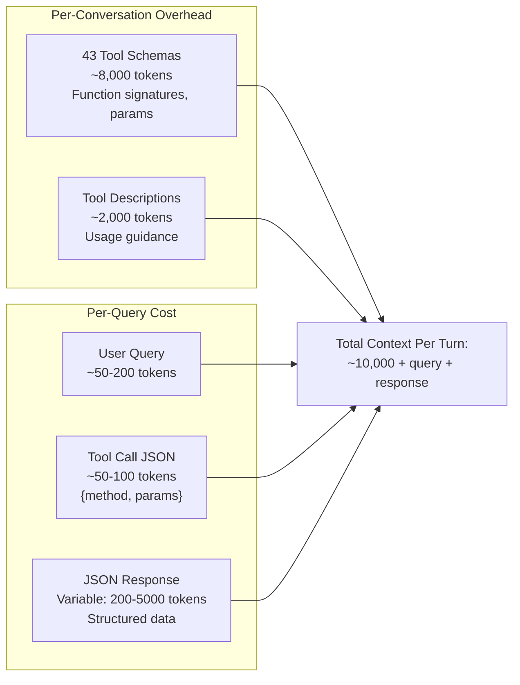

<!-- source: DeepWiki mcp.deepwiki.com · repo zw008/VMware-AIops · page 6 AI Agent Integration · fetched 2026-10-26 -->

# AI Agent Integration

<details>
<summary>Relevant source files</summary>

The following files were used as context for generating this wiki page:

- [README-CN.md](README-CN.md)
- [README.md](README.md)
- [plugins/vmware-ops/skills/vmware-aiops/SKILL.md](plugins/vmware-ops/skills/vmware-aiops/SKILL.md)

</details>


This document provides an overview of integrating VMware AIops with AI coding assistants and platforms. It explains the four integration patterns available, when to use each pattern, and how AI agents interact with the VMware infrastructure through natural language commands.

For platform-specific setup instructions, see:
- Claude Code: [Claude Code Integration](#6.1)
- Gemini CLI: [Gemini CLI Integration](#6.2)  
- Codex/Aider/Continue: [Codex, Aider, and Continue Integration](#6.3)
- Local models: [Local Model Integration](#6.4)
- MCP clients: [MCP Client Integration](#6.5)

For CLI command reference, see [CLI Command Reference](#4.1). For MCP tools reference, see [MCP Tools Reference](#5.2).

---

## Integration Landscape

VMware AIops supports **10+ AI platforms** through **four distinct integration patterns**, each optimized for different platform capabilities and operational contexts. All integrations share the same Python backend but differ in how they expose functionality to AI agents.

**Integration Patterns:**



**Sources:** [README.md:268-315](), [plugins/vmware-ops/skills/vmware-aiops/SKILL.md:1-14]()

---

## Operational Modes: CLI vs MCP

VMware AIops provides two operational modes that trade off token efficiency for automation capabilities. The choice between modes depends on AI model capacity, token budget, and automation requirements.

| Mode | Context Size | Interface | Use Case |
|------|-------------|-----------|----------|
| **CLI Mode** | ~2K tokens | Bash shell execution | Token-efficient, local models <32B params, cost optimization |
| **MCP Mode** | ~10K tokens | Structured JSON tools | Automated pipelines, type-safe parameters, agent chaining |

### CLI Mode Architecture



**Token Budget Breakdown (CLI Mode):**
- SKILL.md documentation: ~1,800 tokens
- Bash tool definition: ~200 tokens
- **Total per conversation turn:** ~2,000 tokens

**Sources:** [plugins/vmware-ops/skills/vmware-aiops/SKILL.md:60-76](), [vmware_aiops/cli.py]()

### MCP Mode Architecture



**Token Budget Breakdown (MCP Mode):**
- 43 tool schemas: ~8,000 tokens
- Tool descriptions and parameters: ~2,000 tokens
- **Total per conversation turn:** ~10,000 tokens

**Sources:** [mcp_server/server.py](), [plugins/vmware-ops/skills/vmware-aiops/SKILL.md:115-129]()

### Decision Matrix

| Factor | CLI Mode | MCP Mode |
|--------|----------|----------|
| AI Model Size | <32B parameters (Qwen 7B/32B, DeepSeek Coder) | >70B or cloud (GPT-4o, Claude 3.5) |
| Token Budget | Limited (<8K context) | Generous (>32K context) |
| Accuracy Needs | Basic operations, human oversight | Production automation, type safety |
| Deployment Type | Interactive usage, ad-hoc queries | CI/CD pipelines, agent chaining |
| Shell Parsing | Required (AI parses text output) | Not needed (structured JSON) |
| Error Handling | Text-based, may need retry | Structured error codes |

**Sources:** [README.md:59-66](), [plugins/vmware-ops/skills/vmware-aiops/SKILL.md:60-76]()

---

## Integration Pattern 1: Native Plugin System (Claude Code)

Claude Code provides a native skill/plugin system with marketplace support. Plugins are defined using `plugin.json` and SKILL.md files following the Claude Code specification.

### File Structure



**Plugin Metadata Structure** ([.claude-plugin/marketplace.json]()):
- `name`: `"io.github.zw008/vmware-aiops"`
- `displayName`: Human-readable name
- `description`: Marketplace description
- `plugins`: Array of plugin definitions

**Skill File Format** ([plugins/vmware-ops/skills/vmware-aiops/SKILL.md:1-14]()):
```markdown
---
name: vmware-aiops
description: >
  AI-powered VMware vCenter/ESXi monitoring and operations...
installer:
  kind: uv
  package: vmware-aiops
metadata: {"openclaw":{"requires":{"bins":["vmware-aiops"]}}}
---
```

**Installation Flow:**
1. User runs `/plugin marketplace add zw008/VMware-AIops`
2. Claude Code fetches marketplace.json from GitHub
3. User runs `/plugin install vmware-ops`
4. Claude Code installs Python package via `uv tool install vmware-aiops`
5. Skill becomes available: `/vmware-ops:vmware-aiops`

**Sources:** [README.md:40-51](), [plugins/vmware-ops/skills/vmware-aiops/SKILL.md:1-14]()

---

## Integration Pattern 2: Extension System (Gemini CLI)

Gemini CLI uses an extension system with a manifest file and extension-specific documentation format.

### Extension Structure



**Extension Manifest** ([gemini-extension/gemini-extension.json]()):
```json
{
  "name": "vmware-aiops",
  "version": "1.0.0",
  "description": "VMware vCenter/ESXi operations",
  "main": "GEMINI.md"
}
```

**Installation:**
```bash
# Local install
gemini extensions install ./gemini-extension

# GitHub install
gemini extensions install https://github.com/zw008/VMware-AIops
```

**Execution Model:**
- Gemini reads GEMINI.md documentation
- Gemini generates shell commands based on user intent
- Commands execute via `vmware-aiops` CLI
- Gemini parses text output

**Sources:** [README.md:445-463](), [README-CN.md:352-358]()

---

## Integration Pattern 3: Convention/Rules Files

Several AI platforms (Codex CLI, Aider, Continue, Trae IDE, Kimi) use convention or rules files that are copied to platform-specific directories. The AI reads these files to understand available capabilities.

### Convention File Types



### File Organization by Platform

| Platform | Convention File | Installation Path | Format |
|----------|----------------|-------------------|--------|
| Codex CLI | `codex-skill/SKILL.md` | `~/.codex/skills/vmware-aiops/SKILL.md` | Markdown with YAML frontmatter |
| Codex CLI | `codex-skill/AGENTS.md` | Project root `./AGENTS.md` | Plain Markdown |
| Aider | `codex-skill/AGENTS.md` | Command arg `--conventions` | Plain Markdown |
| Continue | `codex-skill/AGENTS.md` | `.continue/rules/vmware-aiops.md` | Plain Markdown |
| Trae IDE | `trae-rules/project_rules.md` | `.trae/rules/project_rules.md` | Plain Markdown |
| Kimi Code | `kimi-skill/SKILL.md` | `~/.kimi/skills/vmware-aiops/SKILL.md` | Markdown with YAML frontmatter |

**Common Pattern:**
1. AI platform reads convention/rules file at startup or per request
2. File describes available `vmware-aiops` CLI commands
3. AI generates appropriate shell commands based on user intent
4. AI executes commands via bash tool
5. AI parses text output and presents to user

**Sources:** [README.md:467-561](), [README-CN.md:361-399]()

---

## Integration Pattern 4: MCP Protocol

The Model Context Protocol (MCP) provides a standardized way to expose tools to AI agents via JSON-RPC over stdio transport. VMware AIops implements an MCP server that exposes 43 tools across 8 functional categories.

### MCP Server Architecture



### Tool Categories and Functions

The MCP server exposes operations through decorated Python functions. Each tool corresponds to a specific operation in the backend modules.

**Inventory Tools** (source: [mcp_server/server.py]()):
- `list_virtual_machines(target, limit, fields)` → `vmware_aiops/ops/inventory.py:list_virtual_machines()`
- `list_esxi_hosts(target)` → `vmware_aiops/ops/inventory.py:list_hosts()`
- `list_all_datastores(target)` → `vmware_aiops/ops/inventory.py:list_datastores()`
- `list_all_clusters(target)` → `vmware_aiops/ops/inventory.py:list_clusters()`

**Health Monitoring Tools:**
- `get_alarms(target)` → `vmware_aiops/ops/health.py:get_active_alarms()`
- `get_events(target, hours, severity)` → `vmware_aiops/ops/health.py:get_recent_events()`
- `vm_info(vm_name, target)` → `vmware_aiops/ops/vm_lifecycle.py:get_vm_info()`

**VM Lifecycle Tools:**
- `vm_power_on(vm_name, target)` → `vmware_aiops/ops/vm_lifecycle.py:power_on_vm()`
- `vm_power_off(vm_name, force, target)` → `vmware_aiops/ops/vm_lifecycle.py:power_off_vm()`
- `vm_set_ttl(vm_name, minutes, target)` → `vmware_aiops/ops/vm_lifecycle.py:set_ttl()`
- `vm_clean_slate(vm_name, snapshot_name, target)` → `vmware_aiops/ops/vm_lifecycle.py:clean_slate()`

**Deployment Tools:**
- `deploy_vm_from_ova(ova_path, vm_name, datastore, network, target)` → `vmware_aiops/ops/vm_deploy.py:deploy_from_ova()`
- `deploy_vm_from_template(template_name, vm_name, datastore, target)` → `vmware_aiops/ops/vm_deploy.py:deploy_from_template()`
- `deploy_linked_clone(source_vm, snapshot_name, new_vm_name, target)` → `vmware_aiops/ops/vm_deploy.py:create_linked_clone()`

**Plan → Apply Tools:**
- `vm_create_plan(actions, target)` → `vmware_aiops/planner.py:create_plan()`
- `vm_apply_plan(plan_id, target)` → `vmware_aiops/plan_executor.py:apply_plan()`
- `vm_rollback_plan(plan_id, target)` → `vmware_aiops/plan_executor.py:rollback_plan()`

### MCP Configuration Files

Platform-specific configuration templates are provided in `examples/mcp-configs/`:

**Claude Desktop** ([examples/mcp-configs/claude-code.json]()):
```json
{
  "mcpServers": {
    "vmware-aiops": {
      "command": "python",
      "args": ["-m", "mcp_server"],
      "env": {
        "VMWARE_AIOPS_CONFIG": "~/.vmware-aiops/config.yaml"
      }
    }
  }
}
```

**Goose** ([examples/mcp-configs/goose.json]()):
```json
{
  "mcp": {
    "vmware-aiops": {
      "command": "vmware-aiops-mcp"
    }
  }
}
```

**Sources:** [README.md:563-598](), [mcp_server/server.py](), [plugins/vmware-ops/skills/vmware-aiops/SKILL.md:96-129]()

---

## Natural Language to Code Flow

This diagram shows how a natural language request flows through the integration layers to execute vSphere API calls.

```mermaid
graph TB
    subgraph "Natural Language Space"
        UserQuery["User: 'List all powered-on VMs<br/>sorted by memory usage'"]
    end
    
    subgraph "AI Processing Layer"
        AIModel["AI Model<br/>Claude/GPT-4/Gemini/Qwen"]
        IntentParse["Intent Recognition<br/>→ inventory query<br/>→ filter: poweredOn<br/>→ sort: memory"]
    end
    
    subgraph "Integration Layer - CLI Mode"
        SkillDoc["SKILL.md or AGENTS.md<br/>Command reference"]
        BashGen["Generate Shell Command:<br/>'vmware-aiops inventory vms<br/>--power-state poweredOn<br/>--sort-by memory_mb'"]
    end
    
    subgraph "Integration Layer - MCP Mode"
        MCPSchema["MCP Tool Schema<br/>list_virtual_machines"]
        JSONGen["Generate JSON-RPC:<br/>{method: 'list_virtual_machines',<br/>params: {power_state: 'poweredOn',<br/>sort_by: 'memory_mb'}}"]
    end
    
    subgraph "Python Backend - CLI Entry"
        CLIApp["vmware_aiops/cli.py<br/>@app.command('inventory')<br/>def inventory_group()"]
        CLIVMs["@inventory_group.command('vms')<br/>def list_vms_cli(power_state, sort_by)"]
    end
    
    subgraph "Python Backend - MCP Entry"
        MCPTool["mcp_server/server.py<br/>@mcp.tool()<br/>def list_virtual_machines(power_state, sort_by)"]
    end
    
    subgraph "Core Operations Module"
        InventoryFunc["vmware_aiops/ops/inventory.py<br/>list_virtual_machines(si, power_state, sort_by)"]
        ConnMgr["vmware_aiops/connection.py<br/>ConnectionManager.get_connection(target)<br/>→ ServiceInstance"]
        PyVmomiCall["pyVmomi API Call<br/>si.content.viewManager<br/>.CreateContainerView()<br/>vim.VirtualMachine"]
    end
    
    subgraph "VMware Infrastructure"
        vCenter["vCenter Server<br/>SOAP API Endpoint<br/>443/tcp"]
        VMs["Virtual Machines<br/>Retrieve properties:<br/>runtime.powerState<br/>config.hardware.memoryMB"]
    end
    
    subgraph "Response Path"
        DataParse["Parse ManagedObject Properties"]
        Filter["Filter: runtime.powerState == 'poweredOn'"]
        Sort["Sort: by config.hardware.memoryMB desc"]
        Format["Format Output<br/>CLI: Rich Table<br/>MCP: JSON Array"]
        AIResponse["AI Model Presents Results<br/>to User in Natural Language"]
    end
    
    UserQuery --> AIModel
    AIModel --> IntentParse
    
    IntentParse --> SkillDoc
    SkillDoc --> BashGen
    BashGen --> CLIApp
    CLIApp --> CLIVMs
    
    IntentParse --> MCPSchema
    MCPSchema --> JSONGen
    JSONGen --> MCPTool
    
    CLIVMs --> InventoryFunc
    MCPTool --> InventoryFunc
    
    InventoryFunc --> ConnMgr
    ConnMgr --> PyVmomiCall
    PyVmomiCall --> vCenter
    vCenter --> VMs
    
    VMs --> DataParse
    DataParse --> Filter
    Filter --> Sort
    Sort --> Format
    Format --> AIResponse
```



**Key Code Entities in the Flow:**

1. **CLI Entry Point** ([vmware_aiops/cli.py]()):
   - `app = typer.Typer()` - Main CLI application
   - `@app.command("inventory")` - Inventory command group
   - Argument parsing via Typer decorators

2. **MCP Entry Point** ([mcp_server/server.py]()):
   - `mcp = FastMCP("vmware-aiops")` - MCP server instance
   - `@mcp.tool()` - Tool decorator for each operation
   - JSON-RPC parameter deserialization

3. **Core Operations** ([vmware_aiops/ops/inventory.py]()):
   - `list_virtual_machines(si, limit, sort_by, power_state, fields)` - Main function
   - Returns list of dict with VM properties

4. **Connection Management** ([vmware_aiops/connection.py]()):
   - `ConnectionManager` class - Singleton connection pool
   - `get_connection(target_name)` - Retrieve or create ServiceInstance
   - Connection caching and reuse

5. **pyVmomi Integration:**
   - `SmartConnect()` - Establish SOAP connection
   - `si.content.viewManager.CreateContainerView()` - VM enumeration
   - Property collector for efficient batch retrieval

**Sources:** [vmware_aiops/cli.py](), [mcp_server/server.py](), [vmware_aiops/ops/inventory.py](), [vmware_aiops/connection.py]()

---

## Token Budget Analysis

Understanding token consumption is critical for choosing between CLI and MCP modes, especially when using local or smaller AI models.

### CLI Mode Token Breakdown



**CLI Mode Characteristics:**
- **Fixed overhead:** ~2,000 tokens per conversation
- **Scalable with data:** Output size varies with query results
- **Optimal for:** Models with 7B-32B parameters, 8K-32K context windows
- **Example models:** Qwen 2.5 Coder 32B, DeepSeek Coder V2, CodeLlama 34B

### MCP Mode Token Breakdown



**MCP Mode Characteristics:**
- **Fixed overhead:** ~10,000 tokens per conversation
- **Structured output:** JSON format may use more tokens than text tables
- **Optimal for:** Cloud models (GPT-4o, Claude 3.5, Gemini Pro), 32K+ context
- **Accuracy benefit:** Type-safe parameters, no shell parsing errors

### Comparison Table

| Metric | CLI Mode | MCP Mode |
|--------|----------|----------|
| **Initial Context** | 2,000 tokens | 10,000 tokens |
| **Per Query** | +100-2,000 tokens | +200-5,000 tokens |
| **Model Minimum** | 7B params, 8K context | 30B+ params, 32K+ context |
| **Accuracy** | Depends on output parsing | High (structured JSON) |
| **Error Recovery** | Text-based, may need clarification | Structured error codes |
| **Best For** | Interactive queries, small models | Automation, production, large models |

**Decision Rule:**
- If model context window < 16K → Use CLI mode
- If model params < 32B → Use CLI mode
- If automation/CI/CD → Use MCP mode
- If human-interactive → Use CLI mode
- If cost-sensitive → Use CLI mode

**Sources:** [README.md:59-66](), [plugins/vmware-ops/skills/vmware-aiops/SKILL.md:60-76]()

---

## Platform Support Matrix

Comprehensive table of all supported AI platforms, their integration patterns, and key characteristics.

| Platform | Integration Pattern | Config File Location | Model Support | Token Mode | MCP Support |
|----------|-------------------|---------------------|---------------|------------|-------------|
| **Claude Code** | Native Plugin | `plugins/vmware-ops/skills/vmware-aiops/SKILL.md` | Anthropic Claude | CLI or MCP | ✅ Native |
| **Gemini CLI** | Extension | `gemini-extension/GEMINI.md` | Google Gemini | CLI | ✅ Via extension |
| **OpenAI Codex CLI** | Convention | `codex-skill/SKILL.md` → `~/.codex/skills/` | OpenAI GPT | CLI | Via Skills.sh |
| **Aider** | Convention | `codex-skill/AGENTS.md` via `--conventions` | Any (cloud + local) | CLI | Third-party |
| **Continue CLI** | Rules | `codex-skill/AGENTS.md` → `.continue/rules/` | Any (cloud + local) | CLI or MCP | ✅ Native |
| **Trae IDE** | Rules | `trae-rules/project_rules.md` → `.trae/rules/` | Claude/DeepSeek/GPT-4o/Doubao | CLI | — |
| **Kimi Code CLI** | Convention | `kimi-skill/SKILL.md` → `~/.kimi/skills/` | Moonshot Kimi | CLI | — |
| **Goose** | MCP Protocol | `examples/mcp-configs/goose.json` | Ollama, LM Studio | MCP | ✅ Native |
| **LocalCowork** | MCP Protocol | `examples/mcp-configs/localcowork.json` | Fully offline | MCP | ✅ Native |
| **mcp-agent** | MCP Protocol | `examples/mcp-configs/mcp-agent.yaml` | Ollama, vLLM | MCP | ✅ Native |
| **VS Code Copilot** | MCP Protocol | `examples/mcp-configs/vscode-copilot.json` | GitHub Copilot | MCP | ✅ Via extension |
| **Cursor** | MCP Protocol | `examples/mcp-configs/cursor.json` | GPT-4 | MCP | ✅ Native |

**Installation Methods:**

| Method | Command | Fetches From |
|--------|---------|--------------|
| Skills.sh | `npx skills add zw008/VMware-AIops` | GitHub → Local copy |
| ClawHub | `clawhub install vmware-aiops` | ClawHub registry (GitHub snapshot) |
| PyPI | `uv tool install vmware-aiops` | PyPI package registry |
| Git Clone | `git clone https://github.com/zw008/VMware-AIops` | GitHub direct |

**Sources:** [README.md:268-315](), [README.md:293-305](), [README-CN.md:244-280]()

---

## File Organization for Integration

The repository organizes integration files by platform and pattern. This structure allows platforms to locate their specific configuration while sharing the same Python backend.

```
VMware-AIops/
├── .claude-plugin/
│   └── marketplace.json              # Claude Code marketplace metadata
│
├── plugins/
│   └── vmware-ops/
│       ├── .claude-plugin/
│       │   └── plugin.json           # Claude Code plugin definition
│       └── skills/
│           └── vmware-aiops/
│               └── SKILL.md          # Claude Code skill (Pattern 1)
│
├── skills/
│   └── vmware-aiops/
│       └── SKILL.md                  # Skills.sh index (Pattern 1)
│
├── gemini-extension/
│   ├── gemini-extension.json         # Gemini manifest
│   └── GEMINI.md                     # Gemini extension doc (Pattern 2)
│
├── codex-skill/
│   ├── SKILL.md                      # Codex CLI skill (Pattern 3)
│   └── AGENTS.md                     # Aider/Continue convention (Pattern 3)
│
├── trae-rules/
│   └── project_rules.md              # Trae IDE rules (Pattern 3)
│
├── kimi-skill/
│   └── SKILL.md                      # Kimi Code CLI skill (Pattern 3)
│
├── mcp_server/
│   ├── __main__.py                   # MCP server entry point
│   └── server.py                     # FastMCP tool definitions (Pattern 4)
│
├── examples/
│   └── mcp-configs/                  # MCP client configs (Pattern 4)
│       ├── goose.json
│       ├── localcowork.json
│       ├── mcp-agent.yaml
│       ├── vscode-copilot.json
│       ├── cursor.json
│       ├── continue.yaml
│       └── claude-code.json
│
└── vmware_aiops/                     # Shared Python backend (all patterns)
    ├── cli.py                        # CLI entry point
    ├── config.py                     # Configuration loader
    ├── connection.py                 # Connection management
    └── ops/                          # Core operations
        ├── inventory.py
        ├── health.py
        ├── vm_lifecycle.py
        └── vm_deploy.py
```

**Integration Pattern File Mapping:**

| Pattern | Platform | Source Files | Destination |
|---------|----------|--------------|-------------|
| 1: Native Plugin | Claude Code | `.claude-plugin/`, `plugins/vmware-ops/` | `~/.claude/plugins/marketplaces/` |
| 2: Extension | Gemini CLI | `gemini-extension/` | Gemini extensions directory |
| 3: Convention | Codex CLI | `codex-skill/SKILL.md` | `~/.codex/skills/vmware-aiops/` |
| 3: Convention | Aider | `codex-skill/AGENTS.md` | Argument: `--conventions` |
| 3: Convention | Continue | `codex-skill/AGENTS.md` | `.continue/rules/vmware-aiops.md` |
| 3: Convention | Trae IDE | `trae-rules/project_rules.md` | `.trae/rules/project_rules.md` |
| 3: Convention | Kimi Code | `kimi-skill/SKILL.md` | `~/.kimi/skills/vmware-aiops/` |
| 4: MCP Protocol | Any MCP client | `mcp_server/`, `examples/mcp-configs/` | Platform config file |

**Sources:** [README.md:887-932](), [README-CN.md:564-596]()

---

## Next Steps

For detailed platform-specific setup instructions and troubleshooting:

- **Claude Code installation and usage:** See [Claude Code Integration](#6.1)
- **Gemini CLI extension setup:** See [Gemini CLI Integration](#6.2)
- **Codex, Aider, Continue configuration:** See [Codex, Aider, and Continue Integration](#6.3)
- **Local model setup with Ollama:** See [Local Model Integration](#6.4)
- **MCP client configuration for Goose, LocalCowork, etc.:** See [MCP Client Integration](#6.5)

For understanding the operational commands:
- **CLI command reference:** See [CLI Command Reference](#4.1)
- **MCP tools reference:** See [MCP Tools Reference](#5.2)

For configuration and credentials:
- **Configuration file structure:** See [Configuration](#2.2)
- **Security best practices:** See [Security and Safety](#10)

---

