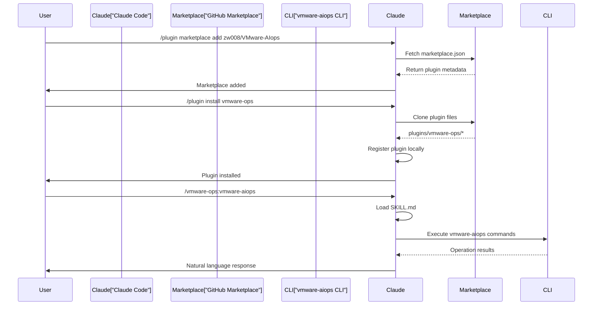
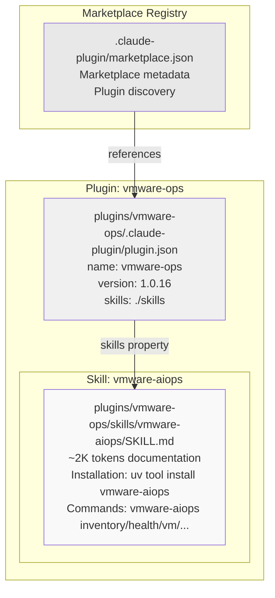
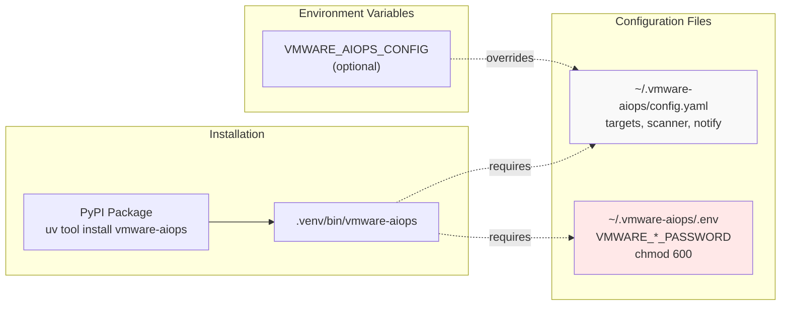
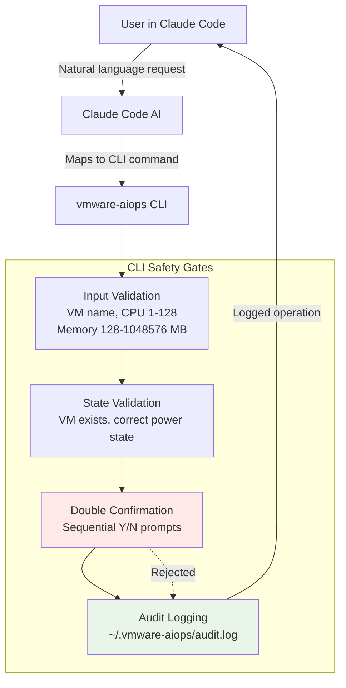

<!-- source: DeepWiki mcp.deepwiki.com · repo zw008/VMware-AIops · page 6.1 Claude Code Integration · fetched 2026-10-26 -->

# Claude Code Integration

<details>
<summary>Relevant source files</summary>

The following files were used as context for generating this wiki page:

- [.claude-plugin/marketplace.json](.claude-plugin/marketplace.json)
- [README.md](README.md)
- [plugins/vmware-ops/.claude-plugin/plugin.json](plugins/vmware-ops/.claude-plugin/plugin.json)
- [plugins/vmware-ops/skills/vmware-aiops/SKILL.md](plugins/vmware-ops/skills/vmware-aiops/SKILL.md)

</details>


This page explains how to install and use the VMware AIops plugin in Claude Code, Anthropic's AI-powered coding assistant. Claude Code supports VMware AIops through its native skill system, allowing natural language control of VMware infrastructure.

For integration with other AI platforms, see [Gemini CLI Integration](#6.2), [Codex, Aider, and Continue Integration](#6.3), [Local Model Integration](#6.4), and [MCP Client Integration](#6.5). For general dual-mode architecture information, see [Dual-Mode Architecture: CLI vs MCP](#3.1).

## Overview

Claude Code integration works through two components:

1. **Marketplace manifest** (`.claude-plugin/marketplace.json`) — Registry entry that makes the plugin discoverable in Claude Code's marketplace
2. **Plugin structure** (`plugins/vmware-ops/`) — Contains the plugin manifest and skill definition files

When invoked, Claude Code reads the skill documentation (SKILL.md) and executes `vmware-aiops` CLI commands via bash to perform VMware operations.

Sources: [README.md:40-51](), [.claude-plugin/marketplace.json:1-34](), [plugins/vmware-ops/.claude-plugin/plugin.json:1-26]()

## Installation Methods

### Method 1: Marketplace Install (Recommended)



**Installation commands:**

```bash
# In Claude Code
/plugin marketplace add zw008/VMware-AIops
/plugin install vmware-ops
```

The marketplace install fetches from GitHub repository `zw008/VMware-AIops` and registers the plugin in Claude Code's plugin directory (`~/.claude/plugins/marketplaces/vmware-aiops`).

Sources: [README.md:389-397](), [.claude-plugin/marketplace.json:1-34]()

### Method 2: Local Install

Local installation provides direct access to the repository for development or when marketplace access is unavailable:

```bash
# Clone repository
git clone https://github.com/zw008/VMware-AIops.git

# Create symlink to Claude plugins directory
ln -sf $(pwd)/VMware-AIops ~/.claude/plugins/marketplaces/vmware-aiops

# Register marketplace programmatically
python3 -c "
import json, pathlib
f = pathlib.Path.home() / '.claude/plugins/known_marketplaces.json'
d = json.loads(f.read_text()) if f.exists() else {}
d['vmware-aiops'] = {
    'source': {'source': 'github', 'repo': 'zw008/VMware-AIops'},
    'installLocation': str(pathlib.Path.home() / '.claude/plugins/marketplaces/vmware-aiops')
}
f.write_text(json.dumps(d, indent=2))
"

# Enable plugin in settings
python3 -c "
import json, pathlib
f = pathlib.Path.home() / '.claude/settings.json'
d = json.loads(f.read_text()) if f.exists() else {}
d.setdefault('enabledPlugins', {})['vmware-ops@vmware-aiops'] = True
f.write_text(json.dumps(d, indent=2))
"
```

After restart, invoke with `/vmware-ops:vmware-aiops`.

Sources: [README.md:407-437]()

## Plugin Structure



**File Hierarchy:**

| File Path | Purpose | Key Fields |
|-----------|---------|------------|
| `.claude-plugin/marketplace.json` | Marketplace entry point | `name`, `owner`, `plugins[]` array |
| `plugins/vmware-ops/.claude-plugin/plugin.json` | Plugin manifest | `name`, `version`, `description`, `skills` |
| `plugins/vmware-ops/skills/vmware-aiops/SKILL.md` | Skill documentation | YAML frontmatter + Markdown instructions |

Sources: [.claude-plugin/marketplace.json:1-34](), [plugins/vmware-ops/.claude-plugin/plugin.json:1-26](), [plugins/vmware-ops/skills/vmware-aiops/SKILL.md:1-509]()

## Skill Definition Format

The `SKILL.md` file uses YAML frontmatter followed by Markdown documentation:

```markdown
---
name: vmware-aiops
description: >
  AI-powered VMware vCenter/ESXi monitoring and operations...
installer:
  kind: uv
  package: vmware-aiops
metadata: 
  openclaw:
    requires:
      env: ["VMWARE_AIOPS_CONFIG", ...]
      bins: ["vmware-aiops"]
      config: ["~/.vmware-aiops/config.yaml", ...]
---

# VMware AIops

[Documentation content...]
```

**YAML Frontmatter Fields:**

| Field | Value | Purpose |
|-------|-------|---------|
| `name` | `vmware-aiops` | Skill identifier |
| `description` | Multi-line text | Brief capability summary |
| `installer.kind` | `uv` | Package manager (uv/pip/npm) |
| `installer.package` | `vmware-aiops` | PyPI package name |
| `metadata.openclaw.requires.bins` | `["vmware-aiops"]` | Required executables |
| `metadata.openclaw.requires.config` | Config file paths | Configuration dependencies |

The Markdown body (~2K tokens) contains:
- **When to Use This Skill** — Use case guidelines
- **Architecture** — System flow diagram
- **Capabilities** — Feature tables organized by category
- **CLI Reference** — Complete command syntax
- **Setup** — Installation and configuration steps
- **Security** — Credential management and safety features

Sources: [plugins/vmware-ops/skills/vmware-aiops/SKILL.md:1-14](), [plugins/vmware-ops/skills/vmware-aiops/SKILL.md:16-509]()

## Invocation and Execution Flow

```mermaid
sequenceDiagram
    participant User
    participant Claude["Claude Code<br/>(Anthropic Claude)"]
    participant Bash["Bash Shell"]
    participant CLI["vmware-aiops CLI<br/>(cli.py)"]
    participant vSphere["vCenter/ESXi<br/>(pyVmomi)"]
    
    User->>Claude: "Show me all VMs on esxi-lab"
    
    Note over Claude: Load SKILL.md (~2K tokens)<br/>Parse capabilities and commands
    
    Claude->>Claude: Identify relevant command:<br/>vmware-aiops inventory vms --target esxi-lab
    
    Claude->>Bash: Execute command
    Bash->>CLI: vmware-aiops inventory vms --target esxi-lab
    
    Note over CLI: Load config.yaml<br/>Load .env credentials<br/>Validate inputs
    
    CLI->>vSphere: pyVmomi RetrieveContent()<br/>Query vim.VirtualMachine
    vSphere-->>CLI: VM inventory data
    
    CLI-->>Bash: Formatted table output
    Bash-->>Claude: Command stdout/stderr
    
    Note over Claude: Parse output<br/>Format natural language response
    
    Claude->>User: "Found 15 VMs on esxi-lab:<br/>- prod-web-01 (powered on, 4 vCPU, 8 GB)<br/>- dev-test-02 (powered off, 2 vCPU, 4 GB)<br/>..."
```

**Execution Steps:**

1. **User Input** — Natural language request in Claude Code
2. **Skill Loading** — Claude reads `SKILL.md` into context (~2K tokens)
3. **Command Mapping** — AI maps user intent to CLI command syntax
4. **Bash Execution** — Claude executes `vmware-aiops` via bash tool
5. **CLI Processing** — CLI validates inputs, loads config, connects to vSphere
6. **API Call** — pyVmomi queries vSphere SOAP API
7. **Response Formatting** — CLI formats output (table/JSON/text)
8. **Natural Language Response** — Claude parses output and responds to user

Sources: [plugins/vmware-ops/skills/vmware-aiops/SKILL.md:133-145](), [README.md:70-82]()

## Token Efficiency: CLI Mode vs MCP Mode

Claude Code supports both CLI mode (via SKILL.md) and MCP mode (via MCP server). CLI mode is optimized for token efficiency:

| Metric | CLI Mode (SKILL.md) | MCP Mode (MCP Server) |
|--------|---------------------|----------------------|
| **Initial Context** | ~2K tokens | ~10K tokens |
| **Tool Definitions** | None (bash execution) | 43 tool schemas |
| **Command Format** | String arguments | Structured JSON |
| **Parsing Required** | Yes (parse stdout) | No (typed responses) |
| **Best For** | Token-sensitive workflows, small models | Automation pipelines, type safety |

**When to use CLI mode:**
- Default for all Claude Code interactions
- Cost optimization with cloud models
- Local/small models (<32B parameters) that struggle with many tool schemas
- Human-in-the-loop operations where output readability matters

**When to use MCP mode:**
- Automated pipelines requiring structured data
- Agent chaining scenarios
- Strict type safety requirements
- No shell output parsing desired

Sources: [README.md:57-66](), [plugins/vmware-ops/skills/vmware-aiops/SKILL.md:60-76]()

## Configuration Requirements

Claude Code requires the following configuration before use:



**Setup Steps:**

```bash
# 1. Install package
uv tool install vmware-aiops

# 2. Create config directory
mkdir -p ~/.vmware-aiops

# 3. Generate config templates
vmware-aiops init

# 4. Edit configuration
vim ~/.vmware-aiops/config.yaml  # Add targets
vim ~/.vmware-aiops/.env          # Add passwords

# 5. Lock permissions
chmod 600 ~/.vmware-aiops/.env

# 6. Verify configuration
vmware-aiops doctor
```

**Required Environment Variables:**

| Variable | Format | Example |
|----------|--------|---------|
| `VMWARE_{TARGET}_PASSWORD` | Target name uppercase, hyphens → underscores | `VMWARE_HOME_ESXI_PASSWORD` |
| `VMWARE_AIOPS_CONFIG` | Path to config.yaml | `~/.vmware-aiops/config.yaml` |

Sources: [plugins/vmware-ops/skills/vmware-aiops/SKILL.md:463-477](), [README.md:342-368]()

## Example Interaction

**User Request:**
```
Show me all powered-on VMs with more than 4 CPUs on my production vCenter
```

**Claude Code Internal Processing:**

1. Loads `SKILL.md` into context
2. Identifies relevant command section: "Inventory"
3. Maps user constraints to CLI flags:
   - "powered-on" → `--power-state poweredOn`
   - "more than 4 CPUs" → post-processing filter
   - "production vCenter" → `--target prod-vcenter`

**Generated Command:**
```bash
vmware-aiops inventory vms --target prod-vcenter --power-state poweredOn
```

**CLI Output (parsed by Claude):**
```
┌──────────────┬──────────┬──────┬───────────┬─────────────┬────────────┐
│ Name         │ State    │ CPUs │ Memory MB │ Guest OS    │ IP Address │
├──────────────┼──────────┼──────┼───────────┼─────────────┼────────────┤
│ prod-web-01  │ poweredOn│  8   │ 16384     │ Ubuntu 22.04│ 10.0.1.101 │
│ prod-db-01   │ poweredOn│  12  │ 32768     │ Ubuntu 22.04│ 10.0.1.102 │
│ prod-app-01  │ poweredOn│  6   │ 12288     │ CentOS 8    │ 10.0.1.103 │
└──────────────┴──────────┴──────┴───────────┴─────────────┴────────────┘
```

**Claude Response:**
```
Found 3 powered-on VMs with more than 4 CPUs on prod-vcenter:

1. **prod-web-01** — 8 vCPUs, 16 GB RAM, Ubuntu 22.04 (10.0.1.101)
2. **prod-db-01** — 12 vCPUs, 32 GB RAM, Ubuntu 22.04 (10.0.1.102)
3. **prod-app-01** — 6 vCPUs, 12 GB RAM, CentOS 8 (10.0.1.103)

All VMs are currently powered on and healthy.
```

Sources: [plugins/vmware-ops/skills/vmware-aiops/SKILL.md:374-377](), [README.md:96-104]()

## Safety Features in Claude Code Context

When operating through Claude Code, all safety mechanisms from the CLI are preserved:



**Safety Mechanisms:**

| Feature | CLI Implementation | Claude Code Behavior |
|---------|-------------------|---------------------|
| **Double Confirmation** | 2 sequential Y/N prompts | Claude relays prompts to user, waits for responses |
| **Dry-run Mode** | `--dry-run` flag shows API calls | Claude can suggest dry-run first |
| **Input Validation** | Parameter range checks | Validation errors shown to user |
| **Rejection Logging** | User declines logged to audit.log | Rejected confirmations tracked |
| **Audit Trail** | JSONL log with before/after state | All operations logged regardless of source |

**Example: Destructive Operation**

User request: "Delete the VM test-cleanup on dev-esxi"

Claude executes:
```bash
vmware-aiops vm delete test-cleanup --target dev-esxi
```

CLI prompts (relayed through Claude):
```
⚠️  WARNING: This will permanently delete VM "test-cleanup"
Current state:
  - Name: test-cleanup
  - Power State: poweredOff
  - CPUs: 2
  - Memory: 4096 MB
  - Disk: 50 GB

This action cannot be undone.

Confirm deletion? [y/N]: y

⚠️  FINAL CONFIRMATION: Delete VM "test-cleanup"? [y/N]: y

✓ VM "test-cleanup" deleted successfully.
```

All confirmation prompts require explicit user input — Claude cannot bypass them.

Sources: [plugins/vmware-ops/skills/vmware-aiops/SKILL.md:306-318](), [README.md:199-214]()

## Marketplace Submission

The plugin can be submitted to Anthropic's official Claude Code plugin directory for public discovery:

**Submission Requirements:**

1. **Valid plugin structure** — `plugin.json` with required fields
2. **SKILL.md documentation** — Complete usage instructions
3. **MIT License** — Open source license
4. **Public GitHub repository** — Accessible source code
5. **Functional installer** — PyPI package or equivalent

**Submission URL:** [https://clau.de/plugin-directory-submission](https://clau.de/plugin-directory-submission)

Once approved, users can discover and install via Claude Code's built-in plugin directory without manual marketplace addition.

Sources: [README.md:439-441]()

## Comparison with Other Integration Methods

| Integration Method | Entry Point | Documentation Format | Token Cost | Best For |
|-------------------|-------------|---------------------|------------|----------|
| **Claude Code (this page)** | `/vmware-ops:vmware-aiops` | SKILL.md (~2K tokens) | Low | Interactive operations with Anthropic Claude |
| **Gemini CLI** | `gemini` CLI | GEMINI.md | Low | Google Gemini users |
| **Codex/Aider/Continue** | Convention files | AGENTS.md | Low | CLI-based AI tools, local models |
| **MCP Protocol** | MCP server | 43 tool schemas (~10K tokens) | High | Automation pipelines, type safety |

Claude Code's skill system provides the lowest token cost for interactive VMware operations while maintaining full safety and audit capabilities.

Sources: [README.md:269-280](), [README.md:282-314]()

## Troubleshooting

### Plugin Not Found

**Symptom:** `/vmware-ops:vmware-aiops` shows "skill not found"

**Solutions:**
1. Verify marketplace added: `/plugin marketplace list`
2. Check plugin installed: `/plugin list`
3. Restart Claude Code after installation
4. Verify symlink: `ls -la ~/.claude/plugins/marketplaces/vmware-aiops`

### Command Execution Fails

**Symptom:** CLI commands return errors

**Solutions:**
1. Check configuration: `vmware-aiops doctor`
2. Verify credentials in `~/.vmware-aiops/.env`
3. Test connectivity: `vmware-aiops inventory vms --target <name>`
4. Check audit log: `tail -f ~/.vmware-aiops/audit.log`

### Slow Response Times

**Symptom:** Claude takes long to respond

**Solutions:**
1. Use `--limit` flag for inventory queries: `vmware-aiops inventory vms --limit 10`
2. Specify target explicitly: `--target prod-vcenter` (avoids multi-target queries)
3. Filter power state: `--power-state poweredOn` (reduces result set)

Sources: [plugins/vmware-ops/skills/vmware-aiops/SKILL.md:366-370](), [README.md:962-964]()

---

