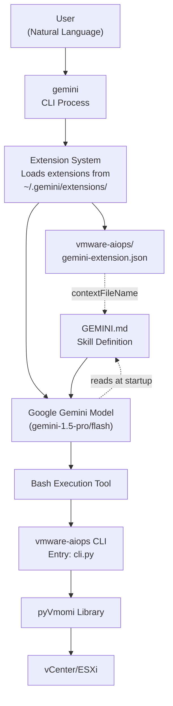
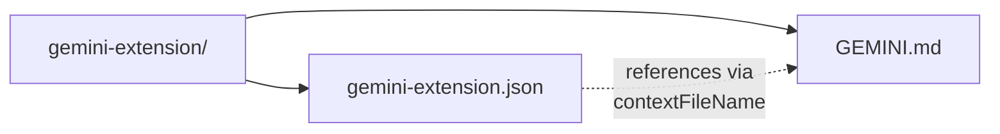
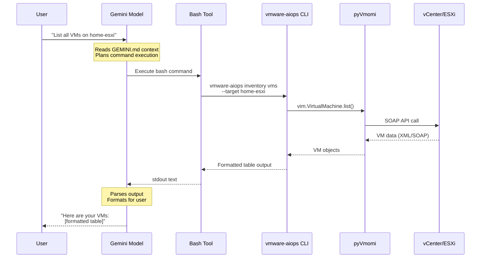

<!-- source: DeepWiki mcp.deepwiki.com · repo zw008/VMware-AIops · page 6.2 Gemini CLI Integration · fetched 2026-10-26 -->

# Gemini CLI Integration

<details>
<summary>Relevant source files</summary>

The following files were used as context for generating this wiki page:

- [README.md](README.md)
- [gemini-extension/gemini-extension.json](gemini-extension/gemini-extension.json)

</details>


This document describes how to integrate VMware AIops with Google's Gemini CLI using the extension system. This integration enables Gemini's AI model to manage VMware infrastructure through natural language commands.

**Related pages**: For Claude Code plugin integration, see [Claude Code Integration](#6.1). For MCP-based integrations with other clients, see [MCP Client Integration](#6.5). For local model usage with Aider/Continue, see [Local Model Integration](#6.4).

---

## Overview

Gemini CLI integration uses Google Gemini CLI's **extension system** to expose VMware AIops capabilities. Unlike Claude Code's marketplace plugin approach ([6.1](#6.1)), Gemini uses a lightweight extension manifest that references a skill documentation file. The integration operates in **CLI mode**, consuming approximately 2K tokens of context compared to 10K tokens for MCP mode ([3.1](#3.1)).

**Key characteristics**:
- Extension-based integration (not a plugin marketplace)
- Uses `gemini-extension.json` manifest file
- References `GEMINI.md` for skill definitions
- Invokes `vmware-aiops` CLI commands via bash tool
- Supports both local and GitHub-based installation
- Free tier: 60 requests per minute (as of documentation date)

Sources: [README.md:445-462](), [gemini-extension/gemini-extension.json:1-6]()

---

## Architecture

The following diagram shows how Gemini CLI integrates with the VMware AIops system:

**Gemini CLI Extension Architecture**



**Invocation flow**:
1. User starts `gemini` CLI process
2. Extension system loads `gemini-extension.json` from installed extensions
3. Manifest references `GEMINI.md` via `contextFileName` property
4. Gemini model reads `GEMINI.md` into context (~2K tokens)
5. User issues natural language command
6. Gemini model plans execution using bash tool
7. Bash tool executes `vmware-aiops` CLI commands
8. CLI output is parsed and formatted by Gemini for user

Sources: [README.md:70-82](), [gemini-extension/gemini-extension.json:1-6]()

---

## Extension Structure

The Gemini CLI extension consists of two files in the `gemini-extension/` directory:

**Extension Manifest File Structure**



### gemini-extension.json

The manifest file defines extension metadata and points to the skill definition:

[gemini-extension/gemini-extension.json:1-6]()

| Field | Value | Purpose |
|-------|-------|---------|
| `name` | `vmware-aiops` | Extension identifier |
| `version` | `1.0.16` | Extension version (tracks package version) |
| `description` | VMware vCenter/ESXi AI-powered monitoring and operations | Human-readable description |
| `contextFileName` | `GEMINI.md` | Path to skill definition file (relative to manifest) |

### GEMINI.md

The context file contains the complete skill definition in markdown format. This file:
- Documents all available CLI commands organized by category
- Provides usage examples and parameter specifications
- Defines safety requirements (double confirmation, dry-run modes)
- Lists input validation rules and constraints
- Explains the dual-skill architecture (vmware-monitor vs vmware-aiops)

The `GEMINI.md` file follows the same structure as `SKILL.md` ([6.1](#6.1)) and `AGENTS.md` ([6.3](#6.3)) but is named according to Gemini CLI conventions.

Sources: [gemini-extension/gemini-extension.json:1-6](), [README.md:273]()

---

## Installation

### Prerequisites

Verify Node.js and Python versions:

```bash
# Node.js 18+ required for Gemini CLI
node --version

# Python 3.10+ required for vmware-aiops
python3 --version
```

### Step 1: Install Gemini CLI

Install the official Gemini CLI package:

```bash
npm install -g @google/gemini-cli
```

**Verification**:
```bash
gemini --version
```

### Step 2: Install VMware AIops Backend

The Python backend must be installed before the extension:

```bash
# Clone the repository
git clone https://github.com/zw008/VMware-AIops.git
cd VMware-AIops

# Create virtual environment
python3 -m venv .venv
source .venv/bin/activate

# Install the package
pip install -e .
```

**Verification**:
```bash
vmware-aiops --version
```

### Step 3: Install Gemini Extension

**Method 1: Local installation (from cloned repository)**

```bash
# From the VMware-AIops repository root
gemini extensions install ./gemini-extension
```

**Method 2: GitHub direct installation**

```bash
# Install directly from GitHub (not yet implemented in example)
# gemini extensions install https://github.com/zw008/VMware-AIops
```

**Verification**:
```bash
# List installed extensions
gemini extensions list

# Should show:
# vmware-aiops (1.0.16)
```

The extension is installed to `~/.gemini/extensions/vmware-aiops/`.

Sources: [README.md:445-462](), [README.md:320-357]()

---

## Configuration

### Configure VMware Targets

Create the configuration directory and file:

```bash
mkdir -p ~/.vmware-aiops
cp config.example.yaml ~/.vmware-aiops/config.yaml
```

Edit `~/.vmware-aiops/config.yaml` to define your vCenter/ESXi targets. For configuration file structure, see [Configuration](#2.2).

### Configure Credentials

**Recommended approach**: Use `.env` file for password storage.

```bash
# Copy template
cp .env.example ~/.vmware-aiops/.env

# Edit and add passwords
# Example entries:
# VMWARE_HOME_ESXI_PASSWORD=your-password-here
# VMWARE_PROD_VCENTER_PASSWORD=your-password-here

# Secure the file (owner-only read/write)
chmod 600 ~/.vmware-aiops/.env
```

**Environment variable naming convention**:
```
VMWARE_{TARGET_NAME_UPPER}_PASSWORD
```
Replace hyphens with underscores and convert to uppercase. Examples:
- Target `home-esxi` → `VMWARE_HOME_ESXI_PASSWORD`
- Target `prod-vcenter` → `VMWARE_PROD_VCENTER_PASSWORD`

For credential management best practices, see [Credential Management](#10.1).

### Verify Configuration

```bash
vmware-aiops doctor

# Or skip authentication check (faster):
vmware-aiops doctor --skip-auth
```

Sources: [README.md:342-379]()

---

## Usage Examples

### Starting Gemini CLI

```bash
gemini
```

The Gemini CLI will load the vmware-aiops extension automatically at startup, loading `GEMINI.md` into the model's context.

### Basic Inventory Queries

```
> Show me all VMs on my ESXi host

> List all datastores and their capacity

> What hosts are in the prod-vcenter cluster?
```

### Health Monitoring

```
> Check for active alarms on home-esxi

> Show me recent critical events from the last 24 hours

> What's the current status of ESXi host sensors?
```

### VM Lifecycle Operations

```
> Power on the VM named web-server

> Create a snapshot of database-vm named "before-upgrade"

> Clone test-vm to test-vm-backup

> Show me information about my-application-vm
```

**Note on destructive operations**: Operations requiring double confirmation (power-off, delete, reconfigure) will prompt twice sequentially. The Gemini model will explain each confirmation step to the user.

### VM Deployment

```
> Deploy an OVA from /path/to/ubuntu.ova as ubuntu-web

> Create a linked clone from base-vm using snapshot clean

> Deploy 5 VMs from template golden-ubuntu with prefix lab-
```

### Multi-step Operations

For complex operations, Gemini will use the plan-apply workflow:

```
> Create 3 test VMs, configure them with 4 CPUs and 8GB RAM, then snapshot all of them
```

Gemini will:
1. Call `vm_create_plan` to validate and generate execution plan
2. Present the plan to user for review
3. Upon approval, call `vm_apply_plan` to execute
4. If failure occurs, offer rollback option

Sources: [README.md:445-462](), [README.md:95-176]()

---

## Invocation Flow

**Natural Language to CLI Command Flow**



**Key points**:
1. **Context loading**: `GEMINI.md` is loaded once at startup, not on every request (~2K tokens)
2. **Command construction**: Gemini model constructs appropriate `vmware-aiops` CLI commands based on skill definition
3. **Bash execution**: Commands executed through Gemini's bash tool capability
4. **Output parsing**: CLI output (tables, JSON) parsed by Gemini for natural language presentation
5. **Error handling**: CLI errors are intercepted and explained in user-friendly language

**Example command construction**:

User intent: *"Show me VMs with high memory usage"*

Gemini constructs:
```bash
vmware-aiops inventory vms --sort-by memory_mb --limit 10
```

User intent: *"Create a snapshot of prod-db before the upgrade"*

Gemini constructs:
```bash
vmware-aiops vm snapshot-create prod-db --name "before-upgrade"
```

Sources: [README.md:70-82]()

---

## CLI Mode vs MCP Mode

Gemini CLI uses the **CLI mode** of VMware AIops. Understanding the trade-offs:

**Comparison Table**

| Aspect | CLI Mode (Gemini) | MCP Mode |
|--------|-------------------|----------|
| **Context size** | ~2K tokens (GEMINI.md) | ~10K tokens (43 tool schemas) |
| **Invocation** | Bash tool executes CLI commands | Structured JSON-RPC tool calls |
| **Output parsing** | Model parses text output | Structured JSON responses |
| **Type safety** | None (text-based) | Full JSON schema validation |
| **Best for** | Token efficiency, local models | Automation, type-safe pipelines |
| **Gemini compatibility** | ✅ Native support | ⚠️ Via third-party MCP client |

**Why CLI mode for Gemini**:
- Gemini CLI has native bash tool capability
- 2K token context is more efficient than 10K for MCP
- Text-based output is natural for conversational interface
- No additional MCP client needed

For automation pipelines requiring structured I/O, consider using MCP mode with an MCP-compatible client. See [MCP Client Integration](#6.5).

Sources: [README.md:57-66]()

---

## Safety Features

Gemini CLI integration inherits all safety features from the underlying `vmware-aiops` CLI:

**Safety Mechanisms in Effect**

| Feature | How it Works with Gemini |
|---------|-------------------------|
| **Double Confirmation** | Gemini prompts user twice for destructive operations; no bypass possible |
| **Dry-run Mode** | User can request `--dry-run` flag; Gemini shows planned API calls without execution |
| **Input Validation** | CLI validates parameters (CPU 1-128, memory 128-1048576 MB, etc.) before pyVmomi calls |
| **Audit Logging** | All operations logged to `~/.vmware-aiops/audit.log` including user confirmations and rejections |
| **State Validation** | Pre-operation checks ensure VM exists, power state is correct, etc. |
| **Plan Review** | Multi-step operations shown as plan before execution; irreversible steps flagged |

**Example: Double confirmation flow**

User: *"Delete the old-test-vm"*

Gemini response:
```
I'll delete the VM "old-test-vm". This requires confirmation.

First confirmation: Are you sure you want to delete old-test-vm? (yes/no)
```

User: *"yes"*

Gemini response:
```
Second confirmation: This action is irreversible. Delete old-test-vm permanently? (yes/no)
```

User: *"yes"*

Gemini executes:
```bash
vmware-aiops vm delete old-test-vm --confirm
```

If user says "no" at any step, the operation is aborted and logged to audit trail.

For comprehensive safety documentation, see [Safety Features](#3.3).

Sources: [README.md:199-213]()

---

## Troubleshooting

### Extension Not Found

**Symptom**: `gemini` CLI does not recognize vmware-aiops commands

**Solutions**:
```bash
# Verify extension is installed
gemini extensions list

# Should show: vmware-aiops (1.0.16)

# If not listed, reinstall
cd VMware-AIops
gemini extensions install ./gemini-extension

# Verify installation directory
ls -la ~/.gemini/extensions/vmware-aiops/
```

### CLI Not Found

**Symptom**: Gemini reports "vmware-aiops: command not found"

**Solutions**:
```bash
# Verify vmware-aiops is in PATH
which vmware-aiops

# If not found, activate virtual environment
source .venv/bin/activate

# Or install globally
pip install -e . --user

# Verify installation
vmware-aiops --version
```

### Configuration Errors

**Symptom**: "Failed to connect to target" or authentication errors

**Solutions**:
```bash
# Run diagnostics
vmware-aiops doctor

# Check config file exists
ls -l ~/.vmware-aiops/config.yaml

# Check .env file permissions (should be 600)
ls -l ~/.vmware-aiops/.env

# Verify environment variables loaded
cat ~/.vmware-aiops/.env | grep PASSWORD

# Test connection directly
vmware-aiops inventory vms --target your-target-name
```

### Model Not Following GEMINI.md

**Symptom**: Gemini constructs incorrect commands or doesn't use vmware-aiops

**Causes**:
- Context size limitations
- Skill definition not clear enough
- Complex multi-step operations

**Solutions**:
- Break complex requests into smaller steps
- Explicitly mention "using vmware-aiops" in your prompt
- Verify extension is loaded: ask Gemini "What VMware operations can you perform?"

### Rate Limiting

**Symptom**: "Rate limit exceeded" errors from Gemini API

**Solution**:
- Gemini free tier: 60 requests per minute
- Wait 60 seconds or upgrade to paid tier
- Batch related queries into single request

### Permission Denied on Operations

**Symptom**: Operations fail with "Permission denied" or "Insufficient privileges"

**Solutions**:
```bash
# Verify vCenter/ESXi account permissions
vmware-aiops doctor --target your-target

# Check audit log for details
tail -f ~/.vmware-aiops/audit.log | jq .

# Ensure service account has required roles (see Configuration documentation)
```

Sources: [README.md:962-963]()

---

## Update and Maintenance

### Updating the Extension

When new versions are released:

```bash
# Update Python package
cd VMware-AIops
git pull origin main
pip install -e . --upgrade

# Reinstall extension (picks up GEMINI.md updates)
gemini extensions install ./gemini-extension --force

# Verify new version
vmware-aiops --version
gemini extensions list
```

### Version Synchronization

The extension version in `gemini-extension.json` tracks the package version:

[gemini-extension/gemini-extension.json:3]()

When upgrading, ensure:
- Python package version matches extension manifest version
- `GEMINI.md` is updated with any new commands or changes
- Backward compatibility is maintained for existing scripts

Sources: [README.md:613-625](), [gemini-extension/gemini-extension.json:1-6]()

---

