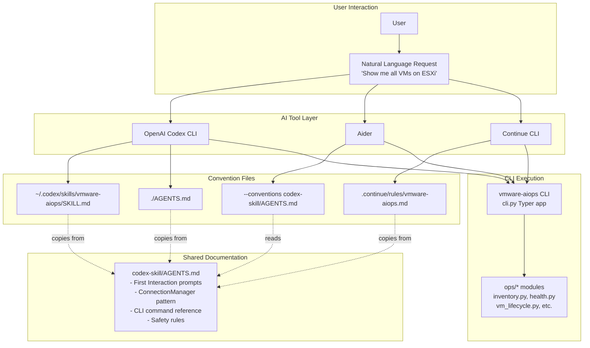
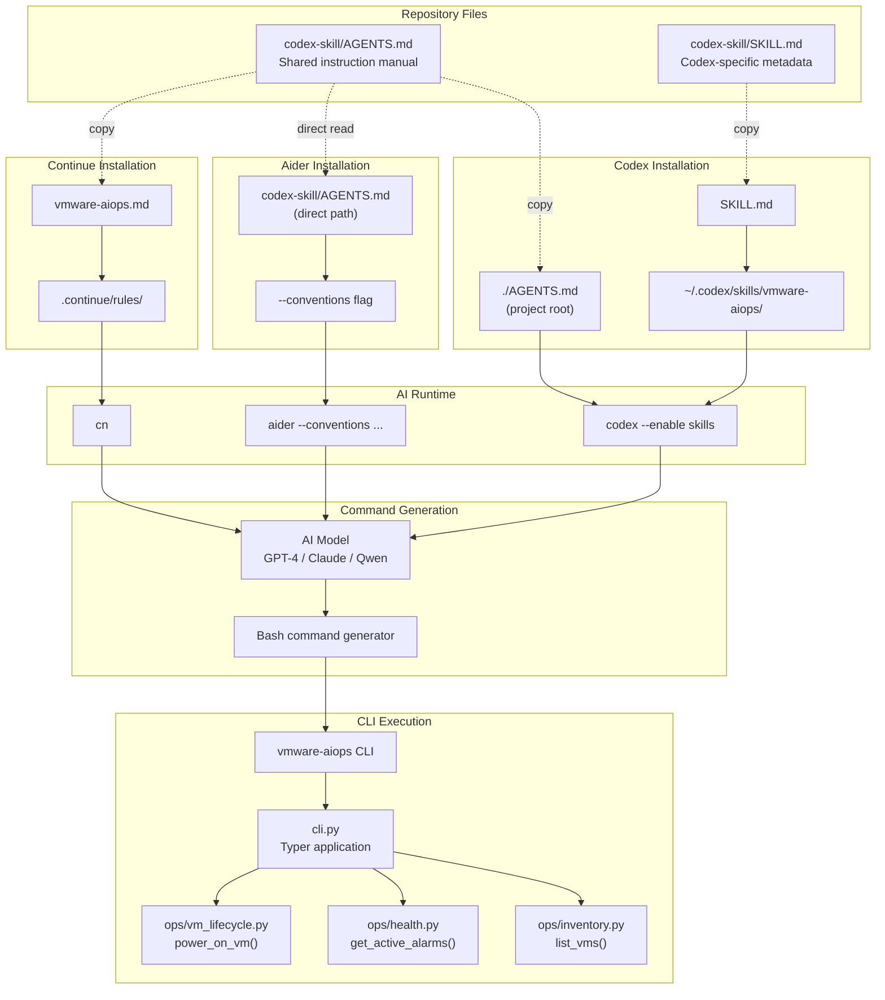
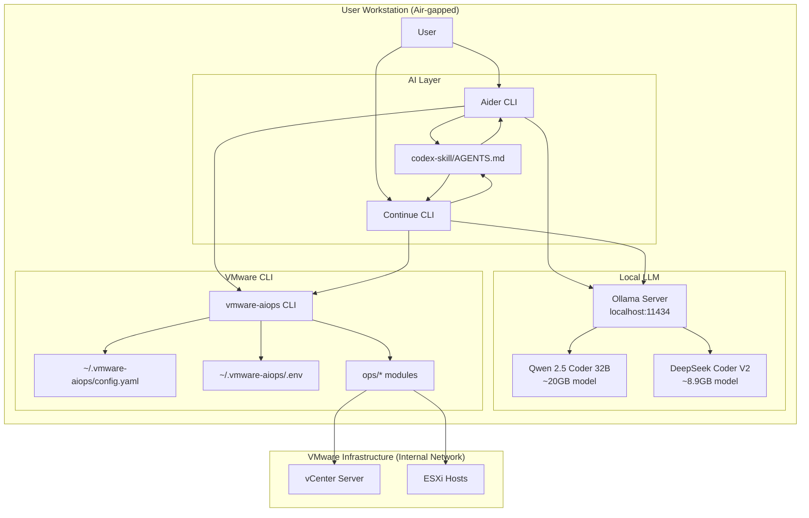

<!-- source: DeepWiki mcp.deepwiki.com · repo zw008/VMware-AIops · page 6.3 Codex, Aider, and Continue Integration · fetched 2026-10-26 -->

# Codex, Aider, and Continue Integration

<details>
<summary>Relevant source files</summary>

The following files were used as context for generating this wiki page:

- [README-CN.md](README-CN.md)
- [README.md](README.md)
- [codex-skill/AGENTS.md](codex-skill/AGENTS.md)

</details>


This page describes how to integrate VMware AIops with OpenAI Codex CLI, Aider, and Continue CLI - three AI coding assistants that use convention-based file patterns to provide context to AI models. Unlike native plugin systems (see [Claude Code Integration](#6.1)) or extension frameworks (see [Gemini CLI Integration](#6.2)), these tools read markdown documentation files from predefined locations to understand available capabilities.

All three tools share the same integration file: `codex-skill/AGENTS.md`, which contains structured instructions for AI models on how to invoke the `vmware-aiops` CLI tool.

---

## Convention-Based Integration Pattern

These three tools follow a **convention file pattern** where the AI model reads markdown documentation from specific filesystem locations to understand tool capabilities. This contrasts with programmatic APIs or structured protocol definitions.



**Key Characteristics**:

| Aspect | Pattern |
|--------|---------|
| **Integration Method** | File-based conventions (markdown documentation) |
| **Context Loading** | AI reads instructions from filesystem at startup |
| **Tool Discovery** | Pattern matching in documentation (bash command examples) |
| **Parameter Passing** | Shell command-line arguments (no structured schemas) |
| **Output Parsing** | Natural language interpretation of CLI stdout |
| **Token Efficiency** | ~2K tokens (SKILL.md/AGENTS.md content only) |

Sources: [README.md:466-535](), [codex-skill/AGENTS.md:1-505]()

---

## The Three Tools Compared

| Tool | Model Support | Primary Use Case | Config Location | CLI Invocation |
|------|---------------|------------------|-----------------|----------------|
| **OpenAI Codex CLI** | OpenAI GPT models | Code generation and task automation | `~/.codex/skills/` | `codex --enable skills` |
| **Aider** | Any LLM (OpenAI, Anthropic, local via Ollama) | Interactive code editing with AI | `--conventions <path>` flag | `aider --conventions codex-skill/AGENTS.md` |
| **Continue CLI** | Any LLM (cloud + local via Ollama) | Command-line coding assistant | `.continue/rules/` | `cn` |

**Primary Differences**:

- **Codex CLI**: Tightly integrated with OpenAI's ecosystem, requires two files (SKILL.md in skills directory + AGENTS.md in project root)
- **Aider**: Most flexible, supports any model via LiteLLM, uses `--conventions` flag to specify documentation path
- **Continue CLI**: Similar to Aider but uses `.continue/rules/` directory pattern, native VS Code extension also available

Sources: [README.md:273-280](), [README.md:467-535]()

---

## AGENTS.md Structure and Content

The `codex-skill/AGENTS.md` file serves as the shared instruction manual for all three tools. It defines how AI models should interact with VMware infrastructure.

### File Structure

```mermaid
graph TB
    AgentsMD["codex-skill/AGENTS.md"]
    
    subgraph "Section 1: Context Establishment"
        FirstInteraction["First Interaction<br/>Lines 7-25<br/>Target selection prompt"]
        ConnSetup["Connection Setup<br/>Lines 27-73<br/>config.yaml format<br/>ConnectionManager pattern"]
    end
    
    subgraph "Section 2: Operations Reference"
        Inventory["Inventory Queries<br/>Lines 77-137<br/>vim.VirtualMachine<br/>vim.HostSystem<br/>vim.Datastore<br/>vim.ClusterComputeResource"]
        Health["Health & Alarms<br/>Lines 139-187<br/>alarm_mgr<br/>event_mgr<br/>EventFilterSpec"]
        Lifecycle["VM Lifecycle<br/>Lines 189-309<br/>PowerOn/PowerOff/Reset<br/>CreateVM/Destroy<br/>Snapshot/Clone/Migrate"]
        TaskTracking["Task Tracking<br/>Lines 311-325<br/>wait_for_task()<br/>TaskInfo.State"]
    end
    
    subgraph "Section 3: Advanced Features"
        VSAN["vSAN Management<br/>Lines 327-360<br/>VsanVcClusterHealthSystem<br/>VsanSpaceReportSystem"]
        Aria["Aria Operations<br/>Lines 362-389<br/>REST API /suite-api/<br/>vRealizeOpsToken"]
        VKS["VKS Management<br/>Lines 391-410<br/>kubectl subprocess<br/>Cluster API"]
    end
    
    subgraph "Section 4: Execution Control"
        Events["Event Types<br/>Lines 412-423<br/>VmFailedToPowerOnEvent<br/>HostConnectionLostEvent"]
        Version["Version Compatibility<br/>Lines 425-441<br/>vSphere 6.5-8.0"]
        Workflow["Execution Workflow<br/>Lines 446-457<br/>Plan→Confirm→Execute→Log"]
        Safety["Safety Rules<br/>Lines 459-469<br/>Double confirmation<br/>Input validation"]
        CLIRef["CLI Commands<br/>Lines 471-504<br/>vmware-aiops inventory<br/>vmware-aiops vm"]
    end
    
    AgentsMD --> FirstInteraction
    AgentsMD --> ConnSetup
    AgentsMD --> Inventory
    AgentsMD --> Health
    AgentsMD --> Lifecycle
    AgentsMD --> TaskTracking
    AgentsMD --> VSAN
    AgentsMD --> Aria
    AgentsMD --> VKS
    AgentsMD --> Events
    AgentsMD --> Version
    AgentsMD --> Workflow
    AgentsMD --> Safety
    AgentsMD --> CLIRef
```



### Key Instruction Sections

**First Interaction Prompt** [codex-skill/AGENTS.md:7-25]():
```markdown
When the user starts a conversation, **always ask first**:
1. **Which environment** do they want to manage?
2. **Which target** from their config?
3. If no config exists yet, guide them through creating config.yaml
```
This ensures the AI establishes context before executing operations.

**ConnectionManager Pattern** [codex-skill/AGENTS.md:62-72]():
```python
from vmware_aiops.connection import ConnectionManager

mgr = ConnectionManager.from_config()
si = mgr.connect("prod-vcenter")
content = si.RetrieveContent()
```
AI models learn to use this pattern for establishing pyVmomi connections.

**Safety Rules** [codex-skill/AGENTS.md:459-469]():
- Double confirmation for destructive operations
- Always show current state before changes
- Always wait for task completion
- Input validation (CPU 1-128, memory 128-1048576 MB, etc.)
- No password storage in scripts

Sources: [codex-skill/AGENTS.md:1-505]()

---

## Installation and Setup

### OpenAI Codex CLI

**Prerequisites**: Node.js 18+

**Installation**:
```bash
# Install Codex CLI
npm install -g @openai/codex
# Or on macOS:
brew install --cask codex
```

**Setup**:
```bash
# Create skills directory
mkdir -p ~/.codex/skills/vmware-aiops

# Copy skill file
cp codex-skill/SKILL.md ~/.codex/skills/vmware-aiops/SKILL.md

# Copy AGENTS.md to project root
cp codex-skill/AGENTS.md ./AGENTS.md
```

**Usage**:
```bash
# Start Codex with skills enabled
codex --enable skills

# Example interaction:
> List all VMs on my ESXi host
# Codex reads ~/.codex/skills/vmware-aiops/SKILL.md
# AI generates: vmware-aiops inventory vms --target lab-esxi
```

**File Locations**:
- Skill definition: `~/.codex/skills/vmware-aiops/SKILL.md` (copied from `codex-skill/SKILL.md`)
- Extended instructions: `./AGENTS.md` (copied from `codex-skill/AGENTS.md`)

Sources: [README.md:467-486]()

---

### Aider

**Prerequisites**: Python 3.10+

**Installation**:
```bash
pip install aider-chat
```

**Setup**:
No file copying required - Aider loads conventions via command-line flag.

**Usage with Cloud Models**:
```bash
# OpenAI GPT
export OPENAI_API_KEY="sk-..."
aider --conventions codex-skill/AGENTS.md

# Anthropic Claude
export ANTHROPIC_API_KEY="sk-ant-..."
aider --conventions codex-skill/AGENTS.md --model claude-3-5-sonnet-20241022
```

**Usage with Local Models**:
```bash
# Install Ollama
brew install ollama  # macOS
ollama pull qwen2.5-coder:32b

# Run Aider with local model
aider --conventions codex-skill/AGENTS.md \
  --model ollama/qwen2.5-coder:32b
```

**Persistent Configuration** (`~/.aider.conf.yml`):
```yaml
model: ollama/qwen2.5-coder:32b
conventions: codex-skill/AGENTS.md
```

**File Locations**:
- Convention file: `codex-skill/AGENTS.md` (read directly from repo)

Sources: [README.md:490-507](), [README.md:736-758]()

---

### Continue CLI

**Prerequisites**: Node.js 18+

**Installation**:
```bash
npm install -g @continuedev/cli
```

**Setup**:
```bash
# Create rules directory
mkdir -p .continue/rules

# Copy AGENTS.md as a rule file
cp codex-skill/AGENTS.md .continue/rules/vmware-aiops.md
```

**Configuration** (`~/.continue/config.yaml`):
```yaml
models:
  - name: local-coder
    provider: ollama
    model: qwen2.5-coder:32b

# Or cloud model:
models:
  - name: gpt-4
    provider: openai
    model: gpt-4o
```

**Usage**:
```bash
# Start Continue CLI
cn

# Example interaction:
> Check ESXi health and alarms
# Continue reads .continue/rules/vmware-aiops.md
# AI generates: vmware-aiops health alarms --target lab-esxi
```

**File Locations**:
- Rules file: `.continue/rules/vmware-aiops.md` (copied from `codex-skill/AGENTS.md`)
- Config: `~/.continue/config.yaml`

Sources: [README.md:512-534]()

---

## Integration Architecture: Convention Files to CLI



Sources: [README.md:467-535](), [codex-skill/AGENTS.md:471-504]()

---

## Local Model Support

Both Aider and Continue CLI support fully offline operation with local models via Ollama, enabling air-gapped deployments.

### Ollama Setup

```bash
# macOS
brew install ollama

# Linux - download from https://ollama.com
curl -fsSL https://ollama.com/install.sh | sh

# Start Ollama server
ollama serve
```

### Recommended Models

| Model | Command | Size | Use Case |
|-------|---------|------|----------|
| Qwen 2.5 Coder 32B | `ollama pull qwen2.5-coder:32b` | ~20GB | Best for complex VMware operations |
| Qwen 2.5 Coder 7B | `ollama pull qwen2.5-coder:7b` | ~4.5GB | Low-memory systems (8GB RAM) |
| DeepSeek Coder V2 | `ollama pull deepseek-coder-v2` | ~8.9GB | Strong reasoning for planning |
| CodeLlama 34B | `ollama pull codellama:34b` | ~19GB | Meta's coding model |

**Hardware Requirements**:
- 32B models: ~20GB VRAM (GPU) or 32GB RAM (CPU fallback)
- 7B models: 8GB RAM minimum

### Aider with Ollama

```bash
# Start Ollama server
ollama serve

# Pull model
ollama pull qwen2.5-coder:32b

# Run Aider with local model
aider --conventions codex-skill/AGENTS.md \
  --model ollama/qwen2.5-coder:32b

# Low-memory option
aider --conventions codex-skill/AGENTS.md \
  --model ollama/qwen2.5-coder:7b
```

**Persistent Configuration** (`~/.aider.conf.yml`):
```yaml
model: ollama/qwen2.5-coder:32b
conventions: codex-skill/AGENTS.md
```

### Continue with Ollama

**Configuration** (`~/.continue/config.yaml`):
```yaml
models:
  - name: local-qwen
    provider: ollama
    model: qwen2.5-coder:32b
    
  - name: local-deepseek
    provider: ollama
    model: deepseek-coder-v2
```

**Usage**:
```bash
cn
> Connect to lab-esxi and show all VMs
```

### Fully Offline Architecture



**Privacy Characteristics**:
- No cloud API calls
- No internet connectivity required
- All AI inference runs locally
- VMware credentials never leave local network

Sources: [README.md:707-768](), [README.md:724-758]()

---

## Usage Examples

### Example 1: List VMs with Aider

```bash
$ aider --conventions codex-skill/AGENTS.md

# User prompt:
> Show me all VMs on my lab ESXi host

# Aider reads AGENTS.md, identifies target selection pattern
# AI response:
I'll list the VMs on your ESXi host. First, let me check your configured targets.

Let me run: vmware-aiops inventory vms --target lab-esxi

# Command executed, output displayed
```

### Example 2: Create VM with Codex

```bash
$ codex --enable skills

# User prompt:
> Create a new VM named "test-ubuntu" with 4 CPUs, 8GB RAM, 100GB disk

# Codex reads ~/.codex/skills/vmware-aiops/SKILL.md and ./AGENTS.md
# AI response:
I'll create the VM with the specified configuration.

vmware-aiops vm create test-ubuntu \
  --cpu 4 \
  --memory 8192 \
  --disk 100 \
  --target lab-esxi

# Command executed
```

### Example 3: Health Check with Continue

```bash
$ cn

# User prompt:
> Check for critical alarms on production vCenter

# Continue reads .continue/rules/vmware-aiops.md
# AI response:
I'll check the active alarms on prod-vcenter.

vmware-aiops health alarms --target prod-vcenter

# Output displayed
```

Sources: [codex-skill/AGENTS.md:471-504]()

---

## Command-Line Reference for AI Models

The AGENTS.md file instructs AI models to use these CLI commands:

### Inventory Commands

```bash
vmware-aiops inventory vms [--target <name>]
vmware-aiops inventory vms --limit 10 --sort-by memory_mb
vmware-aiops inventory vms --power-state poweredOn
vmware-aiops inventory hosts [--target <name>]
vmware-aiops inventory datastores [--target <name>]
vmware-aiops inventory clusters [--target <name>]
```

### Health Commands

```bash
vmware-aiops health alarms [--target <name>]
vmware-aiops health events --hours 24 --severity warning [--target <name>]
```

### VM Lifecycle Commands

```bash
vmware-aiops vm info <vm-name> [--target <name>]
vmware-aiops vm power-on <vm-name>
vmware-aiops vm power-off <vm-name> [--force]
vmware-aiops vm create <name> --cpu <n> --memory <mb> --disk <gb>
vmware-aiops vm delete <name> --confirm
vmware-aiops vm reconfigure <name> --cpu <n> --memory <mb>
vmware-aiops vm snapshot-create <name> --name <snap-name>
vmware-aiops vm snapshot-list <name>
vmware-aiops vm snapshot-revert <name> --name <snap-name>
vmware-aiops vm snapshot-delete <name> --name <snap-name>
vmware-aiops vm clone <name> --new-name <new-name>
vmware-aiops vm migrate <name> --to-host <host>
```

### Deployment Commands

```bash
vmware-aiops deploy ova <path> --name <vm> --datastore <ds>
vmware-aiops deploy template <template> --name <vm>
vmware-aiops deploy linked-clone --source <vm> --snapshot <snap> --name <new>
vmware-aiops deploy batch-clone --source <vm> --count <n> --prefix <prefix>
```

Sources: [codex-skill/AGENTS.md:471-504]()

---

## Comparison: Convention Files vs MCP Protocol

| Aspect | Convention Files (Codex/Aider/Continue) | MCP Protocol |
|--------|----------------------------------------|--------------|
| **Integration Type** | Markdown documentation | Structured JSON-RPC protocol |
| **Context Size** | ~2K tokens (AGENTS.md content) | ~10K tokens (43 tool schemas) |
| **Tool Discovery** | Pattern matching in text | Structured tool list |
| **Parameter Validation** | AI interprets from examples | JSON schema validation |
| **Output Format** | Plain text CLI stdout | Structured JSON responses |
| **Type Safety** | None (AI parses text) | Full (JSON schema) |
| **Best For** | Local models, human-in-loop | Automation pipelines, large models |
| **Setup Complexity** | Copy markdown file | Configure JSON-RPC server |

For MCP-based integrations with these tools, see [MCP Client Integration](#6.5).

Sources: [README.md:57-66]()

---

## Troubleshooting

### Common Issues

**Issue**: Codex doesn't recognize vmware-aiops commands
- **Cause**: Skills not enabled or SKILL.md not in correct location
- **Solution**: Verify `~/.codex/skills/vmware-aiops/SKILL.md` exists and run with `--enable skills`

**Issue**: Aider can't find conventions file
- **Cause**: Incorrect path to AGENTS.md
- **Solution**: Use absolute path: `aider --conventions $(pwd)/codex-skill/AGENTS.md`

**Issue**: Local model generates invalid commands
- **Cause**: Model too small (< 7B parameters) or insufficient context
- **Solution**: Use Qwen 2.5 Coder 32B for complex operations, 7B for simple queries

**Issue**: Continue doesn't load rules
- **Cause**: Rule file not in `.continue/rules/` directory
- **Solution**: Verify `.continue/rules/vmware-aiops.md` exists in project root

### Verification

Check that convention files are properly loaded:

```bash
# Codex
ls -la ~/.codex/skills/vmware-aiops/SKILL.md
ls -la ./AGENTS.md

# Aider
aider --conventions codex-skill/AGENTS.md --verbose

# Continue
ls -la .continue/rules/vmware-aiops.md
```

Sources: [README.md:961-963]()

---

## Summary

Codex CLI, Aider, and Continue CLI provide convention-based integration patterns for VMware AIops:

- **Shared File**: All three tools use `codex-skill/AGENTS.md` as the instruction manual
- **Token Efficiency**: ~2K token context vs ~10K for MCP protocol
- **Local Model Support**: Aider and Continue work fully offline with Ollama
- **Setup Pattern**: Copy markdown files to tool-specific locations
- **Command Generation**: AI models read conventions and generate bash commands for `vmware-aiops` CLI
- **Best Use Case**: Cost-sensitive workflows, local models, human-in-loop operations

For structured automation with type-safe parameters, consider using [MCP Mode](#5) instead.

Sources: [README.md:273-280](), [codex-skill/AGENTS.md:1-505]()

---

