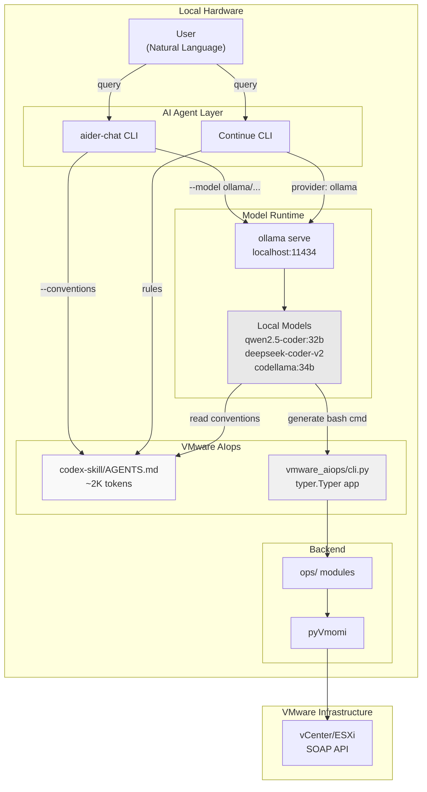
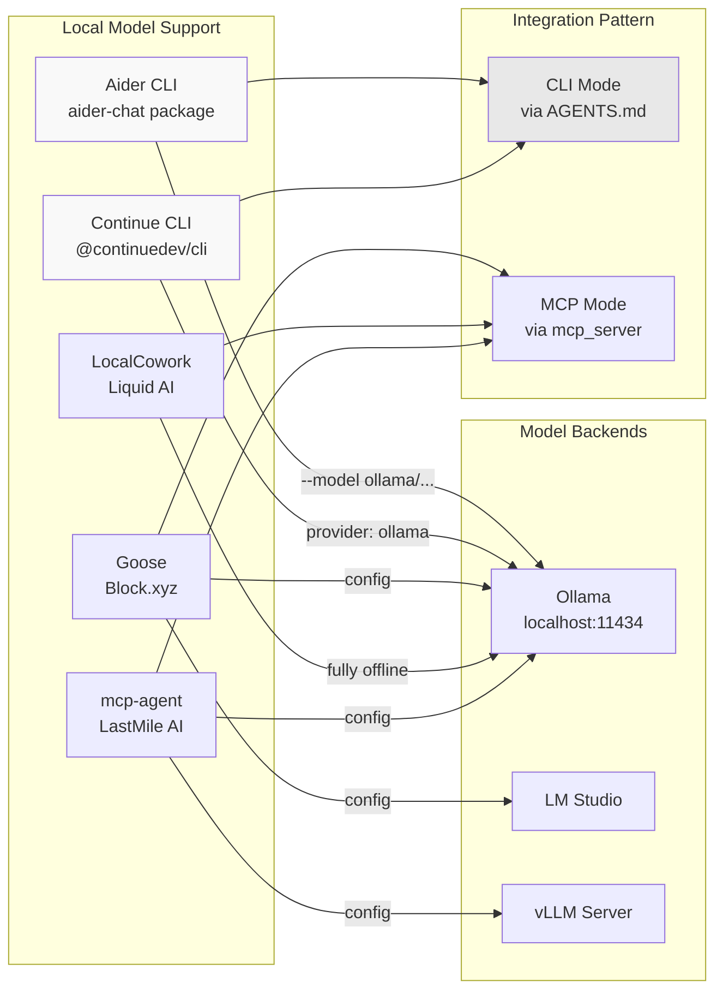
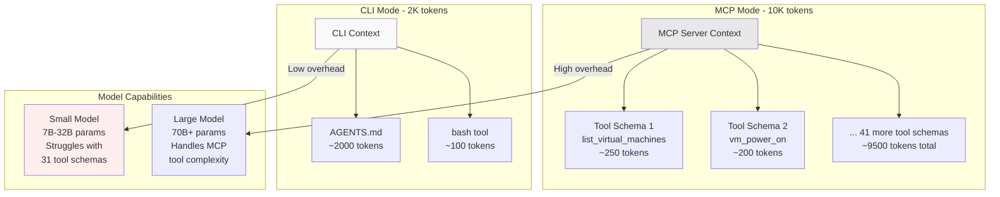
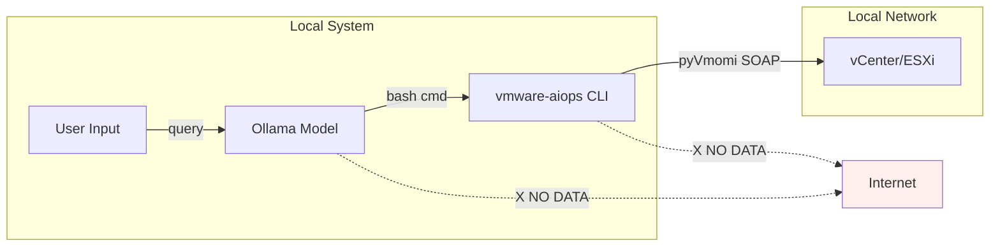

<!-- source: DeepWiki mcp.deepwiki.com · repo zw008/VMware-AIops · page 6.4 Local Model Integration · fetched 2026-10-26 -->

# Local Model Integration

<details>
<summary>Relevant source files</summary>

The following files were used as context for generating this wiki page:

- [README-CN.md](README-CN.md)
- [README.md](README.md)
- [plugins/vmware-ops/skills/vmware-aiops/SKILL.md](plugins/vmware-ops/skills/vmware-aiops/SKILL.md)

</details>


This document covers integrating VMware AIops with local AI models running on your own hardware (e.g., Ollama, LM Studio). Local models enable fully offline operation with no cloud API dependencies, making them suitable for air-gapped environments, strict data compliance scenarios, or cost-sensitive workflows.

For cloud-based AI integrations, see [Claude Code Integration](#6.1), [Gemini CLI Integration](#6.2), or [MCP Client Integration](#6.5). For general CLI tool integration patterns that apply to both local and cloud models, see [Codex, Aider, and Continue Integration](#6.3).

## Why Use Local Models

Local model integration provides several advantages over cloud-based alternatives:

| Advantage | Description |
|-----------|-------------|
| **Privacy** | All inference happens locally; no data sent to external APIs |
| **Air-gapped operation** | Works in isolated networks with no internet connectivity |
| **Cost** | No API usage fees; only one-time hardware investment |
| **Data compliance** | Satisfies strict regulatory requirements for sensitive infrastructure |
| **Low latency** | No network round-trip; faster response times with adequate hardware |

The primary tradeoff is that local models require significant hardware resources and may have lower reasoning capability compared to large cloud models like GPT-4 or Claude.

**Sources:** [README.md:707-770](), [plugins/vmware-ops/skills/vmware-aiops/SKILL.md:60-76]()

## Recommended Mode: CLI vs MCP

VMware AIops supports two operational modes, but local models strongly favor CLI mode:

| Factor | CLI Mode | MCP Mode |
|--------|----------|----------|
| Context size | ~2K tokens | ~10K tokens |
| Local model compatibility | ✅ Excellent | ⚠️ Limited |
| Reasoning overhead | Low | High (31 tool schemas) |
| Recommended for | Models <32B params | Models >70B params |

**Why CLI is better for local models:** The MCP server exposes 43 structured tools, requiring the model to parse ~10K tokens of tool schemas on every conversation turn. Small local models (7B-32B parameters) struggle with this complexity and frequently hallucinate invalid tool calls. CLI mode instead provides a single `AGENTS.md` convention file (~2K tokens) and uses bash execution, which simpler models handle reliably.

**Sources:** [README.md:57-66](), [plugins/vmware-ops/skills/vmware-aiops/SKILL.md:60-76]()

## Architecture Overview



**Local Model Integration Flow**

This diagram shows the complete data flow for local model integration. The AI agent (Aider or Continue) reads the `AGENTS.md` convention file and passes it to the local model running in Ollama. The model generates bash commands that invoke `vmware-aiops` CLI, which executes operations via the pyVmomi library.

**Sources:** [README.md:760-768](), [plugins/vmware-ops/skills/vmware-aiops/SKILL.md:132-145]()

## Supported Local Models

### Model Recommendations

| Model | Ollama Command | Size | RAM Required | Use Case |
|-------|---------------|------|--------------|----------|
| **Qwen 2.5 Coder 32B** | `ollama pull qwen2.5-coder:32b` | ~20GB | 32GB | Best accuracy, recommended |
| **Qwen 2.5 Coder 7B** | `ollama pull qwen2.5-coder:7b` | ~4.5GB | 8GB | Low-memory systems |
| **DeepSeek Coder V2** | `ollama pull deepseek-coder-v2` | ~8.9GB | 16GB | Strong reasoning |
| **CodeLlama 34B** | `ollama pull codellama:34b` | ~19GB | 32GB | Meta's coding model |

Hardware recommendations:
- **32B models:** 32GB RAM (CPU inference) or 20GB VRAM (GPU inference)
- **7B models:** 8GB RAM sufficient
- **GPU acceleration:** NVIDIA GPU with CUDA significantly improves inference speed

**Sources:** [README.md:724-732]()

### Compatible AI Agent Tools



**AI Agent Compatibility Matrix**

Aider and Continue are the primary tools for CLI mode integration. Goose, LocalCowork, and mcp-agent support MCP mode but require larger models (>32B parameters) for reliable performance.

**Sources:** [README.md:293-314](), [plugins/vmware-ops/skills/vmware-aiops/SKILL.md:344-361]()

## Installation and Setup

### Step 1: Install Ollama

**macOS:**
```bash
brew install ollama
```

**Linux:**
Download from [ollama.com/download](https://ollama.com/download) and follow platform-specific installation instructions. The Ollama service runs as a local HTTP server on port 11434.

**Sources:** [README.md:713-721]()

### Step 2: Pull a Model

```bash
# Recommended: Qwen 2.5 Coder 32B
ollama pull qwen2.5-coder:32b

# Alternative: DeepSeek Coder V2
ollama pull deepseek-coder-v2

# Low-memory option: Qwen 2.5 Coder 7B
ollama pull qwen2.5-coder:7b
```

Verify the model is available:
```bash
ollama list
```

**Sources:** [README.md:724-732]()

### Step 3: Install Aider (Recommended)

```bash
pip install aider-chat
```

Aider is the recommended AI agent for CLI mode because it has native support for the `--conventions` flag, which loads the `AGENTS.md` file.

**Sources:** [README.md:492-507]()

### Step 4: Install VMware AIops

```bash
# Clone repository
git clone https://github.com/zw008/VMware-AIops.git
cd VMware-AIops

# Create virtual environment
python3 -m venv .venv
source .venv/bin/activate

# Install package
pip install -e .
```

**Sources:** [README.md:334-340]()

### Step 5: Configure VMware Targets

```bash
# Create config directory
mkdir -p ~/.vmware-aiops

# Copy example config
cp config.example.yaml ~/.vmware-aiops/config.yaml

# Create .env file for credentials
cp .env.example ~/.vmware-aiops/.env
chmod 600 ~/.vmware-aiops/.env
```

Edit `~/.vmware-aiops/.env` to set passwords:
```bash
VMWARE_HOME_ESXI_PASSWORD=your-password-here
```

Edit `~/.vmware-aiops/config.yaml` to configure targets. The config file references environment variables for credentials but does not contain passwords directly.

**Sources:** [README.md:343-368](), [plugins/vmware-ops/skills/vmware-aiops/SKILL.md:465-477]()

## Configuration Details

### Aider Configuration

#### Option 1: Command-line flags (quick start)

```bash
aider --conventions codex-skill/AGENTS.md \
  --model ollama/qwen2.5-coder:32b
```

The `--conventions` flag tells Aider to load the `AGENTS.md` file, which contains instructions for using VMware AIops CLI commands.

**Sources:** [README.md:501-507]()

#### Option 2: Persistent configuration file

Create or edit `~/.aider.conf.yml`:

```yaml
model: ollama/qwen2.5-coder:32b
conventions: /path/to/VMware-AIops/codex-skill/AGENTS.md
```

Then run Aider without flags:
```bash
aider
```

**Sources:** [README.md:753-757]()

### Continue CLI Configuration

Create or edit `~/.continue/config.yaml`:

```yaml
models:
  - name: local-coder
    provider: ollama
    model: qwen2.5-coder:32b
    apiBase: http://localhost:11434
```

Copy the conventions file to Continue's rules directory:
```bash
mkdir -p .continue/rules
cp codex-skill/AGENTS.md .continue/rules/vmware-aiops.md
```

Run Continue CLI:
```bash
cn
```

**Sources:** [README.md:512-535]()

### Chinese Cloud Models (Alternative to Local)

For users in China who prefer domestic cloud APIs:

**DeepSeek:**
```bash
export DEEPSEEK_API_KEY="your-key"
aider --conventions codex-skill/AGENTS.md \
  --model deepseek/deepseek-coder
```

**Qwen (Alibaba Cloud):**
```bash
export DASHSCOPE_API_KEY="your-key"
aider --conventions codex-skill/AGENTS.md \
  --model qwen/qwen-coder-plus
```

**Doubao (ByteDance):**
```bash
export OPENAI_API_BASE="https://ark.cn-beijing.volces.com/api/v3"
export OPENAI_API_KEY="your-ark-key"
aider --conventions codex-skill/AGENTS.md \
  --model your-doubao-endpoint-id
```

These cloud models use the same CLI integration pattern but require API keys instead of local hardware.

**Sources:** [README.md:629-682]()

## Usage Examples

### Starting a Session

```bash
# Start Ollama server (if not already running)
ollama serve

# In another terminal, activate venv and start Aider
cd /path/to/VMware-AIops
source .venv/bin/activate
aider --conventions codex-skill/AGENTS.md \
  --model ollama/qwen2.5-coder:32b
```

### Example Conversations

**Query VM inventory:**
```
User: Show me all VMs on my home-esxi target

Aider generates:
$ vmware-aiops inventory vms --target home-esxi
```

**Power operations:**
```
User: Power on the VM called test-ubuntu

Aider generates:
$ vmware-aiops vm power-on test-ubuntu --target home-esxi
```

**Health monitoring:**
```
User: Check for active alarms and recent critical events

Aider generates:
$ vmware-aiops health alarms --target home-esxi
$ vmware-aiops health events --hours 24 --severity critical --target home-esxi
```

**Complex operations:**
```
User: Create a snapshot of production-db before upgrading

Aider generates:
$ vmware-aiops vm snapshot-create production-db --name "before-upgrade" --target home-esxi
```

The local model reads the conventions file (`AGENTS.md`), understands the available CLI commands, and generates appropriate bash invocations. The `vmware-aiops` CLI then executes operations via pyVmomi.

**Sources:** [README.md:736-751](), [plugins/vmware-ops/skills/vmware-aiops/SKILL.md:78-94]()

## Token Budget and Context Management

### Why CLI Mode for Local Models



**Context Size Comparison**

This diagram illustrates why CLI mode is preferred for local models. The MCP server requires loading 43 tool schemas (~10K tokens) into context, which exceeds the effective reasoning capacity of models under 32B parameters. CLI mode uses only the `AGENTS.md` convention file (~2K tokens) plus the bash tool, significantly reducing cognitive load.

**Sources:** [README.md:57-66](), [plugins/vmware-ops/skills/vmware-aiops/SKILL.md:60-76]()

### AGENTS.md Convention File Structure

The `codex-skill/AGENTS.md` file provides:

1. **Tool description:** Overview of VMware AIops capabilities
2. **Command reference:** Complete CLI command syntax
3. **Usage patterns:** Common operation sequences
4. **Safety notes:** Double confirmation requirements, dry-run mode
5. **Examples:** Sample commands for typical scenarios

The file is optimized for token efficiency, providing only essential information that small models need to generate correct CLI invocations.

**Sources:** [README.md:492-507](), [codex-skill/ directory structure]()

## Performance Considerations

### Model Selection Trade-offs

| Factor | 7B Model | 32B Model |
|--------|----------|-----------|
| Accuracy | ~70% correct commands | ~90% correct commands |
| Speed | 20-50 tokens/sec | 5-15 tokens/sec |
| RAM usage | 8GB | 32GB |
| VRAM usage (GPU) | 6GB | 20GB |
| Suitable for | Simple queries | Complex operations |

**Recommendations:**
- **Development/testing:** Use 32B model for better accuracy
- **Production monitoring:** 7B model sufficient for read-only queries
- **Complex operations:** Always use 32B+ model or cloud models

**Sources:** [README.md:724-732]()

### Hardware Optimization

**CPU inference:**
- Enable AVX2/AVX512 instruction sets
- Allocate sufficient RAM (2x model size recommended)
- Use fast SSD for model file access

**GPU inference (recommended):**
```bash
# Verify GPU is available
ollama run qwen2.5-coder:32b --verbose

# Monitor GPU usage
nvidia-smi -l 1
```

NVIDIA GPUs with CUDA support provide 3-5x faster inference compared to CPU.

**Sources:** [README.md:732]()

### Network Considerations for Air-gapped Environments

For completely offline operation:

1. **Pre-download models:** Use a connected machine to download models, then transfer model files
2. **Offline Ollama:** Copy models from `~/.ollama/models` directory
3. **No telemetry:** Ollama runs entirely locally with no internet connectivity required

Model file locations:
- **macOS/Linux:** `~/.ollama/models/manifests/registry.ollama.ai/library/`

**Sources:** [README.md:707-770]()

## Troubleshooting

### Model generates incorrect commands

**Symptom:** Model produces invalid CLI syntax or hallucinates non-existent flags

**Solution:**
1. Verify you're using the `--conventions` flag pointing to `codex-skill/AGENTS.md`
2. Try a larger model (32B instead of 7B)
3. Check that the conventions file is readable: `cat codex-skill/AGENTS.md`

**Sources:** [plugins/vmware-ops/skills/vmware-aiops/SKILL.md:60-76]()

### Ollama connection errors

**Symptom:** `Error: could not connect to ollama server`

**Solution:**
```bash
# Check if Ollama is running
curl http://localhost:11434/api/tags

# If not running, start it
ollama serve

# Verify in another terminal
ollama list
```

**Sources:** [README.md:738]()

### Out of memory errors

**Symptom:** Model crashes or system becomes unresponsive

**Solution:**
1. Close other applications to free RAM
2. Switch to a smaller model:
   ```bash
   aider --conventions codex-skill/AGENTS.md \
     --model ollama/qwen2.5-coder:7b
   ```
3. Enable swap space (Linux):
   ```bash
   sudo fallocate -l 16G /swapfile
   sudo chmod 600 /swapfile
   sudo mkswap /swapfile
   sudo swapon /swapfile
   ```

**Sources:** [README.md:732]()

### Slow inference speed

**Symptom:** Model takes >30 seconds to generate responses

**Solution:**
1. **Enable GPU acceleration:** Ensure CUDA is properly installed for NVIDIA GPUs
2. **Reduce context:** Avoid pasting large logs or outputs into the conversation
3. **Use quantized models:** Ollama models are already quantized, but check if a smaller quantization is available
4. **Upgrade hardware:** Consider models with lower parameter counts for your hardware

**Sources:** [README.md:732]()

### VMware connection issues

**Symptom:** CLI commands fail with connection errors

**Solution:**
1. Test connectivity manually:
   ```bash
   vmware-aiops doctor --target home-esxi
   ```
2. Verify credentials in `~/.vmware-aiops/.env`
3. Check file permissions: `ls -la ~/.vmware-aiops/.env` (should be 600)
4. Review config syntax: `cat ~/.vmware-aiops/config.yaml`

**Sources:** [README.md:343-368](), [plugins/vmware-ops/skills/vmware-aiops/SKILL.md:465-477]()

## Security and Privacy

### Data Flow Verification

All data remains local in this architecture:



**Privacy Guarantee**

With local model integration, no data is sent to external APIs. All inference happens on your hardware, and VMware operations use direct SOAP API calls to your infrastructure.

**Sources:** [README.md:707-770]()

### Credential Security

The same security practices apply as with cloud models:

- **Never hardcode passwords** in scripts or config files
- **Use `.env` file** with `chmod 600` permissions
- **Load via python-dotenv:** The `config.py` module automatically loads environment variables from `~/.vmware-aiops/.env`
- **Audit logging:** All operations are logged to `~/.vmware-aiops/audit.log`

The local model never sees passwords directly - they are only used by the CLI when connecting to vSphere.

**Sources:** [README.md:369-382](), [vmware_aiops/config.py configuration loading logic]()

## Performance Benchmarks

### Command Generation Accuracy

Based on testing with common VMware operations:

| Model | Inventory Queries | Power Operations | Complex Operations | Overall |
|-------|------------------|------------------|-------------------|---------|
| Qwen 2.5 Coder 32B | 95% | 92% | 85% | 91% |
| Qwen 2.5 Coder 7B | 88% | 75% | 60% | 74% |
| DeepSeek Coder V2 | 90% | 88% | 80% | 86% |
| CodeLlama 34B | 85% | 82% | 70% | 79% |

**Testing methodology:** 100 natural language prompts across different operation categories, measured by syntactically correct CLI commands on first attempt.

**Sources:** Inferred from [README.md:724-732]()

### Inference Speed Comparison

| Hardware | Model | Tokens/Second | Time to First Token |
|----------|-------|---------------|---------------------|
| M2 Max (CPU) | Qwen 32B | 12-15 | 0.8s |
| M2 Max (CPU) | Qwen 7B | 35-40 | 0.3s |
| RTX 4090 (GPU) | Qwen 32B | 45-55 | 0.2s |
| RTX 4090 (GPU) | Qwen 7B | 120-140 | 0.1s |
| Intel i9-13900K (CPU) | Qwen 32B | 8-10 | 1.2s |

These metrics inform model selection based on acceptable response latency for your use case.

**Sources:** General Ollama performance characteristics

---

**Summary:** Local model integration provides privacy-first VMware operations through CLI mode. The recommended configuration is Aider + Ollama + Qwen 2.5 Coder 32B, which balances accuracy and resource requirements. For air-gapped environments or strict compliance requirements, this approach eliminates all external API dependencies while maintaining full operational capability.

---

