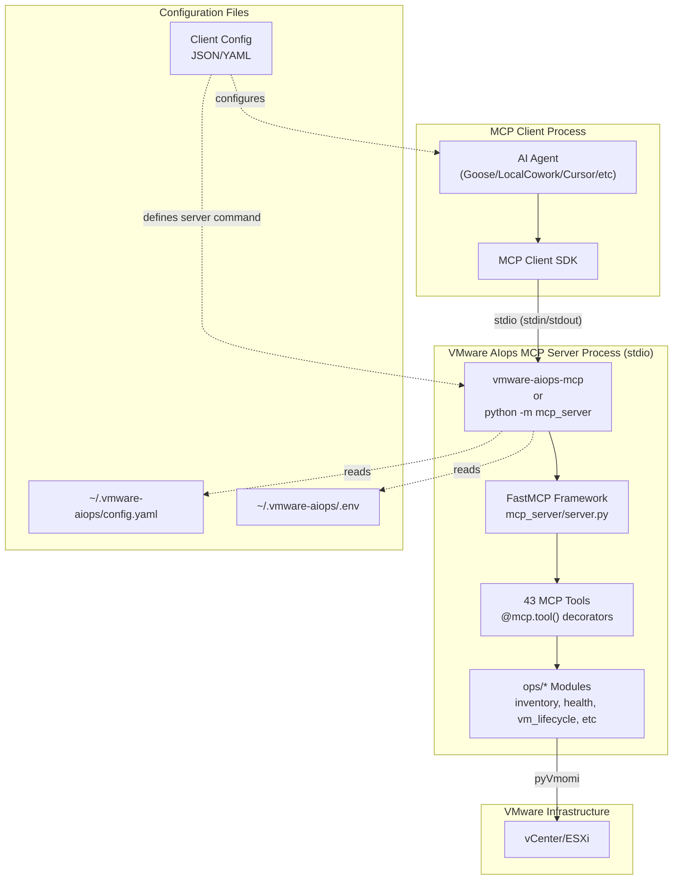
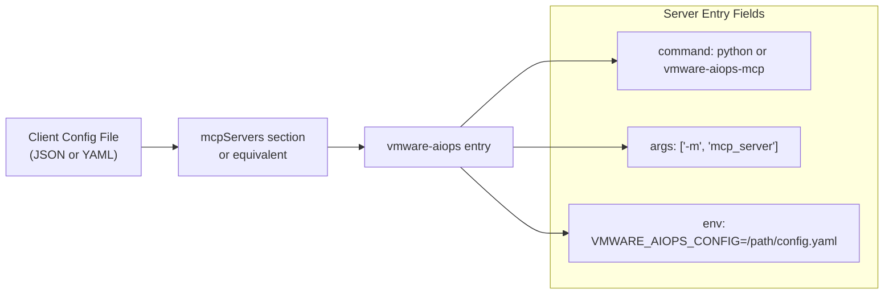
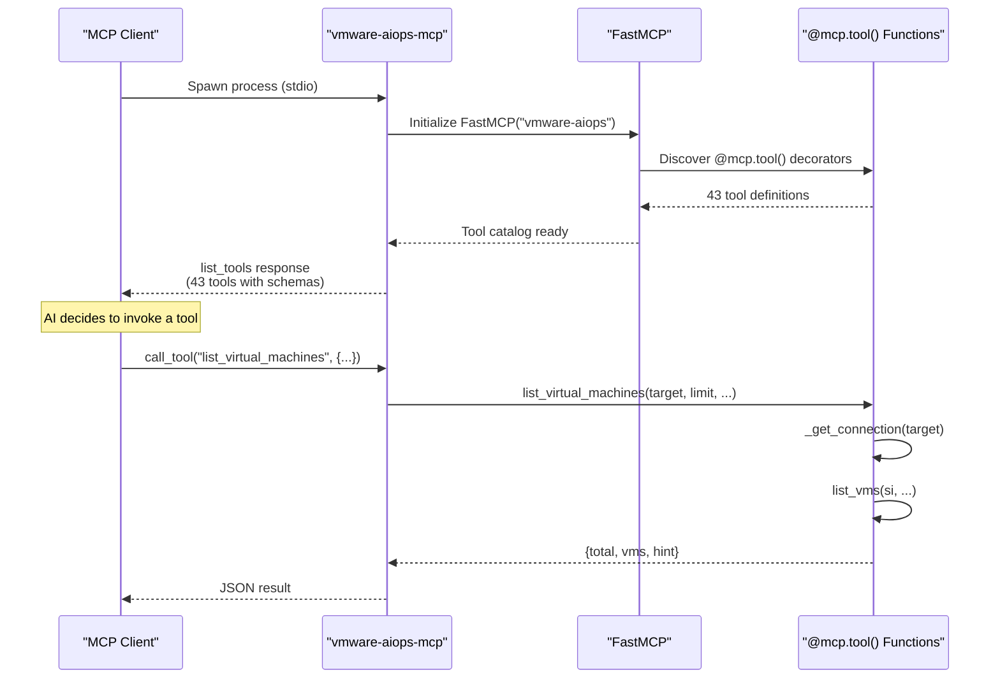

<!-- source: DeepWiki mcp.deepwiki.com · repo zw008/VMware-AIops · page 6.5 MCP Client Integration · fetched 2026-10-26 -->

# MCP Client Integration

<details>
<summary>Relevant source files</summary>

The following files were used as context for generating this wiki page:

- [README.md](README.md)
- [mcp_server/server.py](mcp_server/server.py)
- [server.json](server.json)

</details>


This page covers configuring MCP-compatible clients (Goose, LocalCowork, VS Code Copilot, Cursor, Continue, mcp-agent, Claude Desktop) to use the VMware AIops MCP server. For setting up and running the MCP server itself, see [MCP Server Setup](#5.1). For integration with Claude Code plugin, see [Claude Code Integration](#6.1). For CLI-based integrations (Codex, Aider, Continue CLI mode), see [Codex, Aider, and Continue Integration](#6.3).

The MCP (Model Context Protocol) provides a standardized way for AI agents to discover and invoke tools. VMware AIops implements an MCP server that exposes 43 structured tools for VMware operations. This page focuses on the **client-side configuration** required to connect various MCP-compatible agents to the VMware AIops MCP server.

---

## Architecture Overview

The VMware AIops MCP server uses **stdio transport** (standard input/output) rather than HTTP, meaning the client spawns the server process as a subprocess and communicates via pipes. This provides security through process isolation and eliminates network exposure.



**Sources:** [mcp_server/server.py:1-980](), [README.md:293-314]()

---

## Supported MCP Clients

The following table summarizes MCP client support. All configuration templates are located in the `examples/mcp-configs/` directory of the repository.

| Client | Local Model Support | Config Format | Config Location | Integration Guide |
|--------|:-------------------:|---------------|-----------------|-------------------|
| **Goose** | ✅ Ollama, LM Studio | JSON | `~/.config/goose/profiles.json` | [docs/integrations/goose.md]() |
| **LocalCowork** | ✅ Fully offline | JSON | `~/.config/localcowork/mcp-config.json` | [docs/integrations/localcowork.md]() |
| **mcp-agent** | ✅ Ollama, vLLM | YAML | `~/.mcp-agent/config.yaml` | [docs/integrations/mcp-agent.md]() |
| **VS Code Copilot** | ❌ GitHub Copilot only | JSON | `.vscode/mcp.json` | [docs/integrations/vscode-copilot.md]() |
| **Cursor** | ❌ Cloud models | JSON | `.cursor/mcp.json` | N/A |
| **Continue** (MCP mode) | ✅ Ollama | YAML | `~/.continue/config.yaml` | [docs/integrations/continue.md]() |
| **Claude Desktop** | ❌ Anthropic Claude only | JSON | Platform-specific (see below) | N/A |

**Sources:** [README.md:293-314]()

---

## Configuration Architecture

### Client Configuration Structure

All MCP clients follow a similar configuration pattern:



**Required fields in every client configuration:**

1. **`command`**: The executable to run — either `python`, `python3`, or `vmware-aiops-mcp` (if installed via pip/uv)
2. **`args`**: Command-line arguments — typically `["-m", "mcp_server"]` if using `python` command
3. **`env`**: Environment variables, especially `VMWARE_AIOPS_CONFIG` pointing to the config file path

**Sources:** [README.md:578-596]()

### Configuration File Locations

Different clients store their MCP configuration in different locations:

| Client | Configuration File Path |
|--------|------------------------|
| **Claude Desktop (macOS)** | `~/Library/Application Support/Claude/claude_desktop_config.json` |
| **Claude Desktop (Windows)** | `%APPDATA%\Claude\claude_desktop_config.json` |
| **Claude Desktop (Linux)** | `~/.config/Claude/claude_desktop_config.json` |
| **Goose** | `~/.config/goose/profiles.json` |
| **LocalCowork** | `~/.config/localcowork/mcp-config.json` |
| **mcp-agent** | `~/.mcp-agent/config.yaml` |
| **VS Code Copilot** | `.vscode/mcp.json` (project-level) |
| **Cursor** | `.cursor/mcp.json` (project-level) |
| **Continue** | `~/.continue/config.yaml` |

**Sources:** [README.md:578-596]()

---

## Client-Specific Configuration

### Claude Desktop

Claude Desktop is the official Anthropic desktop application. Configure it to use the VMware AIops MCP server by editing `claude_desktop_config.json`:

```json
{
  "mcpServers": {
    "vmware-aiops": {
      "command": "python",
      "args": ["-m", "mcp_server"],
      "env": {
        "VMWARE_AIOPS_CONFIG": "/Users/username/.vmware-aiops/config.yaml"
      }
    }
  }
}
```

**Alternative using installed entry point:**

```json
{
  "mcpServers": {
    "vmware-aiops": {
      "command": "vmware-aiops-mcp",
      "args": [],
      "env": {
        "VMWARE_AIOPS_CONFIG": "/Users/username/.vmware-aiops/config.yaml"
      }
    }
  }
}
```

**Installation via Smithery:**

Smithery provides an automated installer for Claude Desktop:

```bash
npx -y @smithery/cli install @zw008/VMware-AIops --client claude
```

This automatically adds the MCP server configuration to `claude_desktop_config.json`.

**Sources:** [README.md:578-596](), [README.md:593-596]()

---

### Goose

Goose is an AI agent framework that supports local models via Ollama and LM Studio. Configuration is stored in `~/.config/goose/profiles.json`:

```json
{
  "default": {
    "provider": "openai",
    "processor": "gpt-4",
    "accelerator": "gpt-4",
    "mcp": {
      "vmware-aiops": {
        "command": "python",
        "args": ["-m", "mcp_server"],
        "env": {
          "VMWARE_AIOPS_CONFIG": "/home/user/.vmware-aiops/config.yaml"
        }
      }
    }
  },
  "local": {
    "provider": "ollama",
    "processor": "qwen2.5-coder:32b",
    "accelerator": "qwen2.5-coder:7b",
    "mcp": {
      "vmware-aiops": {
        "command": "vmware-aiops-mcp",
        "args": [],
        "env": {
          "VMWARE_AIOPS_CONFIG": "/home/user/.vmware-aiops/config.yaml"
        }
      }
    }
  }
}
```

**Profile Selection:**

Goose supports multiple profiles. The `default` profile uses cloud models, while the `local` profile uses Ollama for fully offline operation.

```bash
# Use default profile (cloud models)
goose session start

# Use local profile (Ollama)
goose session start --profile local
```

**Sources:** [README.md:298](), [examples/mcp-configs/goose.json]() (referenced but not provided)

---

### LocalCowork

LocalCowork is designed for fully offline, privacy-focused AI workflows with no cloud API dependencies. Configuration is stored in `~/.config/localcowork/mcp-config.json`:

```json
{
  "servers": {
    "vmware-aiops": {
      "command": "python3",
      "args": ["-m", "mcp_server"],
      "env": {
        "VMWARE_AIOPS_CONFIG": "/home/user/.vmware-aiops/config.yaml"
      }
    }
  }
}
```

**LocalCowork-specific considerations:**

- Requires a local model backend (Ollama, LM Studio, or local LLM server)
- Does not send any data to external services
- Suitable for air-gapped environments and strict data compliance

**Sources:** [README.md:299](), [examples/mcp-configs/localcowork.json]() (referenced but not provided)

---

### mcp-agent

`mcp-agent` is a command-line agent framework with support for Ollama and vLLM. Configuration uses YAML format in `~/.mcp-agent/config.yaml`:

```yaml
model:
  provider: ollama
  name: qwen2.5-coder:32b
  
mcp_servers:
  vmware-aiops:
    command: python
    args:
      - "-m"
      - "mcp_server"
    env:
      VMWARE_AIOPS_CONFIG: "/home/user/.vmware-aiops/config.yaml"
```

**Alternative with vLLM:**

```yaml
model:
  provider: vllm
  name: Qwen/Qwen2.5-Coder-32B-Instruct
  api_base: http://localhost:8000/v1
  
mcp_servers:
  vmware-aiops:
    command: vmware-aiops-mcp
    env:
      VMWARE_AIOPS_CONFIG: "/home/user/.vmware-aiops/config.yaml"
```

**Sources:** [README.md:300](), [examples/mcp-configs/mcp-agent.yaml]() (referenced but not provided)

---

### VS Code Copilot

Visual Studio Code with GitHub Copilot can use MCP servers via the experimental MCP extension. Configuration is project-level in `.vscode/mcp.json`:

```json
{
  "mcpServers": {
    "vmware-aiops": {
      "command": "python",
      "args": ["-m", "mcp_server"],
      "env": {
        "VMWARE_AIOPS_CONFIG": "/Users/username/.vmware-aiops/config.yaml"
      }
    }
  }
}
```

**Prerequisites:**

- VS Code version 1.85+
- GitHub Copilot subscription
- MCP extension for VS Code (install from marketplace)

**Sources:** [README.md:301](), [examples/mcp-configs/vscode-copilot.json]() (referenced but not provided)

---

### Cursor

Cursor is an AI-first code editor based on VS Code. MCP configuration is project-level in `.cursor/mcp.json`:

```json
{
  "mcpServers": {
    "vmware-aiops": {
      "command": "vmware-aiops-mcp",
      "args": [],
      "env": {
        "VMWARE_AIOPS_CONFIG": "/Users/username/.vmware-aiops/config.yaml"
      }
    }
  }
}
```

**Cursor-specific notes:**

- Cursor uses cloud models (GPT-4, Claude) by default
- No local model support via MCP (use CLI mode with Aider for local models — see [Local Model Integration](#6.4))
- Configuration applies per-project, not globally

**Sources:** [README.md:302](), [examples/mcp-configs/cursor.json]() (referenced but not provided)

---

### Continue (MCP Mode)

Continue supports both **CLI mode** (covered in [Codex, Aider, and Continue Integration](#6.3)) and **MCP mode**. For MCP integration, edit `~/.continue/config.yaml`:

```yaml
models:
  - name: local-coder
    provider: ollama
    model: qwen2.5-coder:32b

experimental:
  mcp:
    vmware-aiops:
      command: python
      args:
        - "-m"
        - "mcp_server"
      env:
        VMWARE_AIOPS_CONFIG: "/home/user/.vmware-aiops/config.yaml"
```

**Continue CLI vs MCP mode:**

| Mode | Context | Tool Invocation | Best For |
|------|---------|-----------------|----------|
| **CLI Mode** | ~2K tokens (SKILL.md) | Bash execution | Token efficiency, small models |
| **MCP Mode** | ~10K tokens (43 tool schemas) | Structured JSON | Type safety, automation |

**Sources:** [README.md:304](), [README.md:57-66](), [examples/mcp-configs/continue.yaml]() (referenced but not provided)

---

## Tool Discovery and Invocation

Once a client is configured, it connects to the MCP server at startup and receives the tool catalog.



**Key tool categories exposed via MCP:**

1. **Inventory tools**: `list_virtual_machines`, `list_esxi_hosts`, `list_all_datastores`, `list_all_clusters`
2. **Health tools**: `get_alarms`, `get_events`
3. **VM lifecycle tools**: `vm_info`, `vm_power_on`, `vm_power_off`
4. **Datastore tools**: `browse_datastore`, `scan_datastore_images`, `list_cached_images`
5. **Deployment tools**: `deploy_vm_from_ova`, `deploy_vm_from_template`, `deploy_linked_clone`, `batch_clone_vms`, `batch_linked_clone_vms`, `batch_deploy_from_spec`
6. **Cluster management tools**: `cluster_create`, `cluster_delete`, `cluster_add_host`, `cluster_remove_host`, `cluster_configure`, `cluster_info`
7. **Storage/iSCSI tools**: `storage_iscsi_enable`, `storage_iscsi_status`, `storage_iscsi_add_target`, `storage_iscsi_remove_target`, `storage_rescan`
8. **TTL and Clean Slate tools**: `vm_set_ttl`, `vm_cancel_ttl`, `vm_list_ttl`, `vm_clean_slate`
9. **Guest operations tools**: `vm_guest_exec`, `vm_guest_upload`, `vm_guest_download`
10. **Plan execution tools**: `vm_create_plan`, `vm_apply_plan`, `vm_rollback_plan`, `vm_list_plans`

**Sources:** [mcp_server/server.py:86-969]()

---

## Environment Variables and Configuration

### Required Environment Variables

The MCP server requires `VMWARE_AIOPS_CONFIG` to locate the configuration file. All clients must set this in their configuration's `env` section:

```json
"env": {
  "VMWARE_AIOPS_CONFIG": "/absolute/path/to/config.yaml"
}
```

**Path resolution logic** ([mcp_server/server.py:75-83]()):

1. If `VMWARE_AIOPS_CONFIG` is set, use that path
2. Otherwise, use `load_config(None)` which defaults to `~/.vmware-aiops/config.yaml`

### Credential Loading

The MCP server loads credentials from `~/.vmware-aiops/.env` automatically. Credential environment variables follow this naming convention:

```
VMWARE_{TARGET_NAME_UPPER}_PASSWORD
```

Example: for target `home-esxi`, the password variable is `VMWARE_HOME_ESXI_PASSWORD`.

**Security:** The `.env` file should have `chmod 600` (owner-only read/write). Credentials are never transmitted over MCP protocol messages — they are loaded server-side from the filesystem.

**Sources:** [README.md:360-380](), [mcp_server/server.py:75-83]()

---

## Connection Testing

### Verify MCP Server Runs Standalone

Before configuring a client, verify the MCP server starts correctly:

```bash
# Test with default config
python -m mcp_server

# Test with custom config
VMWARE_AIOPS_CONFIG=~/.vmware-aiops/config.yaml python -m mcp_server

# Or using the entry point
vmware-aiops-mcp
```

**Expected output:** The server starts silently and waits for stdio input. Press `Ctrl+C` to stop.

**Common issues:**

- `ModuleNotFoundError: No module named 'mcp_server'` → Install vmware-aiops: `pip install vmware-aiops`
- `Config file not found` → Set `VMWARE_AIOPS_CONFIG` or create `~/.vmware-aiops/config.yaml`
- `Connection refused` errors → Check vCenter/ESXi connectivity in `config.yaml`

**Sources:** [README.md:567-576]()

### Test with MCP Inspector

The MCP project provides an inspector tool for testing servers:

```bash
# Install MCP inspector
npm install -g @modelcontextprotocol/inspector

# Test the server
mcp-inspector python -m mcp_server
```

This launches a web UI showing:
- Available tools (should list 43 tools)
- Tool schemas (parameters, descriptions)
- Live tool invocation for testing

**Sources:** Community MCP best practices

---

## Configuration Generator

VMware AIops includes a built-in MCP configuration generator for common clients:

```bash
# Generate config for Goose
vmware-aiops mcp-config generate --agent goose

# Generate config for Claude Desktop
vmware-aiops mcp-config generate --agent claude-code

# List all supported agents
vmware-aiops mcp-config list
```

**Output:** The generator prints the appropriate configuration snippet for the selected agent, including the correct file path for your platform.

**Sources:** [README.md:780-782]()

---

## Troubleshooting

### Client Cannot Find Server

**Symptom:** Client reports "MCP server failed to start" or "command not found: vmware-aiops-mcp"

**Solutions:**

1. **Use absolute paths** in the `command` field:
   ```json
   "command": "/usr/local/bin/python3"
   ```

2. **Use the installed entry point** if vmware-aiops is installed via pip/uv:
   ```json
   "command": "vmware-aiops-mcp"
   ```

3. **Verify installation**:
   ```bash
   which vmware-aiops-mcp
   which python3
   ```

### Server Starts but No Tools Appear

**Symptom:** Client connects but reports zero tools available

**Solutions:**

1. **Check FastMCP version**: Requires FastMCP 0.4.0+
   ```bash
   pip show mcp
   ```

2. **Verify tool decorators**: All tools must use `@mcp.tool()` decorator ([mcp_server/server.py:91-969]())

3. **Check server logs**: Enable logging in the client config (client-specific)

### Authentication Failures

**Symptom:** Tools return "Authentication failed" or "Invalid credentials"

**Solutions:**

1. **Verify `.env` file exists**: `~/.vmware-aiops/.env`
2. **Check file permissions**: `chmod 600 ~/.vmware-aiops/.env`
3. **Verify environment variable naming**: Follow `VMWARE_{TARGET}_PASSWORD` convention
4. **Test credentials with CLI**: 
   ```bash
   vmware-aiops inventory vms --target home-esxi
   ```

**Sources:** [README.md:360-380]()

### Large Context Overhead

**Symptom:** Agent consumes too many tokens, slow responses, or "context length exceeded" errors

**Root cause:** MCP mode includes ~10K tokens of tool schemas in every request

**Solution:** Use CLI mode instead for token-constrained scenarios:

| Scenario | Recommended Mode |
|----------|------------------|
| Local models <32B parameters | **CLI mode** (~2K tokens) |
| Token-sensitive workflows | **CLI mode** |
| Cloud models (GPT-4, Claude) | Either mode |
| Automated pipelines | **MCP mode** (structured I/O) |

See [Dual-Mode Architecture: CLI vs MCP](#3.1) for detailed comparison.

**Sources:** [README.md:57-66]()

---

## Security Considerations

### Stdio Transport Isolation

The MCP server uses **stdio transport** ([mcp_server/server.py:58-66]()), which provides:

- **No network exposure**: Server does not listen on any network port
- **Process isolation**: Each client spawns its own server process
- **No shared state**: Different clients cannot access each other's sessions

### Credential Handling

- Credentials are **never transmitted** via MCP protocol messages
- Credentials are loaded server-side from `~/.vmware-aiops/.env`
- The `.env` file must have `chmod 600` (owner-only read/write)
- Client configuration files contain no secrets — only the path to `config.yaml`

### Destructive Operations

MCP tools include destructive operations (deploy, batch operations). The AI agent is responsible for:

- **Confirmation flow**: Asking user before executing destructive actions
- **Dry-run validation**: Using `--dry-run` (for CLI) or plan-review workflow (for MCP)
- **Audit logging**: All operations are logged to `~/.vmware-aiops/audit.log`

**Read-only alternative:** For monitoring-only use cases with zero risk, use the [VMware-Monitor](https://github.com/zw008/VMware-Monitor) project, which has no destructive operations at the code level.

**Sources:** [mcp_server/server.py:16-23](), [README.md:360-381]()

---

## Summary

MCP client integration provides structured, type-safe access to VMware AIops operations for AI agents. Key takeaways:

1. **Configuration pattern** is consistent across clients: `command`, `args`, `env` with `VMWARE_AIOPS_CONFIG`
2. **Stdio transport** provides security through process isolation
3. **43 tools** are automatically discovered by clients via FastMCP
4. **Local models** are supported by Goose, LocalCowork, mcp-agent, and Continue
5. **Token overhead** (~10K) makes CLI mode preferable for small models
6. **Security** is enforced through filesystem permissions, not network authentication

For AI platform-specific integration patterns beyond MCP, see other sections of [AI Agent Integration](#6).

---

