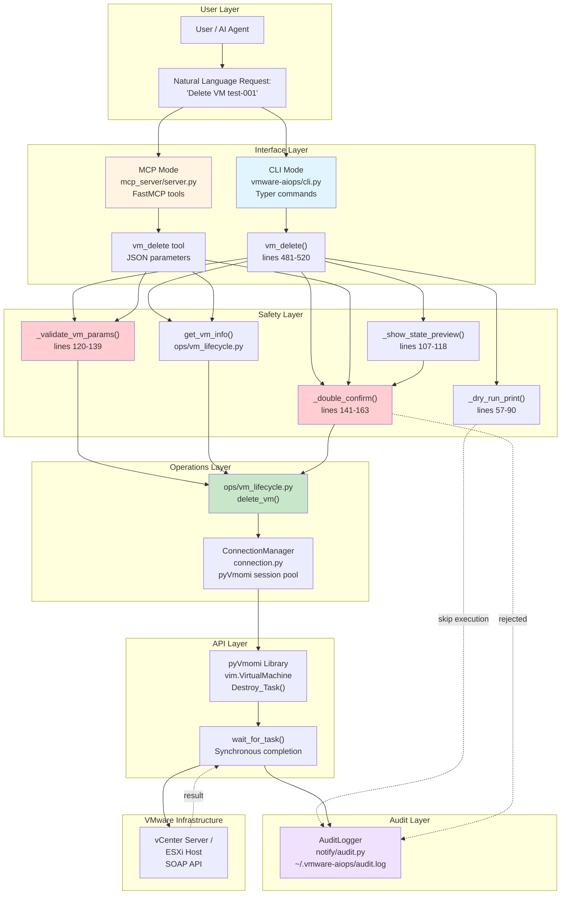
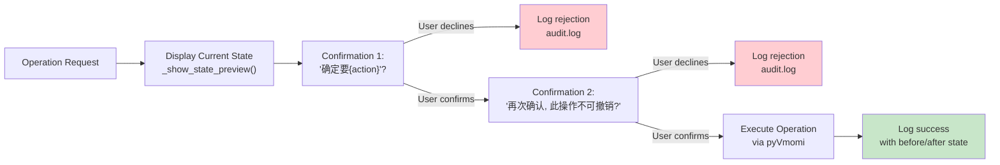
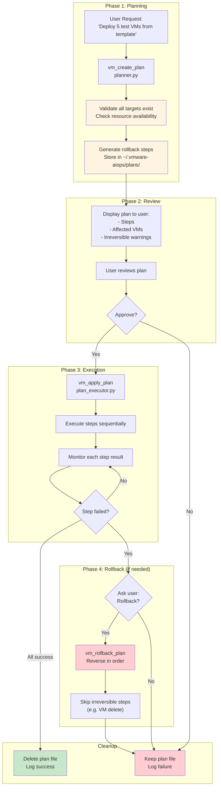
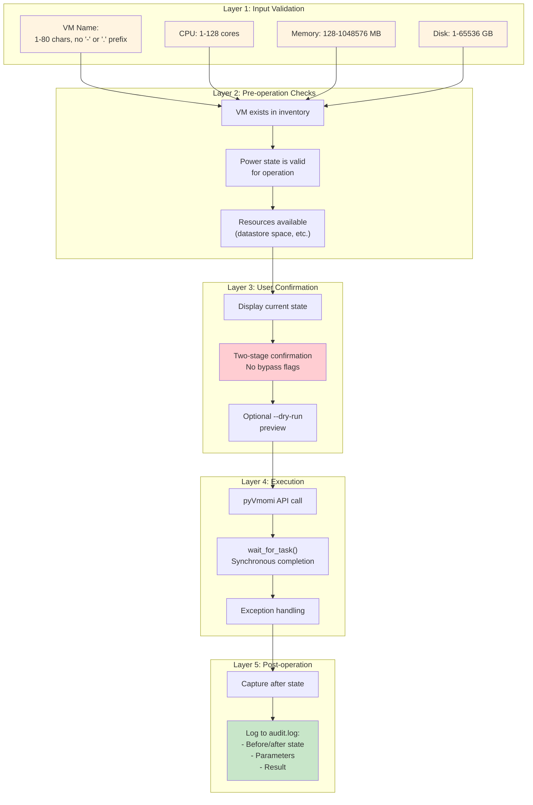

<!-- source: DeepWiki mcp.deepwiki.com · repo zw008/VMware-AIops · page 7 Operations Guide · fetched 2026-10-26 -->

# Operations Guide

<details>
<summary>Relevant source files</summary>

The following files were used as context for generating this wiki page:

- [README.md](README.md)
- [skills/vmware-aiops/SKILL.md](skills/vmware-aiops/SKILL.md)
- [vmware_aiops/cli.py](vmware_aiops/cli.py)

</details>


This guide covers all operational capabilities of VMware AIops for managing VMware vCenter and ESXi infrastructure. It provides an overview of operation categories, execution modes, safety mechanisms, and common workflows that apply across all operation types.

For step-by-step instructions on specific operations, see the child pages: [Inventory and Monitoring](#7.1), [VM Lifecycle Management](#7.2), [VM Deployment](#7.3), [Guest Operations](#7.4), [Cluster Management](#7.5), [Storage and iSCSI Management](#7.6), [Datastore Browser](#7.7), and [Advanced Features](#7.8).

For understanding the architectural design behind these operations, see [Core Concepts](#3) and [System Architecture](#9).

## Operation Categories

VMware AIops organizes operations into eight functional domains, each implemented as a separate Python module in the `ops/` directory:

| Category | Module | Scope | Destructive? | Sub-page |
|----------|--------|-------|:------------:|----------|
| **Inventory & Monitoring** | `ops/inventory.py`, `ops/health.py` | List VMs/hosts/datastores/clusters, query alarms/events | No | [7.1](#7.1) |
| **VM Lifecycle** | `ops/vm_lifecycle.py` | Power operations, create/delete, reconfigure, snapshots, clone, migrate | Yes | [7.2](#7.2) |
| **VM Deployment** | `ops/vm_deploy.py` | OVA deployment, template cloning, linked clones, batch operations | Yes | [7.3](#7.3) |
| **Guest Operations** | `ops/guest_ops.py` | Execute commands, upload/download files inside VM guest OS | No* | [7.4](#7.4) |
| **Cluster Management** | `ops/cluster_mgmt.py` | Create/delete clusters, add/remove hosts, configure HA/DRS | Yes | [7.5](#7.5) |
| **Storage & iSCSI** | `ops/iscsi_config.py` | Enable iSCSI, add/remove targets, rescan storage | Yes | [7.6](#7.6) |
| **Datastore Browser** | `ops/datastore_browser.py` | Browse files, scan for deployable images, manage registry | No | [7.7](#7.7) |
| **Advanced Features** | `ops/vsan.py`, `ops/aria_ops.py`, `ops/vks.py` | vSAN management, Aria Operations analytics, Kubernetes clusters | Mixed | [7.8](#7.8) |

\* Guest operations modify guest OS state but not VM infrastructure.

**Sources:** [README.md:95-264](), [skills/vmware-aiops/SKILL.md:149-304]()

## Operational Modes

All operations can be executed through two modes, each optimized for different use cases:

### CLI Mode

The CLI provides direct command-line access to all operations via the `vmware-aiops` command. Best for:
- Human-in-the-loop operations requiring visual confirmation
- Token-efficient workflows with local/small AI models (~2K context tokens)
- Interactive troubleshooting and exploration
- Operations triggered by AI agents reading `SKILL.md` documentation

**Entry Point:** [vmware_aiops/cli.py:18-22]() - `typer.Typer` application  
**Invocation:** `vmware-aiops <category> <operation> [options]`

### MCP Mode

The MCP server exposes operations as structured tools via Model Context Protocol. Best for:
- Automated pipelines and agent chaining
- Type-safe parameter validation with JSON schemas
- Operations requiring structured output parsing
- Integration with MCP-compatible AI platforms (Claude Code, Cursor, Goose, etc.)

**Entry Point:** `mcp_server/server.py` - FastMCP server with 43 tool definitions  
**Invocation:** MCP clients call tools via stdio transport with JSON-RPC

**Mode Selection:** See [Dual-Mode Architecture](#3.1) for detailed comparison and selection criteria.

**Sources:** [README.md:57-66](), [skills/vmware-aiops/SKILL.md:60-76]()

## Operation Flow Architecture



**Diagram: Operation Execution Flow from User Request to vSphere API**

This diagram shows how a destructive operation (VM deletion) flows through the system's safety layers. Non-destructive operations (inventory queries, monitoring) skip the Safety Layer and go directly from Interface → Operations → API layers.

**Sources:** [vmware_aiops/cli.py:481-521](), [vmware_aiops/cli.py:141-163](), [vmware_aiops/cli.py:57-90]()

## Common Operation Patterns

### Double Confirmation Workflow

All destructive operations require **two sequential confirmations** with no bypass option. This is implemented at the CLI level via `_double_confirm()` and enforced for MCP tools through the tool schema design.



**Diagram: Double Confirmation Flow for Destructive Operations**

**Implementation Details:**
- **Location:** [vmware_aiops/cli.py:141-163]()
- **Covered Operations:** power-off, delete, reconfigure, snapshot-revert/delete, clone, migrate, cluster operations, storage operations
- **Rejection Logging:** Both confirmation stages log rejection events with `result="rejected"` for security audit trails

**Sources:** [vmware_aiops/cli.py:141-163](), [README.md:199-214]()

### Dry-Run Mode

The `--dry-run` flag previews API calls and expected state changes **without executing** them. Available in CLI mode only (not applicable to MCP tools due to protocol constraints).

**Output Format:**
```
[DRY-RUN] No changes will be made.
  Target:    home-esxi
  VM:        test-vm
  Operation: delete_vm
  API Call:  vim.VirtualMachine.Destroy_Task()
  Current:   {'power_state': 'poweredOff', 'cpu': 2, 'memory_mb': 4096}
  Run without --dry-run to execute.
```

**Implementation:** [vmware_aiops/cli.py:57-90]() - `_dry_run_print()` helper function

**Coverage:** All CLI commands support `--dry-run` via the `DryRunOption` type annotation ([cli.py:52-54]()).

**Sources:** [vmware_aiops/cli.py:57-90](), [README.md:202]()

### State Capture and Audit

Every operation (success, failure, or rejection) is logged to `~/.vmware-aiops/audit.log` in JSONL format with before/after state snapshots.

**Audit Entry Schema:**
```json
{
  "timestamp": "2024-01-15T10:30:45.123456",
  "target": "home-esxi",
  "operation": "delete_vm",
  "resource": "test-vm",
  "parameters": {"confirm": true},
  "before_state": {"power_state": "poweredOff", "cpu": 2, "memory_mb": 4096, "snapshot_count": 1},
  "after_state": {},
  "result": "VM 'test-vm' deleted successfully",
  "user": "admin"
}
```

**Logger Implementation:** [vmware_aiops/notify/audit.py]() - `AuditLogger` class

**State Capture Functions:**
- `get_vm_info()` - [ops/vm_lifecycle.py]() - Captures VM state before/after operations
- `_show_state_preview()` - [cli.py:107-118]() - Displays current state to user before destructive operations

**Sources:** [vmware_aiops/cli.py:82-90](), [vmware_aiops/cli.py:107-118](), [README.md:206]()

### Plan → Apply → Rollback Workflow

Complex multi-step operations (affecting 2+ VMs or 2+ sequential actions) use a structured workflow to ensure atomicity and provide rollback capability.



**Diagram: Plan → Apply → Rollback Workflow for Multi-step Operations**

**Implementation:**
- **Planner:** `ops/planner.py` - `create_plan()` validates actions and generates rollback information
- **Executor:** `ops/plan_executor.py` - `apply_plan()` and `rollback_plan()` handle sequential execution
- **Storage:** Plans stored in `~/.vmware-aiops/plans/<plan-id>.json`
- **Auto-cleanup:** Successful plans deleted immediately; failed plans auto-cleaned after 24 hours

**CLI Commands:**
- `vmware-aiops plan list` - View all pending/failed plans

**MCP Tools:**
- `vm_create_plan` - Create and validate a plan
- `vm_apply_plan` - Execute a plan
- `vm_rollback_plan` - Reverse executed steps
- `vm_list_plans` - List all plans

**Sources:** [README.md:153-164](), [skills/vmware-aiops/SKILL.md:207-218](), [vmware_aiops/cli.py:1706-1738]()

## Operation Safety Architecture



**Diagram: Five-Layer Safety Architecture for Operations**

**Layer Implementations:**

1. **Input Validation:** [vmware_aiops/cli.py:120-139]() - `_validate_vm_params()`
2. **Pre-operation Checks:** Each operation module performs state validation (e.g., [ops/vm_lifecycle.py]())
3. **User Confirmation:** [vmware_aiops/cli.py:141-163]() - `_double_confirm()` and [cli.py:107-118]() - `_show_state_preview()`
4. **Execution:** Operations modules use `wait_for_task()` from pyVmomi to ensure synchronous completion
5. **Post-operation:** [vmware_aiops/notify/audit.py]() - `AuditLogger.log()`

**Sources:** [README.md:199-214](), [vmware_aiops/cli.py:120-139](), [vmware_aiops/cli.py:141-163]()

## Operation-to-Code Mapping

This table maps high-level operation categories to their CLI commands, MCP tools, and backend implementation modules:

### Inventory & Monitoring Operations

| Operation | CLI Command | MCP Tool | Implementation | pyVmomi API |
|-----------|-------------|----------|----------------|-------------|
| List VMs | `inventory vms` | `list_virtual_machines` | `ops/inventory.py:list_vms()` | `vim.VirtualMachine` container view |
| List Hosts | `inventory hosts` | `list_esxi_hosts` | `ops/inventory.py:list_hosts()` | `vim.HostSystem` container view |
| List Datastores | `inventory datastores` | `list_all_datastores` | `ops/inventory.py:list_datastores()` | `vim.Datastore` container view |
| List Clusters | `inventory clusters` | `list_all_clusters` | `ops/inventory.py:list_clusters()` | `vim.ClusterComputeResource` |
| Active Alarms | `health alarms` | `get_alarms` | `ops/health.py:get_active_alarms()` | `vim.alarm.AlarmManager` |
| Recent Events | `health events` | `get_events` | `ops/health.py:get_recent_events()` | `vim.event.EventManager` |
| VM Info | `vm info` | `vm_info` | `ops/vm_lifecycle.py:get_vm_info()` | `vim.VirtualMachine.summary` |

**Sources:** [vmware_aiops/cli.py:168-346](), [README.md:95-123]()

### VM Lifecycle Operations

| Operation | CLI Command | MCP Tool | Implementation | pyVmomi API | Confirmation |
|-----------|-------------|----------|----------------|-------------|:------------:|
| Power On | `vm power-on` | `vm_power_on` | `ops/vm_lifecycle.py:power_on_vm()` | `vim.VirtualMachine.PowerOn()` | No |
| Power Off | `vm power-off` | `vm_power_off` | `ops/vm_lifecycle.py:power_off_vm()` | `vim.VirtualMachine.ShutdownGuest()` / `PowerOff()` | Double |
| Create VM | `vm create` | (use plan workflow) | `ops/vm_lifecycle.py:create_vm()` | `vim.Folder.CreateVM_Task()` | No |
| Delete VM | `vm delete` | (use plan workflow) | `ops/vm_lifecycle.py:delete_vm()` | `vim.VirtualMachine.Destroy_Task()` | Double |
| Reconfigure | `vm reconfigure` | (use plan workflow) | `ops/vm_lifecycle.py:reconfigure_vm()` | `vim.VirtualMachine.ReconfigVM_Task()` | Double |
| Create Snapshot | `vm snapshot-create` | (use plan workflow) | `ops/vm_lifecycle.py:create_snapshot()` | `vim.VirtualMachine.CreateSnapshotEx_Task()` | No |
| Revert Snapshot | `vm snapshot-revert` | (use plan workflow) | `ops/vm_lifecycle.py:revert_to_snapshot()` | `vim.vm.Snapshot.RevertToSnapshot_Task()` | Double |
| Delete Snapshot | `vm snapshot-delete` | (use plan workflow) | `ops/vm_lifecycle.py:delete_snapshot()` | `vim.vm.Snapshot.RemoveSnapshot_Task()` | Double |
| Clone VM | `vm clone` | (use plan workflow) | `ops/vm_lifecycle.py:clone_vm()` | `vim.VirtualMachine.Clone()` | Double |
| Migrate (vMotion) | `vm migrate` | (use plan workflow) | `ops/vm_lifecycle.py:migrate_vm()` | `vim.VirtualMachine.Relocate()` | Double |

**Sources:** [vmware_aiops/cli.py:351-772](), [README.md:124-150]()

### Deployment Operations

| Operation | CLI Command | MCP Tool | Implementation | pyVmomi API | Speed |
|-----------|-------------|----------|----------------|-------------|-------|
| Deploy OVA | `deploy ova` | `deploy_vm_from_ova` | `ops/vm_deploy.py:deploy_ova()` | `vim.OvfManager.CreateImportSpec()` + `ImportVApp()` | Minutes |
| Deploy Template | `deploy template` | `deploy_vm_from_template` | `ops/vm_deploy.py:deploy_from_template()` | `vim.VirtualMachine.Clone()` | Minutes |
| Linked Clone | `deploy linked-clone` | `deploy_linked_clone` | `ops/vm_deploy.py:linked_clone()` | `vim.VirtualMachine.Clone(diskMoveType=createNewChildDiskBacking)` | Seconds |
| Attach ISO | `deploy iso` | `attach_iso_to_vm` | `ops/vm_deploy.py:attach_iso()` | `vim.VirtualMachine.ReconfigVM_Task()` (CD-ROM config) | Instant |
| Mark Template | `deploy mark-template` | `convert_vm_to_template` | `ops/vm_deploy.py:convert_to_template()` | `vim.VirtualMachine.MarkAsTemplate()` | Instant |
| Batch Clone | `deploy batch-clone` | `batch_clone_vms` | `ops/vm_deploy.py:batch_clone()` | Multiple `Clone()` calls | Minutes |
| Batch Deploy YAML | `deploy batch` | `batch_deploy_from_spec` | `ops/vm_deploy.py:batch_deploy()` | Multiple operations per spec | Auto |

**Sources:** [vmware_aiops/cli.py:1040-1292](), [README.md:166-177]()

### Guest Operations

| Operation | CLI Command | MCP Tool | Implementation | VMware API | Requires |
|-----------|-------------|----------|----------------|------------|----------|
| Execute Command | `vm guest-exec` | `vm_guest_exec` | `ops/guest_ops.py:guest_exec()` | `vim.vm.guest.ProcessManager.StartProgramInGuest()` | VMware Tools |
| Upload File | `vm guest-upload` | `vm_guest_upload` | `ops/guest_ops.py:guest_upload()` | `vim.vm.guest.FileManager.InitiateFileTransferToGuest()` | VMware Tools |
| Download File | `vm guest-download` | `vm_guest_download` | `ops/guest_ops.py:guest_download()` | `vim.vm.guest.FileManager.InitiateFileTransferFromGuest()` | VMware Tools |

**Sources:** [vmware_aiops/cli.py:872-950](), [README.md:147-151]()

### Cluster Management Operations

| Operation | CLI Command | MCP Tool | Implementation | pyVmomi API | Confirmation |
|-----------|-------------|----------|----------------|-------------|:------------:|
| Cluster Info | `cluster info` | `cluster_info` | `ops/cluster_mgmt.py:get_cluster_info()` | `vim.ClusterComputeResource.summary` | No |
| Create Cluster | `cluster create` | `cluster_create` | `ops/cluster_mgmt.py:create_cluster()` | `datacenter.hostFolder.CreateClusterEx()` | No |
| Delete Cluster | `cluster delete` | `cluster_delete` | `ops/cluster_mgmt.py:delete_cluster()` | `vim.ClusterComputeResource.Destroy_Task()` | Double |
| Add Host | `cluster add-host` | `cluster_add_host` | `ops/cluster_mgmt.py:add_host_to_cluster()` | `vim.ClusterComputeResource.MoveInto_Task()` | Double |
| Remove Host | `cluster remove-host` | `cluster_remove_host` | `ops/cluster_mgmt.py:remove_host_from_cluster()` | `datacenter.hostFolder.MoveInto_Task()` | Double |
| Configure HA/DRS | `cluster configure` | `cluster_configure` | `ops/cluster_mgmt.py:configure_cluster()` | `vim.ClusterComputeResource.ReconfigureComputeResource_Task()` | Double |

**Sources:** [vmware_aiops/cli.py:1297-1487](), [README.md:274-284]()

### Storage & iSCSI Operations

| Operation | CLI Command | MCP Tool | Implementation | pyVmomi API | Confirmation |
|-----------|-------------|----------|----------------|-------------|:------------:|
| Enable iSCSI | `storage iscsi-enable` | `storage_iscsi_enable` | `ops/iscsi_config.py:enable_software_iscsi()` | `vim.host.StorageSystem.UpdateSoftwareInternetScsiEnabled(True)` | Double |
| iSCSI Status | `storage iscsi-status` | `storage_iscsi_status` | `ops/iscsi_config.py:get_iscsi_status()` | `vim.host.StorageSystem.storageDeviceInfo` | No |
| Add Target | `storage iscsi-add-target` | `storage_iscsi_add_target` | `ops/iscsi_config.py:add_iscsi_target()` | `vim.host.StorageSystem.AddInternetScsiSendTargets()` | Double |
| Remove Target | `storage iscsi-remove-target` | `storage_iscsi_remove_target` | `ops/iscsi_config.py:remove_iscsi_target()` | `vim.host.StorageSystem.RemoveInternetScsiSendTargets()` | Double |
| Rescan Storage | `storage rescan` | `storage_rescan` | `ops/iscsi_config.py:rescan_storage()` | `vim.host.StorageSystem.RescanAllHba()` + `RescanVmfs()` | No |

**Sources:** [vmware_aiops/cli.py:1492-1632](), [README.md:285-294]()

### Datastore Browser Operations

| Operation | CLI Command | MCP Tool | Implementation | pyVmomi API |
|-----------|-------------|----------|----------------|-------------|
| Browse Files | `datastore browse` | `browse_datastore` | `ops/datastore_browser.py:browse_datastore()` | `vim.host.DatastoreBrowser.SearchDatastore()` |
| Scan Images | `datastore scan-images` | `scan_datastore_images` | `ops/datastore_browser.py:update_registry()` | Iterates all datastores, searches for ISO/OVA/OVF/VMDK |
| List Images | `datastore images` | `list_cached_images` | `ops/datastore_browser.py:list_images()` | Reads `~/.vmware-aiops/image_registry.json` |

**Sources:** [vmware_aiops/cli.py:955-1035](), [README.md:178-185]()

## Target Selection

All operations accept an optional `--target` parameter to specify which vCenter/ESXi instance to operate on. If omitted, the default target from `config.yaml` is used.

**CLI Syntax:**
```bash
vmware-aiops inventory vms --target prod-vcenter
vmware-aiops vm power-on test-vm --target home-esxi
```

**MCP Tools:**
All MCP tools include an optional `target` parameter in their JSON schema.

**Target Resolution:** [vmware_aiops/connection.py]() - `ConnectionManager.connect()` resolves target names to connection details from `config.yaml`.

**Sources:** [vmware_aiops/cli.py:92-105](), [vmware_aiops/cli.py:46-48]()

## Next Steps

For detailed operational procedures and examples:
- **[Inventory and Monitoring](#7.1)** - Querying infrastructure state and health
- **[VM Lifecycle Management](#7.2)** - Power operations, creation, deletion, configuration
- **[VM Deployment](#7.3)** - OVA deployment, templates, linked clones, batch operations
- **[Guest Operations](#7.4)** - Executing commands and file transfers inside VMs
- **[Cluster Management](#7.5)** - Creating and configuring vSphere clusters
- **[Storage and iSCSI Management](#7.6)** - Configuring storage adapters and targets
- **[Datastore Browser](#7.7)** - Browsing files and discovering deployable images
- **[Advanced Features](#7.8)** - vSAN, Aria Operations, and Kubernetes management

For understanding the design principles behind these operations:
- **[Core Concepts](#3)** - Architectural patterns and design decisions
- **[Safety Features](#3.3)** - Detailed safety mechanism documentation
- **[System Architecture](#9)** - Deep dive into module structure and API integration

**Sources:** [README.md:1-968](), [skills/vmware-aiops/SKILL.md:1-509]()

---

