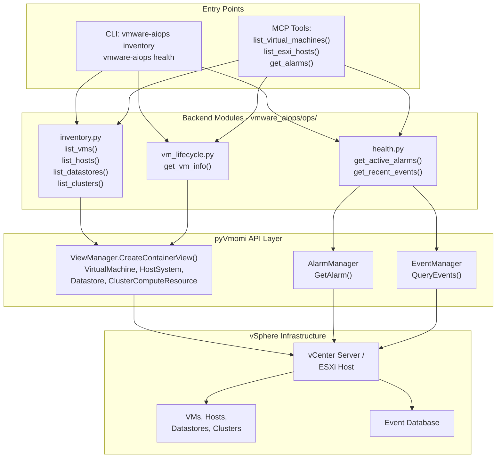
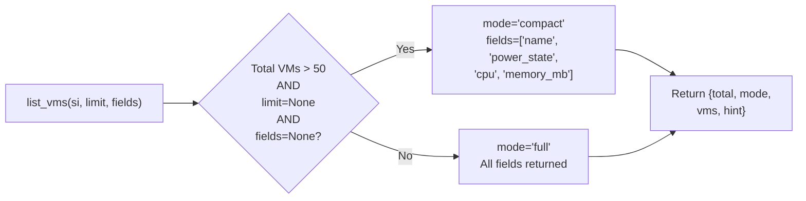
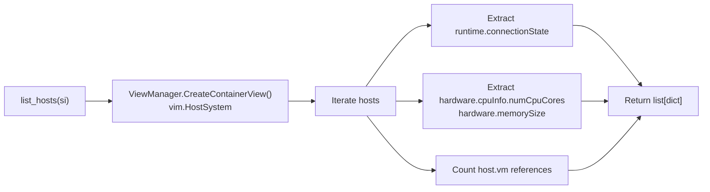
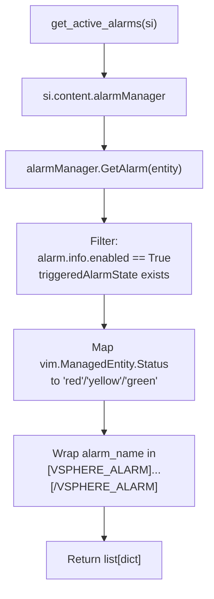
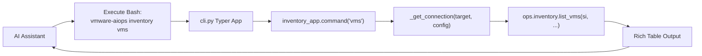
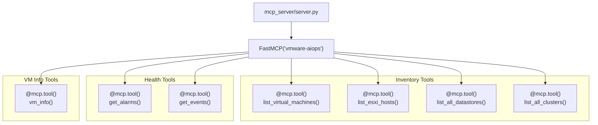
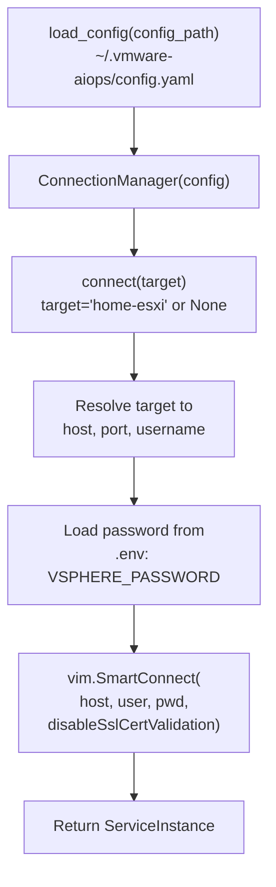

<!-- source: DeepWiki mcp.deepwiki.com · repo zw008/VMware-AIops · page 7.1 Inventory and Monitoring · fetched 2026-10-26 -->

# Inventory and Monitoring

<details>
<summary>Relevant source files</summary>

The following files were used as context for generating this wiki page:

- [mcp_server/server.py](mcp_server/server.py)
- [skills/vmware-aiops/SKILL.md](skills/vmware-aiops/SKILL.md)
- [vmware_aiops/cli.py](vmware_aiops/cli.py)

</details>


This page covers the **read-only** inventory querying and health monitoring capabilities of VMware AIops. These operations inspect the state of VMware infrastructure without making any changes, making them safe for production environments.

**Scope**: VM inventory, ESXi host enumeration, datastore capacity checks, cluster status, active alarms, and recent events. For VM lifecycle operations (power, create, delete, snapshot, etc.), see [VM Lifecycle Management](#7.2). For deployment operations, see [VM Deployment](#7.3).

---

## Architecture Overview

### Inventory and Health System Components



**Sources**: [vmware_aiops/cli.py:165-293](), [vmware_aiops/cli.py:295-346](), [mcp_server/server.py:86-183]()

---

## Inventory Operations

Inventory operations query the current state of VMware infrastructure resources. All operations support the `--target` / `target` parameter to specify which vCenter/ESXi host to query (uses default target if omitted).

### Virtual Machines

**CLI Command**: `vmware-aiops inventory vms`  
**MCP Tool**: `list_virtual_machines()`

Lists all virtual machines with power state, CPU, memory, guest OS, IP address, and host placement.

#### Auto-Compaction Behavior

The `list_vms()` function implements **automatic compaction** when inventory size exceeds 50 VMs and no explicit `limit` or `fields` are provided. This reduces token consumption for LLM context windows.



**Full fields** (mode='full', <50 VMs or explicit fields):
- `name`, `power_state`, `cpu`, `memory_mb`, `guest_os`, `ip_address`, `host`, `uuid`, `tools_status`

**Compact fields** (mode='compact', ≥50 VMs):
- `name`, `power_state`, `cpu`, `memory_mb`

**Sources**: [vmware_aiops/ops/inventory.py:15-95](), [mcp_server/server.py:91-117](), [vmware_aiops/cli.py:168-216]()

#### CLI Usage

```bash
# List all VMs (auto-compact if >50)
vmware-aiops inventory vms --target home-esxi

# Override compaction with limit
vmware-aiops inventory vms --limit 20

# Filter by power state
vmware-aiops inventory vms --power-state poweredOn

# Sort by CPU or memory
vmware-aiops inventory vms --sort-by cpu
vmware-aiops inventory vms --sort-by memory_mb
```

#### MCP Usage

```python
# Basic inventory (auto-compact)
list_virtual_machines(target="home-esxi")

# Force full fields for specific VMs
list_virtual_machines(limit=10, fields=["name", "power_state", "ip_address"])

# Filter powered-on VMs
list_virtual_machines(power_state="poweredOn", sort_by="memory_mb")
```

**Output Format** (CLI):

| Name | Power | CPUs | Memory (MB) | Guest OS | IP Address |
|------|-------|------|-------------|----------|------------|
| web-01 | poweredOn | 4 | 8192 | Ubuntu Linux (64-bit) | 192.168.1.10 |
| db-01 | poweredOff | 8 | 16384 | CentOS 7 (64-bit) | - |

**Sources**: [vmware_aiops/cli.py:168-216](), [vmware_aiops/ops/inventory.py:15-95]()

---

### ESXi Hosts

**CLI Command**: `vmware-aiops inventory hosts`  
**MCP Tool**: `list_esxi_hosts()`

Lists all ESXi hosts managed by vCenter, or the standalone host if connected directly to ESXi.

**Returned Fields**:
- `name`: Host FQDN or IP
- `connection_state`: `connected`, `disconnected`, `notResponding`
- `cpu_cores`: Total physical CPU cores
- `memory_gb`: Total physical RAM in GB
- `vm_count`: Number of VMs hosted
- `esxi_version`: ESXi version (e.g., "7.0.3")
- `uptime_days`: Host uptime in days

**Implementation**: [vmware_aiops/ops/inventory.py:98-134]()



**Sources**: [vmware_aiops/ops/inventory.py:98-134](), [vmware_aiops/cli.py:218-240](), [mcp_server/server.py:119-128]()

---

### Datastores

**CLI Command**: `vmware-aiops inventory datastores`  
**MCP Tool**: `list_all_datastores()`

Lists all datastores with capacity, free space, type (VMFS, NFS, vSAN), and usage percentage.

**Returned Fields**:
- `name`: Datastore name
- `type`: `VMFS`, `NFS`, `vsan`, `VVOL`
- `total_gb`: Total capacity in GB
- `free_gb`: Free space in GB
- `vm_count`: Number of VMs stored

**Color-coded Usage Display** (CLI only):
- Green: <70% used
- Yellow: 70-85% used
- Red: >85% used

**Sources**: [vmware_aiops/ops/inventory.py:137-164](), [vmware_aiops/cli.py:243-268](), [mcp_server/server.py:130-139]()

---

### Clusters

**CLI Command**: `vmware-aiops inventory clusters`  
**MCP Tool**: `list_all_clusters()`

Lists all vSphere clusters with host count, DRS/HA status, and resource totals.

**Returned Fields**:
- `name`: Cluster name
- `host_count`: Number of hosts in the cluster
- `drs_enabled`: `True` if DRS is enabled
- `drs_behavior`: `fullyAutomated`, `partiallyAutomated`, `manual`
- `ha_enabled`: `True` if vSphere HA is enabled
- `total_cpu_mhz`: Aggregate CPU capacity
- `total_memory_gb`: Aggregate memory capacity

**vCenter Only**: Clusters are a vCenter-only construct. When connected directly to ESXi, this command returns an empty list.

**Sources**: [vmware_aiops/ops/inventory.py:167-204](), [vmware_aiops/cli.py:271-292](), [mcp_server/server.py:141-150]()

---

## Health Monitoring

Health monitoring operations query alarms and events to detect infrastructure issues. These operations are **read-only** and safe to run continuously via the scanner daemon (see [Scheduled Scanning and Daemon](#8)).

### Active Alarms

**CLI Command**: `vmware-aiops health alarms`  
**MCP Tool**: `get_alarms()`

Retrieves all **triggered alarms** across the entire vCenter/ESXi inventory. Alarms represent persistent conditions (e.g., "Host CPU usage > 80%") that remain active until the underlying issue resolves.

**Returned Fields**:
- `severity`: `red`, `yellow`, `green` (mapped from vSphere alarm status)
- `alarm_name`: Name of the triggered alarm (e.g., "Host memory usage")
- `entity_name`: Affected resource (VM name, host name, datastore name)
- `entity_type`: `VirtualMachine`, `HostSystem`, `Datastore`, etc.
- `time`: Timestamp when alarm triggered
- `status`: `red` (critical), `yellow` (warning)

#### Alarm Query Flow



**Prompt Injection Protection**: Alarm names and descriptions from vSphere are wrapped in `[VSPHERE_ALARM]...[/VSPHERE_ALARM]` boundary markers and truncated to prevent injection attacks when consumed by LLMs.

**Sources**: [vmware_aiops/ops/health.py:10-69](), [vmware_aiops/cli.py:298-322](), [mcp_server/server.py:157-166]()

---

### Events and Logs

**CLI Command**: `vmware-aiops health events`  
**MCP Tool**: `get_events()`

Queries vCenter's event database for recent events filtered by severity and time range.

**Parameters**:
- `hours`: Lookback window (default: 24 hours)
- `severity`: Minimum severity level: `info`, `warning`, `critical` (default: `warning`)

**Returned Fields**:
- `time`: Event timestamp
- `event_type`: vSphere event class (e.g., `VmPoweredOnEvent`, `HostConnectionLostEvent`)
- `message`: Event description (truncated to 500 chars)
- `severity`: `critical`, `warning`, `info` (inferred from event type)

#### Monitored Event Types

The system classifies **50+ vSphere event types** into severity categories:

| Category | Severity | Event Examples |
|----------|----------|----------------|
| VM Failures | `critical` | `VmFailedToPowerOnEvent`, `VmFailoverFailed`, `VmDiskFailedEvent` |
| Host Issues | `critical` | `HostConnectionLostEvent`, `HostDasErrorEvent`, `DasHostFailedEvent` |
| Storage | `warning` | `DatastoreCapacityIncreasedEvent`, SCSI sense code events |
| HA/DRS | `warning` | `DrsVmMigratedEvent`, `DrsSoftRuleViolationEvent` |
| Provisioning | `info` | `VmCreatedEvent`, `VmClonedEvent`, `VmDeployedEvent` |
| Authentication | `warning` | `BadUsernameSessionEvent`, `NoAccessUserEvent` |

**Event Query Implementation**: [vmware_aiops/ops/health.py:72-159]()

**Prompt Injection Protection**: Event messages are:
1. Truncated to 500 characters
2. Stripped of control characters (`\x00-\x1f`)
3. Wrapped in `[VSPHERE_EVENT]...[/VSPHERE_EVENT]` boundary markers

**Sources**: [vmware_aiops/ops/health.py:72-159](), [vmware_aiops/cli.py:324-346](), [mcp_server/server.py:168-183]()

---

### VM-Specific Information

**CLI Command**: `vmware-aiops vm info <name>`  
**MCP Tool**: `vm_info(vm_name)`

Retrieves **detailed configuration** for a single VM, including hardware specs, network adapters, disk layout, and snapshot tree.

**Returned Fields**:
- Basic: `name`, `power_state`, `cpu`, `memory_mb`, `guest_os`, `uuid`
- Network: `ip_address`, `mac_addresses` (list of NICs)
- Storage: `disks` (list with `label`, `size_gb`, `datastore` per disk)
- Snapshots: `snapshot_count`, `snapshot_tree` (hierarchical structure)
- Guest: `tools_status`, `tools_version`
- Placement: `host`, `cluster`, `folder_path`

**Implementation**: [vmware_aiops/ops/vm_lifecycle.py:25-123]()

**Usage**:
```bash
# CLI
vmware-aiops vm info web-01 --target home-esxi

# MCP
vm_info(vm_name="web-01", target="home-esxi")
```

**Sources**: [vmware_aiops/ops/vm_lifecycle.py:25-123](), [vmware_aiops/cli.py:351-364](), [mcp_server/server.py:190-200]()

---

## Usage Modes

VMware AIops supports **dual-mode operation** for inventory and monitoring. Choose based on your AI platform and token budget requirements.

### CLI Mode

**Token Cost**: ~2K tokens (SKILL.md documentation)  
**Best For**: Local models, token-sensitive workflows, human-in-the-loop operations

The AI assistant reads [skills/vmware-aiops/SKILL.md:1-509]() and executes commands via bash subprocess. No tool schemas are loaded into context.

#### CLI Command Structure



**CLI Entry Point**: [vmware_aiops/cli.py:1-1846]()  
**Inventory Commands**: [vmware_aiops/cli.py:165-293]()  
**Health Commands**: [vmware_aiops/cli.py:295-346]()

**Sources**: [vmware_aiops/cli.py:1-1846](), [skills/vmware-aiops/SKILL.md:1-509]()

---

### MCP Mode

**Token Cost**: ~10K tokens (43 tool schemas)  
**Best For**: Cloud LLMs (GPT-4, Claude), automated pipelines, type-safe operations

The MCP server exposes inventory and health operations as **structured JSON tools** via stdio transport. No bash execution required.

#### MCP Tool Registration



**MCP Entry Point**: [mcp_server/server.py:1-980]()  
**Inventory Tools**: [mcp_server/server.py:86-150]()  
**Health Tools**: [mcp_server/server.py:152-183]()

**Tool Invocation**:
```json
{
  "tool": "list_virtual_machines",
  "arguments": {
    "target": "home-esxi",
    "limit": 20,
    "power_state": "poweredOn"
  }
}
```

**Sources**: [mcp_server/server.py:86-183]()

---

## Output Formats and Filtering

### CLI Output

CLI commands use [Rich](https://github.com/Textualize/rich) tables for terminal display with color-coded status indicators:

- **Power State**: Green (`poweredOn`), Red (`poweredOff`/`suspended`)
- **Connection State**: Green (`connected`), Red (`disconnected`/`notResponding`)
- **Datastore Usage**: Green (<70%), Yellow (70-85%), Red (>85%)
- **Alarm Severity**: Red (`critical`), Yellow (`warning`)

**Implementation**: [vmware_aiops/cli.py:9-11]() imports Rich Console and Table

### MCP Output

MCP tools return **pure Python dicts/lists** serialized to JSON. No color codes or terminal formatting.

**Example Response**:
```json
{
  "total": 127,
  "mode": "compact",
  "vms": [
    {
      "name": "web-01",
      "power_state": "poweredOn",
      "cpu": 4,
      "memory_mb": 8192
    }
  ],
  "hint": "Showing compact fields (50+ VMs). Use limit or fields to override."
}
```

### Filtering and Sorting

Both CLI and MCP modes support:

| Feature | CLI Flag | MCP Parameter | Description |
|---------|----------|---------------|-------------|
| Limit | `--limit <n>` | `limit=<n>` | Return only top N results |
| Sort | `--sort-by <field>` | `sort_by=<field>` | Sort by: `name`, `cpu`, `memory_mb`, `power_state` |
| Power Filter | `--power-state <state>` | `power_state=<state>` | Filter VMs: `poweredOn`, `poweredOff`, `suspended` |
| Field Selection | N/A | `fields=[...]` | MCP only: select specific fields to return |

**Sources**: [vmware_aiops/cli.py:168-216](), [mcp_server/server.py:91-117]()

---

## Connection Management

All inventory and health operations share a **single connection manager** that handles pyVmomi session pooling and multi-target support.

### Connection Lifecycle



**Multi-Target Support**: The `target` parameter selects which vCenter/ESXi host to query from `config.yaml`. If omitted, uses the first target or `default` target.

**SSL Certificate Handling**: The `disableSslCertValidation` option (per-target in config.yaml) allows self-signed certificates for lab/home ESXi hosts. **Production environments should use CA-signed certificates with TLS verification enabled.**

**Connection Manager**: [vmware_aiops/connection.py:1-100]()  
**Config Loading**: [vmware_aiops/config.py:1-150]()

**Sources**: [vmware_aiops/connection.py:1-100](), [vmware_aiops/config.py:1-150](), [vmware_aiops/cli.py:92-100](), [mcp_server/server.py:75-84]()

---

## Version Compatibility

Inventory and monitoring operations are compatible with all supported vSphere versions:

| vSphere Version | Inventory | Health | Notes |
|-----------------|:---------:|:------:|-------|
| 8.0 / 8.0U1-U3 | ✅ Full | ✅ Full | All APIs supported |
| 7.0 / 7.0U1-U3 | ✅ Full | ✅ Full | All APIs supported |
| 6.7 | ✅ Full | ✅ Full | Backward-compatible, tested |
| 6.5 | ✅ Full | ✅ Full | Backward-compatible, tested |

**API Version Negotiation**: pyVmomi automatically negotiates the correct API version during SOAP handshake. No manual configuration required.

**Sources**: [skills/vmware-aiops/SKILL.md:319-329]()

---

## Related Pages

- For VM power operations, creation, deletion, snapshots, cloning, and migration, see [VM Lifecycle Management](#7.2)
- For deploying VMs from OVA, templates, or linked clones, see [VM Deployment](#7.3)
- For setting up the scheduled scanner daemon, see [Scheduled Scanning and Daemon](#8)
- For understanding dual-mode architecture trade-offs, see [Dual-Mode Architecture: CLI vs MCP](#3.1)

---

