<!-- source: DeepWiki mcp.deepwiki.com · repo zw008/VMware-AIops · page 7.2 VM Lifecycle Management · fetched 2026-10-26 -->

# VM Lifecycle Management

<details>
<summary>Relevant source files</summary>

The following files were used as context for generating this wiki page:

- [README.md](README.md)
- [codex-skill/AGENTS.md](codex-skill/AGENTS.md)
- [skills/vmware-aiops/SKILL.md](skills/vmware-aiops/SKILL.md)
- [vmware_aiops/cli.py](vmware_aiops/cli.py)

</details>


This document covers the core VM lifecycle operations available in VMware AIops: power state management, VM creation/deletion, reconfiguration, snapshots, cloning, migration, and advanced features like TTL and Clean Slate. These operations modify the state of existing VMs or create/destroy VM resources.

For deploying VMs from OVA files, templates, or linked clones, see [VM Deployment](#7.3). For executing commands inside VM guest operating systems, see [Guest Operations](#7.4). For read-only inventory queries, see [Inventory and Monitoring](#7.1).

## Architecture Overview

VM lifecycle operations flow through a consistent architecture pattern:

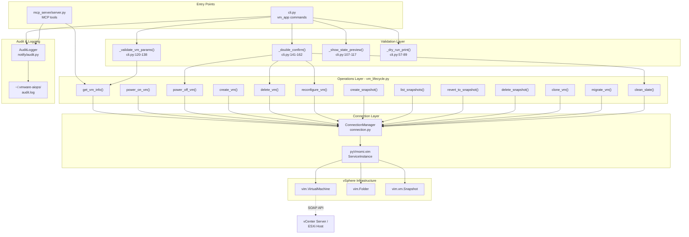

**VM Lifecycle Operation Flow**

All destructive operations (power-off, delete, reconfigure, snapshot operations, clone, migrate) pass through the double confirmation layer before execution. All operations are logged to the audit trail regardless of outcome.

**Sources:** [vmware_aiops/cli.py:1-2647](), [vmware_aiops/ops/vm_lifecycle.py:1-end](), [vmware_aiops/connection.py:1-end](), [vmware_aiops/notify/audit.py:1-end]()

---

## Power State Management

### Power Operations

VM power operations are implemented in [vmware_aiops/ops/vm_lifecycle.py]() with CLI commands in [vmware_aiops/cli.py:366-433]().

| Operation | API Call | Function | CLI Command | Confirmation Required |
|-----------|----------|----------|-------------|----------------------|
| Power On | `vim.VirtualMachine.PowerOn()` | `power_on_vm()` | `vm power-on <name>` | No |
| Graceful Shutdown | `vim.VirtualMachine.ShutdownGuest()` | `power_off_vm(force=False)` | `vm power-off <name>` | Double |
| Force Power Off | `vim.VirtualMachine.PowerOff()` | `power_off_vm(force=True)` | `vm power-off <name> --force` | Double |
| Reset | `vim.VirtualMachine.Reset()` | `reset_vm()` | `vm reset <name>` | No |
| Suspend | `vim.VirtualMachine.Suspend()` | `suspend_vm()` | `vm suspend <name>` | No |

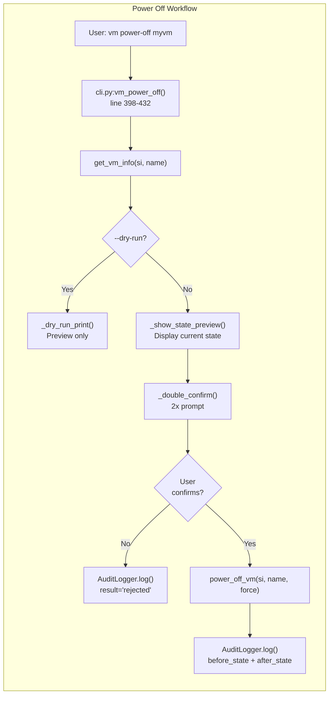

**Power-Off Operation with Safety Gates**

The double confirmation mechanism at [vmware_aiops/cli.py:141-162]() requires two sequential prompts with no bypass options. Rejected confirmations are logged to the audit trail.

**Sources:** [vmware_aiops/cli.py:366-433](), [vmware_aiops/ops/vm_lifecycle.py:1-end]()

---

## VM Creation and Deletion

### Creating VMs

The `create_vm()` function in [vmware_aiops/ops/vm_lifecycle.py]() constructs a `vim.vm.ConfigSpec` and invokes `vim.Folder.CreateVM_Task()`.

**Key Components:**

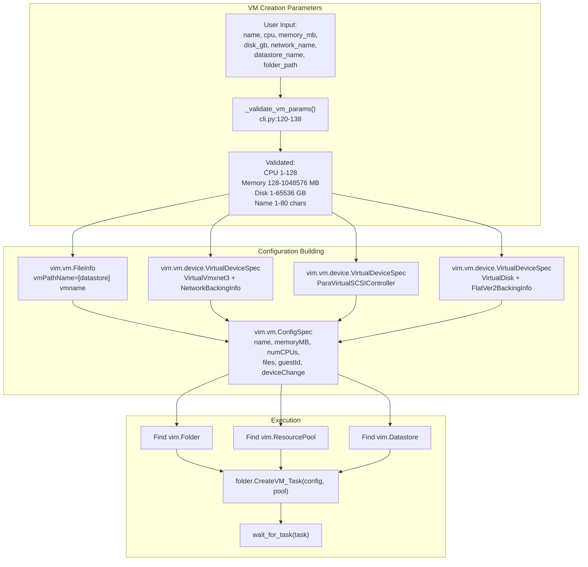

**VM Creation Configuration Flow**

Input validation occurs at [vmware_aiops/cli.py:120-138]() before any vSphere API calls are made. The CLI command is defined at [vmware_aiops/cli.py:435-478]().

**Parameter Validation Rules:**

| Parameter | Constraint | Error Message |
|-----------|-----------|---------------|
| `name` | 1-80 characters, no leading `-` or `.` | "VM name must be 1-80 characters, got {len}" |
| `cpu` | 1-128 | "CPU count must be 1-128, got {cpu}" |
| `memory_mb` | 128-1048576 | "Memory must be 128-1048576 MB, got {memory_mb}" |
| `disk_gb` | 1-65536 | "Disk size must be 1-65536 GB, got {disk_gb}" |

**Sources:** [vmware_aiops/cli.py:435-478](), [vmware_aiops/cli.py:120-138](), [vmware_aiops/ops/vm_lifecycle.py:1-end]()

### Deleting VMs

VM deletion requires double confirmation and power-off pre-check:

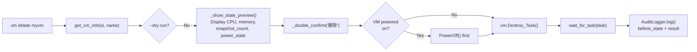

**VM Deletion Workflow**

The delete operation at [vmware_aiops/cli.py:481-520]() captures the before state (CPU, memory, snapshot count, power state) for audit logging before destruction.

**Sources:** [vmware_aiops/cli.py:481-520](), [vmware_aiops/ops/vm_lifecycle.py:1-end]()

---

## VM Reconfiguration

The `reconfigure_vm()` function modifies CPU and memory settings using `vim.VirtualMachine.ReconfigVM_Task()`.

**Reconfiguration Flow:**

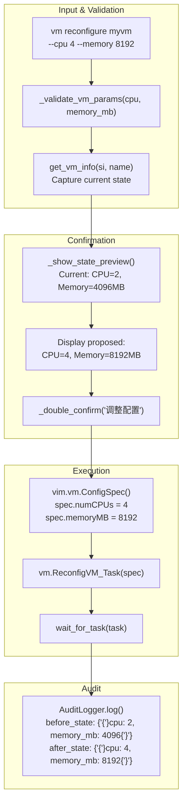

**VM Reconfiguration with Before/After State Capture**

The reconfigure command at [vmware_aiops/cli.py:523-578]() shows both current and proposed states before requiring confirmation. Both `cpu` and `memory_mb` parameters are optional — unchanged values are not modified.

**Sources:** [vmware_aiops/cli.py:523-578](), [vmware_aiops/ops/vm_lifecycle.py:1-end]()

---

## Snapshot Operations

### Snapshot Management Architecture

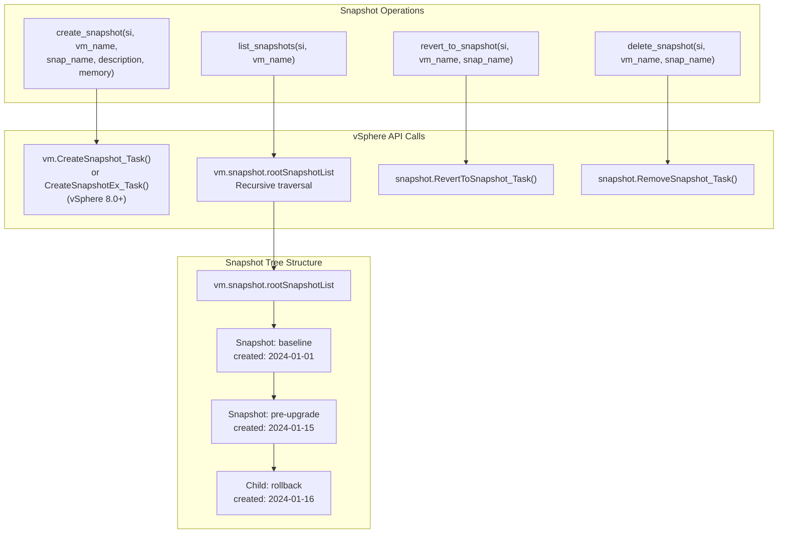

**Snapshot Operations and Tree Structure**

Snapshots are organized in a tree structure accessible via `vm.snapshot.rootSnapshotList`. The `list_snapshots()` function recursively traverses this tree.

### Snapshot CLI Commands

| Operation | CLI Command | Confirmation | API Call | Implementation |
|-----------|-------------|--------------|----------|----------------|
| Create | `vm snapshot-create <vm> --name <snap>` | No | `CreateSnapshot_Task()` | [cli.py:581-610]() |
| List | `vm snapshot-list <vm>` | No | Read `vm.snapshot` | [cli.py:613-629]() |
| Revert | `vm snapshot-revert <vm> --name <snap>` | Double | `RevertToSnapshot_Task()` | [cli.py:632-665]() |
| Delete | `vm snapshot-delete <vm> --name <snap>` | Double | `RemoveSnapshot_Task()` | [cli.py:668-697]() |

### Version-Specific Snapshot Behavior

vSphere 8.0+ deprecates `CreateSnapshot_Task()` in favor of `CreateSnapshotEx_Task()`:

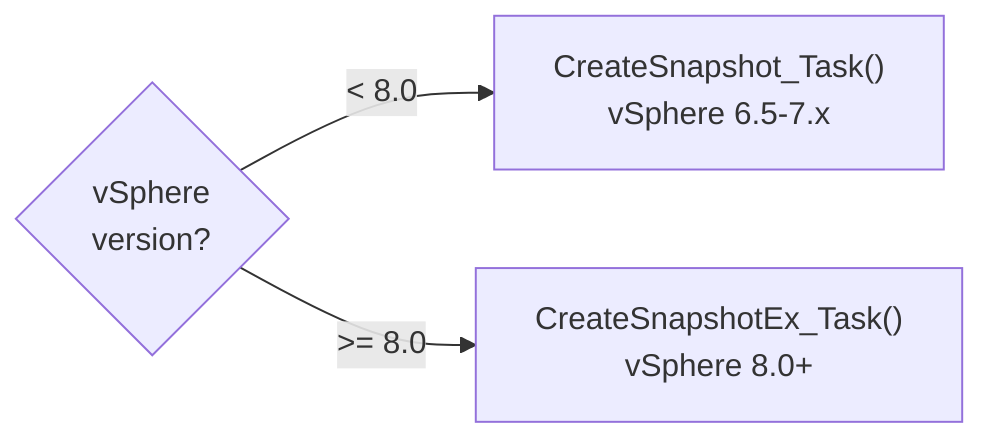

The implementation in [vmware_aiops/ops/vm_lifecycle.py]() handles this automatically through pyVmomi's version negotiation.

**Sources:** [vmware_aiops/cli.py:581-697](), [vmware_aiops/ops/vm_lifecycle.py:1-end](), [README.md:88-93]()

---

## Cloning and Migration

### VM Cloning

The `clone_vm()` function creates a full copy of a VM using `vim.VirtualMachine.Clone()`:

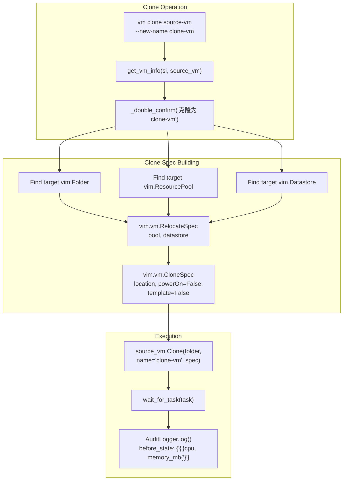

**VM Cloning Workflow**

Clone operations at [vmware_aiops/cli.py:700-733]() require double confirmation and capture the source VM configuration for audit logging.

**Sources:** [vmware_aiops/cli.py:700-733](), [vmware_aiops/ops/vm_lifecycle.py:1-end]()

### VM Migration (vMotion)

The `migrate_vm()` function moves a VM to a different ESXi host using `vim.VirtualMachine.Relocate()`:

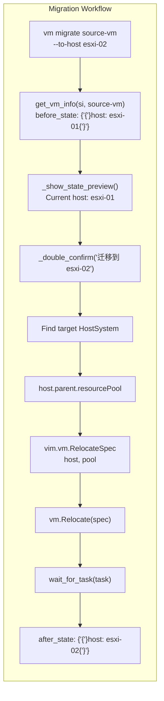

**vMotion Migration Flow**

Migration is only available on vCenter-managed environments. Standalone ESXi hosts do not support vMotion. The CLI command is at [vmware_aiops/cli.py:736-771]().

**Sources:** [vmware_aiops/cli.py:736-771](), [vmware_aiops/ops/vm_lifecycle.py:1-end]()

---

## Advanced Features

### Time-to-Live (TTL) Management

TTL allows automatic VM deletion after a specified time period, useful for temporary test environments:

```mermaid
graph TB
    subgraph "TTL Registry"
        SetTTL["vm set-ttl myvm --minutes 60"]
        Registry["~/.vmware-aiops/ttl_registry.json<br/>{'{'}\"myvm\": {'{'}\"expires_at\": \"2024-...\",<br/>\"target\": \"prod-vcenter\"{'}'{'}'}"]
        Daemon["scanner/scheduler.py<br/>Periodic check every interval"]
        Check{"TTL<br/>expired?"}
        DeleteVM["delete_vm(si, vm_name)"]
        RemoveEntry["Remove from registry"]
    end
    
    SetTTL --> Registry
    Registry --> Daemon
    Daemon --> Check
    Check -->|Yes| DeleteVM
    DeleteVM --> RemoveEntry
    Check -->|No| Daemon
```

**TTL Automatic Deletion Mechanism**

TTL operations are implemented in [vmware_aiops/ops/ttl.py]() with CLI commands at [vmware_aiops/cli.py:777-831](). The daemon process checks the registry periodically and deletes expired VMs.

**TTL Commands:**

| Command | Function | Description |
|---------|----------|-------------|
| `vm set-ttl <name> --minutes <n>` | `set_ttl()` | Register VM for auto-deletion in N minutes |
| `vm cancel-ttl <name>` | `cancel_ttl()` | Cancel TTL for a VM |
| `vm list-ttl` | `list_ttl()` | Display all VMs with active TTLs |

**Sources:** [vmware_aiops/cli.py:777-831](), [vmware_aiops/ops/ttl.py:1-end]()

### Clean Slate Operation

Clean Slate reverts a VM to a baseline snapshot, forcing a power-off if necessary:

```mermaid
graph LR
    Input["vm clean-slate myvm<br/>--snapshot baseline"]
    GetInfo["get_vm_info(si, myvm)"]
    ShowState["_show_state_preview()"]
    Confirm["_double_confirm('恢复基线快照')"]
    PowerCheck{"VM<br/>powered on?"}
    PowerOff["PowerOff()"]
    FindSnap["Find snapshot 'baseline'"]
    RevertTask["snapshot.RevertToSnapshot_Task()"]
    Wait["wait_for_task(task)"]
    Audit["AuditLogger.log()<br/>before_state: {'{'}power_state{'}'}"]
    
    Input --> GetInfo
    GetInfo --> ShowState
    ShowState --> Confirm
    Confirm --> PowerCheck
    PowerCheck -->|Yes| PowerOff
    PowerCheck -->|No| FindSnap
    PowerOff --> FindSnap
    FindSnap --> RevertTask
    RevertTask --> Wait
    Wait --> Audit
```

**Clean Slate Workflow**

Clean Slate is implemented at [vmware_aiops/cli.py:834-866]() and is commonly used for lab environments where VMs need to be reset to a known-good state.

**Sources:** [vmware_aiops/cli.py:834-866](), [vmware_aiops/ops/vm_lifecycle.py:1-end]()

---

## Safety and Validation Mechanisms

### Multi-Layer Safety Architecture

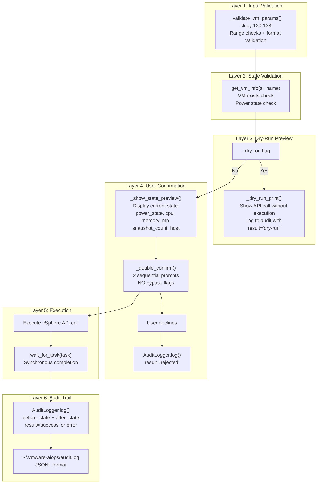

**Six-Layer Safety Architecture for Destructive Operations**

All destructive operations pass through these six layers sequentially. No layer can be bypassed.

### Destructive Operations Requiring Double Confirmation

The following operations require double confirmation via [vmware_aiops/cli.py:141-162]():

| Operation | CLI Function | Line Numbers |
|-----------|--------------|--------------|
| Power Off | `vm_power_off()` | [cli.py:398-432]() |
| Delete VM | `vm_delete()` | [cli.py:481-520]() |
| Reconfigure | `vm_reconfigure()` | [cli.py:523-578]() |
| Snapshot Revert | `vm_snapshot_revert()` | [cli.py:632-665]() |
| Snapshot Delete | `vm_snapshot_delete()` | [cli.py:668-697]() |
| Clone | `vm_clone()` | [cli.py:700-733]() |
| Migrate | `vm_migrate()` | [cli.py:736-771]() |
| Clean Slate | `vm_clean_slate()` | [cli.py:834-866]() |

### Audit Log Format

All operations are logged to `~/.vmware-aiops/audit.log` in JSONL format by [vmware_aiops/notify/audit.py]():

```json
{
  "timestamp": "2024-01-15T14:30:00Z",
  "target": "prod-vcenter",
  "operation": "delete_vm",
  "resource": "test-vm-01",
  "parameters": {},
  "before_state": {
    "power_state": "poweredOff",
    "cpu": 2,
    "memory_mb": 4096,
    "snapshot_count": 3
  },
  "after_state": {},
  "result": "success",
  "user": "admin"
}
```

Rejected confirmations are also logged:

```json
{
  "timestamp": "2024-01-15T14:25:00Z",
  "target": "prod-vcenter",
  "operation": "delete_vm",
  "resource": "production-db",
  "result": "rejected"
}
```

**Sources:** [vmware_aiops/cli.py:141-162](), [vmware_aiops/notify/audit.py:1-end]()

---

## Common Workflows

### Workflow 1: Testing VM Configuration Changes

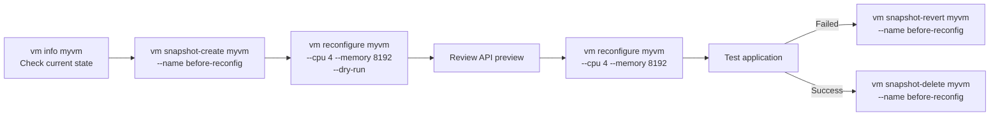

**Safe Reconfiguration Workflow**

Use dry-run mode to preview changes, create snapshots before risky operations, and revert if needed.

### Workflow 2: Temporary Test Environment with TTL

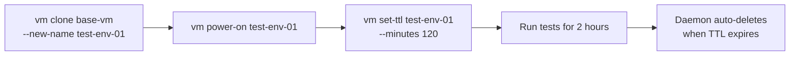

**Temporary Environment with Auto-Cleanup**

TTL management ensures temporary test VMs are automatically cleaned up without manual intervention.

### Workflow 3: Clean Slate Lab Reset

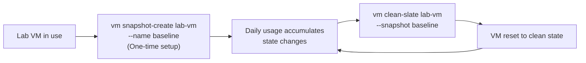

**Lab Environment Daily Reset**

Clean Slate operations are ideal for training labs or demo environments that need daily resets.

**Sources:** [vmware_aiops/cli.py:1-2647](), [skills/vmware-aiops/SKILL.md:1-509]()

---

## MCP Mode Integration

All VM lifecycle operations are also available as MCP tools via [mcp_server/server.py](). The MCP tools mirror the CLI commands:

| CLI Command | MCP Tool | Parameters |
|-------------|----------|------------|
| `vm power-on` | `vm_power_on` | `vm_name`, `target` (optional) |
| `vm power-off` | `vm_power_off` | `vm_name`, `force`, `target` |
| `vm create` | `vm_create` | `vm_name`, `cpu`, `memory_mb`, `disk_gb`, `network_name`, `datastore_name`, `target` |
| `vm delete` | `vm_delete` | `vm_name`, `target` |
| `vm reconfigure` | `vm_reconfigure` | `vm_name`, `cpu`, `memory_mb`, `target` |
| `vm snapshot-create` | `vm_snapshot_create` | `vm_name`, `snapshot_name`, `description`, `memory`, `target` |
| `vm snapshot-list` | `vm_snapshot_list` | `vm_name`, `target` |
| `vm snapshot-revert` | `vm_snapshot_revert` | `vm_name`, `snapshot_name`, `target` |
| `vm snapshot-delete` | `vm_snapshot_delete` | `vm_name`, `snapshot_name`, `target` |
| `vm clone` | `vm_clone` | `vm_name`, `new_name`, `target` |
| `vm migrate` | `vm_migrate` | `vm_name`, `to_host`, `target` |
| `vm set-ttl` | `vm_set_ttl` | `vm_name`, `minutes`, `target` |
| `vm cancel-ttl` | `vm_cancel_ttl` | `vm_name` |
| `vm list-ttl` | `vm_list_ttl` | None |
| `vm clean-slate` | `vm_clean_slate` | `vm_name`, `snapshot_name`, `target` |
| `vm info` | `vm_info` | `vm_name`, `target` |

All MCP tools return structured JSON responses and include the same safety mechanisms (double confirmation is implemented in the MCP server layer).

**Sources:** [mcp_server/server.py:1-end](), [skills/vmware-aiops/SKILL.md:116-129]()

---

## Version Compatibility

VM lifecycle operations are compatible across all supported vSphere versions with automatic API version negotiation:

| vSphere Version | Support Status | Notes |
|----------------|----------------|-------|
| 8.0 / 8.0U1-U3 | ✅ Full | `CreateSnapshot_Task` deprecated → use `CreateSnapshotEx_Task` |
| 7.0 / 7.0U1-U3 | ✅ Full | All APIs supported |
| 6.7 | ✅ Compatible | Backward-compatible, tested |
| 6.5 | ✅ Compatible | Backward-compatible, tested |

pyVmomi auto-negotiates the API version during the SOAP handshake — no manual configuration is needed. The same codebase manages both vSphere 7.0 and 8.0 environments seamlessly.

**Sources:** [README.md:84-93](), [skills/vmware-aiops/SKILL.md:319-328]()

---

