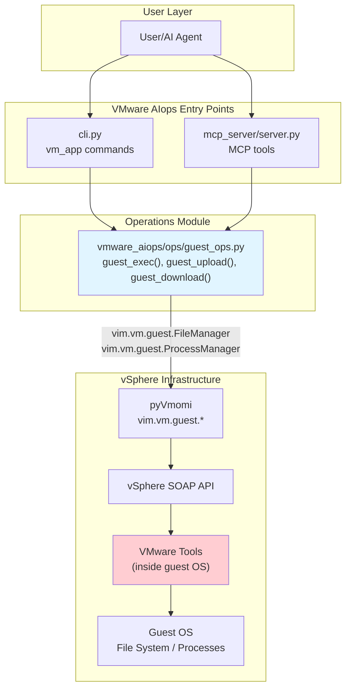
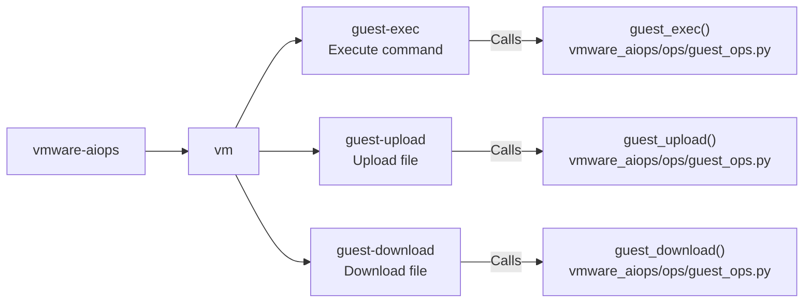
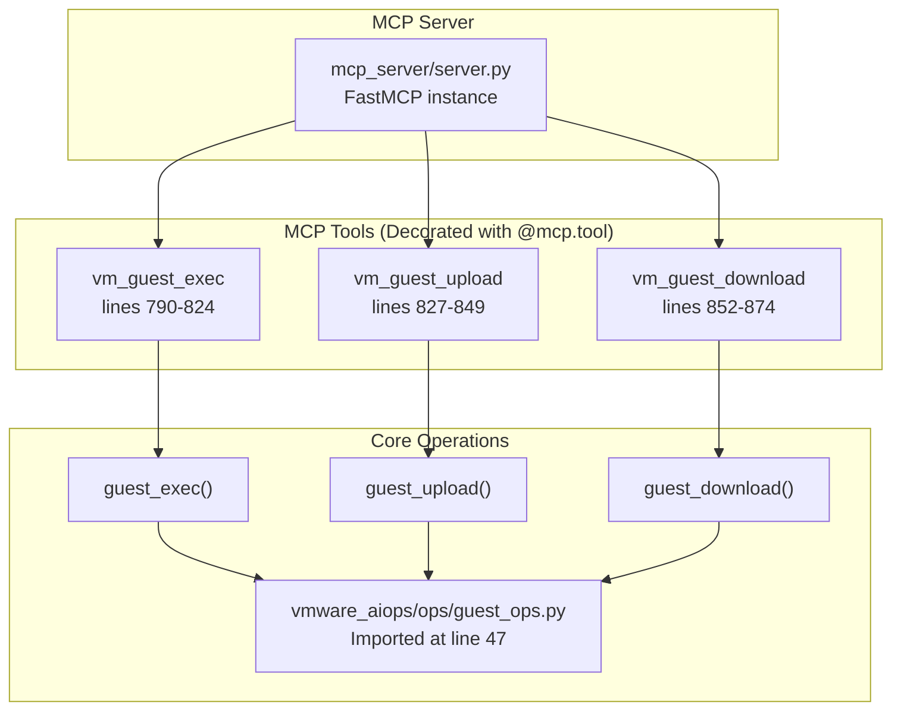
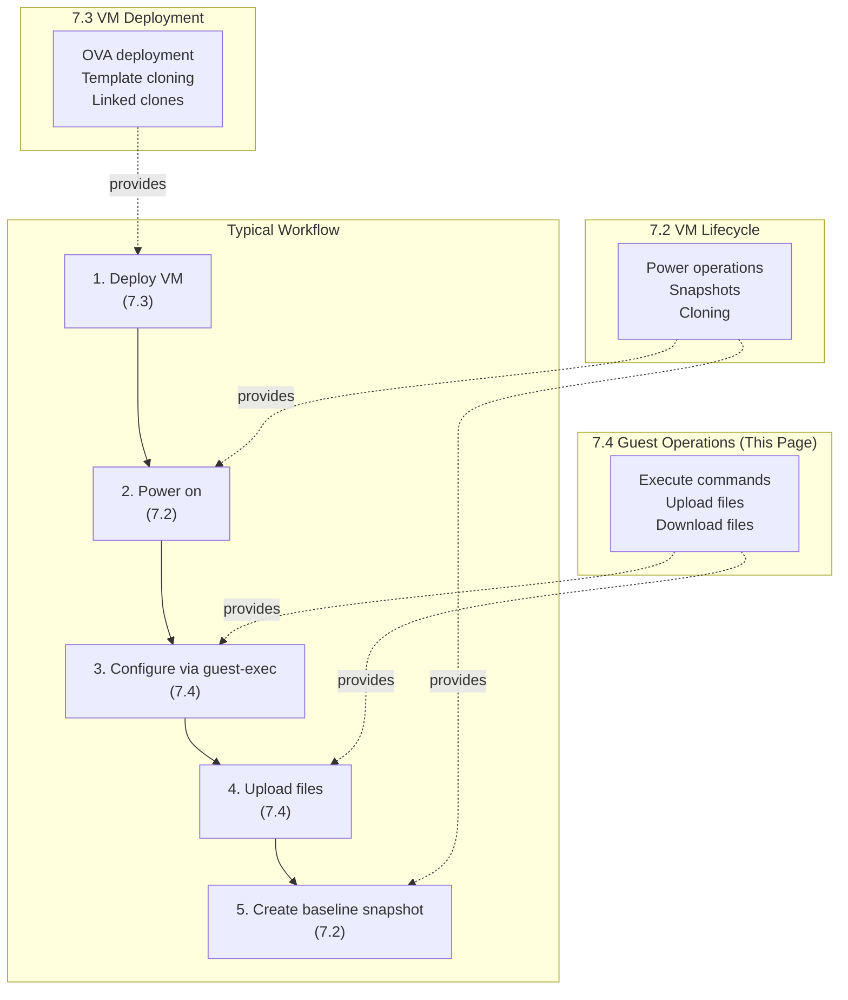

<!-- source: DeepWiki mcp.deepwiki.com · repo zw008/VMware-AIops · page 7.4 Guest Operations · fetched 2026-10-26 -->

# Guest Operations

<details>
<summary>Relevant source files</summary>

The following files were used as context for generating this wiki page:

- [README.md](README.md)
- [mcp_server/server.py](mcp_server/server.py)
- [vmware_aiops/cli.py](vmware_aiops/cli.py)

</details>


Guest Operations enable interaction with software running inside a VM's guest operating system through VMware Tools. This includes executing commands, uploading files to the guest, and downloading files from the guest.

For VM lifecycle management (power, snapshots, cloning), see [VM Lifecycle Management](#7.2). For VM deployment and provisioning, see [VM Deployment](#7.3).

---

## Purpose and Capabilities

Guest Operations use VMware Tools' Guest SDK to perform operations inside a powered-on VM without requiring SSH, RDP, or any network connectivity to the guest OS. All communication flows through the vSphere API and VMware Tools agent running inside the guest.

The three core operations are:

| Operation | Purpose | CLI Command | MCP Tool |
|-----------|---------|-------------|----------|
| **Execute** | Run commands/scripts inside the VM | `vm guest-exec` | `vm_guest_exec` |
| **Upload** | Transfer files from host to VM | `vm guest-upload` | `vm_guest_upload` |
| **Download** | Transfer files from VM to host | `vm guest-download` | `vm_guest_download` |

Sources: [README.md:147-151](), [cli.py:869-950](), [mcp_server/server.py:786-874]()

---

## Prerequisites

### VMware Tools Requirement

All guest operations **require VMware Tools to be installed and running** inside the VM's guest operating system. The operations will fail if VMware Tools is not running, outdated, or not installed.

Check VMware Tools status:
```bash
# Via CLI
vmware-aiops vm info my-vm

# Look for tools_status field:
# - "toolsOk" → Ready for guest operations
# - "toolsNotInstalled" → Install VMware Tools first
# - "toolsNotRunning" → Start VMware Tools service
```

### Guest OS Credentials

Guest operations require valid guest OS credentials (username and password). These are **separate from vSphere credentials** — they are the credentials used to log into the guest operating system itself (e.g., root/password for Linux, Administrator/password for Windows).

Sources: [README.md:151](), [cli.py:872-949]()

---

## Architecture Overview

**Guest Operations Data Flow**



**Key Components:**

- **vim.vm.guest.FileManager**: PyVmomi class for file transfers (upload/download)
- **vim.vm.guest.ProcessManager**: PyVmomi class for executing processes
- **NamePasswordAuthentication**: Credentials object for guest OS authentication
- All operations communicate through vSphere API → VMware Tools → Guest OS

Sources: [cli.py:869-950](), [mcp_server/server.py:786-874]()

---

## Command Execution

### Execute Commands Inside VMs

The `guest-exec` operation runs commands inside a VM's guest OS via VMware Tools. It returns the process ID, exit code, and completion status.

**CLI Usage:**

```bash
# Basic command execution
vmware-aiops vm guest-exec my-vm \
  --cmd /bin/bash \
  --args "-c 'whoami'" \
  --user root \
  --password <password>

# Execute a script (Windows)
vmware-aiops vm guest-exec windows-vm \
  --cmd "C:\Windows\System32\cmd.exe" \
  --args "/c dir C:\\" \
  --user Administrator
```

**MCP Tool:**

```json
{
  "tool": "vm_guest_exec",
  "arguments": {
    "vm_name": "my-vm",
    "command": "/bin/bash",
    "arguments": "-c 'whoami'",
    "username": "root",
    "password": "secret",
    "working_directory": "/tmp"
  }
}
```

**Return Structure:**

| Field | Type | Description |
|-------|------|-------------|
| `command` | string | Full command that was executed |
| `pid` | integer | Guest OS process ID |
| `exit_code` | integer | Process exit code (0 = success) |
| `timed_out` | boolean | Whether the process timed out |

Sources: [cli.py:872-902](), [mcp_server/server.py:790-824]()

### Important: stdout/stderr Limitations

**VMware's Guest Operations API does not directly capture stdout/stderr.** To capture command output, redirect to a file and use `guest-download`:

```bash
# Step 1: Execute command with output redirection
vmware-aiops vm guest-exec my-vm \
  --cmd /bin/bash \
  --args "-c 'ls -la /tmp > /tmp/output.txt'" \
  --user root

# Step 2: Download the output file
vmware-aiops vm guest-download my-vm \
  --guest /tmp/output.txt \
  --local ./output.txt \
  --user root
```

This limitation is inherited from VMware's API design — the `vim.vm.guest.ProcessManager` API only returns exit codes and process status, not captured output streams.

Sources: [mcp_server/server.py:804-808]()

---

## File Transfer Operations

### Upload Files to VMs

Transfer files from the local machine to a VM's guest OS.

**CLI Usage:**

```bash
# Upload a script to Linux VM
vmware-aiops vm guest-upload my-vm \
  --local ./script.sh \
  --guest /tmp/script.sh \
  --user root \
  --password <password>

# Upload a config file to Windows VM
vmware-aiops vm guest-upload windows-vm \
  --local ./config.xml \
  --guest "C:\\Program Files\\MyApp\\config.xml" \
  --user Administrator
```

**MCP Tool:**

```json
{
  "tool": "vm_guest_upload",
  "arguments": {
    "vm_name": "my-vm",
    "local_path": "/home/user/script.sh",
    "guest_path": "/tmp/script.sh",
    "username": "root",
    "password": "secret"
  }
}
```

Sources: [cli.py:904-926](), [mcp_server/server.py:827-849]()

### Download Files from VMs

Transfer files from a VM's guest OS to the local machine.

**CLI Usage:**

```bash
# Download a log file from Linux VM
vmware-aiops vm guest-download my-vm \
  --guest /var/log/syslog \
  --local ./syslog.txt \
  --user root \
  --password <password>

# Download a Windows event log
vmware-aiops vm guest-download windows-vm \
  --guest "C:\\Windows\\System32\\winevt\\Logs\\System.evtx" \
  --local ./system.evtx \
  --user Administrator
```

**MCP Tool:**

```json
{
  "tool": "vm_guest_download",
  "arguments": {
    "vm_name": "my-vm",
    "guest_path": "/var/log/syslog",
    "local_path": "/home/user/logs/syslog.txt",
    "username": "root",
    "password": "secret"
  }
}
```

Sources: [cli.py:928-949](), [mcp_server/server.py:852-874]()

---

## CLI Integration

**Guest Operations CLI Command Structure**



All guest operations are subcommands under `vmware-aiops vm`:

- `vmware-aiops vm guest-exec` → [cli.py:872-902]()
- `vmware-aiops vm guest-upload` → [cli.py:904-926]()
- `vmware-aiops vm guest-download` → [cli.py:928-949]()

Each command includes audit logging via `AuditLogger` (line 887-892, 919-924, 943-948 in cli.py).

Sources: [cli.py:869-950]()

---

## MCP Integration

**Guest Operations MCP Tools**



The MCP server exposes guest operations as three tools accessible to AI agents:

| MCP Tool | Function Signature | Returns |
|----------|-------------------|---------|
| `vm_guest_exec` | `(vm_name, command, arguments, username, password, working_directory, target)` | `dict` with exit_code, pid, timed_out |
| `vm_guest_upload` | `(vm_name, local_path, guest_path, username, password, target)` | `str` success message |
| `vm_guest_download` | `(vm_name, guest_path, local_path, username, password, target)` | `str` success message |

MCP tools delegate to the same core implementation as the CLI, ensuring consistent behavior across both interfaces.

Sources: [mcp_server/server.py:786-874](), [mcp_server/server.py:47]()

---

## Security Considerations

### Credential Handling

**Guest OS passwords are passed via command arguments or MCP tool parameters.** To minimize exposure:

1. **CLI Mode**: The `--password` option uses `prompt=True, hide_input=True` in Typer, which:
   - Prompts the user interactively (password not visible in terminal)
   - Prevents passwords from appearing in shell history
   - See [cli.py:878](), [cli.py:910](), [cli.py:934]()

2. **MCP Mode**: Passwords are passed in tool arguments. AI agents should:
   - Prompt the user for credentials at runtime
   - Never hardcode or log passwords
   - Use environment variables when possible

3. **vSphere credentials vs. Guest credentials**: These are completely separate:
   - vSphere credentials (from `.env` file) authenticate to vCenter/ESXi
   - Guest credentials (passed to guest operations) authenticate inside the VM's OS

### Audit Logging

All guest operations are logged to `~/.vmware-aiops/audit.log`:

```jsonl
{"timestamp": "2024-01-01T12:00:00Z", "target": "prod-vcenter", 
 "operation": "guest_exec", "resource": "my-vm", 
 "result": "exit_code=0"}
```

Passwords are **not logged** — only operation results are recorded.

Sources: [cli.py:887-892](), [cli.py:919-924](), [cli.py:943-948]()

---

## Common Use Cases

### Automated Configuration Management

```bash
# Upload configuration file
vmware-aiops vm guest-upload web-server \
  --local ./nginx.conf \
  --guest /etc/nginx/nginx.conf \
  --user root

# Reload service
vmware-aiops vm guest-exec web-server \
  --cmd /bin/systemctl \
  --args "reload nginx" \
  --user root
```

### Log Collection

```bash
# Collect logs from multiple VMs
for vm in web-01 web-02 web-03; do
  vmware-aiops vm guest-download $vm \
    --guest /var/log/application.log \
    --local ./logs/${vm}.log \
    --user root
done
```

### Script Deployment and Execution

```bash
# 1. Upload script
vmware-aiops vm guest-upload test-vm \
  --local ./test-script.sh \
  --guest /tmp/test-script.sh \
  --user root

# 2. Make executable and run
vmware-aiops vm guest-exec test-vm \
  --cmd /bin/bash \
  --args "-c 'chmod +x /tmp/test-script.sh && /tmp/test-script.sh > /tmp/output.txt'" \
  --user root

# 3. Download output
vmware-aiops vm guest-download test-vm \
  --guest /tmp/output.txt \
  --local ./output.txt \
  --user root
```

### Health Checks

```bash
# Check disk usage
vmware-aiops vm guest-exec db-server \
  --cmd /bin/bash \
  --args "-c 'df -h > /tmp/disk-usage.txt'" \
  --user root

vmware-aiops vm guest-download db-server \
  --guest /tmp/disk-usage.txt \
  --local ./disk-usage.txt \
  --user root
```

Sources: [README.md:147-151]()

---

## Cross-Platform Considerations

### Linux Commands

```bash
# Bash script execution
--cmd /bin/bash
--args "-c 'command here'"

# Python script
--cmd /usr/bin/python3
--args "/path/to/script.py --arg1 value1"

# Service management
--cmd /bin/systemctl
--args "restart nginx"
```

### Windows Commands

```bash
# PowerShell execution
--cmd "C:\Windows\System32\WindowsPowerShell\v1.0\powershell.exe"
--args "-Command \"Get-Process | Out-File C:\\temp\\processes.txt\""

# CMD batch file
--cmd "C:\Windows\System32\cmd.exe"
--args "/c C:\\scripts\\backup.bat"

# Service management
--cmd "C:\Windows\System32\sc.exe"
--args "restart W3SVC"
```

**Path Separator Note**: Windows uses backslashes (`\`), which must be escaped in shell commands (`\\`) or JSON strings (`\\\\`).

Sources: [cli.py:872-902](), [mcp_server/server.py:811-813]()

---

## Limitations and Constraints

### 1. VMware Tools Dependency

- **Hard requirement**: Operations fail completely if VMware Tools is not running
- No fallback to SSH/RDP
- Must be running before any guest operation

### 2. No Real-Time stdout/stderr

- VMware Guest Operations API does not capture process output streams directly
- Workaround: Redirect to file → download file
- See [mcp_server/server.py:804-808]() for documentation of this limitation

### 3. Process Timeout

- Default timeout: VMware Tools waits for process completion
- Long-running processes: May time out depending on VMware Tools configuration
- `timed_out` field in result indicates timeout occurred

### 4. Authentication per Operation

- Credentials must be provided for each operation
- No credential caching or session persistence
- Each API call re-authenticates to guest OS via VMware Tools

### 5. File Size Constraints

- Large file transfers may be slow (limited by vSphere API performance)
- No streaming — entire file is transferred in one operation
- Network bandwidth between ESXi host and storage matters

Sources: [README.md:151](), [mcp_server/server.py:804-808]()

---

## Relationship to Other Operations

**Guest Operations in the Broader System**



**Integration Points:**

- **Before guest operations**: VM must be powered on (see [VM Lifecycle Management](#7.2))
- **After deployment**: Guest operations commonly used to configure newly deployed VMs (see [VM Deployment](#7.3))
- **With snapshots**: Take baseline snapshot after initial configuration via guest operations
- **With TTL/Clean Slate**: Guest operations can modify VM state; use Clean Slate to revert (see [VM Lifecycle Management](#7.2))

Sources: [README.md:124-151]()

---

## Error Handling

Common error scenarios and their resolutions:

| Error | Cause | Resolution |
|-------|-------|-----------|
| `VMware Tools not running` | VMware Tools service is stopped | Start VMware Tools inside guest OS |
| `Authentication failure` | Invalid guest OS credentials | Verify username/password for guest OS |
| `File not found` | Guest path does not exist | Check path; create parent directories first |
| `Permission denied` | User lacks file/execute permissions | Use a user with appropriate permissions (e.g., root, Administrator) |
| `Process timeout` | Command took too long | Increase timeout or run as background job |
| `Connection refused` | VM powered off or VMware Tools not installed | Power on VM; install VMware Tools |

All errors are raised as Python exceptions and logged to the audit trail with `result` field indicating failure.

Sources: [cli.py:887-892](), [cli.py:919-924](), [cli.py:943-948]()

---

