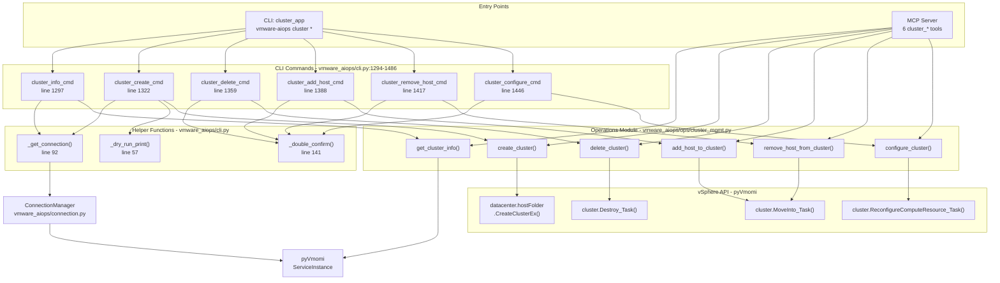

<!-- source: DeepWiki mcp.deepwiki.com · repo zw008/VMware-AIops · page 7.5 Cluster Management · fetched 2026-10-26 -->

# Cluster Management

<details>
<summary>Relevant source files</summary>

The following files were used as context for generating this wiki page:

- [skills/vmware-aiops/SKILL.md](skills/vmware-aiops/SKILL.md)
- [vmware_aiops/cli.py](vmware_aiops/cli.py)

</details>


Cluster management in VMware AIops provides capabilities for creating, configuring, and managing vSphere clusters through both CLI and MCP interfaces. This includes cluster creation with HA/DRS settings, adding/removing hosts, and reconfiguring cluster properties.

**Note**: Cluster operations require vCenter Server and are not supported on standalone ESXi hosts. For general inventory queries including cluster listing, see [Inventory and Monitoring](#7.1). For host-level operations unrelated to cluster membership, see [Storage and iSCSI Management](#7.6).

## Cluster Operations Overview

VMware AIops supports the following cluster management operations:

| Operation | Description | vCenter | ESXi | Confirmation |
|-----------|-------------|:-------:|:----:|:------------:|
| Cluster Info | Get cluster configuration and member hosts | ✅ | ❌ | — |
| Create Cluster | Create new cluster with HA/DRS settings | ✅ | ❌ | — |
| Delete Cluster | Remove empty cluster | ✅ | ❌ | Double |
| Add Host | Move host into cluster | ✅ | ❌ | Double |
| Remove Host | Remove host from cluster | ✅ | ❌ | Double |
| Configure HA/DRS | Modify cluster settings | ✅ | ❌ | Double |

All destructive operations (delete, add/remove host, configure) require double confirmation and are logged to the audit trail at `~/.vmware-aiops/audit.log`.

**Sources**: [skills/vmware-aiops/SKILL.md:274-284]()

## Cluster Management Architecture



This diagram shows the complete call chain from CLI/MCP entry points through the CLI command layer, helper functions, operations module, and finally to pyVmomi API calls. All cluster operations flow through `cluster_mgmt.py` and use the shared `ConnectionManager` for session management.

**Sources**: [vmware_aiops/cli.py:31](), [vmware_aiops/cli.py:1294-1486](), [vmware_aiops/cli.py:92-99](), [vmware_aiops/cli.py:141-162]()

## CLI Command Reference

### Cluster Info

Get detailed information about a cluster including hosts, HA/DRS status, and configuration.

```bash
vmware-aiops cluster info <cluster-name> [--target <name>]
```

**Output includes**:
- Cluster name and host count
- HA enabled/disabled status
- DRS enabled/disabled status and behavior mode
- List of member hosts with connection state and maintenance mode

**Example**:
```bash
vmware-aiops cluster info Production-Cluster --target vcenter-prod
```

**Implementation**: [vmware_aiops/cli.py:1297-1320]()

**Sources**: [vmware_aiops/cli.py:1297-1320](), [skills/vmware-aiops/SKILL.md:419]()

### Create Cluster

Create a new vSphere cluster with optional HA and DRS configuration.

```bash
vmware-aiops cluster create <name> [--ha] [--drs] \
  [--drs-behavior fullyAutomated|partiallyAutomated|manual] \
  [--datacenter <dc-name>] [--target <name>] [--dry-run]
```

**Parameters**:
- `name`: Cluster name (required)
- `--ha`: Enable High Availability
- `--drs`: Enable Distributed Resource Scheduler
- `--drs-behavior`: DRS automation level (default: `fullyAutomated`)
  - `fullyAutomated`: DRS migrates VMs automatically
  - `partiallyAutomated`: DRS suggests migrations, requires approval
  - `manual`: DRS only provides recommendations
- `--datacenter`: Target datacenter name (uses default if omitted)
- `--dry-run`: Preview API calls without execution

**Example**:
```bash
# Create cluster with HA and fully automated DRS
vmware-aiops cluster create Web-Cluster --ha --drs \
  --drs-behavior fullyAutomated --datacenter DC1
```

**API Call**: `datacenter.hostFolder.CreateClusterEx()`

**Implementation**: [vmware_aiops/cli.py:1322-1357]()

**Sources**: [vmware_aiops/cli.py:1322-1357](), [skills/vmware-aiops/SKILL.md:420]()

### Delete Cluster

Delete an empty cluster. The cluster must have no member hosts before deletion.

```bash
vmware-aiops cluster delete <name> [--target <name>] [--dry-run]
```

**Safety**:
- Requires double confirmation (no bypass)
- Captures cluster state (host count, HA/DRS settings) before deletion
- Logs operation to audit trail with before state

**Example**:
```bash
vmware-aiops cluster delete Old-Cluster --target vcenter-prod
```

**Confirmation flow**:
```
⚠️  即将执行: 删除集群 Cluster 'Old-Cluster'
第 1 次确认: 确定要删除集群 'Old-Cluster'?
第 2 次确认: 再次确认删除集群 'Old-Cluster'，此操作不可撤销?
```

**API Call**: `cluster.Destroy_Task()`

**Implementation**: [vmware_aiops/cli.py:1359-1386]()

**Sources**: [vmware_aiops/cli.py:1359-1386](), [skills/vmware-aiops/SKILL.md:421]()

### Add Host to Cluster

Move an ESXi host into a cluster. The host must be in the same datacenter.

```bash
vmware-aiops cluster add-host <cluster-name> --host <hostname> \
  [--target <name>] [--dry-run]
```

**Prerequisites**:
- Host must exist in vCenter inventory
- Host should be in connected state
- Host and cluster must be in the same datacenter

**Safety**:
- Requires double confirmation
- Logs operation with host and cluster names

**Example**:
```bash
vmware-aiops cluster add-host Web-Cluster --host esxi-01.lab.local
```

**API Call**: `cluster.MoveInto_Task(host_moref)`

**Implementation**: [vmware_aiops/cli.py:1388-1414]()

**Sources**: [vmware_aiops/cli.py:1388-1414](), [skills/vmware-aiops/SKILL.md:422]()

### Remove Host from Cluster

Remove an ESXi host from a cluster. The host must be in maintenance mode.

```bash
vmware-aiops cluster remove-host <cluster-name> --host <hostname> \
  [--target <name>] [--dry-run]
```

**Prerequisites**:
- Host must be in maintenance mode
- No running VMs on the host
- DRS must be able to migrate all VMs (if HA is enabled)

**Safety**:
- Requires double confirmation
- Logs operation to audit trail

**Post-operation**: Host moves to the datacenter's root folder and remains managed by vCenter.

**Example**:
```bash
# First put host in maintenance mode (not shown)
vmware-aiops cluster remove-host Web-Cluster --host esxi-01.lab.local
```

**API Call**: `datacenter.hostFolder.MoveInto_Task(host_moref)`

**Implementation**: [vmware_aiops/cli.py:1417-1443]()

**Sources**: [vmware_aiops/cli.py:1417-1443](), [skills/vmware-aiops/SKILL.md:423]()

### Configure Cluster

Modify HA/DRS settings on an existing cluster.

```bash
vmware-aiops cluster configure <name> \
  [--ha | --no-ha] [--drs | --no-drs] \
  [--drs-behavior fullyAutomated|partiallyAutomated|manual] \
  [--target <name>] [--dry-run]
```

**Parameters**:
- `--ha`: Enable High Availability
- `--no-ha`: Disable High Availability
- `--drs`: Enable DRS
- `--no-drs`: Disable DRS
- `--drs-behavior`: Change DRS automation level

**Safety**:
- Requires double confirmation
- Captures before state (current HA/DRS settings)
- Logs all changes to audit trail

**Example**:
```bash
# Enable HA and set DRS to partially automated
vmware-aiops cluster configure Web-Cluster --ha --drs \
  --drs-behavior partiallyAutomated
```

**API Call**: `cluster.ReconfigureComputeResource_Task(spec)`

**Implementation**: [vmware_aiops/cli.py:1446-1486]()

**Sources**: [vmware_aiops/cli.py:1446-1486](), [skills/vmware-aiops/SKILL.md:424]()

## MCP Tools Reference

When using MCP mode, cluster operations are exposed as structured tools. All tools accept an optional `target` parameter.

| MCP Tool | CLI Equivalent | Description |
|----------|----------------|-------------|
| `cluster_info` | `cluster info` | Get cluster details and host list |
| `cluster_create` | `cluster create` | Create new cluster with HA/DRS |
| `cluster_delete` | `cluster delete` | Delete empty cluster |
| `cluster_add_host` | `cluster add-host` | Move host into cluster |
| `cluster_remove_host` | `cluster remove-host` | Remove host from cluster |
| `cluster_configure` | `cluster configure` | Modify HA/DRS settings |

**Example MCP tool call** (from AI agent):
```json
{
  "name": "cluster_create",
  "arguments": {
    "cluster_name": "Web-Cluster",
    "ha_enabled": true,
    "drs_enabled": true,
    "drs_behavior": "fullyAutomated",
    "datacenter_name": "DC1",
    "target": "vcenter-prod"
  }
}
```

**Sources**: [skills/vmware-aiops/SKILL.md:126](), [skills/vmware-aiops/SKILL.md:419-424]()

## Cluster Management Workflow


This diagram shows three primary workflows in cluster management:

1. **Cluster Creation**: Validates datacenter, builds configuration spec with HA/DRS parameters, and creates cluster via `CreateClusterEx()`

2. **Host Addition**: Performs double confirmation, locates host and cluster managed objects, moves host into cluster via `MoveInto_Task()`, and logs to audit trail

3. **Configuration Changes**: Captures current state, requires double confirmation, builds configuration spec with only changed parameters, reconfigures via `ReconfigureComputeResource_Task()`, and logs before/after states

All async operations use `wait_for_task()` for synchronous completion.

**Sources**: [vmware_aiops/cli.py:1322-1357](), [vmware_aiops/cli.py:1388-1414](), [vmware_aiops/cli.py:1446-1486](), [vmware_aiops/cli.py:141-162]()

## Safety and Confirmation Mechanisms

### Double Confirmation

All destructive cluster operations require two sequential confirmations with no bypass option. If the user declines at either step, the operation is logged as "rejected" in the audit trail.

**Protected operations**:
- Delete cluster
- Add host to cluster
- Remove host from cluster
- Configure cluster (HA/DRS changes)

**Confirmation flow** (Chinese prompts, English operations):
```python
# From vmware_aiops/cli.py:141-162
def _double_confirm(action: str, vm_name: str, target: str, resource_type: str):
    console.print(f"⚠️  即将执行: {action} {resource_type} '{vm_name}'")
    typer.confirm(f"第 1 次确认: 确定要{action} '{vm_name}'?", abort=True)
    typer.confirm(f"第 2 次确认: 再次确认{action} '{vm_name}'，此操作不可撤销?", abort=True)
```

**Sources**: [vmware_aiops/cli.py:141-162](), [vmware_aiops/cli.py:1379](), [vmware_aiops/cli.py:1408](), [vmware_aiops/cli.py:1437](), [vmware_aiops/cli.py:1480]()

### Dry-Run Mode

All cluster operations (except info) support `--dry-run` flag to preview API calls without execution.

**Example dry-run output**:
```
[DRY-RUN] No changes will be made.
  Target:    vcenter-prod
  Cluster:   Web-Cluster
  Operation: create_cluster
  API Call:  datacenter.hostFolder.CreateClusterEx()
  Param:     ha = True
  Param:     drs = True
  Param:     drs_behavior = fullyAutomated
  Run without --dry-run to execute.
```

**Implementation**: Dry-run prints operation details and returns before calling the operations module. Each operation is logged with `dry_run: true` in parameters.

**Sources**: [vmware_aiops/cli.py:57-89](), [vmware_aiops/cli.py:1338-1345]()

### Audit Logging

All cluster operations are logged to `~/.vmware-aiops/audit.log` in JSONL format, including:

**Logged information**:
- `timestamp`: ISO 8601 UTC timestamp
- `target`: vCenter/ESXi target name
- `operation`: Operation type (e.g., `create_cluster`, `cluster_add_host`)
- `resource`: Cluster name or affected resource
- `parameters`: Operation parameters (HA enabled, DRS behavior, host name, etc.)
- `before_state`: Cluster state before destructive operations
- `after_state`: Expected state after operation
- `result`: Success message or error details
- `user`: System user executing the operation

**Example audit entry**:
```json
{
  "timestamp": "2024-01-15T10:30:45.123456Z",
  "target": "vcenter-prod",
  "operation": "cluster_add_host",
  "resource": "Web-Cluster",
  "parameters": {"host": "esxi-01.lab.local"},
  "result": "Host esxi-01.lab.local added to cluster Web-Cluster",
  "user": "admin"
}
```

**Rejection logging**: If user declines confirmation, operation is logged with `result: "rejected"` for security review.

**Sources**: [vmware_aiops/cli.py:82-89](), [vmware_aiops/cli.py:1352-1356](), [vmware_aiops/cli.py:1411-1414](), [vmware_aiops/cli.py:1483-1486]()

## Operations Module Implementation

The `vmware_aiops/ops/cluster_mgmt.py` module contains all cluster management business logic. While the module code is not shown in the provided files, we can infer its structure from CLI usage patterns.

**Expected functions** (based on CLI imports):

| Function | Purpose | Return Type |
|----------|---------|-------------|
| `get_cluster_info(si, cluster_name)` | Retrieve cluster configuration and hosts | `dict` |
| `create_cluster(si, cluster_name, datacenter_name, ha_enabled, drs_enabled, drs_behavior)` | Create new cluster | `str` (success message) |
| `delete_cluster(si, cluster_name)` | Delete empty cluster | `str` (success message) |
| `add_host_to_cluster(si, cluster_name, host_name)` | Move host into cluster | `str` (success message) |
| `remove_host_from_cluster(si, cluster_name, host_name)` | Remove host from cluster | `str` (success message) |
| `configure_cluster(si, cluster_name, ha_enabled, drs_enabled, drs_behavior)` | Modify cluster settings | `str` (success message) |

**Common patterns**:
- All functions accept `ServiceInstance` (pyVmomi connection) as first parameter
- Functions perform pre-operation validation (cluster exists, datacenter exists, etc.)
- Synchronous operations using `wait_for_task()` for task completion
- Return human-readable success messages for CLI output
- Raise exceptions on errors (captured by CLI error handling)

**Sources**: [vmware_aiops/cli.py:1304](), [vmware_aiops/cli.py:1336](), [vmware_aiops/cli.py:1367](), [vmware_aiops/cli.py:1397](), [vmware_aiops/cli.py:1426](), [vmware_aiops/cli.py:1459]()

## HA and DRS Configuration Details

### High Availability (HA)

When HA is enabled on a cluster, vSphere provides automatic VM restart on host failure.

**HA configuration includes**:
- Host failure response: Restart VMs on surviving hosts
- VM monitoring: Monitor VM heartbeats and restart on failure
- Admission control: Reserve resources for failover capacity
- Host isolation response: Define behavior when host loses network connectivity

**Prerequisites**:
- Shared storage (VMFS, NFS, vSAN) for all VMs
- Hosts must be able to access the same datastores
- Network connectivity between all cluster hosts

### Distributed Resource Scheduler (DRS)

DRS balances compute resources across cluster hosts by migrating VMs via vMotion.

**DRS behavior modes**:

| Mode | Description | Use Case |
|------|-------------|----------|
| `fullyAutomated` | DRS migrates VMs automatically | Production clusters with stable workloads |
| `partiallyAutomated` | DRS suggests migrations, requires approval | Clusters requiring manual oversight |
| `manual` | DRS only provides recommendations | Testing/dev environments |

**DRS configuration includes**:
- Automation level (behavior mode)
- Migration threshold (aggressiveness)
- VM/host affinity rules
- Resource pool configurations

**Prerequisites**:
- vMotion-enabled networking on all hosts
- Shared storage for VM files
- Compatible CPU families across hosts (for vMotion)

**Sources**: [vmware_aiops/cli.py:1327-1329](), [vmware_aiops/cli.py:1451-1452]()

## Error Handling and Validation

### Pre-operation Validation

Operations validate inputs before making API calls:

**Cluster creation**:
- Datacenter exists (if specified)
- Cluster name is unique within datacenter
- Valid DRS behavior value

**Host operations**:
- Cluster exists in vCenter inventory
- Host exists in vCenter inventory
- Host is in correct state (connected for add, maintenance mode for remove)

**Configuration changes**:
- Cluster exists
- At least one parameter is specified for change
- Valid DRS behavior value if provided

### Error Scenarios

Common error conditions and their handling:

| Error | Cause | Handling |
|-------|-------|----------|
| Cluster not found | Invalid cluster name | Exception raised, CLI prints error |
| Host not found | Invalid host name | Exception raised, CLI prints error |
| Cluster not empty | Delete called on cluster with hosts | Exception raised with host count |
| Host not in maintenance mode | Remove host without maintenance mode | vSphere API error, task fails |
| Permission denied | Insufficient vCenter privileges | Authentication error from pyVmomi |

All errors are logged to the audit trail with `result` field containing error details.

**Sources**: [vmware_aiops/cli.py:1369-1375](), [vmware_aiops/cli.py:1469-1477]()

## Integration with Other Components

### Connection Management

All cluster operations use the shared `ConnectionManager` for vSphere session pooling:

```python
# From vmware_aiops/cli.py:92-99
def _get_connection(target, config_path):
    from vmware_aiops.config import load_config
    from vmware_aiops.connection import ConnectionManager
    
    cfg = load_config(config_path)
    mgr = ConnectionManager(cfg)
    return mgr.connect(target), cfg
```

The `ConnectionManager` maintains pyVmomi `ServiceInstance` connections with automatic reconnection on session timeout.

**Sources**: [vmware_aiops/cli.py:92-99]()

### Inventory Queries

Cluster listing uses the inventory module:

```bash
vmware-aiops inventory clusters [--target <name>]
```

This provides read-only cluster enumeration with host count and HA/DRS status without requiring cluster management permissions. See [Inventory and Monitoring](#7.1) for details.

**Sources**: [vmware_aiops/cli.py:271-292](), [skills/vmware-aiops/SKILL.md:157]()

### Multi-Target Support

All cluster commands support the `--target` parameter to operate on different vCenter servers defined in `~/.vmware-aiops/config.yaml`:

```yaml
targets:
  vcenter-prod:
    host: vcenter01.prod.local
    type: vcenter
  vcenter-dev:
    host: vcenter02.dev.local
    type: vcenter
```

Without `--target`, operations use the default target (first target in config or `VMWARE_AIOPS_DEFAULT_TARGET` environment variable).

**Sources**: [vmware_aiops/cli.py:46-48](), [vmware_aiops/cli.py:102-104]()

## Version Compatibility

Cluster management operations are supported across vSphere versions:

| vSphere Version | Cluster Creation | HA/DRS Config | Host Management |
|-----------------|:----------------:|:-------------:|:---------------:|
| 8.0 / 8.0U1-U3 | ✅ | ✅ | ✅ |
| 7.0 / 7.0U1-U3 | ✅ | ✅ | ✅ |
| 6.7 | ✅ | ✅ | ✅ |
| 6.5 | ✅ | ✅ | ✅ |

**API compatibility**: pyVmomi auto-negotiates the API version during SOAP handshake. Cluster management uses stable APIs available since vSphere 5.x.

**Sources**: [skills/vmware-aiops/SKILL.md:319-328]()

---

