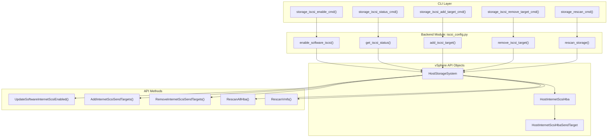
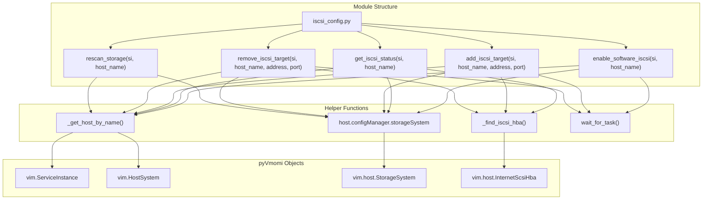
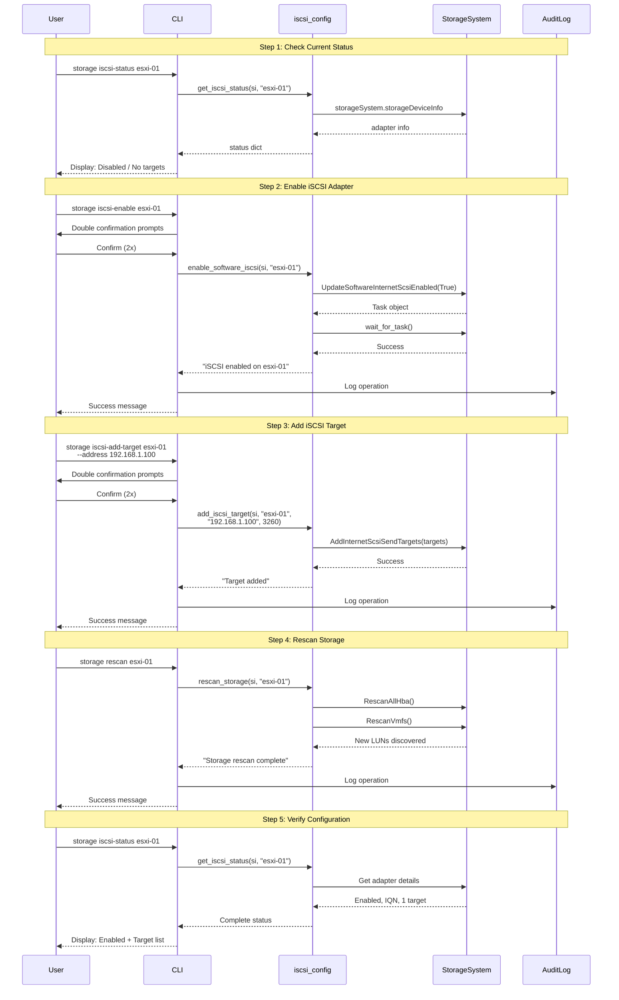

<!-- source: DeepWiki mcp.deepwiki.com · repo zw008/VMware-AIops · page 7.6 Storage and iSCSI Management · fetched 2026-10-26 -->

# Storage and iSCSI Management

<details>
<summary>Relevant source files</summary>

The following files were used as context for generating this wiki page:

- [skills/vmware-aiops/SKILL.md](skills/vmware-aiops/SKILL.md)
- [vmware_aiops/cli.py](vmware_aiops/cli.py)

</details>


This page documents the storage and iSCSI configuration capabilities in VMware AIops, specifically focused on managing software iSCSI adapters on ESXi hosts and configuring iSCSI storage targets. For general datastore browsing and image discovery, see [Datastore Browser](#7.7). For vSAN-specific storage management, see [Advanced Features: vSAN, Aria Operations, VKS](#7.8).

## Overview

VMware AIops provides functionality to configure and manage software iSCSI initiators on ESXi hosts through both CLI and MCP modes. The iSCSI operations enable administrators to:

- Enable or disable the software iSCSI adapter on ESXi hosts
- Query the current iSCSI adapter status, including IQN and configured targets
- Add dynamic discovery (send) targets to the iSCSI adapter
- Remove iSCSI targets from the configuration
- Rescan all storage adapters and VMFS volumes to detect new LUNs

All iSCSI operations support both vCenter-managed hosts and standalone ESXi hosts. Operations that modify the iSCSI configuration require double confirmation and are logged to the audit trail.

**Sources:** [skills/vmware-aiops/SKILL.md:286-293](), [skills/vmware-aiops/SKILL.md:426-431]()

## Architecture: CLI to API Flow

The following diagram shows how iSCSI commands flow from the CLI through the backend module to the vSphere API:



**Sources:** [vmware_aiops/cli.py:1492-1631]()

## CLI Operations Reference

All storage commands are accessed via the `vmware-aiops storage` subcommand namespace. Each operation accepts an optional `--target` parameter to specify which vCenter or ESXi host to operate against (defaults to the first configured target).

### Enable iSCSI Adapter

Enable the software iSCSI adapter on an ESXi host. This operation requires double confirmation.

```bash
vmware-aiops storage iscsi-enable <host-name> [--target <target>] [--dry-run]
```

**Parameters:**
- `<host-name>`: Name of the ESXi host (as it appears in vCenter or the hostname of a standalone ESXi)
- `--target`: Target name from `config.yaml`
- `--dry-run`: Preview the operation without executing

**API Call:** `storageSystem.UpdateSoftwareInternetScsiEnabled(True)`

**Example:**
```bash
vmware-aiops storage iscsi-enable esxi-01.lab.local --target home-vcenter
```

**Sources:** [vmware_aiops/cli.py:1492-1516](), [skills/vmware-aiops/SKILL.md:289]()

### Check iSCSI Status

Query the current status of the iSCSI adapter on a host, including whether it's enabled, the IQN, HBA device name, and any configured send targets. This is a read-only operation requiring no confirmation.

```bash
vmware-aiops storage iscsi-status <host-name> [--target <target>]
```

**Output includes:**
- Software iSCSI adapter enabled status
- HBA device identifier (e.g., `vmhba33`)
- iSCSI Qualified Name (IQN)
- List of configured send targets with IP addresses and ports

**Example:**
```bash
vmware-aiops storage iscsi-status esxi-01.lab.local
```

**Sources:** [vmware_aiops/cli.py:1519-1545](), [skills/vmware-aiops/SKILL.md:290]()

### Add iSCSI Target

Add a dynamic discovery (send) target to the software iSCSI adapter. The adapter will contact this target to discover available iSCSI LUNs. Requires double confirmation.

```bash
vmware-aiops storage iscsi-add-target <host-name> --address <ip-address> [--port <port>] [--target <target>] [--dry-run]
```

**Parameters:**
- `<host-name>`: ESXi host name
- `--address`: IP address of the iSCSI target/portal
- `--port`: iSCSI port (default: 3260)
- `--target`: Target name from config
- `--dry-run`: Preview operation

**API Call:** `storageSystem.AddInternetScsiSendTargets()`

**Example:**
```bash
vmware-aiops storage iscsi-add-target esxi-01.lab.local --address 192.168.1.100 --port 3260
```

**Sources:** [vmware_aiops/cli.py:1548-1575](), [skills/vmware-aiops/SKILL.md:291]()

### Remove iSCSI Target

Remove a configured send target from the software iSCSI adapter. This operation requires double confirmation to prevent accidental disconnection from active storage.

```bash
vmware-aiops storage iscsi-remove-target <host-name> --address <ip-address> [--port <port>] [--target <target>] [--dry-run]
```

**Parameters:**
- `<host-name>`: ESXi host name
- `--address`: IP address of the target to remove
- `--port`: iSCSI port (default: 3260)
- `--target`: Target name from config
- `--dry-run`: Preview operation

**API Call:** `storageSystem.RemoveInternetScsiSendTargets()`

**Example:**
```bash
vmware-aiops storage iscsi-remove-target esxi-01.lab.local --address 192.168.1.100
```

**Sources:** [vmware_aiops/cli.py:1578-1605](), [skills/vmware-aiops/SKILL.md:292]()

### Rescan Storage

Rescan all host bus adapters (HBAs) and VMFS volumes on a host to detect newly added LUNs or storage changes. This is typically executed after adding iSCSI targets or making changes to the SAN configuration.

```bash
vmware-aiops storage rescan <host-name> [--target <target>] [--dry-run]
```

**Operations performed:**
1. Rescan all HBAs (including iSCSI, FC, and local storage adapters)
2. Rescan VMFS filesystems to detect new datastores

**API Calls:** 
- `storageSystem.RescanAllHba()`
- `storageSystem.RescanVmfs()`

**Example:**
```bash
vmware-aiops storage rescan esxi-01.lab.local
```

**Sources:** [vmware_aiops/cli.py:1608-1631](), [skills/vmware-aiops/SKILL.md:293]()

## MCP Tools Reference

When using MCP mode, storage and iSCSI operations are exposed as structured tools. These tools accept JSON input and return JSON output, making them suitable for automated workflows and agent chaining.

### MCP Tool Catalog

| Tool Name | Description | Input Parameters | Confirmation Required |
|-----------|-------------|------------------|----------------------|
| `storage_iscsi_enable` | Enable software iSCSI adapter | `host_name`, `target?` | Yes (double) |
| `storage_iscsi_status` | Query iSCSI adapter status | `host_name`, `target?` | No |
| `storage_iscsi_add_target` | Add iSCSI send target | `host_name`, `address`, `port?`, `target?` | Yes (double) |
| `storage_iscsi_remove_target` | Remove iSCSI send target | `host_name`, `address`, `port?`, `target?` | Yes (double) |
| `storage_rescan` | Rescan storage adapters | `host_name`, `target?` | No |

**Example MCP Tool Call (storage_iscsi_status):**
```json
{
  "tool": "storage_iscsi_status",
  "arguments": {
    "host_name": "esxi-01.lab.local",
    "target": "home-vcenter"
  }
}
```

**Example Response:**
```json
{
  "enabled": true,
  "hba_device": "vmhba33",
  "iqn": "iqn.1998-01.com.vmware:esxi-01-12345678",
  "send_targets": [
    {
      "address": "192.168.1.100",
      "port": 3260
    }
  ]
}
```

**Sources:** [skills/vmware-aiops/SKILL.md:127](), [skills/vmware-aiops/SKILL.md:115]()

## Implementation Architecture

The iSCSI configuration functionality is implemented in the `iscsi_config.py` module within the `vmware_aiops/ops/` directory. The module uses the pyVmomi library to interact with the `HostStorageSystem` managed object.



**Sources:** [vmware_aiops/cli.py:1500](), [vmware_aiops/cli.py:1526](), [vmware_aiops/cli.py:1558](), [vmware_aiops/cli.py:1588](), [vmware_aiops/cli.py:1616]()

## Operational Workflow: Adding iSCSI Storage

The typical workflow for adding iSCSI storage to an ESXi host involves multiple steps. The following diagram illustrates this end-to-end process:



**Sources:** [vmware_aiops/cli.py:1492-1631]()

## Command Mapping: Natural Language to Code

This table maps common administrative tasks to their corresponding code entry points:

| Administrative Task | CLI Command | CLI Function | Backend Function | pyVmomi API |
|---------------------|-------------|--------------|------------------|-------------|
| Enable iSCSI on host | `storage iscsi-enable` | `storage_iscsi_enable_cmd` | `enable_software_iscsi()` | `UpdateSoftwareInternetScsiEnabled(True)` |
| Check iSCSI configuration | `storage iscsi-status` | `storage_iscsi_status_cmd` | `get_iscsi_status()` | `storageSystem.storageDeviceInfo.hostBusAdapter` |
| Add iSCSI portal | `storage iscsi-add-target` | `storage_iscsi_add_target_cmd` | `add_iscsi_target()` | `AddInternetScsiSendTargets()` |
| Remove iSCSI portal | `storage iscsi-remove-target` | `storage_iscsi_remove_target_cmd` | `remove_iscsi_target()` | `RemoveInternetScsiSendTargets()` |
| Discover new LUNs | `storage rescan` | `storage_rescan_cmd` | `rescan_storage()` | `RescanAllHba()` + `RescanVmfs()` |

**Sources:** [vmware_aiops/cli.py:1489-1632](), [skills/vmware-aiops/SKILL.md:426-431]()

## Safety and Audit Mechanisms

All destructive iSCSI operations implement safety features to prevent accidental storage disconnection:

### Double Confirmation

Operations that modify the iSCSI configuration require two sequential confirmations with no bypass option:

1. **Enable iSCSI adapter**: Requires confirmation as it modifies the host network/storage configuration
2. **Add target**: Requires confirmation as it may trigger storage traffic and network connections
3. **Remove target**: Requires confirmation to prevent disconnecting from active storage

**Implementation:**
```python
_double_confirm("启用 iSCSI", host, _resolve_target(target), resource_type="Host")
```

**Sources:** [vmware_aiops/cli.py:1510](), [vmware_aiops/cli.py:1569](), [vmware_aiops/cli.py:1599]()

### Dry-Run Mode

All storage commands support `--dry-run` mode, which displays the vSphere API calls that would be executed without making any changes:

```bash
vmware-aiops storage iscsi-add-target esxi-01 --address 192.168.1.100 --dry-run
```

**Output preview:**
```
[DRY-RUN] No changes will be made.
  Target:    default
  Host:      esxi-01.lab.local
  Operation: iscsi_add_target
  API Call:  storageSystem.AddInternetScsiSendTargets()
  Param:     address = 192.168.1.100
  Param:     port = 3260
  Run without --dry-run to execute.
```

**Sources:** [vmware_aiops/cli.py:1502-1508](), [vmware_aiops/cli.py:1560-1566](), [vmware_aiops/cli.py:1590-1596]()

### Audit Logging

All storage operations (successful or rejected) are logged to `~/.vmware-aiops/audit.log` in JSONL format with the following fields:

- `timestamp`: ISO 8601 timestamp
- `target`: Target vCenter/ESXi name
- `operation`: Operation name (e.g., `iscsi_enable`, `iscsi_add_target`)
- `resource`: Host name
- `parameters`: Operation parameters (address, port)
- `before_state`: State before operation (for status-checking operations)
- `after_state`: State after operation
- `result`: Success message or rejection reason

**Example audit log entry:**
```json
{
  "timestamp": "2024-01-15T10:23:45.123456Z",
  "target": "home-vcenter",
  "operation": "iscsi_add_target",
  "resource": "esxi-01.lab.local",
  "parameters": {
    "address": "192.168.1.100",
    "port": 3260
  },
  "result": "iSCSI target 192.168.1.100:3260 added to esxi-01.lab.local"
}
```

**Sources:** [vmware_aiops/cli.py:1513-1516](), [vmware_aiops/cli.py:1572-1575](), [vmware_aiops/cli.py:1602-1605]()

## Version Compatibility

iSCSI storage management is supported across all vSphere versions supported by VMware AIops:

| vSphere Version | iSCSI Support | Notes |
|-----------------|---------------|-------|
| 8.0 / 8.0U1-U3 | ✅ Full | All iSCSI APIs supported |
| 7.0 / 7.0U1-U3 | ✅ Full | All iSCSI APIs supported |
| 6.7 | ✅ Full | Backward compatible |
| 6.5 | ✅ Full | Backward compatible |

The iSCSI APIs used by VMware AIops (`HostStorageSystem.UpdateSoftwareInternetScsiEnabled`, `AddInternetScsiSendTargets`, `RemoveInternetScsiSendTargets`, `RescanAllHba`, `RescanVmfs`) have been stable since vSphere 5.0 and are supported in all modern versions.

**Sources:** [skills/vmware-aiops/SKILL.md:319-328]()

## Common Use Cases

### Connecting to Shared iSCSI SAN

```bash
# 1. Check if iSCSI is already enabled
vmware-aiops storage iscsi-status esxi-01

# 2. Enable iSCSI adapter if disabled
vmware-aiops storage iscsi-enable esxi-01

# 3. Add the iSCSI SAN portal
vmware-aiops storage iscsi-add-target esxi-01 --address 10.0.1.50 --port 3260

# 4. Rescan to discover LUNs
vmware-aiops storage rescan esxi-01

# 5. Verify targets are configured
vmware-aiops storage iscsi-status esxi-01
```

### Removing Decommissioned Storage

```bash
# 1. Check current targets
vmware-aiops storage iscsi-status esxi-01

# 2. Remove the obsolete target
vmware-aiops storage iscsi-remove-target esxi-01 --address 192.168.1.100

# 3. Rescan storage to update datastore list
vmware-aiops storage rescan esxi-01
```

### Cluster-Wide iSCSI Configuration

```bash
# Get list of hosts in cluster
vmware-aiops inventory hosts --target prod-vcenter

# Enable iSCSI on each host (can be scripted)
for host in esxi-01 esxi-02 esxi-03; do
    vmware-aiops storage iscsi-enable $host --target prod-vcenter
    vmware-aiops storage iscsi-add-target $host --address 10.0.1.50 --target prod-vcenter
    vmware-aiops storage rescan $host --target prod-vcenter
done
```

**Sources:** [skills/vmware-aiops/SKILL.md:426-431]()

---

